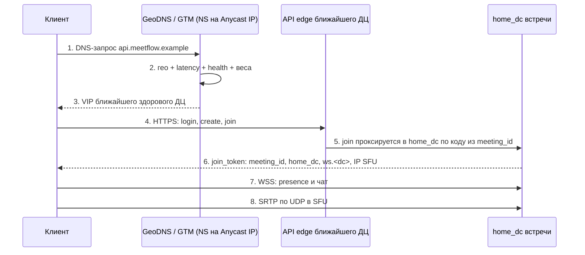
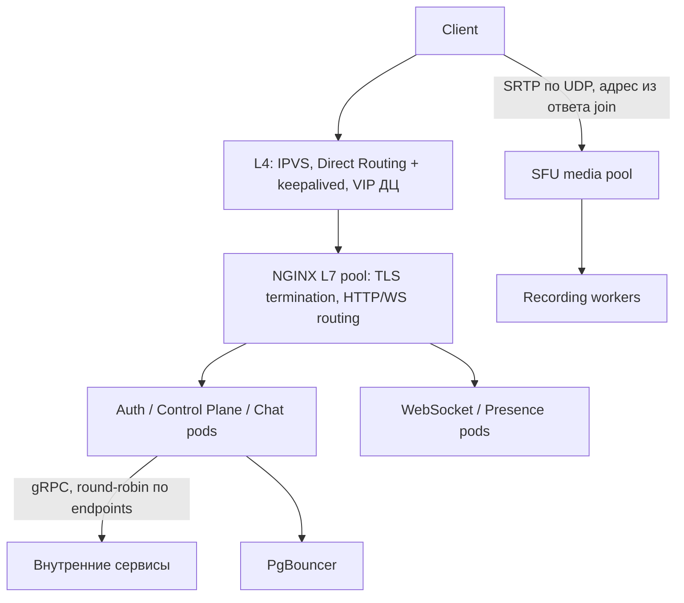
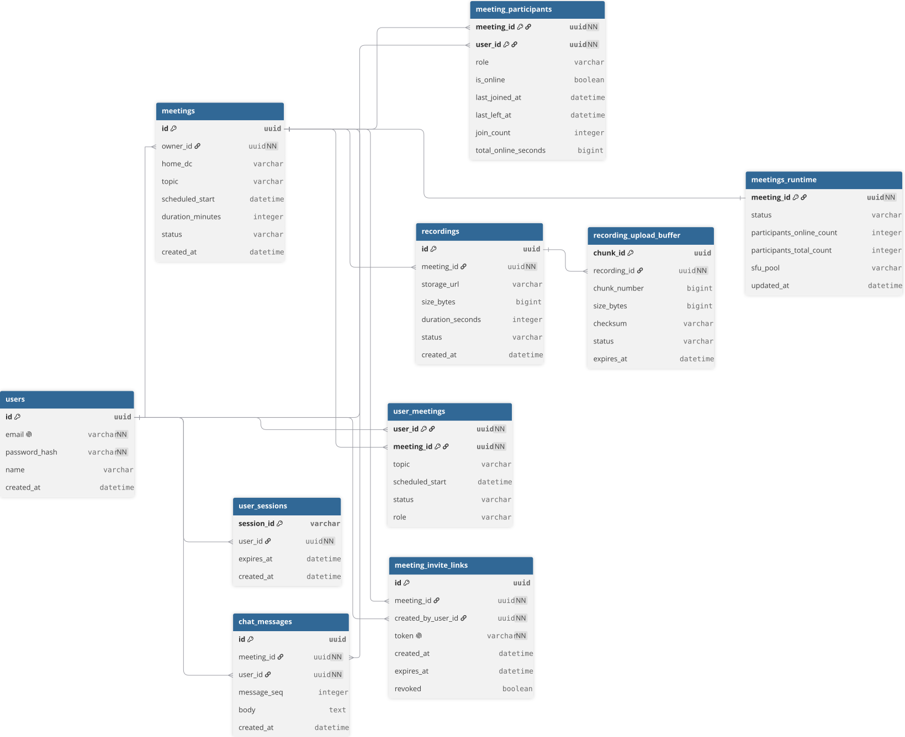
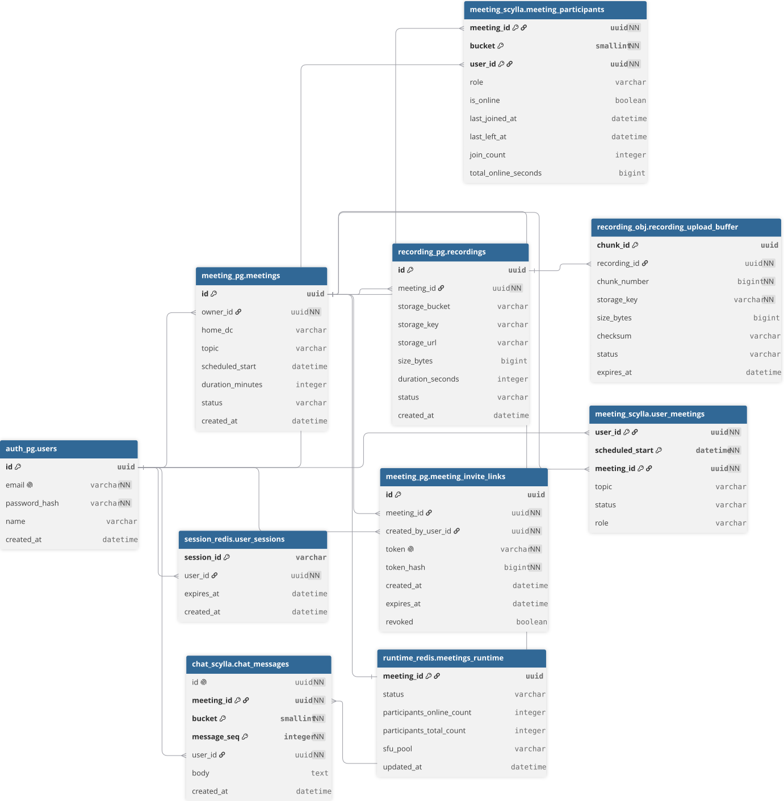
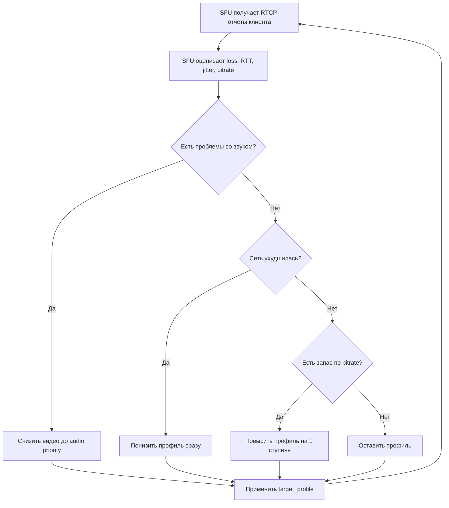
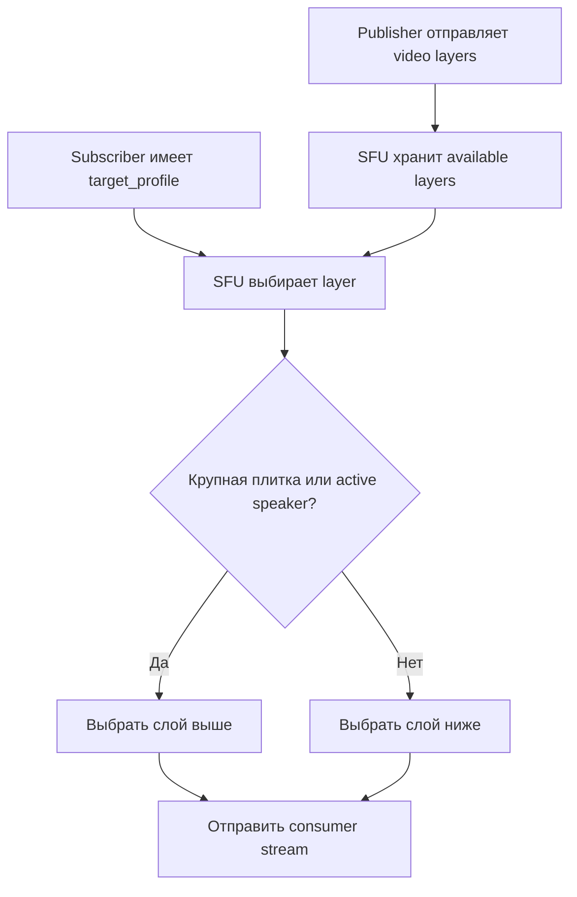
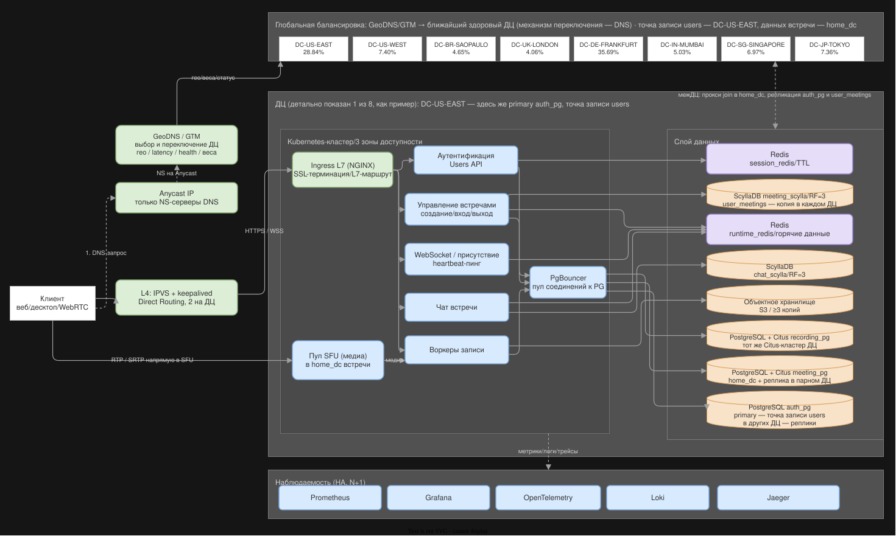

# Проектирование высоконагруженного Zoom-подобного сервиса видеовстреч

В основной части — главные таблицы и схемы по каждому разделу. Формулы, расчеты и подробности вынесены на дополнительные страницы — см. [Приложения](#приложения).

## Содержание

- [1. Тема и целевая аудитория](#1-тема-и-целевая-аудитория)
- [2. Расчет нагрузки](#2-расчет-нагрузки)
- [3. Глобальная балансировка нагрузки](#3-глобальная-балансировка-нагрузки)
- [4. Локальная балансировка нагрузки](#4-локальная-балансировка-нагрузки)
- [5. Логическая схема БД](#5-логическая-схема-бд)
- [6. Физическая схема БД](#6-физическая-схема-бд)
- [7. Алгоритмы](#7-алгоритмы)
- [8. Технологии](#8-технологии)
- [9. Обеспечение надежности](#9-обеспечение-надежности)
- [10. Схема проекта](#10-схема-проекта)
- [11. Список серверов](#11-список-серверов)
- [Приложения](#приложения)
- [Список источников](#список-источников)

## 1. Тема и целевая аудитория

### 1.1. Тип сервиса

| Параметр | Значение |
| -------- | -------- |
| Учебное название | **MeetFlow** |
| Тип сервиса | Zoom-подобный сервис видеовстреч |
| Основной сценарий | Групповая онлайн-встреча: аудио, видео, демонстрация экрана, чат и запись |
| Реальные аналоги | Zoom, Microsoft Teams, Google Meet |

### 1.2. Рыночная ниша и реальные аналоги

| Аналог | Метрика | Что подтверждает |
| ------ | ------- | ---------------- |
| Microsoft Teams | 320 млн monthly active users, FY24 Q1 (октябрь 2023) [^1] | Масштаб аудитории коммуникационного сервиса |
| Microsoft Teams | 115 млн daily active users, октябрь 2020 [^2] | Дневную аудиторию для расчета |
| Zoom | Более 300 млн участий во встречах в день, апрель 2020 — проспект Zoom в SEC; это участия, а не уникальные пользователи [^3] | Ежедневную нагрузку именно на видеовстречи |
| Zoom | Средняя встреча — 54 минуты и 10 участников, данные за 15.11.2020–15.11.2021 [^4] | Базу продуктовой оценки |
| Zoom | $4.8688 млрд выручки за FY2026 и 4 468 клиентов с TTM-выручкой больше $100 000 [^10] | Актуальность ниши в 2026 году |

### 1.3. Функционал MVP

| № | Функция MVP | Кратко | Метрика для расчета |
| -: | ----------- | ------ | ------------------- |
| 1 | Создание встречи | Мгновенная или запланированная встреча | `MF_MEETINGS_DAY`, `POST /meetings` |
| 2 | Подключение к встрече | Вход по ссылке или приглашению | `MF_DMP`, `POST /meetings/{id}/join` |
| 3 | Групповая аудио- и видеосвязь | 720p group video | `MF_VIDEO_UP_MBPS`, `MF_VIDEO_DOWN_MBPS`, `MF_AUDIO_MBPS` |
| 4 | Демонстрация экрана | Участник показывает экран | `MF_SCREEN_MBPS_MAX` |
| 5 | Чат во время встречи | Текстовые сообщения участников | `MF_CHAT_MSG_LIMIT`, `MF_CHAT_PER_JOIN` |
| 6 | Облачная запись | Организатор включает запись встречи | `MF_RECORD_QUOTA_GB`, `MF_RECORDING_SIZE_GB` |

### 1.4. Ключевые продуктовые решения

| Решение | Значение для MVP | Что считается дальше |
| ------- | ---------------- | -------------------- |
| Расчет от групповой встречи | В средней встрече `MF_MEET_SIZE = 10` участников | Число встреч в сутки |
| Базовое качество — 720p group video | Требования Zoom к сети [^5] | Видеотрафик |
| Облачная запись | Сохраняет видео, аудио и текст чата [^7] | Хранилище записей |
| Квота на записи | У Zoom Pro/Business — 10 GB на пользователя [^8] | Верхняя граница хранилища |
| Частота чата — допущение | Есть лимит длины сообщения, но нет публичной частоты [^6]: берем 5 сообщений на участие | Нагрузка и хранилище чата |
| Данные встреч хранятся 30 дней | Метаданные, участники, чат и записи старше 30 дней удаляются | Объем хранения (2.3) |
| Худший случай для записей | Записывается каждая встреча: реальная доля публично неизвестна | Хранилище и его стоимость (2.3, 11.2) |
| Материковый Китай не обслуживаем | Нужен отдельный локальный контур: локализация данных и блокировки трафика | Доли ДЦ (3.2) |

### 1.5. Целевая аудитория

| Параметр | Значение |
| -------- | -------- |
| География | Весь мир, кроме материкового Китая. Zoom используют почти в 200 странах и территориях [^4]; крупнейшие экономики среди обслуживаемых стран — США, Германия, Япония, Великобритания, Индия [^11]. Обслуживаем из 8 ДЦ (п. 3.2) |
| Месячная аудитория | `MF_MAU = 320 000 000` |
| Дневная аудитория | `MF_DAU = 115 000 000` |
| Участий во встречах в день | `MF_DMP = 300 000 000` |
| Средняя встреча | `MF_MEET_SIZE = 10` участников, `MF_MEET_LEN_MIN = 54` минуты |

## 2. Расчет нагрузки

### 2.1. Исходные данные

| Параметр | Значение | Источник |
| -------- | -------: | -------- |
| Месячная аудитория (MAU) | 320 000 000 | Microsoft Teams, 2023 [^1] |
| Дневная аудитория (DAU) | 115 000 000 | Microsoft Teams, 2020 [^2] |
| Участий во встречах в день | 300 000 000 | Zoom, 2020 [^3] |
| Средняя встреча | 10 участников, 54 минуты | Zoom [^4] |
| Видео 720p: отправка / прием | 2.6 / 1.8 Мбит/с | требования Zoom [^5] |
| Аудио / демонстрация экрана | 0.08 / 0.15 Мбит/с | требования Zoom [^5] |
| Коэффициент пика `K` | 1.5 | пиковый час / среднее за сутки |
| Хранение данных встреч | 30 дней | продуктовое решение (п. 1.4) |
| **Встреч в сутки** | **30 000 000** | 300 млн участий / 10 |
| **Участников онлайн в пик** | **16 875 000** | 16.2 млрд участник-минут в сутки / 1 440 × 1.5 |
| **Встреч одновременно в пик** | **1 687 500** | 16 875 000 / 10 |

Допущения по чату, списку встреч и записям, все формулы — в [приложении 2](appendix/2-load.md).

### 2.2. Продуктовые метрики

MAU — 320 млн, DAU — 115 млн. Хранилище — на одного MAU за 30 дней, действия — на одного DAU в сутки.

| Тип данных | Штук на пользователя | Объем на пользователя |
| ---------- | -------------------: | --------------------: |
| Профиль | 1 | 256 B |
| Созданные встречи (метаданные) | 2.81 | 720 B |
| Ссылки-приглашения | 2.81 | 360 B |
| Участия во встречах | 28.1 | 3.6 KB |
| Строки списка встреч | 28.1 | 3.6 KB |
| Сообщения чата | 140.6 | 140.6 KB |
| **Итого без записей** | — | **≈ 149 KB** |
| Записи встреч (худший случай ) | 2.81 | **2.14 GB** |

| Действие | На DAU в сутки |
| -------- | -------------: |
| Логин | 1.00 |
| Создание встречи | 0.26 |
| Вход во встречу (`join`) | 2.61 |
| Выход из встречи (`leave`) | 2.61 |
| Сообщение в чат встречи | 13.04 |
| Загрузка истории чата | 2.61 |
| Открытие списка встреч | 3.00 |
| Метаданные записи | ≤ 0.26 |
| Открытие записи | ≤ 0.26 |
| Heartbeat, автоматически | 338.09 |

### 2.3. Хранение

| Данные | Штук | Объем |
| ------ | ---: | ----: |
| Профили пользователей | 320 млн | 81.92 GB |
| Метаданные встреч, 30 дней | 900 млн | 230.4 GB |
| Ссылки-приглашения, 30 дней | 900 млн | 115.2 GB |
| Участники встреч, 30 дней | 9 млрд | 1.152 TB |
| Списки встреч пользователей, 30 дней | 9 млрд | 1.152 TB |
| Активные сессии | 115 млн | 14.72 GB |
| Чат встречи, 30 дней | 45 млрд | 45 TB |
| **Техническое хранение без записей** | — | **47.75 TB** |
| Записи, worst-case: 0.761 GB на встречу | 30 млн в сутки | 22.842 PB/сутки, **685.26 PB** за 30 дней |
| **Всего за 30 дней** | — | **≈ 685.31 PB** |

### 2.4. Сетевой трафик

| Тип трафика | Битрейт на участника | Суточный объем | Средний | Пиковый |
| ----------- | -------------------: | -------------: | ------: | ------: |
| Video upload | 2.6 Мбит/с | 315 900 000 GB | 29 250 Gbps | 43 875 Gbps |
| Video download | 1.8 Мбит/с | 218 700 000 GB | 20 250 Gbps | 30 375 Gbps |
| Audio VoIP | 0.08 Мбит/с | 9 720 000 GB | 900 Gbps | 1 350 Gbps |
| Screen sharing, верхняя граница | 0.15 Мбит/с | 18 225 000 GB | 1 687.5 Gbps | 2 531.25 Gbps |
| **Медиа клиент ↔ SFU, итого** | 4.63 Мбит/с | **562 545 000 GB** | **52 087.5 Gbps** | **78 131.25 Gbps** |
| Поток в запись SFU → recording workers | 1.88 Мбит/с на встречу | 22 842 000 GB | 2 115 Gbps | 3 172.5 Gbps |

Поток в запись идет внутри ДЦ и в интернет не уходит.

### 2.5. RPS

| Метод / событие | Средний RPS | Пиковый RPS |
| --------------- | ----------: | ----------: |
| `POST /auth/login` | 1 331 | 1 997 |
| `POST /meetings` | 347 | 521 |
| `POST /meetings/{id}/join` | 3 472 | 5 208 |
| `POST /meetings/{id}/leave` | 3 472 | 5 208 |
| `WS /presence/heartbeat` | 450 000 | **675 000** |
| `POST /meeting-chat/messages` | 17 361 | 26 042 |
| `GET /meeting-chat/messages?after_seq=N` | 3 472 | 5 208 |
| `GET /users/{id}/meetings?limit=100` | 3 993 | 5 990 |
| `POST /recordings/metadata` | до 347 | до 521 |
| `GET /recordings/{id}` — ссылка на скачивание | до 347 | до 521 |
| WS push: чат и события `join`/`leave` остальным участникам | 218 750 | 328 125 |

## 3. Глобальная балансировка нагрузки

«ДЦ» в работе — регион провайдера из 3 зон доступности (AZ): отказ зоны закрывается внутри ДЦ, отказ всего ДЦ — глобальной балансировкой.

### 3.1. Функциональное разбиение по доменам

| Домен | Основная нагрузка | Куда направляется запрос | Точка записи |
| ----- | ----------------- | ------------------------ | ------------ |
| `Auth / Users` | логин, профиль | ближайший ДЦ по GeoDNS | `users` — primary `auth_pg` в `DC-US-EAST`; `user_sessions` — ДЦ, где выполнен логин |
| `Meeting Control Plane` | `POST /meetings`, `join`, `leave`, список встреч | ближайший ДЦ; `join` и `leave` проксируются в `home_dc` встречи | `meetings`, `meeting_invite_links` — `home_dc` |
| `Media Plane / SFU` | видео, аудио, screen sharing | только SFU в `home_dc` встречи, адрес приходит в ответе `join` | не хранится, это поток |
| `Presence / Heartbeat` | `WS /presence/heartbeat` | WS-endpoint `home_dc` встречи | `meetings_runtime` — Redis `home_dc` |
| `Meeting Chat` | сообщения внутри встречи | `home_dc` встречи | `chat_messages` — ScyllaDB `home_dc` |
| `Recording` | запись встречи | SFU → recording workers в `home_dc` | файлы — S3 `home_dc`, метаданные — `recording_pg` `home_dc` |
| `User meetings list` | top-100 встреч пользователя | ближайший ДЦ, чтение локальной копии | `user_meetings` пишется в `home_dc` встречи, ScyllaDB реплицирует его во все ДЦ |

`home_dc` — ДЦ встречи: его выбирает control plane при создании встречи (ближайший к организатору), а код ДЦ записан в `meeting_id`.

### 3.2. Расположение дата-центров

| ДЦ | Город | Кого обслуживает | Доля нагрузки | Влияние на продуктовые метрики |
| -- | ----- | ---------------- | ------------: | ------------------------------ |
| `DC-US-EAST` | Ашберн, Вирджиния | восток и центр США, Канада, Мексика, Центральная Америка и Карибы | **28.84%** | join latency и RTT медиа для востока США, Канады, Мексики |
| `DC-US-WEST` | Сан-Хосе, Калифорния | запад США | **7.40%** | RTT медиа для западного побережья США |
| `DC-BR-SAOPAULO` | Сан-Паулу | Южная Америка | **4.65%** | медиа Южной Америки не идет через подводные кабели в США |
| `DC-UK-LONDON` | Лондон | Великобритания | **4.06%** | latency для UK, отдельная юрисдикция после Brexit |
| `DC-DE-FRANKFURT` | Франкфурт | Европа, СНГ, Ближний Восток, Африка | **35.69%** | latency для Европы, СНГ, Ближнего Востока и Африки |
| `DC-IN-MUMBAI` | Мумбаи | Индия и Южная Азия | **5.03%** | latency для Южной Азии, стабильность screen sharing |
| `DC-SG-SINGAPORE` | Сингапур | Юго-Восточная Азия, Австралия, Океания | **6.97%** | latency для Юго-Восточной Азии и Океании |
| `DC-JP-TOKYO` | Токио | Япония, Корея, Тайвань, Монголия | **7.36%** | RTT медиа и packet loss для Японии, Кореи и Тайваня |
| **Итого** | | весь мир, кроме материкового Китая | **100%** | |

Как получены доли и состав стран — в [приложении 3](appendix/3-global-balancing.md).

### 3.3. Распределение нагрузки по дата-центрам

| ДЦ | Доля | Онлайн в пик = WSS-соединений | Пиковый RPS через L7 | Медиа в пик | Поток в запись |
| -- | ---: | ----------: | ----------: | ----------: | ----------: |
| `DC-US-EAST` | 28.84% | 4 866 750 | 304 072 | 22 533.1 Gbps | 914.9 Gbps |
| `DC-US-WEST` | 7.40% | 1 248 750 | 78 021 | 5 781.7 Gbps | 234.8 Gbps |
| `DC-BR-SAOPAULO` | 4.65% | 784 688 | 49 027 | 3 633.1 Gbps | 147.5 Gbps |
| `DC-UK-LONDON` | 4.06% | 685 125 | 42 806 | 3 172.1 Gbps | 128.8 Gbps |
| `DC-DE-FRANKFURT` | 35.69% | 6 022 688 | 376 294 | 27 885.0 Gbps | 1 132.3 Gbps |
| `DC-IN-MUMBAI` | 5.03% | 848 813 | 53 033 | 3 930.0 Gbps | 159.6 Gbps |
| `DC-SG-SINGAPORE` | 6.97% | 1 176 188 | 73 488 | 5 445.7 Gbps | 221.1 Gbps |
| `DC-JP-TOKYO` | 7.36% | 1 242 000 | 77 599 | 5 750.5 Gbps | 233.5 Gbps |
| **Итого** | **100%** | **16 875 000** | **1 054 340** | **78 131.25 Gbps** | **3 172.5 Gbps** |

Метрика ДЦ = глобальная метрика × доля ДЦ.

### 3.4. Точки записи данных

У каждого объекта одна точка записи (primary), чтение — по возможности из локальной копии: два ДЦ никогда не пишут один объект одновременно.

| Данные | Точка записи | Где читаются | Репликация между ДЦ |
| ------ | ------------ | ------------ | ------------------- |
| `users` (`auth_pg`) | **один primary на весь мир — `DC-US-EAST`**, синхронная standby в другой AZ | реплика в каждом ДЦ | асинхронная: primary → 7 реплик [^27][^89] |
| `user_sessions` (`session_redis`) | ДЦ логина; код ДЦ — префикс `session_id` | там же; другой ДЦ один раз забирает сессию по префиксу | нет, перенос по запросу |
| `meetings`, `meeting_invite_links` (`meeting_pg`) | `home_dc` встречи | `home_dc` | реплика в парный ДЦ |
| `meeting_participants` (`meeting_scylla`) | `home_dc` | `home_dc` | нет; снапшоты — в S3 парного ДЦ |
| `meetings_runtime` (`runtime_redis`) | `home_dc` | `home_dc` | нет |
| `chat_messages` (`chat_scylla`) | `home_dc` | `home_dc` | нет; снапшоты — в S3 парного ДЦ |
| `recordings` и файлы (`recording_pg`, S3) | `home_dc` | `home_dc`, по presigned URL | метаданные — реплика в парный ДЦ; файлы — ≥ 3 копии в 3 AZ `home_dc` |
| `user_meetings` (`meeting_scylla`) | `home_dc` встречи | ближайший ДЦ, локально | RF=3 в каждом ДЦ [^80][^81] |

### 3.5. Схема DNS-балансировки

ДЦ выбирается и переключается через GeoDNS/GTM — managed-сервис с геолокацией, latency-routing, health checks и весами пулов [^15][^16][^17]. При отказе ДЦ новые подключения уходят в здоровый ДЦ примерно за минуту.

| DNS-имя | Что выбирает | Политика | TTL |
| ------- | ------------ | -------- | --: |
| `api.meetflow.example` | VIP API edge ближайшего здорового ДЦ | geo + latency + health + веса | 30 с |
| `ws.<dc>.meetflow.example` | WebSocket edge конкретного `home_dc` | фиксированное региональное имя, приходит в ответе `join` | 30 с |
| SFU, IP:port | конкретный SFU в `home_dc` | не DNS: адрес и ICE-кандидаты приходят в ответе `join` | — |
| `rec.<dc>.meetflow.example` | скачивание записей из object storage `home_dc` | региональное имя, presigned URL | 300 с |
| `static.meetflow.example` | веб-клиент и статика | CDN провайдера | по CDN |

### 3.7. Регулировка трафика между дата-центрами

Регулировка — через веса пулов в GTM: `effective_weight = geo_match * health * capacity_weight * manual_weight` [^16][^17].

| Ситуация | Что делаем | Кого затрагивает |
| -------- | ---------- | ---------------- |
| Норма | Пользователь → ближайший здоровый ДЦ | — |
| ДЦ перегружен | Снижаем `capacity_weight`: новые пользователи и встречи уходят в резервные ДЦ | только новые |
| Плановые работы | `manual_weight = 0` (drain): новые встречи не создаются, текущие доживают | только новые |
| ДЦ недоступен | `health = 0`, ДЦ убирается из DNS-ответов | все, см. п. 9.2 |
| Деградация пула SFU | Control plane не назначает этот пул новым встречам; при отказе SFU клиент получает новый SFU и заново устанавливает медиасоединение (ICE + DTLS) [^84] | встречи на этом SFU |

| Основной ДЦ | Парный ДЦ (резерв 1) | Резерв 2 |
| ----------- | -------------------- | -------- |
| `DC-US-EAST` | `DC-US-WEST` | `DC-UK-LONDON` |
| `DC-US-WEST` | `DC-US-EAST` | `DC-JP-TOKYO` |
| `DC-BR-SAOPAULO` | `DC-US-EAST` | `DC-DE-FRANKFURT` |
| `DC-UK-LONDON` | `DC-DE-FRANKFURT` | `DC-US-EAST` |
| `DC-DE-FRANKFURT` | `DC-UK-LONDON` | `DC-US-EAST` |
| `DC-IN-MUMBAI` | `DC-SG-SINGAPORE` | `DC-DE-FRANKFURT` |
| `DC-SG-SINGAPORE` | `DC-JP-TOKYO` | `DC-IN-MUMBAI` |
| `DC-JP-TOKYO` | `DC-SG-SINGAPORE` | `DC-US-WEST` |

Трафик отказавшего ДЦ GTM раздает по нескольким ДЦ пропорционально свободной емкости (п. 9.2). Методика долей ДЦ, подробности точек записи и переключения, сценарии — в [приложении 3](appendix/3-global-balancing.md).

## 4. Локальная балансировка нагрузки

### 4.1. Границы локальной балансировки

| Поток | Где балансируется | В расчете NGINX L7 |
| ----- | ----------------- | ------------------ |
| HTTPS API | L4 (IPVS) → NGINX L7 → поды сервисов | Да |
| WSS: heartbeat, доставка чата и presence-событий | L4 (IPVS) → NGINX L7 → WebSocket-поды | Да |
| Метаданные записей и ссылки на скачивание | L4 (IPVS) → NGINX L7 | Да |
| RTP/SRTP медиа | Напрямую на публичный IP:порт SFU из ответа `join`; SFU для встречи выбирает control plane | Нет |
| Скачивание файла записи | Напрямую из object storage `home_dc` по presigned URL | Нет |
| Поток записи SFU → recording workers | Внутри ДЦ, по адресу из control plane | Нет |
| Межсервисные вызовы внутри ДЦ | gRPC, клиентская балансировка по endpoints Kubernetes Service | Нет |
| Межрегиональные вызовы: прокси `join` в `home_dc`, перенос сессии | gRPC с mTLS между ДЦ | Нет |

Медиа идет мимо L4 и L7 напрямую в SFU: балансировщикам не нужно пропускать 78 Тбит/с, а встреча остается на одном SFU.

### 4.2. Схема локальной и межсервисной балансировки

L4 — свой, на IPVS + keepalived: Direct Routing, VIP переезжает по VRRP [^92][^93]. L7 — пул NGINX с TLS termination. Между сервисами — gRPC с round-robin по подам [^52].

### 4.3. Механизмы резервирования

| Уровень | Что делает | Резервирование | Формула |
| ------- | ---------- | -------------- | ------- |
| L4: IPVS + keepalived | TCP-вход HTTPS/WSS в ДЦ, VIP | Active/standby: при отказе директора VIP переезжает по VRRP [^93] | `N+1` |
| NGINX L7 pool | HTTPS/WSS, TLS termination, routing | Active-active; keepalived исключает узел, не прошедший health check | `N+1` |
| NGINX L7 strict HA | Потеря AZ или стойки | Двойная емкость | `N*2` |
| SFU media pool | Видео, аудио, screen sharing | Sticky meeting + health checks; при отказе SFU клиент получает новый адрес и заново устанавливает медиасоединение | `N+1` |

### 4.4. Количество балансировщиков

| ДЦ | WSS-соединений в пик | NGINX L7, `N+1` | NGINX L7, `N*2` | L4 (IPVS) |
| -- | -------------------: | --------------: | --------------: | --------: |
| `DC-US-EAST` | 4 866 750 | **6** | 10 | 2 |
| `DC-US-WEST` | 1 248 750 | **3** | 4 | 2 |
| `DC-BR-SAOPAULO` | 784 688 | **2** | 2 | 2 |
| `DC-UK-LONDON` | 685 125 | **2** | 2 | 2 |
| `DC-DE-FRANKFURT` | 6 022 688 | **7** | 12 | 2 |
| `DC-IN-MUMBAI` | 848 813 | **2** | 2 | 2 |
| `DC-SG-SINGAPORE` | 1 176 188 | **3** | 4 | 2 |
| `DC-JP-TOKYO` | 1 242 000 | **3** | 4 | 2 |
| **Итого** | **16 875 000** | **28** | **40** | **16** |

Главный ограничитель L7 — память под WSS-соединения: до 54 KB на соединение, ≈ 1.04 млн соединений на узел 24 vCPU / 64 GB [^77][^78]. Закладываем `N+1` — 28 узлов; `N*2` (40) переживает потерю зоны доступности. Ограничители и расчет — в [приложении 4](appendix/4-local-balancing.md).

## 5. Логическая схема БД

### 5.1. Логическая схема

Схема построена в [dbdiagram](https://dbdiagram.io/d/logic-database-6a3bcd543b9b0de59965ea98) из [кода DBML](resource/logic-database-sql.md).

| Таблица | Назначение | Ключ | Основные связи |
| ------- | ---------- | ---- | -------------- |
| `users` | Аккаунт пользователя | `id` | Создает встречи, пишет чат, имеет сессии |
| `user_sessions` | Авторизованные сессии | `session_id` | N:1 к `users` |
| `meetings` | Основная карточка встречи | `id` | N:1 к `users`, 1:N к участникам, чату и записям |
| `meeting_participants` | Участники встречи и их состояние | `meeting_id + user_id` | N:1 к `meetings`, N:1 к `users` |
| `meeting_invite_links` | Ссылки-приглашения во встречу | `id` | N:1 к `meetings`, N:1 к `users` |
| `user_meetings` | Список встреч пользователя (read model) | `user_id + meeting_id` | N:1 к `users`, N:1 к `meetings` |
| `chat_messages` | Сообщения чата встречи | `id` | N:1 к `meetings`, N:1 к `users` |
| `recordings` | Записи встреч и ссылки на файлы | `id` | N:1 к `meetings` |
| `recording_upload_buffer` | Части multipart upload до завершения записи | `chunk_id` | N:1 к `recordings` |

Кеши и счетчики (`meetings_runtime`, `chat_seq`, `chat_dedup`, `active_invite_tokens`, `chat_last100`) — производные данные; их описание — в [приложении 5–6](appendix/5-6-databases.md).

### 5.2. Размеры данных и нагрузка

| Таблица | Объем | Read QPS в пик | Write QPS в пик |
| ------- | ----: | -------------: | --------------: |
| `users` | 81.92 GB | 7 726 | ≤ 1 997 |
| `user_sessions` | 14.72 GB | 12 240 | 1 997 |
| `meetings` | 230.4 GB | 10 938 | 521 |
| `meeting_participants` | 1.152 TB | 5 208 | 10 417 |
| `meeting_invite_links` | 115.2 GB | 5 208 | 521 |
| `user_meetings` | 1.152 TB, копия в каждом ДЦ | 5 990 запросов по 100 строк | 10 938 |
| `chat_messages` | 45 TB | ≤ 5 208 запросов по 100 строк | 26 042 |
| `recordings` | 230.4 GB + 685.26 PB файлов | ≤ 521 | 521 |
| `recording_upload_buffer` | ≈ 642 TB в пик | — | 49 570 PUT/с |
| `meetings_runtime` | 0.864 GB | — | 685 938 |
| `chat_seq`, `chat_dedup` | ≈ 0.16 GB | — | 26 042 `INCR` + 26 042 `SET NX` |
| `active_invite_tokens` | 3.84 GB | 5 208 | 521 |
| `chat_last100` | 168.75 GB | ≤ 5 208 запросов по 100 строк | 26 042 |

### 5.3. Требования к консистентности

| Таблица | Консистентность | Почему |
| ------- | --------------- | ------ |
| `users` | Strong | Нельзя авторизовать несуществующего пользователя |
| `user_sessions` | Strong | Ошибка сессии ломает вход во встречу |
| `meetings` | Strong в `home_dc` | `join` должен видеть актуальный статус встречи |
| `meeting_participants` | Strong в `home_dc` | Нельзя дважды добавить одного участника |
| `meeting_invite_links` | Strong | Токен должен быть однозначно валиден или отозван |
| `user_meetings` | Eventual | Список встреч может обновиться с небольшой задержкой |
| `chat_messages` | Strong append внутри `meeting_id` | Внутри встречи важен порядок сообщений |
| `recordings` | Strong metadata + immutable file | UI должен видеть корректный статус записи |
| `recording_upload_buffer` | At-least-once + checksum | Часть можно перезалить под тем же номером, итоговый файл проверяется |
| `meetings_runtime` | Eventual, last write wins | Эфемерное состояние: после потери его восстанавливают heartbeat-ы клиентов |
| `chat_seq`, `chat_dedup` | Strong в одном шарде Redis: проверка и выдача номера — один атомарный скрипт | Номер выдается ровно один раз, повтор запроса не создает дубль |

### 5.4. Распределение нагрузки по ключам

| Ключ | Где используется | Распределение | Риск hot key | Что делаем логически |
| ---- | ---------------- | ------------- | ------------ | -------------------- |
| `user_id` | `users`, `user_sessions`, `user_meetings` | Почти равномерно | Низкий | Храним пользовательские данные отдельно от встреч |
| `meeting_id` | `meetings`, `participants`, `chat`, `recordings` | Неравномерно | Высокий на больших встречах | Встреча закрепляется за `home_dc`, код ДЦ — в первом байте `meeting_id` |
| `meeting_id + user_id` | `meeting_participants`, `user_meetings` | Равномернее, чем один `meeting_id` | Средний | Участники пишутся отдельными строками |
| `session_id` | `user_sessions` | Равномерно | Низкий | Сессия ищется по прямому ключу |
| `token` | `meeting_invite_links` | Равномерно | Низкий | Уникальный токен приглашения |
| `message_id` | `chat_messages` | Равномерно | Низкий | Порядок задается внутри `meeting_id` |
| `recording_id` | `recordings`, `recording_upload_buffer` | По созданным записям | Средний | Файл после финализации не изменяется |
| `storage_url` | `recordings` | Может перекоситься по ДЦ и дате | Средний | Путь строится как `home_dc/date/hash(recording_id)` |

## 6. Физическая схема БД

### 6.1. Физическая схема

Схема построена в [dbdiagram](https://dbdiagram.io/d/6a3beef2d0074fe75d15ee2c) из [кода DBML](resource/physical-database-sql.md); индексы — в DBML и в п. 6.3.

### 6.2. Выбор СУБД

| СУБД | Таблицы | Почему |
| ---- | ------- | ------ |
| PostgreSQL | `users` | Транзакции, уникальный `email`, индексы |
| PostgreSQL + Citus | `meetings`, `meeting_invite_links`, `recordings` | SQL-метаданные со статусами, точечный lookup по токену и шардирование по `meeting_id` |
| ScyllaDB | `meeting_participants`, `user_meetings`, `chat_messages` | Много записей (`join`/`leave`, сообщения), чтение по ключу и диапазону без JOIN, мультиДЦ-репликация `user_meetings` |
| Redis Cluster | `user_sessions`, `meetings_runtime`, `chat_seq`, `chat_dedup`, `active_invite_tokens` | TTL и быстрый доступ по ключу; на `runtime_redis` ≈ 738 000 ops/s в пик |
| S3-compatible Object Storage | файлы записей, `recording_upload_buffer` | Большие неизменяемые файлы и части загрузки не хранятся в SQL |
| Память Chat-сервиса | `chat_last100` | Буфер последних сообщений идущей встречи |

### 6.3. Индексы

| Таблица | Индекс | Для какого запроса |
| ------- | ------ | ------------------ |
| `users` | `PK(id)` | Получение пользователя по `user_id` |
| `users` | `UNIQUE(email)` | Логин и проверка дубля |
| `users` | `INDEX(created_at)` | Админские выборки по дате |
| `user_sessions` | `KEY session:{session_id}` + `TTL(expires_at)` | Проверка сессии, автоудаление |
| `meetings` | `PK(id)` | `join`, `leave`, метаданные записи |
| `meetings` | `INDEX(owner_id, scheduled_start)` | Список встреч владельца |
| `meetings` | `INDEX(home_dc, status)` | Выбор активных встреч в ДЦ |
| `meeting_participants` | `PK(meeting_id, bucket, user_id)` | Вход и выход участника |
| `meeting_participants` | `INDEX(user_id, last_joined_at)` | История участника |
| `meeting_invite_links` | `PK(token_hash, id)` | Citus сразу идет в нужный шард по `token_hash = hash(token)` [^94] |
| `meeting_invite_links` | `UNIQUE(token_hash, token)` | Вход по ссылке |
| `meeting_invite_links` | `INDEX(expires_at)` | Удаление истекших ссылок |
| `user_meetings` | `PK(user_id, scheduled_start, meeting_id)` | Top-100 встреч пользователя |
| `meetings_runtime` | `KEY runtime:{meeting_id}` + TTL, его продлевает heartbeat | Heartbeat и счетчики; брошенная встреча удаляется сама [^22] |
| `chat_seq`, `chat_dedup` | `KEY chat_seq:{meeting_id}`, `KEY chat_dedup:{meeting_id}:{client_msg_id}` | Ключи встречи в одном слоте Redis Cluster [^31]: проверка повтора и выдача номера — один атомарный скрипт |
| `chat_messages` | `PK(meeting_id, bucket, message_seq)` | Чтение сообщений по порядку |
| `chat_messages` | Ключ идемпотентности `SET chat_dedup:{meeting_id}:{client_msg_id} <seq> NX EX 60` [^98] | Повтор сообщения не создает дубль [^45] |
| `recordings` | `PK(meeting_id, id)` | Карточка записи; PK включает колонку распределения [^94] |
| `recordings` | `INDEX(meeting_id, created_at)` | Список записей встречи |
| `recordings` | `INDEX(status, created_at)` | Очередь обработки |
| `recording_upload_buffer` | `UNIQUE(recording_id, chunk_number)` + `TTL(expires_at)` | Повторная загрузка части ее перезаписывает; брошенные загрузки удаляет lifecycle [^46] |

### 6.4. Шардирование и резервирование

Шардирование двухуровневое: сначала по ДЦ (`home_dc`, код в `meeting_id`), затем внутри ДЦ — по ключу из таблицы.

| Таблица | Ключ шардинга | Резервирование |
| ------- | ------------- | -------------- |
| `users` | не шардируем на MVP | синхронная standby в другой AZ + реплика в каждом ДЦ |
| `user_sessions` | `session_id` | Redis Cluster: у каждого master — replica на другом узле |
| `meetings` | `meeting_id` | Citus: синхронная standby в другой AZ + реплика в парном ДЦ |
| `meeting_participants` | `meeting_id + bucket` | ScyllaDB, RF=3 по 3 AZ `home_dc` |
| `meeting_invite_links` | `token_hash` | как у `meetings` |
| `user_meetings` | `user_id` | ScyllaDB, RF=3 в каждом ДЦ |
| `meetings_runtime` | `meeting_id` | Redis replica; потерю восстанавливают heartbeat-ы |
| `chat_messages` | `meeting_id + bucket` | ScyllaDB, RF=3 по 3 AZ `home_dc` + снапшоты (п. 6.8) |
| `recordings` | `meeting_id` | как у `meetings` |
| `recording_upload_buffer` | `recording_id` | S3: ≥ 3 копии в 3 AZ |

### 6.5. Денормализация

| Денормализация | Где хранится | Зачем |
| -------------- | ------------ | ----- |
| `topic`, `scheduled_start`, `status`, `role` в `user_meetings` | ScyllaDB | Список встреч пользователя без JOIN с `meetings` |
| `participants_online_count` в `meetings_runtime` | Redis | Не считать `COUNT(*)` по участникам |
| `home_dc` в `meetings` | PostgreSQL + Citus | Быстро направлять трафик встречи |
| `storage_bucket`, `storage_key` в `recordings` | PostgreSQL + Citus | Ссылка на файл без обхода object storage |
| `message_seq` в `chat_messages` | ScyllaDB | Клиент читает лог от `last_seen_seq` до `head_seq` |

### 6.6. Клиентские библиотеки

| Хранилище | C++-клиент | Источник |
| --------- | ---------- | -------- |
| PostgreSQL | `libpqxx` — C++ API, `libpq` — C API PostgreSQL | [^35][^36] |
| PostgreSQL + Citus | `libpqxx`: Citus — расширение PostgreSQL | [^29] |
| Redis Cluster | `hiredis` — официальный C-клиент, `redis-plus-plus` — C++-обертка | [^37][^38] |
| ScyllaDB | ScyllaDB CPP-RS Driver — замена прежнего C/C++ драйвера, который больше не развивается | [^34] |
| S3-compatible storage | AWS SDK for C++ | [^39] |
| PgBouncer | Для приложения это обычный PostgreSQL endpoint | [^32] |

### 6.7. Балансировка запросов и мультиплексирование подключений

| Хранилище | Как запрос попадает на нужный узел | Мультиплексирование подключений |
| --------- | ---------------------------------- | ------------------------------- |
| PostgreSQL `auth_pg` | Запись — в primary `DC-US-EAST` через gRPC-прокси, чтение — из реплики своего ДЦ | PgBouncer, transaction pooling: соединение с БД выдается только на время транзакции [^32] |
| PostgreSQL + Citus | Координатор направляет запрос в шард по колонке распределения `meeting_id` или `token_hash` [^29] | Тот же PgBouncer перед координатором |
| Redis Cluster | Клиент сам вычисляет слот ключа (16 384 слота) и идет сразу в нужный master [^31] | Одно долгое соединение с каждым узлом из каждого пода |
| ScyllaDB | Драйвер отправляет запрос прямо на узел и ядро CPU с данными (shard-awareness), DC-aware политика держит запросы в своем ДЦ [^100] | Пул соединений драйвера к каждому узлу |
| S3-compatible storage | Клиент скачивает запись по presigned URL из `home_dc`; воркеры записи загружают части туда же | Обычный HTTPS |

### 6.8. Резервное копирование

| Хранилище | Как копируем | Частота и хранение | Куда | RPO при потере всего ДЦ |
| --------- | ------------ | ------------------ | ---- | ----------------------- |
| PostgreSQL `auth_pg` | Непрерывный архив WAL + базовая копия, восстановление на момент времени (PITR) [^28] | WAL — непрерывно, не реже раза в 60 с; базовая копия — раз в сутки; хранение 14 дней | S3 в `DC-US-WEST` | ≈ 1 мин по архиву; обычный отказ закрывает реплика |
| PostgreSQL + Citus | То же для каждого узла [^28] | Так же, как у `auth_pg` | S3 парного ДЦ | ≈ 1 мин по архиву; раньше срабатывает реплика в парном ДЦ |
| ScyllaDB | Снапшоты через ScyllaDB Manager [^96] | Раз в сутки, хранение 7 дней | S3 парного ДЦ | До 24 ч для истории участников и чата: осознанный компромисс |
| Redis | Не копируем: данные эфемерные | — | — | Сессии — повторный логин; состояние встреч восстанавливают heartbeat-ы |
| S3, файлы записей | Отдельной копии нет: ≥ 3 копии в 3 AZ `home_dc` | — | — | Записи `home_dc` теряются: копия 685 PB в другом регионе удвоила бы главную статью расходов |

Объемы и нагрузка на строки, запросы API к БД, кеш, размещение таблиц — в [приложении 5–6](appendix/5-6-databases.md).

## 7. Алгоритмы

### 7.1. Список алгоритмов

| Алгоритм | Задача | Вход → результат | Почему так |
| -------- | ------ | ---------------- | ---------- |
| Adaptive Bitrate | Подобрать качество видео под сеть участника | Потери, RTT, jitter и доступная полоса из RTCP-отчетов [^44][^41] → профиль 720p / 360p / 180p / audio_only | SFU видит всех подписчиков и управляет слоями; звук важнее видео; понижение быстрое, повышение плавное |
| Выбор SFU-слоя видео | Не перекодировать видео, а выбирать готовый слой | Слои simulcast/SVC [^42], размер плитки, активный говорящий [^43] → слой для каждого подписчика | SFU пересылает готовые слои; MCU с перекодированием слишком дорог по CPU |

### 7.2. Adaptive Bitrate

### 7.3. Выбор SFU-слоя видео

Альтернативы, шаги и структуры данных алгоритмов — в [приложении 7](appendix/7-algorithms.md).

## 8. Технологии

### 8.1. Разработка

| Технология | Где используется | Почему |
| ---------- | ---------------- | ------ |
| `C++23` | Backend, control plane, SFU, recording workers | Низкая latency, контроль памяти, строгая типизация [^47] |
| `TypeScript` | Web-клиент и админка | Типизированный frontend, удобная работа с WebRTC API [^48] |
| `SQL`, `CQL` | PostgreSQL / Citus, ScyllaDB | Транзакции и составные индексы [^25][^26]; запросы по partition key [^62] |
| `CMake` + `Conan 2` | Сборка C++-сервисов и зависимости | Target-based сборка, зафиксированные версии библиотек [^49][^50] |
| `Boost.Asio / Boost.Beast` | HTTP, WSS, асинхронная сеть | Асинхронная сеть в C++ без лишнего runtime [^51] |
| `gRPC + Protobuf` | Внутренние вызовы между сервисами | Строгие контракты, генерация C++ client/server кода [^52] |
| `OpenSSL` | TLS / mTLS | Шифрование HTTPS/WSS и внутренних соединений [^61] |
| `WebRTC` | Аудио, видео, screen sharing | Стек real-time media, RTCP feedback и media stats [^40][^41] |
| `SFU` | Media Plane | Маршрутизация потоков без смешивания видео, simulcast/SVC [^14][^42] |

### 8.2. Инфраструктура и данные

| Технология | Где используется | Почему |
| ---------- | ---------------- | ------ |
| `GeoDNS / GTM (managed)` | Выбор ДЦ и переключение между ДЦ | Geo + latency routing, health checks, веса пулов; NS-серверы на Anycast [^15][^16][^17][^83] |
| `IPVS + keepalived` | L4 в каждом ДЦ | Балансировка TCP в ядре Linux; Direct Routing; VIP переезжает по VRRP [^91][^92][^93] |
| `NGINX L7` | HTTPS/WSS edge | TLS termination, L7 routing, балансировка API [^19][^20] |
| `Kubernetes`, `Docker / OCI`, `Helm` | Оркестрация, упаковка и деплой сервисов | Scaling, service discovery, self-healing; один образ для всех сред; версионируемые шаблоны [^53][^54][^55] |
| `PostgreSQL` | `users`, метаданные встреч и записей | Транзакции с изоляцией (strong consistency) [^26], составные индексы [^25] |
| `Citus` | Шардирование PostgreSQL | Распределение таблиц по `meeting_id` / `token_hash` [^29] |
| `PgBouncer` | Пул соединений PostgreSQL | Меньше постоянных соединений к PostgreSQL [^32] |
| `Patroni` | Failover PostgreSQL | Внутри ДЦ автоматически переключает на синхронную standby [^86]; между ДЦ standby-кластер повышают вручную [^97] |
| `Redis Cluster` | Сессии, `meetings_runtime`, счетчики | TTL, hot state, быстрый доступ по ключу [^22][^31] |
| `ScyllaDB` | Участники, чат, `user_meetings` | Высокая нагрузка на запись, чтение по ключу без JOIN, мультиДЦ-репликация [^33][^34][^80] |
| `S3-compatible Object Storage` | Записи встреч и части загрузки | Большие неизменяемые файлы, multipart upload [^23][^46] |
| `Prometheus`, `Grafana`, `OpenTelemetry`, `Loki`, `Jaeger` | Метрики, дашборды, логи, трассировка | Единый сбор метрик, логов и трасс; поиск узких мест между сервисами [^56][^57][^58][^59][^60] |

## 9. Обеспечение надежности

### 9.1. Резервирование компонентов

| Компонент | Резервирование | При отказе |
| --------- | -------------- | ---------- |
| `GeoDNS / GTM` | Managed-сервис: health checks, веса пулов [^15][^16][^17] | ДЦ убирается из DNS-ответов, новые подключения идут в здоровые ДЦ |
| `Anycast DNS` | Один IP из многих точек присутствия [^83] | Запросы уходят в ближайшую живую точку |
| `L4: IPVS + keepalived` | `N+1`: пара директоров, VIP по VRRP [^93] | VIP за секунды переходит на резервный директор, клиенты переподключаются |
| `NGINX L7` | `N+1`, для strict HA — `N*2` | Клиенты переподключаются на живые узлы |
| `Kubernetes` и stateless-сервисы | `replicas >= 2`, `N+1` узлов [^54] | Под пересоздается, запрос уходит на живой под |
| `SFU` | `N+1` в каждом ДЦ, health checks | Новый SFU и новое медиасоединение (ICE + DTLS) [^84] |
| `Recording workers` | `N+1`, retry, multipart upload [^46] | Незавершенную запись дописывает другой воркер |
| `PostgreSQL auth_pg` | Primary + синхронная standby + 7 реплик, Patroni [^86] | Standby становится primary без потери данных; при отказе всего `DC-US-EAST` дежурный повышает реплику `DC-US-WEST` [^97] |
| `PostgreSQL + Citus` | Координатор + standby в ДЦ, реплика в парном ДЦ | Standby в соседней AZ; при отказе ДЦ дежурный повышает реплику в парном ДЦ [^97] |
| `PgBouncer` | 3 на ДЦ [^32] | Приложение переходит на живой pooler |
| `Redis` | 3 master + 3 replica на ДЦ [^31] | Replica становится master; сессии — повторный логин, онлайн-состояние восстанавливают heartbeat-ы |
| `ScyllaDB` | `RF=3`, `LOCAL_QUORUM` [^33][^80] | Чтение и запись работают при отказе узла |
| `S3-compatible Object Storage` | ≥ 3 копии в 3 AZ `home_dc` [^23][^24] | Файл доступен, незавершенные части дозагружаются |
| Наблюдаемость | 2 узла на ДЦ + 2 центральных | Деградируют только алерты и дашборды |

### 9.2. Отказ целого дата-центра

Худший случай — отказ самого большого ДЦ, `DC-DE-FRANKFURT` (35.69% нагрузки).

| Шаг | Что происходит | Время |
| --- | -------------- | ----- |
| 1 | Monitors GTM фиксируют отказ, `DC-DE-FRANKFURT` убирается из DNS-ответов | ≈ 30 с + TTL 30 с |
| 2 | Новые подключения GTM раздает по `capacity_weight`: сначала `DC-UK-LONDON`, затем `DC-US-EAST`, остальное — по свободной емкости других ДЦ | сразу после шага 1 |
| 3 | Встречи обрываются, клиенты переподключаются со случайной задержкой; подписанный `join_token` проверяется в любом ДЦ, поэтому комната пересоздается в резервном ДЦ | десятки секунд |
| 4 | Дежурный повышает реплику Citus в `DC-UK-LONDON` до primary [^97]; код `de-frankfurt` из `meeting_id` начинает указывать на `DC-UK-LONDON` | минуты, RPO — секунды |
| 5 | Чат и история участников недоступны до восстановления ДЦ или из снапшотов в S3 парного ДЦ | осознанный компромисс |

Емкости хватает: на время инцидента видео ограничивается профилем «high-quality» (1.0/0.6 Мбит/с вместо 2.6/1.8 [^5]), и нагрузка — 41.9% штатного пика при 64.31% оставшейся емкости. Расчет — в [приложении 9](appendix/9-reliability.md).

## 10. Схема проекта

### 10.1. Общая схема взаимодействия

Схема с масштабированием и слоями — в diagrams.net: [открыть для просмотра](https://viewer.diagrams.net/?nav=1&title=full-scheme.drawio#Uhttps%3A%2F%2Fraw.githubusercontent.com%2FDanykrane%2Fsystem_design%2Fmain%2Fresource%2Fschemes%2Ffull-scheme.drawio) · [открыть в редакторе](https://app.diagrams.net/#Uhttps%3A%2F%2Fraw.githubusercontent.com%2FDanykrane%2Fsystem_design%2Fmain%2Fresource%2Fschemes%2Ffull-scheme.drawio) · [исходник `.drawio`](resource/schemes/full-scheme.drawio). Все схемы работы — в п. 10.5.

### 10.2. Как читать схему

| Цвет | Что это | Компоненты |
| ---- | ------- | ---------- |
| Зеленый | Сеть и балансировка | `GeoDNS / GTM`, `Anycast DNS`, `L4: IPVS + keepalived`, `Ingress L7` |
| Синий | Сервисы приложения (stateless, C++23) | `Auth/Users API`, `Meeting Control Plane`, `WebSocket/Presence`, `Meeting Chat`, `Recording workers`, `SFU`, `PgBouncer` |
| Оранжевый | Долговременные хранилища | `PostgreSQL`, `PostgreSQL + Citus`, `ScyllaDB`, `Object Storage` |
| Фиолетовый | Кеш и hot state | `Redis session_redis`, `Redis runtime_redis` |
| Белый | Внешний участник и список ДЦ | `Клиент`, плашки 8 ДЦ |
| Серая стрелка | Поток данных | направление запроса или данных |

Детально показан один ДЦ — `DC-US-EAST`: в нем, кроме обычного набора, стоит primary `auth_pg`. Остальные 7 ДЦ устроены так же, но вместо primary в них асинхронная реплика.

### 10.3. Потоки данных

| № | Поток | Путь | Хранилище |
| -: | ----- | ---- | --------- |
| 1 | Авторизация | `Client -> L4 -> Ingress L7 -> Auth API` в ближайшем ДЦ | реплика `auth_pg` + `Redis session_redis` |
| 2 | Создание / вход во встречу | `Client -> L4 -> Ingress L7 -> Control Plane -> PgBouncer`; `join` выполняется в `home_dc` | `PG+Citus meeting_pg`, `ScyllaDB meeting_scylla`, `Redis runtime_redis` |
| 3 | Presence / heartbeat | `Client -> L4 -> Ingress L7 -> WebSocket/Presence` в `home_dc` | `Redis runtime_redis` |
| 4 | Чат встречи | `Client -> L4 -> Ingress L7 -> Meeting Chat` в `home_dc`, доставка через WS | `Redis` (seq, идемпотентность) + `ScyllaDB chat_scylla` |
| 5 | Media: видео / аудио / screen | `Client -> SFU` в `home_dc`, напрямую по адресу из ответа `join` | поток |
| 6 | Запись встречи | `SFU -> Recording workers -> Object Storage`; скачивание — `Client -> Object Storage` по presigned URL | `Object Storage` (файлы) + `PG+Citus recording_pg` (метаданные) |
| 7 | Межрегиональный прокси | `Control Plane ближайшего ДЦ -> gRPC/mTLS -> Control Plane home_dc` | — |
| 8 | Межрегиональная репликация | `auth_pg primary -> реплики во всех ДЦ`; `user_meetings -> все ДЦ`; `Citus -> парный ДЦ` | `auth_pg`, `meeting_scylla`, `meeting_pg`, `recording_pg` |

### 10.4. Балансировка: внешняя и внутренняя

| Уровень | Назначение | Граница балансировки |
| ------- | ---------- | -------------------- |
| Глобальный | Выбор ближайшего здорового ДЦ | Внешняя: GeoDNS/GTM; Anycast только у DNS-серверов |
| ДЦ / Kubernetes | Прием трафика и stateless-сервисы | Внутренняя: L4 (IPVS) → Ingress L7; медиа — напрямую в SFU; gRPC round-robin между сервисами |
| Межрегиональный | Запись в точку записи другого ДЦ | gRPC с mTLS: прокси `join`, перенос сессии, репликация |
| Слой данных | Хранение и hot state | Шардирование по `home_dc` и ключам + репликация |
| Наблюдаемость | Метрики, логи, трассы | Отдельный стек с резервированием |

### 10.5. Исходники и ссылки на схемы

Все схемы открываются без авторизации. Ссылки diagrams.net берут файл из ветки `main`, поэтому новую схему они покажут после слияния изменений в `main`.

| Схема | Где в работе | Открыть | Исходник |
| ----- | ------------ | ------- | -------- |
| Общая схема проекта | 10.1 | [diagrams.net viewer](https://viewer.diagrams.net/?nav=1&title=full-scheme.drawio#Uhttps%3A%2F%2Fraw.githubusercontent.com%2FDanykrane%2Fsystem_design%2Fmain%2Fresource%2Fschemes%2Ffull-scheme.drawio) · [SVG](resource/icons/images/full-scheme.svg) | [`resource/schemes/full-scheme.drawio`](resource/schemes/full-scheme.drawio) |
| Логическая схема БД | 5.1 | [dbdiagram](https://dbdiagram.io/d/logic-database-6a3bcd543b9b0de59965ea98) · [SVG](resource/icons/images/logic-database.svg) | [`resource/logic-database-sql.md`](resource/logic-database-sql.md) (DBML) |
| Физическая схема БД | 6.1 | [dbdiagram](https://dbdiagram.io/d/6a3beef2d0074fe75d15ee2c) · [SVG](resource/icons/images/physical-database.svg) | [`resource/physical-database-sql.md`](resource/physical-database-sql.md) (DBML) |
| DNS, Anycast, локальная балансировка, алгоритмы | 3.5, 3.6, 4.2, 7.2, 7.3 | рендерятся прямо в README на GitHub | Mermaid в тексте; правится в [mermaid.live](https://mermaid.live) |
| Домены и `home_dc`, точки записи, сценарий смены геолокации | приложение 3 | рендерятся на GitHub | Mermaid в тексте приложения |

## 11. Список серверов

Серверы считаются по каждому ДЦ: `ceil(нагрузка_ДЦ / емкость_узла) + 1` с минимальным размером кластера, которого требует технология. Цены — Selectel на 11.10.2026 с НДС 22%, курс ЦБ РФ — 84.90 ₽ за $1 [^66][^67][^99].

### 11.1. Серверы по дата-центрам

| ДЦ | SFU | Запись | L4 | L7 | App | Redis | auth_pg | Citus | Scylla meeting | Scylla chat | Набл. | Всего |
| -- | --: | --: | --: | --: | --: | --: | --: | --: | --: | --: | --: | --: |
| `DC-US-EAST` | 8 238 | 323 | 2 | 6 | 12 | 3 | 2 | 4 | 5 | 39 | 4 | **8 638** |
| `DC-US-WEST` | 2 115 | 84 | 2 | 3 | 6 | 3 | 1 | 3 | 4 | 10 | 2 | **2 233** |
| `DC-BR-SAOPAULO` | 1 329 | 53 | 2 | 2 | 5 | 3 | 1 | 2 | 4 | 7 | 2 | **1 410** |
| `DC-UK-LONDON` | 1 161 | 47 | 2 | 2 | 5 | 3 | 1 | 3 | 4 | 6 | 2 | **1 236** |
| `DC-DE-FRANKFURT` | 10 194 | 399 | 2 | 7 | 14 | 3 | 1 | 3 | 5 | 49 | 2 | **10 679** |
| `DC-IN-MUMBAI` | 1 438 | 58 | 2 | 2 | 5 | 3 | 1 | 2 | 4 | 7 | 2 | **1 524** |
| `DC-SG-SINGAPORE` | 1 992 | 79 | 2 | 3 | 6 | 3 | 1 | 4 | 4 | 10 | 2 | **2 106** |
| `DC-JP-TOKYO` | 2 103 | 84 | 2 | 3 | 6 | 3 | 1 | 3 | 4 | 10 | 2 | **2 221** |
| **Итого** | **28 570** | **1 127** | **16** | **28** | **59** | **24** | **9** | **24** | **34** | **138** | **18** | **30 047** |

### 11.2. Конфигурации и стоимость

| Пул / сервис | Конфигурация | Кол-во | Цена за узел / мес. | Итого / мес. |
| ------------ | ------------ | -----: | ------------------: | -----------: |
| Kubernetes, 3 зоны доступности | Managed Kubernetes HA | 8 | 17 085.59 ₽ | 136 684.72 ₽ |
| `L4: IPVS + keepalived` | `EL11-SSD-10GE`: 6 CPU, 32 GB, 10GE | 16 | 14 000 ₽ | 224 000 ₽ |
| `Ingress L7 (NGINX)` | 24 vCPU / 64 GB / 100 GB SSD | 28 | 35 802.32 ₽ | 1 002 464.96 ₽ |
| `Kubernetes app pool` | `CL34-NVMe`: 14 CPU, 64 GB | 59 | 13 600 ₽ | 802 400 ₽ |
| `Пул SFU (медиа)` | `EL11-SSD-10GE`: 6 CPU, 32 GB, 10GE | 28 570 | 14 000 ₽ | 399 980 000 ₽ |
| `Воркеры записи` | `EL11-SSD-10GE` | 1 127 | 14 000 ₽ | 15 778 000 ₽ |
| `Redis` (session + runtime) | `CL34-NVMe` | 24 | 13 600 ₽ | 326 400 ₽ |
| `PostgreSQL auth_pg` | `BL18-NVMe`: 16 CPU, 128 GB | 9 | 34 900 ₽ | 314 100 ₽ |
| `PostgreSQL + Citus` | `BL18-NVMe` | 24 | 34 900 ₽ | 837 600 ₽ |
| `ScyllaDB meeting_scylla` | `CL34-NVMe`, 2×1 TB NVMe | 34 | 13 600 ₽ | 462 400 ₽ |
| `ScyllaDB chat_scylla` | `CL34-NVMe`, 2×1 TB NVMe | 138 | 13 600 ₽ | 1 876 800 ₽ |
| Object Storage S3, записи | ледяное хранение, 685.26 PB | 685 260 000 GB | 0.89 ₽/GB | 609 881 400 ₽ |
| Наблюдаемость | `CL34-NVMe` | 18 | 13 600 ₽ | 244 800 ₽ |
| **Итого** | | **30 047 серверов + S3** | | **1 031 867 049.68 ₽ ≈ $12 153 911.07** |

Структура расходов: хранение записей — 59.1%, SFU — 38.8%, воркеры записи — 1.5%, все остальное — 0.6%. Внешний трафик медиа сверх тарифа — еще до ≈ 930.20 млн ₽/мес по публичному тарифу, в итог не включен. Нормативы, расчет по сервисам и стоимость подробно — в [приложении 11](appendix/11-servers.md).

## Приложения

Дополнительные страницы с расчетами и подробностями:

- [Приложение 2. Расчет нагрузки: допущения и формулы](appendix/2-load.md)
- [Приложение 3. Глобальная балансировка: методика долей ДЦ, точки записи, DNS, сценарии](appendix/3-global-balancing.md)
- [Приложение 4. Локальная балансировка: ограничители и расчет L7 и L4](appendix/4-local-balancing.md)
- [Приложение 5–6. Базы данных: объемы, запросы, кеш, размещение](appendix/5-6-databases.md)
- [Приложение 7. Алгоритмы: альтернативы, шаги, структуры данных](appendix/7-algorithms.md)
- [Приложение 9. Надежность: отказ дата-центра и расчет емкости](appendix/9-reliability.md)
- [Приложение 11. Серверы: нормативы, расчет по сервисам, стоимость](appendix/11-servers.md)
- Скрипт расчета всех чисел: [`resource/calc/meetflow_calc.py`](resource/calc/meetflow_calc.py)

## Список источников

[^1]: [Microsoft Investor Relations — Earnings Conference Call FY24 Q1 (транскрипт: «more than 320 million monthly active users» у Teams)](https://www.microsoft.com/en-us/investor/events/fy-2024/earnings-fy-2024-q1)

[^2]: [Microsoft 365 Blog — Microsoft Teams reaches 115 million DAU](https://www.microsoft.com/en-us/microsoft-365/blog/2020/10/28/microsoft-teams-reaches-115-million-dau-plus-a-new-daily-collaboration-minutes-metric-for-microsoft-365/)

[^3]: [Zoom Video Communications — Prospectus Supplement (Form 424B5), SEC, 13.01.2021: «In April 2020, our platform surpassed more than 300 million daily meeting participants»; run rate более 3.5 трлн минут встреч в год на 31.10.2020](https://www.sec.gov/Archives/edgar/data/1585521/000119312521008153/d919929d424b5.htm)

[^4]: [Zoom Blog — Here’s How You Zoomed Over the Past Year](https://www.zoom.com/en/blog/how-you-zoomed-over-the-past-year-2021/)

[^5]: [Zoom Support — Zoom system requirements: Zoom Web App](https://support.zoom.com/hc/en/article?id=zm_kb&sysparm_article=KB0058323)

[^6]: [Zoom Support — Zoom Chat specifications and limitations](https://support.zoom.com/hc/en/article?id=zm_kb&sysparm_article=KB0079326)

[^7]: [Zoom Support — Starting a cloud recording](https://support.zoom.com/hc/en/article?id=zm_kb&sysparm_article=KB0062627)

[^8]: [Zoom Support — Cloud recording storage capacity](https://support.zoom.com/hc/en/article?id=zm_kb&sysparm_article=KB0067670)

[^10]: [Zoom Investor Relations — Zoom Communications Reports Fourth Quarter and Fiscal Year 2026 Financial Results](https://investors.zoom.us/news-releases/news-release-details/zoom-communications-reports-fourth-quarter-and-fiscal-year-2026)

[^11]: [IMF — World Economic Outlook (April 2026): GDP, current prices (NGDPD), млрд долларов США, данные 2025 года](https://www.imf.org/external/datamapper/NGDPD@WEO/OEMDC/ADVEC/WEOWORLD)

[^14]: [mediasoup Documentation — SFU overview](https://mediasoup.org/documentation/overview/)

[^15]: [AWS Route 53 Documentation — Latency-based routing](https://docs.aws.amazon.com/Route53/latest/DeveloperGuide/routing-policy-latency.html)

[^16]: [Cloudflare Docs — Global traffic steering policies](https://developers.cloudflare.com/load-balancing/understand-basics/traffic-steering/steering-policies/)

[^17]: [Cloudflare Docs — Create a monitor (минимальный интервал: 60 с Pro, 15 с Business, 10 с Enterprise; consecutive_down через API)](https://developers.cloudflare.com/load-balancing/monitors/create-monitor/)

[^19]: [NGINX Community Blog — Testing the Performance of NGINX Ingress Controller for Kubernetes](https://blog.nginx.org/blog/testing-performance-nginx-ingress-controller-kubernetes)

[^20]: [NGINX Community Blog — Testing the Performance of NGINX and NGINX Plus Web Servers](https://blog.nginx.org/blog/testing-the-performance-of-nginx-and-nginx-plus-web-servers)

[^22]: [Redis Docs — Key expiration](https://redis.io/docs/latest/develop/using-commands/keyspace/)

[^23]: [Amazon S3 — Strong Consistency](https://aws.amazon.com/s3/consistency/)

[^24]: [Google Cloud Storage — Consistency](https://docs.cloud.google.com/storage/docs/consistency)

[^25]: [PostgreSQL Documentation — Multicolumn Indexes](https://www.postgresql.org/docs/current/indexes-multicolumn.html)

[^26]: [PostgreSQL Documentation — Transaction Isolation](https://www.postgresql.org/docs/current/transaction-iso.html)

[^27]: [PostgreSQL Documentation — Replication](https://www.postgresql.org/docs/current/runtime-config-replication.html)

[^28]: [PostgreSQL Documentation — Continuous Archiving and Point-in-Time Recovery](https://www.postgresql.org/docs/current/continuous-archiving.html)

[^29]: [Citus Documentation — Choosing Distribution Column](https://docs.citusdata.com/en/stable/sharding/data_modeling.html)

[^31]: [Redis Documentation — Redis Cluster Specification](https://redis.io/docs/latest/operate/oss_and_stack/reference/cluster-spec/)

[^32]: [PgBouncer Documentation — Features](https://www.pgbouncer.org/features.html)

[^33]: [ScyllaDB Documentation — Fault Tolerance](https://docs.scylladb.com/manual/stable/architecture/architecture-fault-tolerance.html)

[^34]: [ScyllaDB CPP-RS Driver — API-совместимая замена C/C++ Driver, который больше не развивается](https://cpp-rs-driver.docs.scylladb.com/stable/)

[^35]: [PostgreSQL Documentation — libpq C Library](https://www.postgresql.org/docs/current/libpq.html)

[^36]: [libpqxx — C++ connector for PostgreSQL](https://pqxx.org/libpqxx/)

[^37]: [Redis Documentation — hiredis guide](https://redis.io/docs/latest/develop/clients/hiredis/)

[^38]: [redis-plus-plus — C++ Redis client](https://github.com/sewenew/redis-plus-plus)

[^39]: [AWS Documentation — AWS SDK for C++](https://docs.aws.amazon.com/sdk-for-cpp/v1/developer-guide/welcome.html)

[^40]: [W3C — Identifiers for WebRTC's Statistics API](https://www.w3.org/TR/webrtc-stats/)

[^41]: [RFC 8888 — RTP Control Protocol Feedback for Congestion Control](https://www.rfc-editor.org/rfc/rfc8888.html)

[^42]: [mediasoup Documentation — RTP Parameters and Capabilities](https://mediasoup.org/documentation/v3/mediasoup/rtp-parameters-and-capabilities/)

[^43]: [mediasoup Documentation — ActiveSpeakerObserver API](https://mediasoup.org/documentation/v3/mediasoup/api/#ActiveSpeakerObserver)

[^44]: [RFC 3550 — RTP: A Transport Protocol for Real-Time Applications](https://datatracker.ietf.org/doc/html/rfc3550)

[^45]: [Stripe Docs — Idempotent requests](https://docs.stripe.com/api/idempotent_requests)

[^46]: [Amazon S3 Documentation — Multipart upload overview](https://docs.aws.amazon.com/AmazonS3/latest/userguide/mpuoverview.html)

[^47]: [cppreference — Compiler support for C++23](https://en.cppreference.com/w/cpp/compiler_support/23)

[^48]: [TypeScript Documentation — The TypeScript Handbook](https://www.typescriptlang.org/docs/handbook/intro.html)

[^49]: [CMake Documentation — cmake-buildsystem(7)](https://cmake.org/cmake/help/latest/manual/cmake-buildsystem.7.html)

[^50]: [Conan Documentation — Conan 2 C/C++ Package Manager](https://docs.conan.io/)

[^51]: [Boost.Beast Documentation — WebSocket](https://www.boost.org/doc/libs/latest/libs/beast/doc/html/beast/using_websocket.html)

[^52]: [gRPC Documentation — C++](https://grpc.io/docs/languages/cpp/)

[^53]: [Docker Docs — Docker overview](https://docs.docker.com/get-started/docker-overview/)

[^54]: [Kubernetes Documentation — Overview](https://kubernetes.io/docs/concepts/overview/)

[^55]: [Helm Documentation — Docs Home](https://helm.sh/docs/)

[^56]: [Prometheus Documentation — Overview](https://prometheus.io/docs/introduction/overview/)

[^57]: [Grafana Documentation — Grafana OSS and Enterprise](https://grafana.com/docs/grafana/latest/)

[^58]: [OpenTelemetry Documentation](https://opentelemetry.io/docs/)

[^59]: [Grafana Loki OSS — Log aggregation system](https://grafana.com/oss/loki/)

[^60]: [Jaeger Documentation — Introduction](https://www.jaegertracing.io/docs/latest/)

[^61]: [OpenSSL Documentation — openssl command summary](https://docs.openssl.org/3.5/man1/openssl/)

[^62]: [ScyllaDB Documentation — CQL Reference](https://docs.scylladb.com/manual/stable/cql/)

[^66]: [Selectel — Тарифы и цены на услуги: выделенные серверы](https://selectel.ru/prices/)

[^67]: [Selectel — Тарифы и цены на услуги: облачные серверы и балансировщики](https://selectel.ru/prices/)

[^77]: [NGINX (F5) Blog — NGINX WebSocket Performance](https://www.f5.com/company/blog/nginx/nginx-websockets-performance)

[^78]: [OpenSSL Documentation — SSL_CTX_set_mode, SSL_MODE_RELEASE_BUFFERS](https://docs.openssl.org/3.5/man3/SSL_CTX_set_mode/)

[^80]: [ScyllaDB Documentation — Create a ScyllaDB Cluster: Multi Data Centers](https://docs.scylladb.com/manual/stable/operating-scylla/procedures/cluster-management/create-cluster-multidc.html)

[^81]: [ScyllaDB Documentation — Production Readiness Guidelines](https://docs.scylladb.com/manual/stable/operating-scylla/procedures/tips/production-readiness.html)

[^83]: [RFC 4786 — Operation of Anycast Services](https://datatracker.ietf.org/doc/html/rfc4786)

[^84]: [RFC 8445 — Interactive Connectivity Establishment (ICE)](https://datatracker.ietf.org/doc/html/rfc8445)

[^86]: [Patroni Documentation](https://patroni.readthedocs.io/en/latest/)

[^89]: [PostgreSQL Documentation — Log-Shipping Standby Servers, synchronous replication](https://www.postgresql.org/docs/current/warm-standby.html)

[^91]: [Linux kernel — net/netfilter/ipvs/Kconfig: запись в таблице соединений IPVS занимает 128 B, элемент хеш-таблицы — 8 B](https://github.com/torvalds/linux/blob/master/net/netfilter/ipvs/Kconfig)

[^92]: [Linux Virtual Server — Virtual Server via Direct Routing](https://www.linuxvirtualserver.org/VS-DRouting.html)

[^93]: [Keepalived Documentation — Introduction: IPVS, health checks, VRRP](https://keepalived.readthedocs.io/en/latest/introduction.html)

[^94]: [Citus Documentation — Creating and Modifying Distributed Objects (DDL): первичные ключи и UNIQUE должны включать колонку распределения](https://docs.citusdata.com/en/stable/develop/reference_ddl.html)

[^96]: [ScyllaDB Manager Documentation — Backup](https://manager.docs.scylladb.com/stable/backup/)

[^97]: [Patroni Documentation — HA multi datacenter: standby-кластер во втором ДЦ повышают вручную](https://patroni.readthedocs.io/en/latest/ha_multi_dc.html)

[^98]: [Redis Documentation — SET (опции NX, EX)](https://redis.io/docs/latest/commands/set/)

[^99]: [Банк России — Официальные курсы валют на 10.10.2026: 84.9048 ₽ за $1](https://www.cbr.ru/currency_base/daily/?UniDbQuery.Posted=True&UniDbQuery.To=10.10.2026)

[^100]: [ScyllaDB CPP-RS Driver — Load balancing: token-aware, datacenter-aware, shard-awareness](https://cpp-rs-driver.docs.scylladb.com/stable/topics/configuration/load-balancing.html)
