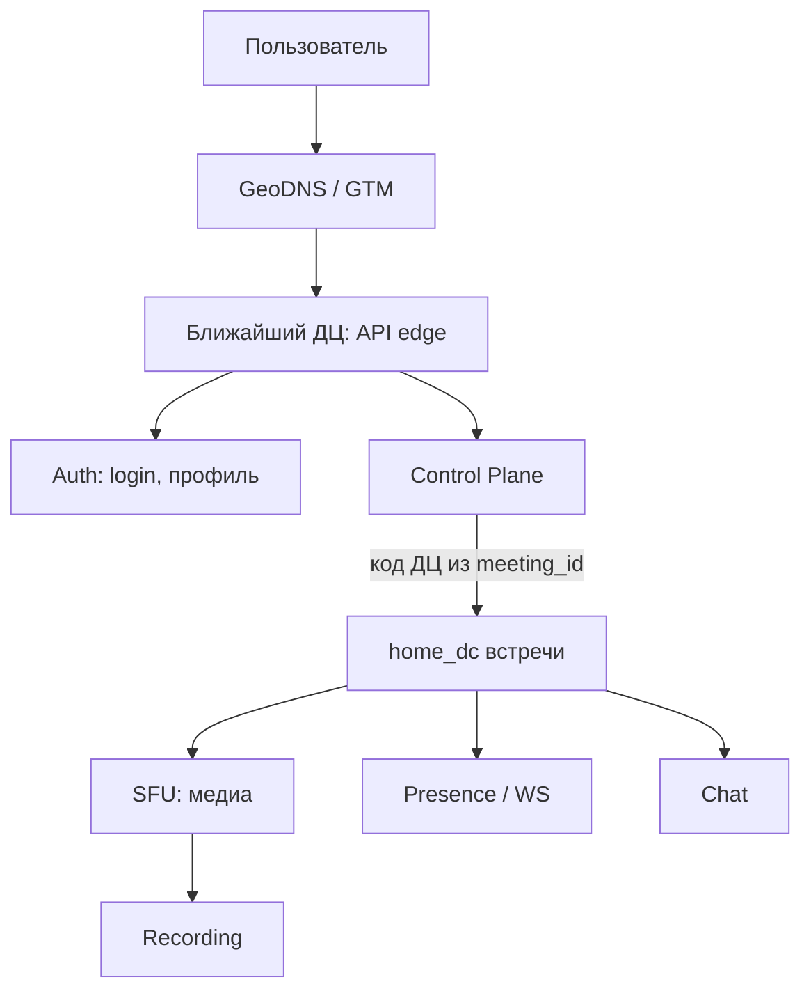
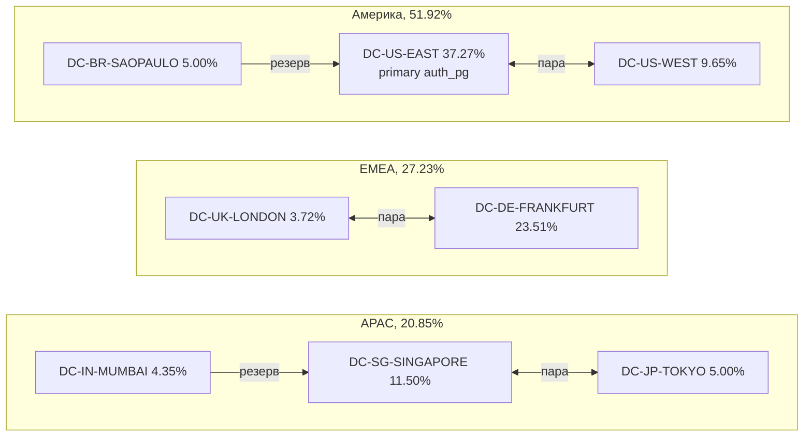
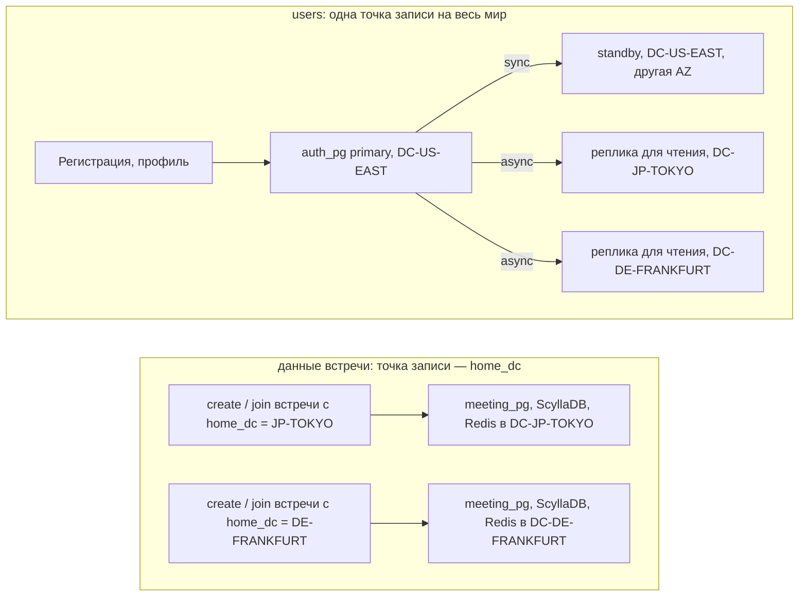
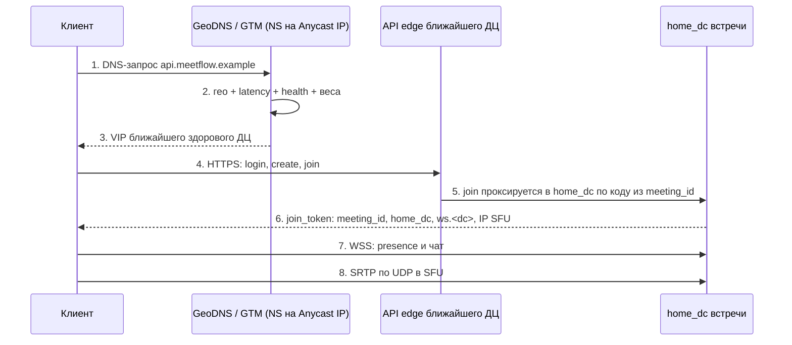
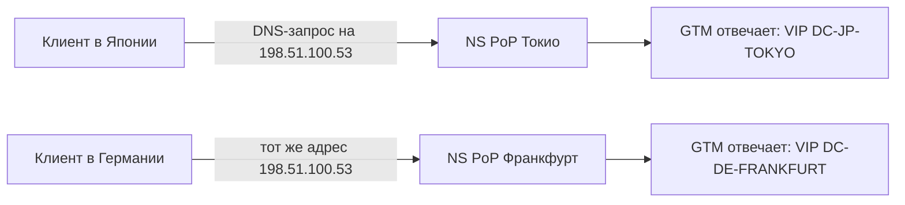
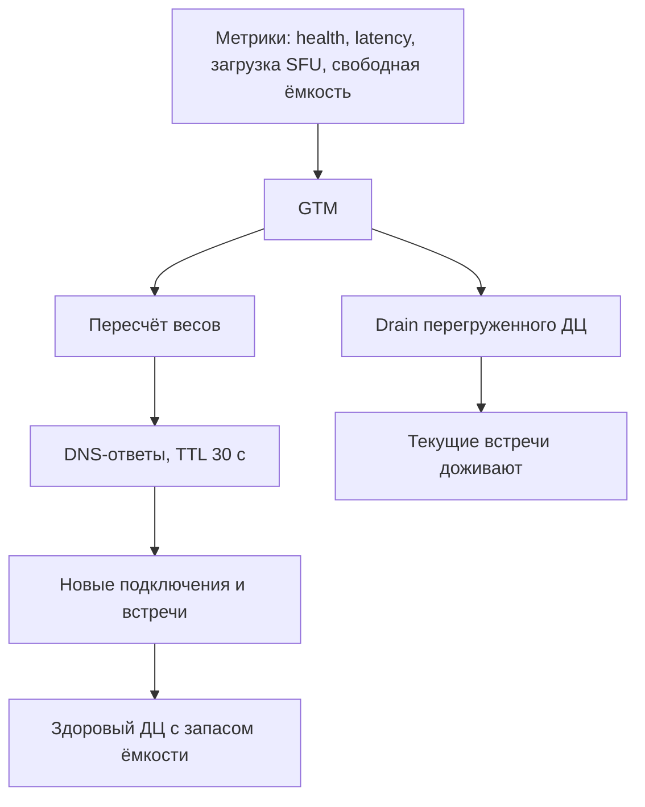
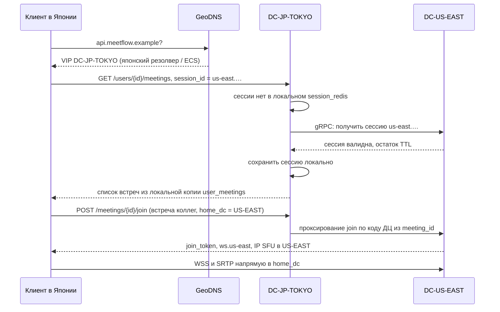
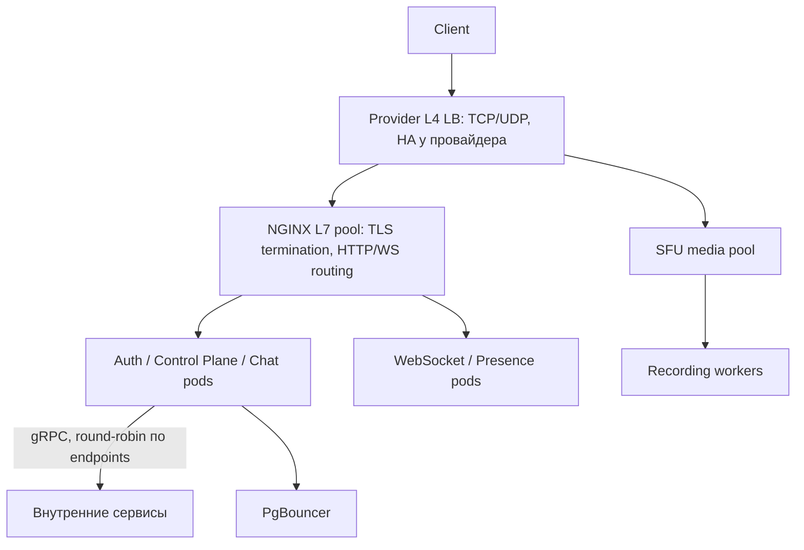
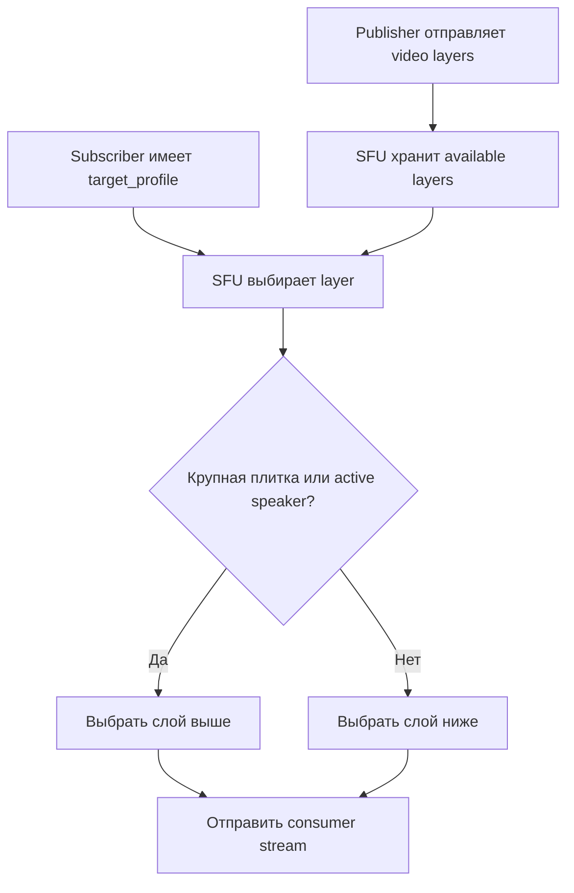
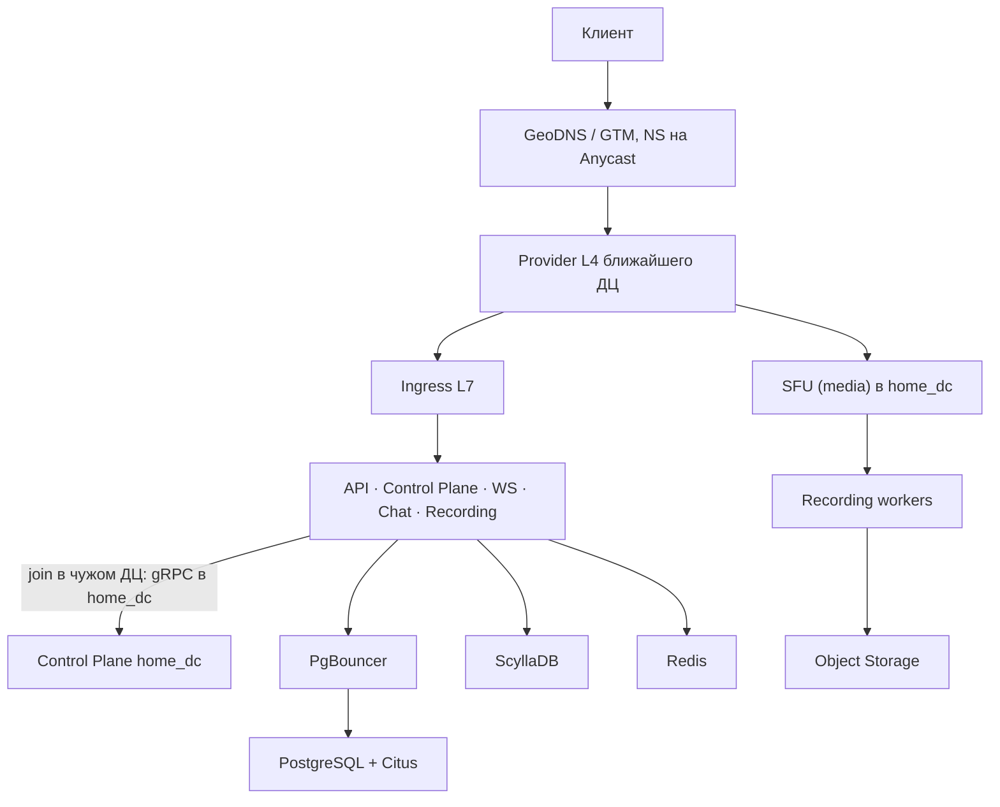

# Проектирование высоконагруженного Zoom-подобного сервиса видеовстреч

## Изменения после ревью

| Замечание | Что сделано | Где |
| --------- | ----------- | --- |
| `K = 1.5` | `MF_K_PEAK = 1.5` вместо 3; все пиковые значения, балансировщики, серверы и стоимость пересчитаны одним скриптом [`meetflow_calc.py`](resource/calc/meetflow_calc.py) | [2.1](#21-исходные-метрики-и-методика-расчёта), [11](#11-список-серверов) |
| `other_pool` не понравился | `OTHER_REGIONAL_POOL` (42.51%) разложен по макрорегионам: SimilarWeb + выручка Zoom по регионам + перепись США. Итог — 8 конкретных ДЦ с городами и парами для резерва | [3.2](#32-выбор-и-расположение-дата-центров) |
| Зашарить схемы | Исходник общей схемы в репозитории, ссылки на просмотр в diagrams.net; все схемы со ссылками в одной таблице | [10.1](#101-общая-схема-взаимодействия), [10.5](#105-исходники-и-ссылки-на-схемы) |
| Где в глобальной балансировке точка записи | Отдельный подраздел: `users` — один primary в `DC-US-EAST` + реплики; данные встречи — `home_dc`; `user_meetings` — мультиДЦ-репликация | [3.4](#34-точки-записи-данных) |
| Пользователь залогинился в США и поехал в Японию | Пошаговый сценарий с sequence-диаграммой: без повторного логина и без миграции данных | [3.8](#38-сценарий-вход-в-сша-затем-поездка-в-японию) |
| Механизм переключения: Anycast или DNS | **DNS (GeoDNS/GTM)**; Anycast — только для авторитетных DNS-серверов; медиа переключает приложение (новый SFU, ICE restart) | [3.5](#35-схема-dns-балансировки--основной-механизм-переключения)–[3.7](#37-регулировка-трафика-и-переключение-между-дата-центрами) |

Попутно исправлены расчёт L7 (теперь учтена память под одновременные WSS-соединения), ёмкость SFU (проверена по CPU), серверы данных посчитаны по каждому ДЦ, а несостыковки между разделами устранены.

## Содержание

- [Основная часть](#основная-часть)
  - [1. Тема и целевая аудитория](#1-тема-и-целевая-аудитория)
    - [1.1. Тип сервиса](#11-тип-сервиса)
    - [1.2. Рыночная ниша и реальные аналоги](#12-рыночная-ниша-и-реальные-аналоги)
    - [1.3. Функционал MVP](#13-функционал-mvp)
    - [1.4. Ключевые продуктовые решения](#14-ключевые-продуктовые-решения)
    - [1.5. Целевая аудитория](#15-целевая-аудитория)
  - [2. Расчёт нагрузки](#2-расчёт-нагрузки)
    - [2.1. Исходные метрики и методика расчёта](#21-исходные-метрики-и-методика-расчёта)
    - [2.2. Продуктовая оценка видеовстреч](#22-продуктовая-оценка-видеовстреч)
    - [2.3. Хранилище пользователя и техническое хранение](#23-хранилище-пользователя-и-техническое-хранение)
    - [2.4. Сетевой трафик и RPS](#24-сетевой-трафик-и-rps)
  - [3. Глобальная балансировка нагрузки](#3-глобальная-балансировка-нагрузки)
    - [3.1. Функциональное разбиение по доменам](#31-функциональное-разбиение-по-доменам)
    - [3.2. Выбор и расположение дата-центров](#32-выбор-и-расположение-дата-центров)
    - [3.3. Распределение нагрузки по дата-центрам](#33-распределение-нагрузки-по-дата-центрам)
    - [3.4. Точки записи данных](#34-точки-записи-данных)
    - [3.5. Схема DNS-балансировки — основной механизм переключения](#35-схема-dns-балансировки--основной-механизм-переключения)
    - [3.6. Схема Anycast-балансировки](#36-схема-anycast-балансировки)
    - [3.7. Регулировка трафика и переключение между дата-центрами](#37-регулировка-трафика-и-переключение-между-дата-центрами)
    - [3.8. Сценарий: вход в США, затем поездка в Японию](#38-сценарий-вход-в-сша-затем-поездка-в-японию)
    - [3.9. Вывод по глобальной балансировке](#39-вывод-по-глобальной-балансировке)
  - [4. Локальная балансировка нагрузки](#4-локальная-балансировка-нагрузки)
    - [4.1. Границы локальной балансировки](#41-границы-локальной-балансировки)
    - [4.2. Схема локальной и межсервисной балансировки](#42-схема-локальной-и-межсервисной-балансировки)
    - [4.3. Механизмы резервирования](#43-механизмы-резервирования)
    - [4.4. Ограничители для расчёта](#44-ограничители-для-расчёта)
    - [4.5. Расчёт количества L7-балансировщиков](#45-расчёт-количества-l7-балансировщиков)
    - [4.6. Итоговое количество балансировщиков](#46-итоговое-количество-балансировщиков)
  - [5. Логическая схема БД](#5-логическая-схема-бд)
    - [5.1. Список логических таблиц](#51-список-логических-таблиц)
    - [5.2. Размеры данных и QPS](#52-размеры-данных-и-qps)
    - [5.3. Требования к консистентности](#53-требования-к-консистентности)
    - [5.4. Распределение нагрузки по ключам](#54-распределение-нагрузки-по-ключам)
  - [6. Физическая схема БД](#6-физическая-схема-бд)
    - [6.1. Физическая схема БД](#61-физическая-схема-бд)
    - [6.2. Где хранятся данные](#62-где-хранятся-данные)
    - [6.3. Выбор СУБД по таблицам](#63-выбор-субд-по-таблицам)
    - [6.4. Индексы](#64-индексы)
    - [6.5. Шардирование и размещение по дата-центрам](#65-шардирование-и-размещение-по-дата-центрам)
    - [6.6. Нагрузка на строки](#66-нагрузка-на-строки)
    - [6.7. API -> запрос -> БД](#67-api---запрос---бд)
    - [6.8. Кеш](#68-кеш)
    - [6.9. Денормализация и отказ от JOIN](#69-денормализация-и-отказ-от-join)
    - [6.10. Клиентские библиотеки](#610-клиентские-библиотеки)
  - [7. Алгоритмы](#7-алгоритмы)
    - [7.1. Список алгоритмов](#71-список-алгоритмов)
    - [7.2. Adaptive Bitrate](#72-adaptive-bitrate)
    - [7.3. Выбор SFU-слоя видео](#73-выбор-sfu-слоя-видео)
  - [8. Технологии](#8-технологии)
    - [8.1. Языки](#81-языки)
    - [8.2. Сводная таблица технологий](#82-сводная-таблица-технологий)
  - [9. Обеспечение надёжности](#9-обеспечение-надёжности)
    - [9.1. Резервирование компонентов](#91-резервирование-компонентов)
    - [9.2. Отказ целого дата-центра](#92-отказ-целого-дата-центра)
  - [10. Схема проекта](#10-схема-проекта)
    - [10.1. Общая схема взаимодействия](#101-общая-схема-взаимодействия)
    - [10.2. Как читать схему](#102-как-читать-схему)
    - [10.3. Потоки данных](#103-потоки-данных)
    - [10.4. Балансировка: внешняя и внутренняя](#104-балансировка-внешняя-и-внутренняя)
    - [10.5. Исходники и ссылки на схемы](#105-исходники-и-ссылки-на-схемы)
  - [11. Список серверов](#11-список-серверов)
    - [11.1. Начальные нормативы для расчёта ресурсов](#111-начальные-нормативы-для-расчёта-ресурсов)
    - [11.2. Расчёт ресурсов по сервисам](#112-расчёт-ресурсов-по-сервисам)
    - [11.3. Итоговая таблица серверов](#113-итоговая-таблица-серверов)
    - [11.4. Оценка стоимости инфраструктуры](#114-оценка-стоимости-инфраструктуры)
- [Список источников](#список-источников)

## Основная часть

---

### 1. Тема и целевая аудитория

#### 1.1. Тип сервиса

| Параметр            | Значение                                                                                                   |
| ------------------- | ---------------------------------------------------------------------------------------------------------- |
| Учебное название    | **MeetFlow**                                                                                               |
| Тип сервиса         | Zoom-подобный сервис видеовстреч                                                                           |
| Основной сценарий   | Групповая онлайн-встреча с аудио, видео, демонстрацией экрана, чатом и записью                             |
| Целевые регионы     | Глобально: Америка, EMEA, Азиатско-Тихоокеанский регион; крупнейшие рынки — США, Япония, Индия, Великобритания, Канада [^12] |
| Реальные аналоги    | Zoom, Microsoft Teams, Google Meet                                                                         |
| Масштаб для расчёта | `MF_MAU = 320 млн MAU`, `MF_DAU = 115 млн DAU`, `MF_DMP = 300 млн участий во встречах в день` [^1][^2][^3] |

#### 1.2. Рыночная ниша и реальные аналоги

| Аналог | Метрика | Что подтверждает |
| ------ | ------- | ---------------- |
| Microsoft Teams | 320 млн monthly active users, раскрыто в FY24 Q1 [^1] | Массовый размер аудитории коммуникационного сервиса |
| Microsoft Teams | 115 млн daily active users, октябрь 2020 [^2] | Нижнюю публичную границу daily-аудитории для расчёта |
| Zoom | 300 млн daily meeting participants, апрель 2020; это участники встреч, а не unique users [^3] | Массовую ежедневную нагрузку именно на видеовстречи |
| Zoom | Средняя встреча — 54 минуты и 10 участников, данные за 15.11.2020–15.11.2021 [^4] | Базу для продуктовой оценки видеозвонков |
| Zoom | $4.8688 млрд выручки за FY2026 и 4 468 клиентов с TTM-выручкой больше $100 000 [^10] | Актуальность ниши на 2026 год |

#### 1.3. Функционал MVP

| № | Функция MVP | Кратко | Метрика для расчёта |
| -: | ----------- | ------ | ------------------- |
| 1 | Создание встречи | Пользователь создаёт мгновенную или запланированную встречу | `MF_MEETINGS_DAY`, `POST /meetings` |
| 2 | Подключение к встрече | Участник входит по ссылке или приглашению | `MF_DMP`, `POST /meetings/{id}/join` |
| 3 | Групповая аудио- и видеосвязь | Участники общаются в 720p group video | `MF_VIDEO_UP_MBPS`, `MF_VIDEO_DOWN_MBPS`, `MF_AUDIO_MBPS` |
| 4 | Демонстрация экрана | Участник показывает экран | `MF_SCREEN_MBPS_MAX` |
| 5 | Чат во время встречи | Участники отправляют текстовые сообщения | `MF_CHAT_MSG_LIMIT`, `MF_CHAT_PER_JOIN` |
| 6 | Облачная запись | Организатор включает запись встречи | `MF_RECORD_QUOTA_GB`, `MF_RECORDING_SIZE_GB` |

#### 1.4. Ключевые продуктовые решения

| Решение | Значение для MVP | Что считается дальше |
| ------- | ---------------- | -------------------- |
| Расчёт ведётся от групповой встречи | Средняя встреча: `MF_MEET_SIZE = 10` участников | Количество встреч в сутки |
| Базовый профиль качества | 720p group video по официальным требованиям Zoom [^5] | Видео-трафик upload/download |
| Запись встречи включается в облако | Cloud recording сохраняет видео, аудио и текст чата [^7] | Хранилище записей |
| Хранилище записей ограничено квотой | Для Pro/Business у Zoom — 10 GB на licensed user [^8] | Верхняя граница object storage |
| Частота чата — явное допущение | Есть лимит сообщения, но нет публичной частоты сообщений на пользователя [^6]; принимаем 5 сообщений на одно участие | Нагрузка и хранилище чата (2.2–2.4), уточняется после запуска |

#### 1.5. Целевая аудитория

| Параметр | Значение |
| -------- | -------: |
| География | Глобальный рынок; Zoom использовался почти в 200 странах и территориях [^4]; обслуживаем из 8 ДЦ (п. 3.2) |
| Месячная аудитория | `MF_MAU = 320 000 000` пользователей/месяц |
| Дневная аудитория | `MF_DAU = 115 000 000` пользователей/день |
| Участий во встречах в день | `MF_DMP = 300 000 000` участий/день |
| Средний размер встречи | `MF_MEET_SIZE = 10` участников |
| Средняя длительность встречи | `MF_MEET_LEN_MIN = 54` минуты |

---

### 2. Расчёт нагрузки

#### 2.1. Исходные метрики и методика расчёта

| Название | Описание (бывшее значение) | Источник / расчёт |
| -------- | -------------------------- | ----------------- |
| `MF_MAU` | 320 000 000 monthly active users; публичное значение Microsoft Teams, FY24 Q1 / 2023 | Берётся как целевой месячный масштаб аналога; без пересчёта на 2026, потому что более новой публичной MAU-метрики Teams в открытых источниках не найдено [^1] |
| `MF_DAU` | 115 000 000 daily active users; публичное значение Microsoft Teams, октябрь 2020 | Берётся как консервативная daily-аудитория аналога; это не статистика Zoom и не результат экстраполяции [^2] |
| `MF_DMP` | 300 000 000 daily meeting participants; публичное значение Zoom, апрель 2020 | Используется для нагрузки на видеовстречи; это участники встреч, один пользователь может считаться несколько раз [^3] |
| `MF_MEET_SIZE` | 10 участников в средней Zoom-встрече; данные за 15.11.2020–15.11.2021 | Используется для расчёта `MF_MEETINGS_DAY = MF_DMP / MF_MEET_SIZE` [^4] |
| `MF_MEET_LEN_MIN` | 54 минуты — средняя длительность Zoom-встречи; данные за 15.11.2020–15.11.2021 | Используется для расчёта participant-minutes [^4] |
| `MF_VIDEO_UP_MBPS` | 2.6 Mbps на участника для 720p group video upload | Официальные требования Zoom к bandwidth [^5] |
| `MF_VIDEO_DOWN_MBPS` | 1.8 Mbps на участника для 720p group video download | Официальные требования Zoom к bandwidth [^5] |
| `MF_VIDEO_HQ_MBPS` | 1.0 / 0.6 Mbps up/down для group «high-quality video» (ниже 720p) | Требования Zoom [^5]; профиль деградации при отказе ДЦ (п. 9.2) |
| `MF_AUDIO_MBPS` | 0.08 Mbps на участника для VoIP audio | Верхняя граница диапазона 60–80 kbps из требований Zoom [^5] |
| `MF_SCREEN_MBPS_MAX` | 0.15 Mbps на участника для screen sharing upper-bound | Верхняя граница диапазона 50–150 kbps из требований Zoom [^5] |
| `MF_CHAT_MSG_LIMIT` | 4 000 символов на одно chat-сообщение | Лимит Zoom Team Chat [^6] |
| `MF_CHAT_PER_JOIN` | 5 сообщений на одно участие во встрече | **Проектное допущение**: публичной частоты нет [^6]. Раньше стояло только в п. 6.6 — теперь задано здесь и используется везде |
| `MF_CHAT_MSG_SIZE` | 1 KB в среднем на сообщение (максимум ≈ 10 KB при 4 000 символов) | Проектное допущение для хранилища чата |
| `MF_LIST_PER_DAU` | 3 открытия списка встреч на DAU в сутки | Проектное допущение. Раньше было неявно зашито в число 11 979 в п. 6.6 |
| `MF_LOGIN_PER_DAU` | 1 создание сессии (логин) на DAU в сутки | Проектное допущение. Раньше было неявно зашито в число 3 993 в п. 5.2 |
| `MF_RECORD_QUOTA_GB` | 10 GB cloud recording storage на licensed user | Квота Zoom для Pro/Business [^8] |
| `MF_HEARTBEAT_SEC` | 25 секунд между heartbeat-событиями | Дефолтный `pingInterval = 25000 ms` в Socket.IO [^9] |
| `MF_K_PEAK` | **1.5** (в прошлой версии — 3) | Коэффициент суточного пика: пиковый час / среднее за сутки. Применяется одинаково к RPS, bandwidth и числу одновременных соединений. Сервис глобальный: когда в Америке рабочий день, в Азии ночь, и часовые пояса сглаживают общую суточную кривую. Значение 1.5 — по замечанию ревьюера; 3 удваивало пиковые значения |

Текущая актуальность ниши проверяется не устаревшими usage-числами, а финансовой метрикой: Zoom в FY2026 показал $4.8688 млрд выручки и 4 468 крупных клиентов с TTM-выручкой больше $100 000 [^10]. Старые usage-метрики используются только там, где они прямо подписаны по году и где показана формула расчёта.

Все числа разделов 2–6 и 11 считаются одним скриптом [`resource/calc/meetflow_calc.py`](resource/calc/meetflow_calc.py): при изменении допущения достаточно поменять константу и перезапустить.

#### 2.2. Продуктовая оценка видеовстреч

| Название | Расчёт | Значение |
| -------- | ------ | -------: |
| `MF_MEETINGS_DAY` | `MF_DMP / MF_MEET_SIZE` = `300 000 000 / 10` | **30 000 000 встреч/сутки** |
| `MF_JOINS_PER_DAU_DAY` | `MF_DMP / MF_DAU` = `300 000 000 / 115 000 000` | **2.61 подключения/DAU/день** |
| `MF_CREATED_MEETINGS_PER_DAU_DAY` | `MF_MEETINGS_DAY / MF_DAU` = `30 000 000 / 115 000 000` | **0.26 созданных встреч/DAU/день** |
| `MF_PARTICIPANT_MIN_DAY` | `MF_DMP * MF_MEET_LEN_MIN` = `300 000 000 * 54` | **16 200 000 000 participant-minutes/сутки** |
| `MF_AVG_ONLINE_PARTICIPANTS` | `MF_PARTICIPANT_MIN_DAY / 1440` | **11 250 000 участников online в среднем** |
| `MF_PEAK_ONLINE_PARTICIPANTS` | `MF_AVG_ONLINE_PARTICIPANTS * MF_K_PEAK` = `11 250 000 * 1.5` | **16 875 000 участников online в пик** |
| `MF_PEAK_WSS_CONNECTIONS` | `= MF_PEAK_ONLINE_PARTICIPANTS`, одно WSS-соединение на участника | **16 875 000 одновременных соединений** |
| `MF_PEAK_ACTIVE_MEETINGS` | `MF_PEAK_ONLINE_PARTICIPANTS / MF_MEET_SIZE` | **1 687 500 встреч одновременно** |
| `MF_HEARTBEAT_EVENTS_DAY` | `MF_PARTICIPANT_MIN_DAY * 60 / MF_HEARTBEAT_SEC` | **38 880 000 000 heartbeat-событий/сутки** |
| `MF_CHAT_MESSAGES_DAY` | `MF_DMP * MF_CHAT_PER_JOIN` = `300 000 000 * 5` | **1 500 000 000 сообщений/сутки** |
| `MF_MEETING_LIST_VIEWS_DAY` | `MF_DAU * MF_LIST_PER_DAU` = `115 000 000 * 3` | **345 000 000 открытий списка/сутки** |
| `MF_LOGINS_DAY` | `MF_DAU * MF_LOGIN_PER_DAU` | **115 000 000 логинов/сутки** |

#### 2.3. Хранилище пользователя и техническое хранение

| Блок данных | Название | Расчёт | Общий объём |
| ----------- | -------- | ------ | ----------: |
| Профили пользователей | `MF_USERS_STORAGE_GB` | `MF_MAU * 256 B` | **81.92 GB** |
| Метаданные встреч, 30 дней | `MF_MEETINGS_META_STORAGE_GB` | `MF_MEETINGS_DAY * 30 * 256 B` | **230.4 GB** |
| Ссылки-приглашения, 30 дней | `MF_INVITES_STORAGE_GB` | `MF_MEETINGS_DAY * 30 * 128 B` | **115.2 GB** |
| Участники встреч, 30 дней | `MF_PARTICIPANTS_STORAGE_TB` | `MF_DMP * 30 * 128 B` | **1.152 TB** |
| Списки встреч пользователей, 30 дней | `MF_USER_MEETINGS_STORAGE_TB` | `MF_DMP * 30 * 128 B` | **1.152 TB** |
| Активные сессии | `MF_SESSIONS_STORAGE_GB` | `MF_DAU * 128 B` | **14.72 GB** |
| Чат встречи, 30 дней | `MF_CHAT_STORAGE_TB` | `MF_CHAT_MESSAGES_DAY * 30 * MF_CHAT_MSG_SIZE` | **45 TB** |
| Суммарное техническое хранение без записей | `MF_TECH_STORAGE_TOTAL_TB` | сумма строк выше, raw без репликации | **47.75 TB** |
| Квота облачных записей | `MF_RECORDING_QUOTA_EB` | `MF_MAU * MF_RECORD_QUOTA_GB` | **3.2 EB квоты** |
| Размер одной записи | `MF_RECORDING_SIZE_GB` | `(MF_VIDEO_DOWN_MBPS + MF_AUDIO_MBPS) * MF_MEET_LEN_MIN * 60 / 8 / 1000` | **0.761 GB** |
| Worst-case рост записей | `MF_RECORDING_WORST_PB_DAY` | `MF_MEETINGS_DAY * MF_RECORDING_SIZE_GB` | **22.842 PB/сутки** |
| Записи за 30 дней, worst-case | `MF_RECORDING_WORST_PB_30D` | `MF_RECORDING_WORST_PB_DAY * 30` | **685.26 PB за 30 дней** |
| Суммарное хранение, 30 дней | `MF_STORAGE_TOTAL_30D_PB` | `MF_RECORDING_WORST_PB_30D + MF_TECH_STORAGE_TOTAL_TB` | **≈ 685.31 PB** |

В итоговый суммарный объём не включается `MF_RECORDING_QUOTA_EB`: это продуктовая квота, а не фактически занятое хранилище. Для sizing object storage используется worst-case 30-дневное хранение записей: `MF_RECORDING_WORST_PB_30D = 685.26 PB` (каждая встреча записывается). Объёмы хранения не зависят от `MF_K_PEAK`: пик меняет скорость, а не суточный объём.

#### 2.4. Сетевой трафик и RPS

##### Сетевой трафик

| Тип трафика | Название | Формула суточного объёма | Суточный объём | Средний bandwidth | Пиковый bandwidth |
| ----------- | -------- | ------------------------ | -------------: | ----------------: | ----------------: |
| Video upload | `MF_VIDEO_UP_GB_DAY` | `MF_PARTICIPANT_MIN_DAY * 60 * MF_VIDEO_UP_MBPS / 8 / 1000` | **315 900 000 GB/сутки** | **29 250 Gbps** | **43 875 Gbps** |
| Video download | `MF_VIDEO_DOWN_GB_DAY` | `MF_PARTICIPANT_MIN_DAY * 60 * MF_VIDEO_DOWN_MBPS / 8 / 1000` | **218 700 000 GB/сутки** | **20 250 Gbps** | **30 375 Gbps** |
| Audio VoIP | `MF_AUDIO_GB_DAY` | `MF_PARTICIPANT_MIN_DAY * 60 * MF_AUDIO_MBPS / 8 / 1000` | **9 720 000 GB/сутки** | **900 Gbps** | **1 350 Gbps** |
| Screen sharing upper-bound | `MF_SCREEN_GB_DAY_MAX` | `MF_PARTICIPANT_MIN_DAY * 60 * MF_SCREEN_MBPS_MAX / 8 / 1000` | **18 225 000 GB/сутки** | **1 687.5 Gbps** | **2 531.25 Gbps** |
| **Media клиент ↔ SFU, итого** | `MF_MEDIA_GB_DAY` | сумма строк выше | **562 545 000 GB/сутки** | **52 087.5 Gbps** | **78 131.25 Gbps** |
| Поток в запись SFU → recording workers, worst-case | `MF_REC_STREAM_GBPS` | `active_meetings * (MF_VIDEO_DOWN_MBPS + MF_AUDIO_MBPS)` | **22 842 000 GB/сутки** (= объём записей) | **2 115 Gbps** | **3 172.5 Gbps** |

Расчёт bandwidth в таблице:

```text
avg_bandwidth_Gbps  = MF_AVG_ONLINE_PARTICIPANTS * bitrate_Mbps / 1000
peak_bandwidth_Gbps = avg_bandwidth_Gbps * MF_K_PEAK
rec_stream_Gbps     = (MF_AVG_ONLINE_PARTICIPANTS / MF_MEET_SIZE) * (1.8 + 0.08) / 1000 * K
```

Поток в запись — внутренний трафик ДЦ: SFU отправляет его recording workers как ещё одному подписчику встречи. В интернет он не уходит, но нагружает SFU и воркеры записи, поэтому учитывается в разделе 11.

##### RPS по основным методам

| Метод / событие | Название | Событий в сутки | Средний RPS | Пиковый RPS |
| --------------- | -------- | --------------: | ----------: | ----------: |
| `POST /auth/login` | `MF_LOGIN_RPS` | `MF_LOGINS_DAY` = 115 000 000 | **1 331** | **1 997** |
| `POST /meetings` | `MF_CREATE_MEETING_RPS` | `MF_MEETINGS_DAY` = 30 000 000 | **347** | **521** |
| `POST /meetings/{id}/join` | `MF_JOIN_RPS` | `MF_DMP` = 300 000 000 | **3 472** | **5 208** |
| `POST /meetings/{id}/leave` | `MF_LEAVE_RPS` | `MF_DMP` = 300 000 000 | **3 472** | **5 208** |
| `WS /presence/heartbeat` | `MF_HEARTBEAT_RPS` | `MF_HEARTBEAT_EVENTS_DAY` = 38 880 000 000 | **450 000** | **675 000** |
| `POST /meeting-chat/messages` | `MF_CHAT_RPS` | `MF_CHAT_MESSAGES_DAY` = 1 500 000 000 | **17 361** | **26 042** |
| `GET /users/{id}/meetings?limit=100` | `MF_LIST_RPS` | `MF_MEETING_LIST_VIEWS_DAY` = 345 000 000 | **3 993** | **5 990** |
| `POST /recordings/metadata` | `MF_RECORDING_META_RPS` | до `MF_MEETINGS_DAY` = 30 000 000 | **до 347** | **до 521** |
| WS push: доставка чата и событий join/leave остальным участникам | `MF_WS_PUSH_RPS` | `(chat + join + leave) * (MF_MEET_SIZE − 1)` | **218 750** | **328 125** |

Формула для RPS:

```text
avg_RPS  = events_per_day / 86400
peak_RPS = avg_RPS * MF_K_PEAK
```


---

### 3. Глобальная балансировка нагрузки

Глобальная балансировка отвечает на четыре вопроса. Короткие ответы:

| Вопрос | Решение в MeetFlow | Где подробно |
| ------ | ------------------ | ------------ |
| Где стоят дата-центры | 8 ДЦ: `DC-US-EAST`, `DC-US-WEST`, `DC-BR-SAOPAULO`, `DC-UK-LONDON`, `DC-DE-FRANKFURT`, `DC-IN-MUMBAI`, `DC-SG-SINGAPORE`, `DC-JP-TOKYO`. Абстрактного пула `OTHER` нет: каждая группа стран привязана к конкретному ДЦ | 3.2 |
| Как пользователь попадает в ДЦ и как ДЦ переключаются | **DNS**: GeoDNS/GTM выбирает ДЦ по гео, latency, health и весам. **Anycast** — только для доставки DNS-запросов к авторитетным NS-серверам. Медиа переключается на уровне приложения: control plane выдаёт новый SFU | 3.5–3.7 |
| Где точка записи | `users` — один primary в `DC-US-EAST`; всё, что относится к встрече, — в `home_dc` встречи; список встреч пользователя — локально с асинхронной репликацией во все ДЦ | 3.4 |
| Что при отказе ДЦ или переезде пользователя | ДЦ убирается из DNS, новые встречи уходят в резервные ДЦ. Переезд не требует ни миграции данных, ни повторного логина | 3.7, 3.8, 9.2 |

«ДЦ» в работе — это регион провайдера из 3 зон доступности (AZ). Отказ одной AZ закрывается резервированием внутри ДЦ (разделы 4 и 9), отказ всего ДЦ — глобальной балансировкой.

#### 3.1. Функциональное разбиение по доменам

| Домен | Основная нагрузка | Куда направляется запрос | Точка записи |
| ----- | ----------------- | ------------------------ | ------------ |
| `Auth / Users` | логин, профиль | ближайший ДЦ по GeoDNS | `users` — primary `auth_pg` в `DC-US-EAST`; `user_sessions` — ДЦ, где выполнен логин |
| `Meeting Control Plane` | `POST /meetings`, `join`, `leave`, список встреч | ближайший ДЦ; `join` и `leave` проксируются в `home_dc` встречи | `meetings`, `meeting_invite_links` — `home_dc` |
| `Media Plane / SFU` | видео, аудио, screen sharing | только SFU в `home_dc` встречи, адрес приходит в ответе `join` | не хранится, это поток |
| `Presence / Heartbeat` | `WS /presence/heartbeat` | WS-endpoint `home_dc` встречи | `meetings_runtime` — Redis `home_dc` |
| `Meeting Chat` | сообщения внутри встречи | `home_dc` встречи | `chat_messages` — ScyllaDB `home_dc` |
| `Recording` | запись встречи | SFU → recording workers в `home_dc` | файлы — S3 `home_dc`, метаданные — `recording_pg` `home_dc` |
| `User meetings list` | top-100 встреч пользователя | ближайший ДЦ, чтение локальной копии | `user_meetings` пишется в `home_dc` встречи, ScyllaDB реплицирует его во все ДЦ |

`home_dc` — ДЦ, за которым закреплена встреча. Control plane выбирает его при `POST /meetings`: это ДЦ, который обработал запрос, то есть ближайший к организатору. Код `home_dc` записан в `meeting_id` (UUIDv8, первый байт — код ДЦ [^85]) и в invite-токен. Поэтому любой ДЦ понимает, куда направить `join`, без глобального справочника встреч.



#### 3.2. Выбор и расположение дата-центров

**Шаг 1. Страны с известной долей.** По SimilarWeb: U.S. — 40.73%, Japan — 5%, India — 4.35%, UK — 3.72%, Canada — 3.69%, Other — 42.5% [^12]. Other округлён до 42.51%, чтобы сумма была 100%. Другие оценки дают США ещё большую долю — около половины MAU [^11], так что США в любом случае крупнейший рынок.

**Шаг 2. Раскладываем Other (42.51%) по макрорегионам.** В прошлой версии Other был одним пулом `OTHER_REGIONAL_POOL`: у него не было ни места, ни состава стран, под него нельзя было поставить серверы.

| Шаг | Расчёт | Результат |
| --- | ------ | --------: |
| Латинская Америка | Ни одна страна LatAm не входит в топ-5, значит, каждая < 3.69%. Допущение: Бразилия ≈ 2.5%, Мексика ≈ 2%, остальные ≈ 3% | **7.5%** |
| EMEA + APAC целиком | `100 − (US + Canada) − LatAm = 100 − 44.42 − 7.5` | **48.08%** |
| Деление EMEA : APAC | По выручке Zoom за FY2026: EMEA 15.8%, APAC 12.1% [^72]. `48.08 × 15.8 / 27.9` и `48.08 × 12.1 / 27.9` | EMEA **27.23%**, APAC **20.85%** |
| Остаток EMEA | `27.23 − UK 3.72` | **23.51%** |
| Остаток APAC | `20.85 − Japan 5.00 − India 4.35` | **11.50%** |
| Проверка | `7.5 + 23.51 + 11.50 = 42.51` = Other | ✓ |

Выручку используем только для пропорции EMEA : APAC — у этих рынков близкая выручка на пользователя. Для Америк выручка не подходит: в США выручка на пользователя заметно выше. Проверка: по трафику Америки дают 51.92%, а по выручке 72.1% [^72]. Значит, выручка на единицу трафика в Америках примерно в 2.4 раза выше, чем в EMEA/APAC, — это ожидаемо.

**Шаг 3. США делим на восток и запад** по населению: на регион West по переписи 2020 приходится 23.7% населения [^73]. Один ДЦ на 40% мирового трафика — слишком большой радиус отказа, и у западного побережья задержка до восточного ДЦ выше.

**Шаг 4. Каждой группе стран — ближайший по задержке ДЦ.**

| Группа стран | Доля | Основание | ДЦ |
| ------------ | ---: | --------- | -- |
| США: Northeast, Midwest, South (76.3% населения) | 31.08% | `40.73% × 0.763` [^12][^73] | `DC-US-EAST` (Ашберн, Вирджиния) |
| Канада | 3.69% | SimilarWeb [^12] | `DC-US-EAST` |
| Мексика, Центральная Америка, Карибы | 2.50% | ≈ 1/3 населения LatAm, допущение | `DC-US-EAST` |
| США: West (23.7% населения) | 9.65% | `40.73% × 0.237` [^12][^73] | `DC-US-WEST` (Сан-Хосе, Калифорния) |
| Южная Америка | 5.00% | ≈ 2/3 LatAm, допущение | `DC-BR-SAOPAULO` |
| Великобритания | 3.72% | SimilarWeb [^12] | `DC-UK-LONDON` |
| Континентальная Европа, СНГ, Ближний Восток, Африка | 23.51% | остаток EMEA [^72] | `DC-DE-FRANKFURT` |
| Индия | 4.35% | SimilarWeb [^12] | `DC-IN-MUMBAI` |
| Юго-Восточная Азия, Океания, Корея, Тайвань, Гонконг, Южная Азия без Индии | 11.50% | остаток APAC [^72] | `DC-SG-SINGAPORE` |
| Япония | 5.00% | SimilarWeb [^12] | `DC-JP-TOKYO` |
| **Итого** | **100%** | | **8 ДЦ** |

Границы групп условные: GeoDNS выбирает ДЦ по фактической задержке. Например, западная Канада может уйти в `DC-US-WEST`, а страны Персидского залива — в `DC-IN-MUMBAI`. Доли сдвинутся на единицы процентов, это компенсируют веса GTM (п. 3.7) и резерв `N+1`. Точные доли уточняются по GeoIP-аналитике после запуска.

| ДЦ | Доля нагрузки | Пара для резерва | На какие продуктовые метрики влияет |
| -- | ------------: | ---------------- | ----------------------------------- |
| `DC-US-EAST` | 37.27% | `DC-US-WEST` | join latency и RTT медиа для востока США, Канады, Мексики |
| `DC-US-WEST` | 9.65% | `DC-US-EAST` | RTT медиа для западного побережья США |
| `DC-BR-SAOPAULO` | 5.00% | `DC-US-EAST` | без своего ДЦ медиа Южной Америки шло бы через подводные кабели в США |
| `DC-UK-LONDON` | 3.72% | `DC-DE-FRANKFURT` | latency для UK, отдельная юрисдикция после Brexit |
| `DC-DE-FRANKFURT` | 23.51% | `DC-UK-LONDON` | latency для Европы, СНГ, Ближнего Востока и Африки |
| `DC-IN-MUMBAI` | 4.35% | `DC-SG-SINGAPORE` | latency для Индии, стабильность screen sharing |
| `DC-SG-SINGAPORE` | 11.50% | `DC-JP-TOKYO` | latency для Юго-Восточной Азии и Океании |
| `DC-JP-TOKYO` | 5.00% | `DC-SG-SINGAPORE` | RTT медиа и packet loss для Японии |



Zoom как реальный аналог позволяет платным аккаунтам выбирать ДЦ для real-time video/audio/shared content [^13]. Поэтому в MeetFlow **control plane** и **media plane** разделены: API обслуживает ближайший ДЦ, а медиа всегда идёт в `home_dc` встречи.

#### 3.3. Распределение нагрузки по дата-центрам

Формула:

```text
dc_metric = global_metric * dc_share
```

Предполагается, что встречи распределены по `home_dc` так же, как пользователи по ДЦ: организатор и большинство участников обычно из одного региона.

##### Продуктовая нагрузка

| ДЦ | Доля | DAU | Участий/сутки | Встреч/сутки | Peak online = WSS-соединений |
| -- | ---: | --: | ------------: | -----------: | ----------: |
| `DC-US-EAST` | 37.27% | **42 857 038** | **111 800 970** | **11 180 097** | **6 288 805** |
| `DC-US-WEST` | 9.65% | **11 100 962** | **28 959 030** | **2 895 903** | **1 628 945** |
| `DC-BR-SAOPAULO` | 5.00% | **5 750 000** | **15 000 000** | **1 500 000** | **843 750** |
| `DC-UK-LONDON` | 3.72% | **4 278 000** | **11 160 000** | **1 116 000** | **627 750** |
| `DC-DE-FRANKFURT` | 23.51% | **27 034 315** | **70 524 301** | **7 052 430** | **3 966 992** |
| `DC-IN-MUMBAI` | 4.35% | **5 002 500** | **13 050 000** | **1 305 000** | **734 062** |
| `DC-SG-SINGAPORE` | 11.50% | **13 227 185** | **34 505 699** | **3 450 570** | **1 940 946** |
| `DC-JP-TOKYO` | 5.00% | **5 750 000** | **15 000 000** | **1 500 000** | **843 750** |
| **Итого** | **100%** | **115 000 000** | **300 000 000** | **30 000 000** | **16 875 000** |

##### Пиковый RPS

| ДЦ | `login` | `create` | `join` | `leave` | `heartbeat` | `chat` | `list` | `recording meta` |
| -- | --: | --: | --: | --: | --: | --: | --: | --: |
| `DC-US-EAST` | **744** | **194** | **1 941** | **1 941** | **251 552** | **9 705** | **2 232** | **194** |
| `DC-US-WEST` | **193** | **50** | **503** | **503** | **65 158** | **2 514** | **578** | **50** |
| `DC-BR-SAOPAULO` | **100** | **26** | **260** | **260** | **33 750** | **1 302** | **299** | **26** |
| `DC-UK-LONDON` | **74** | **19** | **194** | **194** | **25 110** | **969** | **223** | **19** |
| `DC-DE-FRANKFURT` | **469** | **122** | **1 224** | **1 224** | **158 680** | **6 122** | **1 408** | **122** |
| `DC-IN-MUMBAI` | **87** | **23** | **227** | **227** | **29 362** | **1 133** | **261** | **23** |
| `DC-SG-SINGAPORE` | **230** | **60** | **599** | **599** | **77 638** | **2 995** | **689** | **60** |
| `DC-JP-TOKYO` | **100** | **26** | **260** | **260** | **33 750** | **1 302** | **299** | **26** |
| **Итого** | **1 997** | **521** | **5 208** | **5 208** | **675 000** | **26 042** | **5 990** | **521** |

##### Пиковый media bandwidth

| ДЦ | Video upload | Video download | Audio | Screen sharing | Media суммарно | SFU → запись |
| -- | -----------: | -----------: | -----------: | -----------: | -----------: | -----------: |
| `DC-US-EAST` | **16 350.9 Gbps** | **11 319.8 Gbps** | **503.1 Gbps** | **943.3 Gbps** | **29 117.2 Gbps** | 1 182.3 Gbps |
| `DC-US-WEST` | **4 235.3 Gbps** | **2 932.1 Gbps** | **130.3 Gbps** | **244.3 Gbps** | **7 542.0 Gbps** | 306.2 Gbps |
| `DC-BR-SAOPAULO` | **2 193.8 Gbps** | **1 518.8 Gbps** | **67.5 Gbps** | **126.6 Gbps** | **3 906.6 Gbps** | 158.6 Gbps |
| `DC-UK-LONDON` | **1 632.2 Gbps** | **1 130.0 Gbps** | **50.2 Gbps** | **94.2 Gbps** | **2 906.5 Gbps** | 118.0 Gbps |
| `DC-DE-FRANKFURT` | **10 314.2 Gbps** | **7 140.6 Gbps** | **317.4 Gbps** | **595.0 Gbps** | **18 367.2 Gbps** | 745.8 Gbps |
| `DC-IN-MUMBAI` | **1 908.6 Gbps** | **1 321.3 Gbps** | **58.7 Gbps** | **110.1 Gbps** | **3 398.7 Gbps** | 138.0 Gbps |
| `DC-SG-SINGAPORE` | **5 046.5 Gbps** | **3 493.7 Gbps** | **155.3 Gbps** | **291.1 Gbps** | **8 986.6 Gbps** | 364.9 Gbps |
| `DC-JP-TOKYO` | **2 193.8 Gbps** | **1 518.8 Gbps** | **67.5 Gbps** | **126.6 Gbps** | **3 906.6 Gbps** | 158.6 Gbps |
| **Итого** | **43 875.00 Gbps** | **30 375.00 Gbps** | **1 350.00 Gbps** | **2 531.25 Gbps** | **78 131.25 Gbps** | **3 172.5 Gbps** |

##### Записи встреч

| ДЦ | Worst-case запись/сутки | Worst-case запись за 30 дней |
| -- | ------: | ------: |
| `DC-US-EAST` | **8.513 PB/сутки** | **255.38 PB** |
| `DC-US-WEST` | **2.205 PB/сутки** | **66.15 PB** |
| `DC-BR-SAOPAULO` | **1.142 PB/сутки** | **34.26 PB** |
| `DC-UK-LONDON` | **0.850 PB/сутки** | **25.49 PB** |
| `DC-DE-FRANKFURT` | **5.370 PB/сутки** | **161.09 PB** |
| `DC-IN-MUMBAI` | **0.994 PB/сутки** | **29.81 PB** |
| `DC-SG-SINGAPORE` | **2.627 PB/сутки** | **78.82 PB** |
| `DC-JP-TOKYO` | **1.142 PB/сутки** | **34.26 PB** |
| **Итого** | **22.842 PB/сутки** | **685.26 PB** |

#### 3.4. Точки записи данных

Правило: **у каждого объекта одна точка записи** (primary), а чтение по возможности идёт из локальной копии в ближайшем ДЦ. Тогда не бывает двух одновременных записей одного объекта в разных ДЦ, и не нужен сложный multi-master с разрешением конфликтов.

| Данные | Точка записи | Где читаются | Репликация между ДЦ | Почему так |
| ------ | ------------ | ------------ | ------------------- | ---------- |
| `users` (`auth_pg`) | **один primary на весь мир — `DC-US-EAST`**, синхронная standby в другой AZ того же ДЦ | локальная асинхронная реплика в каждом ДЦ | streaming replication: primary → 7 реплик [^27][^89] | Нужна глобальная уникальность `email`. Записи редкие: даже если каждый DAU раз в сутки меняет профиль, в пик это ≤ 1 997 записей/с — одного primary хватает |
| `user_sessions` (`session_redis`) | ДЦ, где выполнен логин; код ДЦ — префикс `session_id` (`us-east.<128 бит>`) | там же; другой ДЦ один раз забирает сессию по префиксу (п. 3.8) | нет, перенос по запросу | Сессия нужна там, где пользователь сейчас; копии во всех ДЦ не нужны |
| `meetings`, `meeting_invite_links` (`meeting_pg`) | `home_dc` встречи | `home_dc` | асинхронная реплика в парный ДЦ на случай отказа | `join` должен видеть актуальный статус (strong, п. 5.3) |
| `meeting_participants` (`meeting_scylla`) | `home_dc` | `home_dc` | нет: keyspace реплицируется только внутри `home_dc`, RF=3 по 3 AZ; снапшоты — в S3 парного ДЦ | Нужны во время встречи и для истории |
| `meetings_runtime` (`runtime_redis`) | `home_dc` | `home_dc` | нет | Эфемерное состояние, клиенты восстанавливают его при переподключении |
| `chat_messages` (`chat_scylla`) | `home_dc` | `home_dc` | нет; снапшоты — в S3 парного ДЦ | Порядок задаёт `chat_seq` в одном Redis `home_dc` |
| `recordings` и файлы (`recording_pg`, S3) | `home_dc` | `home_dc` по presigned URL | метаданные — асинхронная реплика в парный ДЦ; файлы — ≥ 3 копии в 3 AZ `home_dc` | Копия 685 PB в другой регион удвоила бы самую дорогую статью расходов |
| `user_meetings` (`meeting_scylla`) | `home_dc` встречи, запись с `LOCAL_QUORUM` | ближайший к пользователю ДЦ, локально | keyspace с RF=3 **в каждом** ДЦ (NetworkTopologyStrategy) [^80][^81] | Read model с eventual consistency (п. 5.3): список встреч доступен локально в любой стране |



**Как запрос на запись попадает в точку записи:**

1. Запрос приходит в ближайший ДЦ (GeoDNS, п. 3.5).
2. Сервис определяет точку записи: для `users` это всегда `DC-US-EAST`, для данных встречи — код ДЦ из `meeting_id`.
3. Если точка записи в другом ДЦ, запрос проксируется по gRPC с mTLS по межрегиональному каналу [^52]. Это добавляет RTT между ДЦ — например, ≈ 153 мс Токио ↔ восточное побережье США [^87], но только для редких записей.
4. После своей записи пользователь несколько секунд читает из primary (read-your-writes), пока асинхронная реплика не догонит.

**Отказ точки записи.** Primary `auth_pg` переключается на синхронную standby в соседней AZ без потери данных; переключение автоматическое, через Patroni [^86]. При отказе всего `DC-US-EAST` primary становится реплика `DC-US-WEST`; RPO — секунды лага асинхронной репликации. Логин продолжает работать: он читает локальную реплику и пишет сессию в локальный Redis. На время переключения блокируются только регистрация и изменение профиля.

#### 3.5. Схема DNS-балансировки — основной механизм переключения

**Ответ на вопрос «Anycast или DNS?»: ДЦ выбирается и переключается через DNS.** Используется GeoDNS/GTM — managed-сервис с геолокацией, latency-based routing, health checks и весами пулов [^15][^16][^17]. Anycast стоит только «под» DNS: авторитетные NS-серверы GTM-провайдера доступны по Anycast IP (п. 3.6).

| DNS-имя | Что выбирает | Политика | TTL |
| ------- | ------------ | -------- | --: |
| `api.meetflow.example` | VIP API edge ближайшего здорового ДЦ | geo + latency + health + веса | 30 с |
| `ws.<dc>.meetflow.example` | WebSocket edge конкретного `home_dc` | фиксированное региональное имя, приходит в ответе `join` | 30 с |
| SFU, IP:port | конкретный SFU в `home_dc` | не DNS: адрес и ICE-кандидаты приходят в ответе `join` | — |
| `rec.<dc>.meetflow.example` | скачивание записей из object storage `home_dc` | региональное имя, presigned URL | 300 с |
| `static.meetflow.example` | веб-клиент и статика | CDN провайдера | по CDN |

GeoDNS определяет местоположение по IP рекурсивного резолвера или по подсети клиента из EDNS Client Subnet [^82]. Поэтому ДЦ выбирается по тому, где пользователь находится сейчас, а не где он регистрировался.



**Время переключения через DNS.** Monitor GTM опрашивает health-endpoint каждого ДЦ, интервал настраивается — берём 10 с [^17]. После 3 неудач подряд ДЦ выводится из ответов (≈ 30 с), плюс TTL 30 с. Итого новые подключения уходят в здоровый ДЦ примерно за минуту. Часть резолверов кеширует дольше TTL, поэтому у клиента есть свой fallback: при ошибке соединения он заново резолвит имя, а если это не помогло — идёт на резервный региональный адрес из конфигурации приложения.

#### 3.6. Схема Anycast-балансировки

Anycast — один IP-адрес, который анонсируется по BGP из многих точек; пакет приходит в «ближайшую» по маршрутизации точку [^83]. В MeetFlow Anycast используется **только там, где запросы короткие и не хранят состояние на сервере**:

| Трафик | Anycast | Почему |
| ------ | ------- | ------ |
| DNS-запросы к авторитетным NS-серверам GTM | **Да** | UDP «запрос — ответ» без сессии: ответ из ближайшего PoP, устойчивость к отказу точки и DDoS [^83] |
| Статика веб-клиента | Да, через CDN провайдера | короткие запросы, контент одинаковый во всех точках |
| API `api.meetflow.example` | Нет | BGP выбирает маршрут по AS-path, а не по задержке и загрузке ДЦ: нельзя задать веса, вывести ДЦ на обслуживание (drain), учесть ёмкость. Глобальный proxy-балансировщик с одним Anycast IP есть у крупных облаков [^18], но он привязывает к сети одного облака |
| WebSocket | Нет | долгоживущее TCP-соединение: при перестроении BGP-маршрута пакеты уйдут в другой ДЦ, где нет состояния этого соединения [^83] |
| RTP/SRTP медиа | Нет | встреча живёт на конкретном SFU в `home_dc`, смена маршрута рвёт медиасессию |



Оба PoP анонсируют по BGP один и тот же адрес (в примере — документационный `198.51.100.53`), и маршрутизация приводит каждый запрос в ближайшую к клиенту точку.

Итог: Anycast ускоряет и защищает **получение DNS-ответа**, а **решение, в какой ДЦ идти, принимает GTM** — это и есть механизм переключения.

#### 3.7. Регулировка трафика и переключение между дата-центрами

Регулировка идёт через веса пулов в GTM. Monitors регулярно проверяют endpoints и выводят нездоровый пул из ротации [^16][^17].

```text
effective_weight = geo_match * health * capacity_weight * manual_weight
```

| Ситуация | Что делаем | Кого затрагивает |
| -------- | ---------- | ---------------- |
| Норма | Пользователь → ближайший здоровый ДЦ | — |
| ДЦ перегружен | Снижаем `capacity_weight`: новые пользователи и встречи уходят в резервные ДЦ | только новые |
| Плановые работы | `manual_weight = 0` (drain): новые встречи не создаются, текущие доживают | только новые |
| ДЦ недоступен | `health = 0`, ДЦ убирается из DNS-ответов | все, см. п. 9.2 |
| Деградация пула SFU | Control plane не назначает этот пул новым встречам. При отказе SFU клиент получает адрес нового SFU по WebSocket и делает ICE restart [^84] | встречи на этом SFU |

| Основной ДЦ | Резерв 1 | Резерв 2 | Почему |
| ----------- | -------- | -------- | ------ |
| `DC-US-EAST` | `DC-US-WEST` | `DC-UK-LONDON` | та же страна, затем ближайший ДЦ через Атлантику |
| `DC-US-WEST` | `DC-US-EAST` | `DC-JP-TOKYO` | та же страна, затем через Тихий океан |
| `DC-BR-SAOPAULO` | `DC-US-EAST` | `DC-DE-FRANKFURT` | прямые кабели в США и Европу |
| `DC-UK-LONDON` | `DC-DE-FRANKFURT` | `DC-US-EAST` | соседний европейский ДЦ |
| `DC-DE-FRANKFURT` | `DC-UK-LONDON` | `DC-IN-MUMBAI` | соседний европейский ДЦ, затем Ближний Восток |
| `DC-IN-MUMBAI` | `DC-SG-SINGAPORE` | `DC-DE-FRANKFURT` | ближайший ДЦ в Азии |
| `DC-SG-SINGAPORE` | `DC-JP-TOKYO` | `DC-IN-MUMBAI` | ближайшие ДЦ в Азии |
| `DC-JP-TOKYO` | `DC-SG-SINGAPORE` | `DC-US-WEST` | ближайший ДЦ в Азии, затем через Тихий океан |

Резервный ДЦ может быть меньше основного: `DC-US-WEST` (9.65%) не вместит `DC-US-EAST` (37.27%). Поэтому столбцы «Резерв» задают **порядок предпочтения**, а не единственный адрес. GTM раздаёт трафик отказавшего ДЦ по нескольким ДЦ пропорционально свободной ёмкости (`capacity_weight`). Расчёт того, что ёмкости хватит, — в п. 9.2.



#### 3.8. Сценарий: вход в США, затем поездка в Японию

Вопрос: пользователь залогинился в США, а потом улетел в Японию. Что происходит?



| Шаг | Что происходит | Почему так |
| --- | -------------- | ---------- |
| 1. Логин в США | Пароль проверяется по локальной реплике `auth_pg`. Сессия `us-east.<id>` создаётся в `session_redis` `DC-US-EAST` | Логину не нужна запись в primary |
| 2. Прилёт в Японию | GeoDNS видит японский резолвер или подсеть клиента из ECS [^82] и отдаёт VIP `DC-JP-TOKYO` | ДЦ выбирается по текущему местоположению; привязки к стране логина нет |
| 3. Первый запрос в `DC-JP-TOKYO` | Сессии нет в локальном Redis. По префиксу `us-east` Auth один раз забирает её из `DC-US-EAST` (+≈ 153 мс [^87]) и сохраняет у себя. **Повторный логин не нужен** | Сессии не копируются во все ДЦ заранее, а переносятся по запросу |
| 4. Профиль | Чтение — из локальной реплики `auth_pg`, изменение — в primary `DC-US-EAST` | Одна точка записи для `users` (п. 3.4) |
| 5. Список встреч | Читается из локальной копии `user_meetings` в `DC-JP-TOKYO` | Keyspace реплицирован во все ДЦ |
| 6. Встреча американских коллег | `home_dc = DC-US-EAST`. `DC-JP-TOKYO` проксирует `join` в `DC-US-EAST` по коду ДЦ в `meeting_id`. WS и медиа идут в `DC-US-EAST`: RTT ≈ 153 мс [^87], в одну сторону ≈ 76 мс — это меньше 150 мс, которые ITU-T G.114 считает приемлемыми для разговора [^88] | Все участники встречи должны быть на одном SFU. Улучшение после MVP — каскад SFU: клиент подключается к SFU в Токио, а тот пересылает потоки в SFU `home_dc` по магистрали |
| 7. Новая встреча, созданная в Японии | `home_dc = DC-JP-TOKYO`; американские участники подключаются к SFU в Токио | `home_dc` выбирается по организатору |
| 8. Пользователь остался жить в Японии | Мигрировать ничего не нужно: данные пользователя глобальные (реплики во всех ДЦ), а встречи привязаны к своему `home_dc`, а не к пользователю. Старая сессия в `DC-US-EAST` истечёт по TTL | В системе нет «домашнего ДЦ пользователя», который пришлось бы переносить |
| 9. Logout | Сессия удаляется локально и в ДЦ из префикса, событие отзыва рассылается во все 8 ДЦ | Отозванная сессия не должна жить ни в одной копии |

#### 3.9. Вывод по глобальной балансировке

| Решение | Значение |
| ------- | -------- |
| ДЦ | 8 ДЦ в трёх макрорегионах. Доли посчитаны по SimilarWeb, 10-K Zoom и переписи США; абстрактного `OTHER` нет |
| Механизм выбора и переключения ДЦ | **DNS**: GeoDNS/GTM с health checks и весами, TTL 30 с, плюс клиентский fallback |
| Anycast | Только авторитетные DNS-серверы и CDN для статики |
| Переключение медиа | На уровне приложения: новый SFU от control plane, ICE restart |
| Точки записи | `users` — один primary в `DC-US-EAST`; данные встречи — `home_dc`; `user_meetings` — локально с асинхронной репликацией во все ДЦ |
| Переезд пользователя | Без миграции и без повторного логина: сессия переносится по префиксу, данные пользователя читаются из локальной реплики |


---

### 4. Локальная балансировка нагрузки

#### 4.1. Границы локальной балансировки

| Поток | Где балансируется | В расчёте NGINX L7 |
| ----- | ----------------- | ------------------ |
| HTTPS API | Provider L4 → NGINX L7 → поды сервисов | Да |
| WSS: heartbeat, доставка чата и presence-событий | Provider L4 → NGINX L7 → WebSocket-поды | Да |
| RTP/SRTP медиа | Provider L4 → пул SFU, адрес SFU назначает control plane | Нет |
| Recording metadata | Provider L4 → NGINX L7 | Да |
| Поток записи SFU → recording workers | внутри ДЦ, по адресу из control plane | Нет |
| Межсервисные вызовы внутри ДЦ | gRPC, клиентская балансировка по endpoints Kubernetes Service | Нет |
| Межрегиональные вызовы: прокси `join` в `home_dc`, перенос сессии | gRPC с mTLS между ДЦ | Нет |

#### 4.2. Схема локальной и межсервисной балансировки



Межсервисная балансировка: gRPC-клиент получает список подов через headless Kubernetes Service и распределяет вызовы round-robin [^52][^54]. Обычная L4-балансировка здесь не подходит: gRPC держит одно долгое HTTP/2-соединение, и все вызовы ушли бы в один под.

#### 4.3. Механизмы резервирования

| Уровень | Что делает | Резервирование | Формула |
| ------- | ---------- | -------------- | ------- |
| Provider L4 LB | TCP/UDP вход в ДЦ | Managed HA у провайдера | Не считаем |
| NGINX L7 pool | HTTPS/WSS, TLS termination, routing | Active-active + health checks | `N+1` |
| NGINX L7 strict HA | Потеря AZ или стойки | Двойная ёмкость | `N*2` |
| SFU media pool | Видео, аудио, screen sharing | Sticky meeting + health checks | `N+1` |

#### 4.4. Ограничители для расчёта

| Ограничитель | Значение | Источник / расчёт |
| ------------ | -------: | ----------------- |
| `LB_HTTPS_RPS` | **342 785 RPS** | NGINX Ingress Controller, HTTPS, 24 CPU: запросы по уже открытым соединениям [^19] |
| `LB_TLS_CPS` | **10 274 новых TLS-соединений/с** | NGINX, HTTPS CPS на 24 CPU: полный TLS handshake на каждое соединение [^20]. Берём консервативно: тест Ingress даёт 58 811 SSL TPS [^19] |
| `LB_NET_GBPS` | **8.8 Gbps** | Throughput NGINX Ingress Controller [^19] |
| `MF_L7_REQ_SIZE` | **1 KB** | Размер запроса из HTTPS/RPS-бенчмарка [^19] |
| `MF_L7_CONN_MEM` | **54 KB на WSS-соединение** | NGINX держит проксируемое WebSocket-соединение (клиент + upstream) меньше чем в 20 KB: 50 000 соединений занимают < 1 GB [^77]. Плюс до 34 KB TLS-буферов, если они не освобождены [^78]. Это худший случай |
| Узел L7 | **24 vCPU / 64 GB / 100 GB SSD** | 56 GB под соединения: `56 GB / 54 KB ≈ 1.04 млн` WSS-соединений на узел. Дескрипторы и порты настраиваются (`ulimit`, `ip_local_port_range`) |
| Provider L4 | Внешний `LoadBalancer` | В Kubernetes внешний LB создаёт провайдер, он же отвечает за HA [^21] |

> **Исправлено после ревью.** В прошлой версии весь RPS, включая heartbeat, делился на SSL TPS. Но SSL TPS — это скорость **новых** TLS-рукопожатий, а heartbeat идёт по уже открытому WSS-соединению. Теперь у каждого ограничителя своя метрика. Для WebSocket главным ограничителем оказалась **память под одновременные соединения**, которая раньше не учитывалась.

#### 4.5. Расчёт количества L7-балансировщиков

```text
MF_L7_REST_RPS  = login + create + join + leave + list + recording_metadata + chat      = 45 486
MF_L7_WS_IN     = heartbeat                                                              = 675 000
MF_L7_WS_OUT    = (chat + join + leave) * (MF_MEET_SIZE - 1)                             = 328 125
MF_L7_PEAK_RPS  = MF_L7_REST_RPS + MF_L7_WS_IN + MF_L7_WS_OUT                            = 1 048 611
MF_L7_NEW_TLS   = (login + create + join + leave + list + recording_metadata) + join     = 24 653
                  # REST без keep-alive (худший случай) + новое WSS-соединение на каждый join
MF_L7_PEAK_GBPS = MF_L7_PEAK_RPS * 1 KB * 8 / 10^6                                       = 8.39
MF_L7_PEAK_CONN = MF_PEAK_WSS_CONNECTIONS                                                = 16 875 000

N_rps  = ceil(RPS_dc / 342 785)
N_tls  = ceil(NEW_TLS_dc / 10 274)
N_net  = ceil(GBPS_dc / 8.8)
N_conn = ceil(CONN_dc * 54 KB / 56 GB)
N_base = max(N_rps, N_tls, N_net, N_conn)

N+1 = N_base + 1
N*2 = N_base * 2
```

| ДЦ | L7 peak RPS | Новых TLS/с | L7 Gbps | WSS-соединений |
| -- | ----------: | ----------: | ------: | -------------: |
| `DC-US-EAST` | **390 786** | 9 187 | 3.13 | **6 288 805** |
| `DC-US-WEST` | **101 223** | 2 380 | 0.81 | **1 628 945** |
| `DC-BR-SAOPAULO` | **52 431** | 1 233 | 0.42 | **843 750** |
| `DC-UK-LONDON` | **39 008** | 917 | 0.31 | **627 750** |
| `DC-DE-FRANKFURT` | **246 509** | 5 795 | 1.97 | **3 966 992** |
| `DC-IN-MUMBAI` | **45 615** | 1 072 | 0.36 | **734 062** |
| `DC-SG-SINGAPORE` | **120 610** | 2 836 | 0.96 | **1 940 946** |
| `DC-JP-TOKYO` | **52 431** | 1 233 | 0.42 | **843 750** |
| **Сумма по ДЦ** | **1 048 611** | **24 653** | **8.39** | **16 875 000** |

| ДЦ | `N_rps` | `N_tls` | `N_net` | `N_conn` | `N+1` | `N*2` |
| -- | ----: | ----: | ----: | ----: | ----: | ----: |
| `DC-US-EAST` | 2 | 1 | 1 | 7 | **8** | 14 |
| `DC-US-WEST` | 1 | 1 | 1 | 2 | **3** | 4 |
| `DC-BR-SAOPAULO` | 1 | 1 | 1 | 1 | **2** | 2 |
| `DC-UK-LONDON` | 1 | 1 | 1 | 1 | **2** | 2 |
| `DC-DE-FRANKFURT` | 1 | 1 | 1 | 4 | **5** | 8 |
| `DC-IN-MUMBAI` | 1 | 1 | 1 | 1 | **2** | 2 |
| `DC-SG-SINGAPORE` | 1 | 1 | 1 | 2 | **3** | 4 |
| `DC-JP-TOKYO` | 1 | 1 | 1 | 1 | **2** | 2 |
| **Сумма по ДЦ** | **9** | **8** | **8** | **19** | **27** | **38** |

#### 4.6. Итоговое количество балансировщиков

| Режим | Количество NGINX L7 | Что закладываем |
| ----- | ------------------: | --------------- |
| Рабочий вариант | **27** | `N+1` в каждом ДЦ |
| Жёсткое резервирование | **38** | `N*2` в каждом ДЦ: переживает потерю AZ |
| Provider L4 | **8 managed LB** | по одному HA-балансировщику на ДЦ |

| Что ограничивает расчёт | Итог |
| ----------------------- | ---- |
| Память под одновременные WSS-соединения | **Основной ограничитель**: 16.9 млн соединений в пик |
| RPS и TLS handshake | Не основной: 1–2 узла на ДЦ |
| Пропускная способность сети | Не основной ограничитель для control plane |
| Media traffic | Не проходит через NGINX L7 |


---

### 5. Логическая схема БД

#### 5.1. Список логических таблиц

Логическая схема не привязана к конкретной СУБД, шардингу и физическим индексам. В схему включены только основные сущности сервиса и связи между ними.

##### Логическая схема
Для получения картинки использовался сервис [dbdiagram](https://dbdiagram.io/) с кодом из [этого файла](resource/logic-database-sql.md) ([интерактивная ссылка на работу](https://dbdiagram.io/d/logic-database-6a3bcd543b9b0de59965ea98)).


##### Группы данных

| Группа | Таблицы | Что хранит |
| ------ | ------- | ---------- |
| Пользователи | `users`, `user_sessions` | Аккаунты и активные сессии |
| Встречи | `meetings`, `meeting_participants`, `meeting_invite_links`, `user_meetings` | Создание, вход, роли, список встреч пользователя |
| Чат | `chat_messages` | Сообщения внутри встречи |
| Файлы | `recordings`, `recording_upload_buffer` | Метаданные записей и временные чанки загрузки |

##### Описание таблиц

| Таблица | Тип данных | Назначение | Ключ | Основные связи |
| ------- | ---------- | ---------- | ---- | -------------- |
| `users` | persistent | Аккаунт пользователя | `id` | Создаёт встречи, пишет чат, имеет сессии |
| `user_sessions` | session state | Авторизованные пользовательские сессии | `session_id` | N:1 к `users` |
| `meetings` | persistent | Основная карточка встречи | `id` | N:1 к `users`, 1:N к участникам, чату и записям |
| `meeting_participants` | persistent | Участники встречи и их состояние | `meeting_id + user_id` | N:1 к `meetings`, N:1 к `users` |
| `meeting_invite_links` | persistent | Ссылки-приглашения во встречу | `id` | N:1 к `meetings`, N:1 к `users` |
| `user_meetings` | read model | Список встреч пользователя | `user_id + meeting_id` | N:1 к `users`, N:1 к `meetings` |
| `chat_messages` | persistent | Сообщения чата встречи | `id` | N:1 к `meetings`, N:1 к `users` |
| `recordings` | persistent / file metadata | Записи встреч и ссылки на файлы | `id` | N:1 к `meetings` |
| `recording_upload_buffer` | upload buffer | Временные чанки записи до финализации | `chunk_id` | N:1 к `recordings` |

#### 5.2. Размеры данных и QPS

##### Допущения для таблиц

| Допущение | Значение | Основание |
| --------- | -------: | --------- |
| Активная сессия | 1 на `DAU`, создаётся при логине (`MF_LOGIN_PER_DAU = 1`) | Упрощённая модель входа |
| Проверка сессии | при `create`, `join` и открытии списка встреч | Трафик внутри встречи (`leave`, чат, WS, медиа) авторизуется подписанным `join_token` в `home_dc` без похода в `user_sessions` |
| Invite link | 1 на встречу | Для MVP достаточно одной ссылки на встречу |
| Файлы записи | Видео, аудио и текст чата | Cloud recording у аналога хранит эти типы данных [^7] |
| Данные по чатам | 5 сообщений на участие, в среднем 1 KB | Допущение `MF_CHAT_PER_JOIN` из п. 2.1: публичной частоты сообщений нет, есть только лимит длины [^6] |
| Список встреч | 3 открытия на DAU в сутки, по 100 строк | Допущение `MF_LIST_PER_DAU` из п. 2.1 |

##### Таблицы, объём и нагрузка

| Таблица | Строки / окно | Байт / строка | Объём | Read QPS peak | Write QPS peak | Основание |
| ------- | :-----------: | ------------: | ----: | ------------: | -------------: | --------- |
| `users` | 320 000 000 | 256 B | 81.92 GB | 7 726 | ≤ 1 997 | Чтение при `login`, `create`, `join`; запись — регистрации и профиль. Верхняя оценка записи: каждый DAU раз в сутки (п. 3.4) |
| `user_sessions` | 115 000 000 | 128 B | 14.72 GB | 11 719 | 1 997 | Проверка при `create`, `join`, `list`; запись при `login` |
| `meetings` | 900 000 000 / 30 дней | 256 B | 230.4 GB | 10 938 | 521 | Чтение при `join`, `leave`, `recording_metadata`; запись при `create` |
| `meeting_participants` | 9 000 000 000 / 30 дней | 128 B | 1.152 TB | 5 208 | 10 417 | `join + leave` |
| `meeting_invite_links` | 900 000 000 / 30 дней | 128 B | 115.2 GB | 5 208 | 521 | 1 ссылка на встречу |
| `user_meetings` | 9 000 000 000 / 30 дней | 128 B | 1.152 TB, копия в каждом ДЦ | 5 990 запросов, по 100 строк | 10 417 | Быстрый список встреч пользователя |
| `chat_messages` | 45 000 000 000 / 30 дней | 1 KB в среднем, до 10 KB | 45 TB | только догрузка истории после переподключения | 26 042 | 5 сообщений на участие (п. 2.1); новые сообщения доставляются через WS без чтения из БД |
| `recordings` | 900 000 000 / 30 дней | 256 B + file | 230.4 GB metadata + 685.26 PB files | formula | 521 | Метаданные + файлы записей |
| `recording_upload_buffer` | formula | `chunk_size` | formula | formula | formula | Буфер чанков до сборки итогового файла |

#### 5.3. Требования к консистентности

| Таблица | Консистентность | Почему |
| ------- | --------------- | ------ |
| `users` | Strong | Нельзя авторизовать несуществующего пользователя |
| `user_sessions` | Strong | Ошибка сессии ломает вход во встречу |
| `meetings` | Strong в `home_dc` | `join` должен видеть актуальный статус встречи |
| `meeting_participants` | Strong в `home_dc` | Нельзя дважды добавить одного участника |
| `meeting_invite_links` | Strong | Токен должен быть однозначно валиден или отозван |
| `user_meetings` | Eventual | Список встреч может обновиться с небольшой задержкой |
| `chat_messages` | Strong append внутри `meeting_id` | Внутри встречи важен порядок сообщений |
| `recordings` | Strong metadata + immutable file | UI должен видеть корректный статус записи |
| `recording_upload_buffer` | At-least-once + checksum | Чанк можно перезалить, итоговый файл проверяется |

#### 5.4. Распределение нагрузки по ключам

| Ключ | Где используется | Распределение | Риск hot key | Что делаем логически |
| ---- | ---------------- | ------------- | ------------ | -------------------- |
| `user_id` | `users`, `user_sessions`, `user_meetings` | Почти равномерно | Низкий | Храним пользовательские данные отдельно от встреч |
| `meeting_id` | `meetings`, `participants`, `chat`, `recordings` | Неравномерно | Высокий на больших встречах | Встреча закрепляется за `home_dc`, код ДЦ записан в первом байте `meeting_id` (п. 3.1) |
| `meeting_id + user_id` | `meeting_participants`, `user_meetings` | Равномернее, чем один `meeting_id` | Средний | Участники пишутся отдельными строками |
| `session_id` | `user_sessions` | Равномерно | Низкий | Сессия ищется по прямому ключу |
| `token` | `meeting_invite_links` | Равномерно | Низкий | Уникальный токен приглашения |
| `message_id` | `chat_messages` | Равномерно | Низкий | Порядок задаётся внутри `meeting_id` |
| `recording_id` | `recordings`, `recording_upload_buffer` | По созданным записям | Средний | Файл после финализации не изменяется |
| `storage_url` | `recordings` | Может перекоситься по ДЦ/дате | Средний | Путь строится как `home_dc/date/hash(recording_id)` |

---

### 6. Физическая схема БД

#### 6.1. Физическая схема БД

Для получения картинки использовался сервис [dbdiagram](https://dbdiagram.io/) с кодом из [этого файла](resource/physical-database-sql.md) ([интерактивная ссылка на работу](https://dbdiagram.io/d/6a3beef2d0074fe75d15ee2c)).


#### 6.2. Где хранятся данные

| Таблица | Где хранится | Что хранится физически | Главный ключ доступа | Размещение по ДЦ (п. 3.4) |
| ------- | ------------ | ---------------------- | -------------------- | ------------------------- |
| `users` | PostgreSQL, `auth_pg` | Аккаунты пользователей | `id`, `email` | primary в `DC-US-EAST`, реплики во всех ДЦ |
| `user_sessions` | Redis Cluster, `session_redis` | Активные сессии с TTL | `session_id` = `<dc>.<128 бит>` | ДЦ логина, перенос по запросу |
| `meetings` | PostgreSQL + Citus, `meeting_pg` | Метаданные встреч | `id = meeting_id` | `home_dc` + реплика в парном ДЦ |
| `meeting_participants` | ScyllaDB, `meeting_scylla` | Участники и состояние входа | `meeting_id + bucket + user_id` | `home_dc` |
| `meeting_invite_links` | PostgreSQL + Citus, `meeting_pg` | Токены приглашений | `token_hash`, `token` | `home_dc` + реплика в парном ДЦ |
| `user_meetings` | ScyllaDB, `meeting_scylla` | Список последних встреч пользователя | `user_id + scheduled_start` | все ДЦ, RF=3 в каждом |
| `meetings_runtime` | Redis Cluster, `runtime_redis` | Онлайн-состояние встречи | `meeting_id` | `home_dc` |
| `chat_messages` | ScyllaDB, `chat_scylla` | Append-only лог сообщений | `meeting_id + bucket + message_seq` | `home_dc` |
| `recordings` | PostgreSQL + Citus, `recording_pg` | Метаданные записей | `meeting_id`, `id` | `home_dc` + реплика в парном ДЦ |
| `recording_upload_buffer` | S3-compatible Object Storage + Redis TTL | Временные чанки записи | `recording_id + chunk_number` | `home_dc` |

`meeting_pg` и `recording_pg` — две логические БД на одном Citus-кластере ДЦ: нагрузка на один ДЦ мала (п. 11.2), а связь по `meeting_id` позволяет хранить шарды встречи и её записей рядом (colocation [^30]).

#### 6.3. Выбор СУБД по таблицам

| Таблица | СУБД | Почему так |
| ------- | ---- | ---------- |
| `users` | PostgreSQL | Нужны транзакции, уникальный `email`, индексы |
| `user_sessions` | Redis Cluster | TTL и быстрый lookup сессии |
| `meetings` | PostgreSQL + Citus | SQL-метаданные + шардирование по `meeting_id` |
| `meeting_participants` | ScyllaDB | Много записей `join/leave`, JOIN не нужен |
| `meeting_invite_links` | PostgreSQL + Citus | Точечный lookup по токену и TTL-индекс |
| `user_meetings` | ScyllaDB | Top-100 встреч пользователя без JOIN |
| `meetings_runtime` | Redis Cluster | ≈ `712 000` ops/s в пике: heartbeat 675 000 + join/leave/create + INCR `chat_seq` |
| `chat_messages` | ScyllaDB | Append-only лог, чтение диапазона по `message_seq` |
| `recordings` | PostgreSQL + Citus | Статусы и метаданные записей |
| `recording_upload_buffer` | S3-compatible Object Storage | Чанки и большие файлы не хранятся в SQL |

#### 6.4. Индексы

| Таблица | Индекс | Для какого запроса |
| ------- | ------ | ------------------ |
| `users` | `PK(id)` | Получение пользователя по `user_id` |
| `users` | `UNIQUE(email)` | Логин и проверка дубля |
| `users` | `INDEX(created_at)` | Админские выборки по дате |
| `user_sessions` | `KEY session:{session_id}` | Проверка сессии |
| `user_sessions` | `TTL(expires_at)` | Автоудаление сессий |
| `meetings` | `PK(id)` | `join`, `leave`, `recording_metadata` |
| `meetings` | `INDEX(owner_id, scheduled_start)` | Список встреч владельца |
| `meetings` | `INDEX(home_dc, status)` | Выбор активных встреч в ДЦ |
| `meeting_participants` | `PK(meeting_id, bucket, user_id)` | Вход/выход участника |
| `meeting_participants` | `INDEX(user_id, last_joined_at)` | История участника |
| `meeting_invite_links` | `UNIQUE(token)` | Вход по ссылке |
| `meeting_invite_links` | `INDEX(token_hash)` | Выбор шарда по токену |
| `meeting_invite_links` | `INDEX(expires_at)` | Удаление истёкших ссылок |
| `user_meetings` | `PK(user_id, scheduled_start, meeting_id)` | Top-100 встреч пользователя |
| `meetings_runtime` | `KEY runtime:{meeting_id}` | Heartbeat и счётчики |
| `chat_messages` | `PK(meeting_id, bucket, message_seq)` | Чтение сообщений по порядку |
| `chat_messages` | `UNIQUE(id)` | Идемпотентная запись: повтор запроса с тем же `id` не создаёт дубль [^45] |
| `recordings` | `PK(id)` | Карточка записи |
| `recordings` | `INDEX(meeting_id, created_at)` | Список записей встречи |
| `recordings` | `INDEX(status, created_at)` | Очередь обработки |
| `recording_upload_buffer` | `UNIQUE(recording_id, chunk_number)` | Идемпотентная загрузка чанка |
| `recording_upload_buffer` | `TTL(expires_at)` | Удаление временных чанков |

Индекс в шардированной таблице работает внутри шарда. Поэтому запрос должен сначала попадать в правильный шард по `meeting_id`, `user_id` или `token_hash`.

#### 6.5. Шардирование и размещение по дата-центрам

Шардирование двухуровневое. **Уровень 1 — по ДЦ:** всё, что относится к встрече, лежит в её `home_dc`, код которого записан в `meeting_id` (п. 3.1, 3.4). **Уровень 2 — внутри ДЦ:** по ключам из таблицы ниже.

| Таблица | Что шардируем | Ключ шардинга | Почему |
| ------- | ------------- | ------------- | ------ |
| `users` | Не шардируем на MVP | `id` как partition key | `81.92 GB`, запись низкая; один primary на весь мир (п. 3.4) |
| `user_sessions` | Да | `session_id` | `115 млн` активных сессий, Redis Cluster в каждом ДЦ |
| `meetings` | Да: по `home_dc`, затем по `meeting_id` | `meeting_id` | `900 млн` строк за 30 дней на весь мир, в самом большом ДЦ ≈ 335 млн |
| `meeting_participants` | Да | `meeting_id + bucket` | `9 млрд` строк за 30 дней |
| `meeting_invite_links` | Да | `token_hash` | `join` начинается с токена |
| `user_meetings` | Да | `user_id` | Пользователь читает свой сплошной список; копия в каждом ДЦ |
| `meetings_runtime` | Да | `meeting_id` | ≈ `0.71 млн` ops/s на весь мир |
| `chat_messages` | Да | `meeting_id + bucket` | Чат читается по встрече и диапазону `seq` |
| `recordings` | Да | `meeting_id` | Записи читаются по встрече |
| `recording_upload_buffer` | Да | `recording_id` | Чанки собираются в одну запись |

Объём метаданных одного ДЦ невелик: в `DC-US-EAST` ≈ 215 GB и ≈ 4 100 чтений/с. Поэтому Citus в каждом ДЦ запускается в режиме single-node — координатор сам хранит шарды [^90]. Distribution column `meeting_id` задан сразу, и при росте добавляются worker-узлы с ребалансировкой шардов без смены схемы [^29][^30].

| Правило | Как применено |
| ------- | ------------- |
| Репликация масштабирует чтение | Для чтения можно использовать read-replica |
| Репликация не масштабирует запись | Запись масштабируется шардингом |
| JOIN на больших RPS не делаем | Hot-path разбит на point queries |
| Таблицы в разных СУБД не JOIN-ятся | Связи логические, не физические FK |
| Top-100 списка пользователя | Шард по `user_id`, чтение без fan-out |
| Чат встречи | `message_seq integer`, чтение от `last_seen_seq` до `head_seq` |

#### 6.6. Нагрузка на строки

| API / событие | Peak RPS | Что трогаем | Строк / ключей на запрос | Lines per second |
| ------------- | -------: | ----------- | ------------------------: | ---------------: |
| `POST /auth/login` | **1 997** | `users` (чтение реплики), `user_sessions` (запись) | 2 | **3 993** |
| `POST /meetings` | **521** | `meetings`, `meeting_invite_links`, `user_meetings`, `meetings_runtime` | 4 | **2 083** |
| `POST /meetings/{id}/join` | **5 208** | `user_sessions`, `meeting_invite_links`, `meetings`, `meeting_participants`, `user_meetings`, `meetings_runtime` | 6 | **31 250** |
| `POST /meetings/{id}/leave` | **5 208** | `meeting_participants`, `user_meetings`, `meetings_runtime` | 3 | **15 625** |
| `WS /presence/heartbeat` | **675 000** | `meetings_runtime` | 1 | **675 000** |
| `POST /meeting-chat/messages` | **26 042** | `chat_seq:{meeting_id}`, `chat_messages` | 2 | **52 083** |
| `GET /users/{id}/meetings?limit=100` | **5 990** | `user_meetings` | 100 | **598 958** |
| `POST /recordings/metadata` | **521** | `recordings`, `meetings` | 2 | **1 042** |

Частота чата и списка встреч — допущения `MF_CHAT_PER_JOIN` и `MF_LIST_PER_DAU` из п. 2.1. Heartbeat обновляет только `meetings_runtime`: WSS-соединение авторизуется один раз при подключении по `join_token`, поэтому `user_sessions` на каждом heartbeat не читается. В прошлой версии здесь стояло 2 ключа, а в п. 6.8 нагрузка на `user_sessions` считалась без heartbeat — теперь оба пункта согласованы.

#### 6.7. API -> запрос -> БД

| API | Запрос к БД | Где выполняется | Индекс |
| --- | ----------- | --------------- | ------ |
| `POST /meetings` | `INSERT INTO meetings ...` | PostgreSQL + Citus | `PK(id)` |
| `POST /meetings` | `INSERT INTO meeting_invite_links ...` | PostgreSQL + Citus | `UNIQUE(token)` |
| `POST /meetings` | `HSET runtime:{meeting_id} ...` | Redis Cluster | `meeting_id` |
| `POST /meetings/{id}/join` | `GET session:{session_id}`; если сессии нет локально — один gRPC-запрос в ДЦ из префикса `session_id` (п. 3.8) | Redis Cluster ближайшего ДЦ | `session_id` |
| `POST /meetings/{id}/join` | `SELECT meeting_id FROM meeting_invite_links WHERE token = ?` | PostgreSQL + Citus | `UNIQUE(token)` |
| `POST /meetings/{id}/join` | `SELECT id, status, home_dc FROM meetings WHERE id = ?` | PostgreSQL + Citus | `PK(id)` |
| `POST /meetings/{id}/join` | `INSERT INTO meeting_participants ...` | ScyllaDB | `meeting_id, bucket, user_id` |
| `POST /meetings/{id}/join` | `INSERT INTO user_meetings ...` | ScyllaDB | `user_id, scheduled_start` |
| `POST /meetings/{id}/leave` | `UPDATE meeting_participants SET ...` | ScyllaDB | `meeting_id, bucket, user_id` |
| `WS /presence/heartbeat` | `HSET runtime:{meeting_id} updated_at ...` | Redis Cluster | `meeting_id` |
| `POST /meeting-chat/messages` | `INCR chat_seq:{meeting_id}` | Redis Cluster | `meeting_id` |
| `POST /meeting-chat/messages` | `INSERT INTO chat_messages ...` | ScyllaDB | `meeting_id, bucket, message_seq` |
| `GET /meeting-chat/messages?after_seq=N` | `SELECT ... WHERE meeting_id=? AND bucket=? AND message_seq>? LIMIT 100` | ScyllaDB | `meeting_id, bucket, message_seq` |
| `GET /users/{id}/meetings?limit=100` | `SELECT ... WHERE user_id=? LIMIT 100` | ScyllaDB | `user_id, scheduled_start` |
| `POST /recordings/metadata` | `INSERT INTO recordings ...` | PostgreSQL + Citus | `meeting_id, created_at` |
| `PUT /recordings/{id}/chunks/{n}` | `PUT object storage_key` | S3-compatible storage | `recording_id, chunk_number` |

Запросы к таблицам встречи выполняются в `home_dc`. Если `join` пришёл в другой ДЦ, control plane проксирует его в `home_dc` по коду ДЦ в `meeting_id` (п. 3.4).

#### 6.8. Кеш

| Кеш | Raw size | Peak ops | Cache heat | Решение |
| --- | -------: | -------: | ---------- | ------- |
| `meetings_runtime` | **0.864 GB** | **711 979 ops/s** | Очень высокий | Обязательно Redis |
| `user_sessions` | **14.72 GB** | **13 715 ops/s** | Высокий | Обязательно Redis |
| `active_invite_tokens` | **3.84 GB** | **5 208 ops/s** | Высокий только на join | Можно Redis + PostgreSQL как source of truth |
| `user_meetings_top100` | **1.472 TB** для всех DAU | **598 958 rows/s** | Большой объём | Не кешировать полностью, хранить read model в ScyllaDB |
| `chat_last100` | **168.75 GB** raw | зависит от активных встреч | Средний | In-memory room buffer, не общий Redis |

| Формула | Значение |
| ------- | -------- |
| `meetings_runtime` | `1 687 500 active meetings * 512 B = 0.864 GB`; ops = heartbeat 675 000 + join 5 208 + leave 5 208 + create 521 + INCR `chat_seq` 26 042 |
| `user_sessions` | ops = проверки при create, join, list (11 719) + запись при login (1 997) |
| `active_invite_tokens` | `30 000 000 meetings/day * 128 B = 3.84 GB` |
| `user_meetings_top100` | `115 000 000 DAU * 100 * 128 B = 1.472 TB` |
| `chat_last100` | `1 687 500 active meetings * 100 * 1 KB = 168.75 GB` |

#### 6.9. Денормализация и отказ от JOIN

| Денормализация | Где хранится | Зачем |
| -------------- | ------------ | ----- |
| `topic`, `scheduled_start`, `status`, `role` в `user_meetings` | ScyllaDB | Список встреч пользователя без JOIN с `meetings` |
| `participants_online_count` в `meetings_runtime` | Redis | Не считать `COUNT(*)` по участникам |
| `home_dc` в `meetings` | PostgreSQL + Citus | Быстро направлять meeting traffic |
| `storage_bucket`, `storage_key` в `recordings` | PostgreSQL + Citus | UI получает ссылку без обхода object storage |
| `message_seq` в `chat_messages` | ScyllaDB | Клиент читает лог от `last_seen_seq` до `head_seq` |

| Сценарий | Физическая проекция | Ключ чтения | JOIN в hot-path |
| -------- | ------------------- | ----------- | ---------------- |
| Top-100 актуальных встреч пользователя | `user_meetings` | `user_id` | Нет |
| События конкретной встречи | `meetings`, `meeting_participants`, `chat_messages` | `meeting_id` | Нет |
| Доступ пользователя к своим встречам | `user_meetings` | `user_id` | Нет |
| Доступ встречи к участникам | `meeting_participants` | `meeting_id + bucket` | Нет |
| Чтение новых сообщений | `chat_messages` | `meeting_id + bucket + message_seq` | Нет |

#### 6.10. Клиентские библиотеки

| Хранилище | C++-клиент | Есть ли для C++ | Источник |
| --------- | ---------- | --------------- | -------- |
| PostgreSQL | `libpqxx`, `libpq` | Да | `libpqxx` — C++ API, `libpq` — C API PostgreSQL [^35][^36] |
| PostgreSQL + Citus | `libpqxx` через PostgreSQL protocol | Да | Citus работает как расширение PostgreSQL [^29] |
| Redis Cluster | `hiredis`, `redis-plus-plus` | Да | `hiredis` — официальный C-клиент, `redis-plus-plus` — C++ wrapper [^37][^38] |
| ScyllaDB | ScyllaDB C/C++ Driver / Cassandra CQL driver | Да | ScyllaDB поддерживает CQL-драйверы [^34] |
| S3-compatible storage | AWS SDK for C++ | Да | Есть официальный AWS SDK for C++ [^39] |
| PgBouncer | PostgreSQL protocol | Да | Для приложения это обычный PostgreSQL endpoint [^32] |


---


### 7. Алгоритмы

В раздел включены только алгоритмы, которые влияют на нагрузку, БД, media plane и взаимодействие сервисов.

#### 7.1. Список алгоритмов

| Алгоритм                      | Где используется           | Коротко                                         | На что влияет                          |
| ----------------------------- | -------------------------- | ----------------------------------------------- | -------------------------------------- |
| Adaptive Bitrate              | Media Plane / SFU          | меняем качество под сеть участника              | bandwidth, CPU клиента, SFU-routing    |
| Выбор SFU-слоя видео          | SFU                        | подписчику отдаётся нужный слой 1080p/720p/480p | исходящий трафик SFU                   |

#### 7.2. Adaptive Bitrate

| Параметр | Значение |
| -------- | -------- |
| Блок | `Media Plane / SFU` |
| Задача | Подобрать качество видео под текущую сеть участника |
| Вход | `packet_loss`, `RTT`, `jitter`, `available_bitrate`, `frames_dropped`, `audio_quality` |
| Ограничение | Звук важнее видео; понижение быстрое, повышение плавное |
| Результат | `target_profile = 1080p / 720p / 480p / audio_only` |

Метрики берутся из WebRTC stats API, для congestion control используются RTCP feedback-метрики по потерям и времени доставки пакетов [^40][^41]. Базовый профиль 720p опирается на bandwidth-оценку Zoom [^5].

| Альтернатива | Минус | Решение |
| ------------ | ----- | ------- |
| Всегда 720p | При плохой сети звонок рвётся | Не подходит |
| Только клиент решает качество | SFU хуже управляет исходящим трафиком | Не выбираем |
| Server-guided ABR | SFU видит подписчиков и управляет слоями | **Выбрано** |

Алгоритм:

1. Клиент раз в `1 сек` отправляет media stats.
2. SFU считает состояние сети: потери, RTT, jitter, доступная полоса.
3. Если сеть плохая — профиль снижается сразу.
4. Если сеть стабильна — профиль повышается на одну ступень.
5. Если страдает audio — video снижается первым.
6. Новый профиль применяется к подписке участника.

| Структура | Где | Поля |
| --------- | --- | ---- |
| `participant_network_stats` | memory / metrics pipeline | `meeting_id`, `user_id`, `loss`, `rtt`, `jitter`, `bitrate` |
| `participant_media_profile` | SFU memory | `meeting_id`, `user_id`, `target_profile`, `updated_at` |
| `meetings_runtime` | Redis Cluster | `meeting_id`, `active_profile_count`, `audio_degraded_count` |


| Влияние | Что меняется |
| ------- | ------------ |
| БД | Постоянные таблицы не меняются |
| Redis | В `meetings_runtime` можно хранить агрегаты качества |
| SFU | Нужна per-participant media state |
| Нагрузка | Снижается video download при плохой сети |

---

#### 7.3. Выбор SFU-слоя видео

| Параметр | Значение |
| -------- | -------- |
| Блок | `Media Plane / SFU` |
| Задача | Не транскодировать видео, а выбирать готовый слой |
| Вход | `target_profile`, `viewport`, `active_speaker`, доступные encodings |
| Ограничение | SFU не должен превращаться в MCU с высоким CPU |
| Результат | `selected_layer` для каждого подписчика |

SFU-подход выбран потому, что media-сервер маршрутизирует RTP-потоки [^44] между участниками, а не смешивает их в один общий поток [^14]. Для нескольких качеств используется simulcast / SVC: отправитель публикует несколько encodings, SFU выбирает нужный слой [^42].

| Альтернатива | Минус | Решение |
| ------------ | ----- | ------- |
| Single stream | Всем отдаётся одно качество | Плохо для слабой сети |
| MCU transcoding | Высокая CPU-нагрузка | Не подходит для highload |
| SFU + simulcast/SVC | Больше upload от говорящего, зато меньше CPU на сервере | **Выбрано** |

Алгоритм:

1. Клиент публикует несколько video layers.
2. SFU хранит список доступных слоёв для producer.
3. Для каждого consumer считается `target_profile`.
4. Активному говорящему (его определяет active speaker detection [^43]) и крупной плитке даётся слой выше.
5. Миниатюрам даётся слой ниже.
6. При деградации сети SFU переключает consumer на слой ниже.

| Структура | Где | Поля |
| --------- | --- | ---- |
| `producer_layers` | SFU memory | `producer_id`, `rid`, `width`, `height`, `max_bitrate` |
| `consumer_subscription` | SFU memory | `consumer_id`, `producer_id`, `selected_layer` |
| `participant_media_profile` | SFU memory | `user_id`, `target_profile`, `reason` |



| Влияние | Что меняется |
| ------- | ------------ |
| БД | Не требуется новая persistent-таблица |
| SFU | Нужна таблица подписок `consumer -> producer -> layer` |
| Сеть | Снижается исходящий трафик SFU |
| CPU | Нет постоянного transcoding на сервере |

---
### 8. Технологии

В раздел включены технологии, которые нужны для API, media plane, БД, деплоя и наблюдаемости.

#### 8.1. Языки

| Язык / стандарт | Где используется                               | Мотивационная часть                                                                      |
| --------------- | ---------------------------------------------- | ---------------------------------------------------------------------------------------- |
| `C++23`         | Backend, control-plane, SFU, recording workers | Основной язык: высокая производительность, строгая типизация, современный стандарт [^47] |
| `TypeScript`    | Web-клиент и админка                           | Типизированный frontend, удобно работать с WebRTC API [^48]                              |
| `SQL`           | PostgreSQL / Citus                             | Транзакционные метаданные, индексы, миграции [^25][^26]                                  |
| `CQL`           | ScyllaDB                                       | Запросы по partition key для чата и участников [^62]                                     |

#### 8.2. Сводная таблица технологий

| Технология | Область применения | Мотивационная часть |
| ---------- | ------------------ | ------------------- |
| `C++23` | Основной backend | Низкая latency, контроль памяти, удобен для media/control-plane [^47] |
| `CMake` | Сборка C++ сервисов | Target-based сборка, удобно делить сервисы и библиотеки [^49] |
| `Conan 2` | C++ зависимости | Фиксирует версии библиотек, упрощает сборку на разных окружениях [^50] |
| `Boost.Asio / Boost.Beast` | HTTP / WSS / async networking | Асинхронная сеть в C++ без лишнего runtime [^51] |
| `gRPC + Protobuf` | Внутренние RPC между сервисами | Строгие контракты, генерация C++ client/server кода [^52] |
| `OpenSSL` | TLS / mTLS | Шифрование HTTPS/WSS и внутренних соединений [^61] |
| `WebRTC` | Аудио, видео, screen sharing | Базовый стек real-time media, RTCP feedback и media stats [^40][^41] |
| `SFU` | Media Plane | Маршрутизация потоков без смешивания видео, поддержка simulcast/SVC [^14][^42] |
| `GeoDNS / GTM (managed)` | Выбор ДЦ и переключение между ДЦ | Geo + latency routing, health checks, веса пулов; NS-серверы провайдера на Anycast [^15][^16][^17][^83] |
| `NGINX L7` | HTTPS/WSS edge | SSL Termination, L7 routing, балансировка API [^19][^20] |
| `Kubernetes` | Оркестрация сервисов | Deployment, scaling, Service discovery, self-healing [^54] |
| `Docker / OCI` | Упаковка сервисов | Один образ для dev/stage/prod, проще CI/CD [^53] |
| `Helm` | Деплой в Kubernetes | Версионируемые шаблоны для сервисов и конфигов [^55] |
| `PostgreSQL` | `users`, `meetings`, `recordings` metadata | Транзакции, индексы, strong consistency [^25][^26] |
| `Citus` | Шардирование PostgreSQL | Распределение таблиц по `meeting_id` / `token_hash` [^29] |
| `PgBouncer` | Пул соединений PostgreSQL | Меньше постоянных соединений к PostgreSQL [^32] |
| `Patroni` | Failover PostgreSQL (`auth_pg`, Citus) | Автоматически переключает primary на standby, без ручных действий [^86] |
| `Redis Cluster` | `sessions`, `meetings_runtime`, counters | TTL, hot state, быстрый key-value доступ [^22][^31] |
| `ScyllaDB` | `participants`, `chat_messages`, `user_meetings` | Высокая write-нагрузка, чтение по ключу без JOIN, мультиДЦ-репликация `user_meetings` [^33][^34][^80] |
| `S3-compatible Object Storage` | Записи встреч и чанки | Большие immutable-файлы, multipart upload [^23][^46] |
| `AWS SDK for C++` | Доступ к object storage | C++ клиент для S3-compatible API [^39] |
| `Prometheus` | Метрики | Time-series мониторинг и alerting [^56] |
| `Grafana` | Дашборды | Визуализация метрик, логов и traces [^57] |
| `OpenTelemetry` | Instrumentation | Единый сбор traces, metrics, logs [^58] |
| `Loki` | Логи | Централизованное хранение и поиск логов [^59] |
| `Jaeger` | Distributed tracing | Поиск узких мест между микросервисами [^60] |

---

### 9. Обеспечение надёжности

#### 9.1. Резервирование компонентов

| Компонент системы | Что резервируем | Способ резервирования | Формула | При отказе |
| ----------------- | --------------- | --------------------- | ------- | ---------- |
| `GeoDNS / GTM` | выбор ДЦ и переключение между ДЦ | managed-сервис: health checks + geo/latency routing + веса пулов [^15][^16][^17] | 8 ДЦ, у каждого резерв по п. 3.7 | ДЦ убирается из DNS-ответов, новые подключения уходят в здоровые ДЦ |
| `Anycast DNS` | авторитетные NS-серверы GTM | один Anycast IP из многих PoP провайдера [^83] | `N_PoP >= 2` | DNS-запросы уходят в ближайший живой PoP |
| `Provider L4 LB` | TCP/UDP вход в ДЦ | managed HA у провайдера, Service `LoadBalancer` [^21] | provider HA | backend-ноды с ошибками исключаются из балансировки |
| `NGINX L7 pool` | HTTPS/WSS, TLS termination | active-active, health checks, запас по памяти под соединения [^19][^20][^77] | `N+1`, для strict HA — `N*2` | клиенты переподключаются на живые L7-узлы |
| `Kubernetes` | pods, nodes, deployments | replicas, reschedule, self-healing [^54][^63] | `replicas >= 2`, `N+1 nodes` | pod пересоздаётся, workload переезжает на живую ноду |
| `Auth / Users API` | логин, профиль | stateless pods + локальная реплика `auth_pg` [^27][^54] | `N+1` в каждом ДЦ | запрос повторяется на другом поде |
| `Meeting Control Plane` | create/join/leave, прокси в `home_dc` | stateless pods [^54] | `N+1` в каждом ДЦ | новые запросы идут на живые поды в том же ДЦ |
| `WebSocket / Presence` | heartbeat, доставка чата, online-state | stateless WS-поды + Redis Cluster для runtime-state [^31][^54] | `N+1` в каждом ДЦ | клиент переподключается, состояние читается из Redis |
| `SFU media pool` | audio/video/screen sharing | sticky meeting + health checks, SFU без смешивания потоков [^14][^42] | `N+1` в каждом ДЦ | новые встречи не назначаются на плохой SFU; при отказе SFU клиент получает новый SFU и делает ICE restart [^84] |
| `Recording workers` | сборка и финализация записи | worker pool + retry + multipart upload [^46] | `N+1` в каждом ДЦ | незавершённую запись дописывает другой worker |
| `PostgreSQL auth_pg` | `users` | primary в `DC-US-EAST` + синхронная standby в другой AZ + 7 асинхронных реплик в остальных ДЦ, WAL/PITR, автоматический failover через Patroni [^27][^28][^86][^89] | `1 primary + 1 sync standby + 7 async` | standby становится primary без потери данных; при отказе `DC-US-EAST` primary становится реплика `DC-US-WEST` |
| `PostgreSQL + Citus` (`meeting_pg`, `recording_pg`) | встречи, ссылки, метаданные записей | в каждом ДЦ координатор с локальными шардами + синхронная standby; асинхронная реплика в парном ДЦ; WAL/PITR [^27][^29][^90] | `2 в ДЦ + 1 в парном ДЦ` | standby в соседней AZ; при отказе ДЦ — promote реплики в парном ДЦ |
| `PgBouncer` | пул соединений PostgreSQL | несколько PgBouncer-инстансов перед БД [^32] | 3 на ДЦ | приложение переключается на живой pooler |
| `Redis session_redis` | `user_sessions` | Redis Cluster в каждом ДЦ: 3 master + 3 replica [^31] | `3 master + 3 replica` на ДЦ | replica становится master; потерянные сессии — повторный логин |
| `Redis runtime_redis` | `meetings_runtime`, `chat_seq` | Redis Cluster в каждом ДЦ + TTL для hot-state [^22][^31] | `3 master + 3 replica` на ДЦ | heartbeat-state восстанавливают клиенты после переподключения |
| `ScyllaDB meeting_scylla` | `meeting_participants`, `user_meetings` | один кластер на все ДЦ: participants — RF=3 внутри `home_dc`, `user_meetings` — RF=3 в каждом ДЦ, `LOCAL_QUORUM` [^33][^80][^81] | `RF=3` | отказ узла не останавливает чтение и запись, пока жив кворум ДЦ |
| `ScyllaDB chat_scylla` | `chat_messages` | кластер в каждом ДЦ, append-only log, снапшоты в S3 парного ДЦ [^33] | `RF=3` | сообщения читаются с реплик, запись работает при отказе узла |
| `S3-compatible Object Storage` | записи встреч и чанки | multipart upload, strong consistency, ≥ 3 копии в 3 AZ `home_dc` [^23][^24][^46] | `>=3 copies` | файл доступен, незавершённые части можно дозагрузить |
| `Observability stack` | метрики, логи, traces | Prometheus/OpenTelemetry/Loki локально в каждом ДЦ, Grafana/Jaeger центрально [^56][^57][^58][^59][^60] | 2 узла на ДЦ + 2 центральных | сервис работает, но алерты и дашборды деградируют |

#### 9.2. Отказ целого дата-центра

Отказ одной AZ закрывается внутри ДЦ (п. 9.1). Отказ всего ДЦ — редкий сценарий, но для него есть явный план. Ниже — худший случай: отказ самого большого ДЦ, `DC-US-EAST` (37.27% нагрузки).

| Шаг | Что происходит | Время |
| --- | -------------- | ----- |
| 1 | Monitors GTM фиксируют отказ, `DC-US-EAST` убирается из DNS-ответов (п. 3.5) | ≈ 30 с + TTL 30 с |
| 2 | Новые подключения GTM раздаёт по резервам по `capacity_weight`: сначала `DC-US-WEST`, затем `DC-UK-LONDON`, `DC-DE-FRANKFURT`, `DC-BR-SAOPAULO` | сразу после шага 1 |
| 3 | Активные встречи `DC-US-EAST` обрываются, клиенты переподключаются через `api`. Подписанный `join_token` (`meeting_id`, роль, срок) проверяется в любом ДЦ, поэтому комната пересоздаётся в резервном ДЦ без похода в недоступную БД | десятки секунд |
| 4 | Асинхронная реплика Citus `DC-US-EAST` в `DC-US-WEST` становится primary; в GTM меняется соответствие «код ДЦ `us-east` → обслуживает `DC-US-WEST`». Запланированные встречи снова доступны | минуты, RPO — секунды |
| 5 | Primary `auth_pg` переезжает в `DC-US-WEST` (Patroni [^86]). Логин работает всё время на локальных репликах; регистрация и правка профиля ждут переключения | минуты |
| 6 | Чат и история участников встреч `DC-US-EAST` недоступны до восстановления ДЦ или до восстановления из снапшотов в S3 парного ДЦ | осознанный компромисс |

**Хватит ли ёмкости.** Холодный резерв ×2 по всем ДЦ не закладываем: это +100% к стоимости SFU. Вместо него на время инцидента SFU ограничивает профиль видео до group «high-quality video»: 1.0/0.6 Мбит/с вместо 2.6/1.8 для 720p [^5].

```text
трафик участника, 720p          = 2.6 + 1.8 + 0.08 + 0.15 = 4.63 Мбит/с
трафик участника, high-quality  = 1.0 + 0.6 + 0.08 + 0.15 = 1.83 Мбит/с  → 39.5% от 720p
ёмкость без DC-US-EAST          = 100% − 37.27% = 62.73% штатной
нагрузка при профиле high-quality = 39.5% штатного пика  <  62.73%  → помещается
```

Это верно даже при худшем допущении, что пики всех ДЦ совпали. На деле они разнесены по часовым поясам: в пик `DC-US-EAST` азиатские ДЦ работают ночью. Stateless-слои (NGINX L7, WS-поды) работают на облачных VM и поды Kubernetes, поэтому досоздаются за минуты; запас по соединениям у L7 — 28 млн при пике 16.9 млн.

---

### 10. Схема проекта

#### 10.1. Общая схема взаимодействия


Схема открывается с масштабированием и слоями в diagrams.net: [открыть для просмотра](https://viewer.diagrams.net/?nav=1&title=full-scheme.drawio#Uhttps%3A%2F%2Fraw.githubusercontent.com%2FDanykrane%2Fsystem_design%2Fmain%2Fresource%2Fschemes%2Ffull-scheme.drawio) · [открыть в редакторе](https://app.diagrams.net/#Uhttps%3A%2F%2Fraw.githubusercontent.com%2FDanykrane%2Fsystem_design%2Fmain%2Fresource%2Fschemes%2Ffull-scheme.drawio) · [исходник `.drawio`](resource/schemes/full-scheme.drawio). Все схемы работы со ссылками собраны в п. 10.5.

#### 10.2. Как читать схему

| Цвет | Что это | Компоненты |
| ---- | ------- | ---------- |
| Зелёный | Сеть и балансировка | `GeoDNS / GTM`, `Anycast DNS`, `Provider L4 LB`, `Ingress L7` |
| Синий | Сервисы приложения (stateless, C++23) | `Auth/Users API`, `Meeting Control Plane`, `WebSocket/Presence`, `Meeting Chat`, `Recording workers`, `SFU`, `PgBouncer` |
| Оранжевый | Долговременные хранилища | `PostgreSQL`, `PostgreSQL + Citus`, `ScyllaDB`, `Object Storage` |
| Фиолетовый | Кеш и hot-state | `Redis session_redis`, `Redis runtime_redis` |
| Белый | Внешний участник и список ДЦ | `Клиент`, плашки 8 ДЦ |
| Серая стрелка | Поток данных | направление запроса или данных |

Детально показан один ДЦ — `DC-US-EAST`: в нём, кроме обычного набора, стоит primary `auth_pg` (точка записи `users`). Остальные 7 ДЦ устроены так же, но вместо primary `auth_pg` в них асинхронная реплика.

#### 10.3. Потоки данных

Все потоки начинаются у клиента и расходятся по доменам. Media-поток (RTP/SRTP) намеренно идёт мимо `Ingress L7` — через `Provider L4` прямо в `SFU`: так мы не платим за TLS termination на видеотрафике и держим встречу sticky к одному SFU.

|   № | Поток | Путь | Хранилище |
| --: | ----- | ---- | --------- |
|   1 | Авторизация | `Client -> Ingress L7 -> Auth API` в ближайшем ДЦ | реплика `auth_pg` + `Redis session_redis` |
|   2 | Создание / вход во встречу | `Client -> Ingress L7 -> Control Plane -> PgBouncer`; `join` выполняется в `home_dc` | `PG+Citus meeting_pg`, `ScyllaDB meeting_scylla`, `Redis runtime_redis` |
|   3 | Presence / heartbeat | `Client -> Ingress L7 -> WebSocket/Presence` в `home_dc` | `Redis runtime_redis` |
|   4 | Чат встречи | `Client -> Ingress L7 -> Meeting Chat` в `home_dc`, доставка через WS | `Redis` (seq) + `ScyllaDB chat_scylla` |
|   5 | Media: видео / аудио / screen | `Client -> Provider L4 -> SFU` в `home_dc` (sticky) | поток |
|   6 | Запись встречи | `SFU -> Recording workers` | `Object Storage` (файлы) + `PG+Citus recording_pg` (метаданные) |
|   7 | Межрегиональный прокси | `Control Plane ближайшего ДЦ -> gRPC/mTLS -> Control Plane home_dc` | — |
|   8 | Межрегиональная репликация | `auth_pg primary -> реплики во всех ДЦ`; `user_meetings -> все ДЦ`; `Citus -> парный ДЦ` | `auth_pg`, `meeting_scylla`, `meeting_pg`, `recording_pg` |

Упрощённый поток:



Запись использует multipart upload в object storage, метаданные пишутся отдельно в Citus [^46][^29]. Доступ к PostgreSQL во всех потоках идёт через PgBouncer, чтобы не держать тысячи прямых соединений [^32].

#### 10.4. Балансировка: внешняя и внутренняя

| Уровень | Назначение | Граница балансировки |
| ------- | ---------- | -------------------- |
| Глобальный | Выбор ближайшего здорового ДЦ | внешняя: GeoDNS/GTM; Anycast только у DNS-серверов |
| ДЦ / Kubernetes | Приём трафика и stateless-сервисы | внутренняя: Provider L4 → Ingress L7 / SFU; gRPC round-robin между сервисами |
| Межрегиональный | Запись в точку записи другого ДЦ | gRPC с mTLS: прокси `join`, перенос сессии, репликация |
| Слой данных | Хранение и hot-state | шардинг по `home_dc` и ключам + репликация, не L7 |
| Наблюдаемость | Метрики, логи, traces | side-stack, HA |

#### 10.5. Исходники и ссылки на схемы

Все схемы доступны без авторизации.

| Схема | Где в работе | Открыть | Исходник |
| ----- | ------------ | ------- | -------- |
| Общая схема проекта | 10.1 | [diagrams.net viewer](https://viewer.diagrams.net/?nav=1&title=full-scheme.drawio#Uhttps%3A%2F%2Fraw.githubusercontent.com%2FDanykrane%2Fsystem_design%2Fmain%2Fresource%2Fschemes%2Ffull-scheme.drawio) · [SVG](resource/icons/images/full-scheme.svg) | [`resource/schemes/full-scheme.drawio`](resource/schemes/full-scheme.drawio) |
| Логическая схема БД | 5.1 | [dbdiagram](https://dbdiagram.io/d/logic-database-6a3bcd543b9b0de59965ea98) · [SVG](resource/icons/images/logic-database.svg) | [`resource/logic-database-sql.md`](resource/logic-database-sql.md) (DBML) |
| Физическая схема БД | 6.1 | [dbdiagram](https://dbdiagram.io/d/6a3beef2d0074fe75d15ee2c) · [SVG](resource/icons/images/physical-database.svg) | [`resource/physical-database-sql.md`](resource/physical-database-sql.md) (DBML) |
| Домены и `home_dc`, расположение ДЦ, точки записи, DNS, Anycast, регулировка, сценарий «США → Япония» | 3.1–3.8 | рендерятся прямо в README на GitHub | Mermaid в тексте README; правится в [mermaid.live](https://mermaid.live) |
| Алгоритмы ABR и выбор SFU-слоя | 7.2, 7.3 | рендерятся в README | Mermaid в тексте README |

---

### 11. Список серверов

Серверы считаются **по каждому ДЦ**: данные встречи живут в её `home_dc` (п. 3.4), поэтому в каждом ДЦ свой набор кластеров. Общее правило — `ceil(нагрузка_ДЦ / ёмкость_узла) + 1` (`N+1` в каждом ДЦ) с минимальным размером кластера, которого требует технология.

#### 11.1. Начальные нормативы для расчёта ресурсов

| Компонент | Норматив / бенчмарк | Как используется | Источник |
| --------- | ------------------- | ---------------- | -------- |
| 8 ДЦ | ДЦ из п. 3.2; у Selectel публично доступны 4 страны, 6 регионов, 11 зон доступности и 26 пулов | цены берутся по публичным конфигурациям Selectel, для ДЦ вне РФ — по $1 = 80 ₽ | [^64][^65] |
| `Kubernetes-кластер/3 зоны доступности` | Managed Kubernetes HA: 3 master-ноды | один HA-кластер на ДЦ | [^69] |
| `L4-балансировщик` | Продвинутый балансировщик с резервированием | один HA-балансировщик на ДЦ | [^67] |
| `Ingress L7 (NGINX)` | 342 785 HTTPS RPS; 10 274 новых TLS/с; 8.8 Gbps; 54 KB на WSS-соединение | расчёт узлов L7, п. 4.5 | [^19][^20][^77][^78] |
| Ядро SFU | Jitsi Videobridge: 550.4 Мбит/с при 20.3% CPU 4-ядерного Xeon, CPU растёт линейно с битрейтом → **0.678 Гбит/с на ядро** при 100% CPU | целевая загрузка CPU 70% → 0.474 Гбит/с на ядро | [^74] |
| `Пул SFU (медиа)` | EL11-SSD-10GE, 6 ядер: `min(10 Gbps NIC [^71]; 6 × 0.474) = 2.85 Gbps` на узел | ограничитель — CPU, а не сетевая карта. Проверка: LiveKit (Go) даёт ≈ 0.3 Гбит/с на ядро [^75] — берём более оптимистичный реальный замер. SFU масштабируется по ядрам: один mediasoup worker = одно ядро [^76] | [^66][^74][^75][^76] |
| `Воркеры записи` | те же 2.85 Gbps на узел: расшифровка SRTP и упаковка потока без перекодирования | расчёт по потоку в запись (п. 2.4) | [^66][^74] |
| WebSocket-под | 4 CPU / 8 GB, 6 GB под соединения, ≤ 20 KB на соединение → **300 000 соединений на под** | heartbeat на под ≈ 12 000/с | [^77] |
| Поды Auth / Control Plane / Chat | 1 000 / 1 500 / 5 000 запросов/с на под 4 CPU / 8 GB | проектный норматив для C++-сервиса с точечными запросами без JOIN | — |
| Redis | один шард ≈ 120 000 ops/s: redis-benchmark без пайплайнинга даёт 72–180 тыс. запросов/с | `max(3, ceil(ops_ДЦ / 120 000))` master | [^31][^79] |
| ScyllaDB | CL34-NVMe: 2×1 TB NVMe; ≤ 50% заполнения под compaction → ≤ 1 TB данных на узел | `max(3, ceil(объём_с_RF / 1 TB))` | [^33][^66] |
| `Объектное хранилище S3 / ≥3 копий` | 685.26 PB / 30 дней; 0.81 ₽/GB/мес | стоимость записей встреч | [^70] |
| `Cloud Server custom flavor` | 1 vCPU = 668.35 ₽/мес; 1 GB RAM = 243.04 ₽/мес; 1 GB SSD = 9.53 ₽/мес | узлы L7 | [^67][^68] |
| `EL11-SSD-10GE` | 6 ядер, 32 GB RAM, 2×480 GB SSD, 10GE, 14 000 ₽/мес | SFU и recording workers | [^66] |
| `CL34-NVMe` | 14 ядер, 64 GB RAM, 2×1 TB NVMe, 13 600 ₽/мес | app pool, Redis, ScyllaDB, наблюдаемость | [^66] |
| `BL18-NVMe` | 16 ядер, 128 GB RAM, NVMe, 34 900 ₽/мес | PostgreSQL `auth_pg` и Citus | [^66] |
| Актуальность цен | Прайс Selectel открыт 24.06.2026; с 01.07.2026 заявлено изменение части цен | в README зафиксирована оценка на дату расчёта | [^67] |

Конфигурации `CL62R-NVMe` (Redis сессий) и `PL70-NVMe-10GE` (Scylla чата) из прошлой версии больше не используются. Эти нагрузки упираются в объём данных и ops/s, а не в 128–256 GB RAM и 32 ядра. Например, чат — это 26 042 записи/с на весь мир, а под него стояло 150 серверов по 32 ядра.

#### 11.2. Расчёт ресурсов по сервисам

| Сервис | Пиковая нагрузка, весь мир | Правило на ДЦ | Итоговые ресурсы | Источник |
| ------ | -------------------------- | ------------- | ---------------- | -------- |
| `GeoDNS / GTM` | 8 ДЦ | managed-сервис | 0 серверов | [^16][^17] |
| `Anycast DNS` | NS-серверы GTM | managed у DNS-провайдера | 0 серверов | [^83] |
| `L4-балансировщик` | 8 ДЦ | один HA LB на ДЦ | 8 managed LB | [^67] |
| `Ingress L7 (NGINX)` | 1 048 611 RPS, 24 653 новых TLS/с, 8.39 Gbps, 16 875 000 WSS | п. 4.5, `N+1` | 27 узлов × `24 vCPU / 64 GB` | [^19][^20][^77][^78] |
| `Пул SFU (медиа)` | 78 131.25 Gbps media + 3 172.5 Gbps поток в запись = **81 303.75 Gbps** | `ceil(Gbps_ДЦ / 2.85) + 1` | 28 569 серверов × `6 CPU / 32 GB / 10GE` | [^66][^74] |
| `Воркеры записи` | 3 172.5 Gbps | `ceil(Gbps_ДЦ / 2.85) + 1` | 1 126 серверов × `6 CPU / 32 GB / 10GE` | [^66][^74] |
| `Аутентификация Users API` | 7 726 RPS: login + чтение `users` при create/join | `ceil(RPS_ДЦ / 1 000) + 1` | 19 подов × `4 CPU / 8 GB` | расчёт по п. 5.2 |
| `Управление встречами` | 17 448 RPS: create + join + leave + list + recording meta | `ceil(RPS_ДЦ / 1 500) + 1` | 24 пода × `4 CPU / 8 GB` | расчёт по п. 2.4 |
| `WebSocket / присутствие` | 16 875 000 соединений, 675 000 heartbeat/с | `ceil(соединений_ДЦ / 300 000) + 1` | 68 подов × `4 CPU / 8 GB` | расчёт по п. 2.2 |
| `Чат встречи` | 26 042 msg/s | `ceil(msg_ДЦ / 5 000) + 1` | 18 подов × `4 CPU / 8 GB` | расчёт по п. 2.4 |
| `PgBouncer` | соединения к `auth_pg`, `meeting_pg`, `recording_pg` | 3 пода на ДЦ | 24 пода × `2 CPU / 2 GB` | [^32] |
| `Kubernetes app pool` | 564 CPU подов | `ceil(CPU_ДЦ / 12) + 1` (2 из 14 ядер — ОС и kubelet) | 58 узлов CL34-NVMe | [^66] |
| `Redis` (session + runtime) | runtime: 711 979 ops/s; sessions: 13 715 ops/s и `14.72 GB × 4 × RF2` | `max(3, ceil(ops_ДЦ / 120 000))` узлов; на каждом узле master одного шарда и replica другого | 24 узла CL34-NVMe | [^31][^79] |
| `PostgreSQL auth_pg` | 81.92 GB, 7 726 чтений/с, ≤ 1 997 записей/с | primary + sync standby в `DC-US-EAST`, по одной реплике в остальных ДЦ | 9 узлов BL18-NVMe | [^27][^86] |
| `PostgreSQL + Citus` (`meeting_pg` + `recording_pg`) | 576 GB метаданных, 10 938 чтений/с; в самом большом ДЦ — 215 GB и ≈ 4 100 чтений/с | в ДЦ: координатор с локальными шардами + standby, плюс реплика парного ДЦ. При росте добавляются worker-узлы | 24 узла BL18-NVMe | [^29][^90] |
| `ScyllaDB meeting_scylla/RF=3` | 31.10 TB с репликацией: копия `user_meetings` в каждом ДЦ + participants своего ДЦ | `max(3, ceil(TB_ДЦ / 1))` | 34 узла CL34-NVMe | [^33][^80] |
| `ScyllaDB chat_scylla/RF=3` | 135 TB с репликацией | `max(3, ceil(TB_ДЦ / 1))` | 139 узлов CL34-NVMe | [^33] |
| `Объектное хранилище S3 / ≥3 копий` | 685.26 PB / 30 дней | хранение в `home_dc` | Managed S3 | [^70] |
| `Наблюдаемость` | метрики, логи, traces | 2 узла на ДЦ + 2 центральных в `DC-US-EAST` | 18 узлов CL34-NVMe | [^56][^57][^58][^59][^60] |

#### 11.3. Итоговая таблица серверов

##### Серверы по ДЦ

| ДЦ | SFU | Запись | L7 | App | Redis | auth_pg | Citus | Scylla meeting | Scylla chat | Набл. | Всего |
| -- | --: | --: | --: | --: | --: | --: | --: | --: | --: | --: | --: |
| `DC-US-EAST` | 10 644 | 417 | 8 | 14 | 3 | 2 | 4 | 5 | 51 | 4 | **11 152** |
| `DC-US-WEST` | 2 758 | 109 | 3 | 7 | 3 | 1 | 3 | 4 | 14 | 2 | **2 904** |
| `DC-BR-SAOPAULO` | 1 429 | 57 | 2 | 5 | 3 | 1 | 2 | 4 | 7 | 2 | **1 512** |
| `DC-UK-LONDON` | 1 064 | 43 | 2 | 5 | 3 | 1 | 3 | 4 | 6 | 2 | **1 133** |
| `DC-DE-FRANKFURT` | 6 715 | 263 | 5 | 10 | 3 | 1 | 3 | 5 | 32 | 2 | **7 039** |
| `DC-IN-MUMBAI` | 1 244 | 50 | 2 | 5 | 3 | 1 | 2 | 4 | 6 | 2 | **1 319** |
| `DC-SG-SINGAPORE` | 3 286 | 130 | 3 | 7 | 3 | 1 | 4 | 4 | 16 | 2 | **3 456** |
| `DC-JP-TOKYO` | 1 429 | 57 | 2 | 5 | 3 | 1 | 3 | 4 | 7 | 2 | **1 513** |
| **Итого** | **28 569** | **1 126** | **27** | **58** | **24** | **9** | **24** | **34** | **139** | **18** | **30 028** |

`Citus` = координатор + standby своего ДЦ + реплики парных ДЦ: в `DC-US-EAST` хранятся реплики `DC-US-WEST` и `DC-BR-SAOPAULO`, в `DC-SG-SINGAPORE` — `DC-IN-MUMBAI` и `DC-JP-TOKYO`.

##### Поды Kubernetes по ДЦ

| ДЦ | Auth | Control Plane | WebSocket | Chat | PgBouncer | CPU подов | Узлы app pool |
| -- | --: | --: | --: | --: | --: | --: | --: |
| `DC-US-EAST` | 4 | 6 | 22 | 3 | 3 | 146 | 14 |
| `DC-US-WEST` | 2 | 3 | 7 | 2 | 3 | 62 | 7 |
| `DC-BR-SAOPAULO` | 2 | 2 | 4 | 2 | 3 | 46 | 5 |
| `DC-UK-LONDON` | 2 | 2 | 4 | 2 | 3 | 46 | 5 |
| `DC-DE-FRANKFURT` | 3 | 4 | 15 | 3 | 3 | 106 | 10 |
| `DC-IN-MUMBAI` | 2 | 2 | 4 | 2 | 3 | 46 | 5 |
| `DC-SG-SINGAPORE` | 2 | 3 | 8 | 2 | 3 | 66 | 7 |
| `DC-JP-TOKYO` | 2 | 2 | 4 | 2 | 3 | 46 | 5 |
| **Итого** | **19** | **24** | **68** | **18** | **24** | **564** | **58** |

##### Объём ScyllaDB по ДЦ

| ДЦ | meeting_scylla, с RF | Узлов | chat_scylla, с RF | Узлов |
| -- | --: | --: | --: | --: |
| `DC-US-EAST` | 4.74 TB | 5 | 50.31 TB | 51 |
| `DC-US-WEST` | 3.79 TB | 4 | 13.03 TB | 14 |
| `DC-BR-SAOPAULO` | 3.63 TB | 4 | 6.75 TB | 7 |
| `DC-UK-LONDON` | 3.58 TB | 4 | 5.02 TB | 6 |
| `DC-DE-FRANKFURT` | 4.27 TB | 5 | 31.74 TB | 32 |
| `DC-IN-MUMBAI` | 3.61 TB | 4 | 5.87 TB | 6 |
| `DC-SG-SINGAPORE` | 3.85 TB | 4 | 15.53 TB | 16 |
| `DC-JP-TOKYO` | 3.63 TB | 4 | 6.75 TB | 7 |
| **Итого** | **31.10 TB** | **34** | **135.00 TB** | **139** |

##### Сводка по конфигурациям

| Пул / сервис | Размещение | Конфигурация одного сервера | Кол-во | Итого CPU | Итого RAM | Сеть | Что размещается | Источник |
| ------------ | ---------- | --------------------------- | -----: | --------: | --------: | ---- | --------------- | -------- |
| `Kubernetes-кластер/3 зоны доступности` | по одному на ДЦ | Managed Kubernetes HA | 8 | — | — | сеть провайдера | master-ноды Kubernetes | [^69] |
| `L4-балансировщик` | по одному на ДЦ | Managed LB advanced HA | 8 | — | — | provider HA | `L4-балансировщик` | [^67] |
| `Ingress L7 (NGINX)` | Kubernetes worker pool | `24 vCPU / 64 GB / 100 GB SSD` | 27 | 648 | 1 728 GB | `8.39 Gbps / 27 ≈ 0.31 Gbps` на узел | `Ingress L7 (NGINX)` | [^19][^20][^67] |
| `Kubernetes app pool` | Kubernetes worker pool | `CL34-NVMe`: 14 CPU, 64 GB RAM | 58 | 812 | 3 712 GB | 1 Gbps на узел достаточно для control plane | Auth, Control Plane, WebSocket, Chat, PgBouncer | [^66] |
| `Пул SFU (медиа)` | media pool | `EL11-SSD-10GE`: 6 CPU, 32 GB RAM, 10GE | 28 569 | 171 414 | 914 208 GB | 2.85 Gbps на узел при NIC 10 Gbps | `Пул SFU (медиа)` | [^66][^74] |
| `Воркеры записи` | recording pool | `EL11-SSD-10GE`: 6 CPU, 32 GB RAM, 10GE | 1 126 | 6 756 | 36 032 GB | 2.85 Gbps на узел | `Воркеры записи` | [^66][^74] |
| `Redis` (session + runtime) | data pool | `CL34-NVMe`: 14 CPU, 64 GB RAM | 24 | 336 | 1 536 GB | 1 Gbps на узел | `session_redis`, `runtime_redis` | [^31][^66] |
| `PostgreSQL auth_pg` | data pool | `BL18-NVMe`: 16 CPU, 128 GB RAM | 9 | 144 | 1 152 GB | 1 Gbps на узел | primary, standby, реплики | [^27][^66] |
| `PostgreSQL + Citus` | data pool | `BL18-NVMe`: 16 CPU, 128 GB RAM | 24 | 384 | 3 072 GB | 1 Gbps на узел | `meeting_pg`, `recording_pg` | [^27][^29][^66] |
| `ScyllaDB meeting_scylla/RF=3` | data pool | `CL34-NVMe`: 14 CPU, 64 GB, 2×1 TB NVMe | 34 | 476 | 2 176 GB | 1 Gbps на узел | `meeting_participants`, `user_meetings` | [^33][^66] |
| `ScyllaDB chat_scylla/RF=3` | data pool | `CL34-NVMe`: 14 CPU, 64 GB, 2×1 TB NVMe | 139 | 1 946 | 8 896 GB | 1 Gbps на узел | `chat_messages` | [^33][^66] |
| `Объектное хранилище S3 / ≥3 копий` | Selectel S3 | Managed S3 | — | — | — | сеть object storage | записи встреч | [^70] |
| `Наблюдаемость (HA)` | observability pool | `CL34-NVMe`: 14 CPU, 64 GB RAM | 18 | 252 | 1 152 GB | 1 Gbps на узел | Prometheus, OpenTelemetry, Loki в ДЦ; Grafana, Jaeger центрально | [^56][^57][^58][^59][^60][^66] |

#### 11.4. Оценка стоимости инфраструктуры

| Пул / сервис | Кол-во | Требуемая конфигурация из расчёта | Ближайшая публичная конфигурация Selectel | Цена за 1 узел / мес. | Итого / мес. | Комментарий |
| ------------ | -----: | --------------------------------- | ----------------------------------------- | --------------------: | -----------: | ----------- |
| `Kubernetes-кластер/3 зоны доступности` | 8 | HA master-ноды | Managed Kubernetes HA, 3 master-ноды | 15 532.36 ₽ | 124 258.88 ₽ | по одному HA-кластеру на ДЦ [^69] |
| `L4-балансировщик` | 8 | HA L4 вход | Балансировщик «Продвинутый с резервированием» | 3 944.59 ₽ | 31 556.72 ₽ | по одному LB на ДЦ [^67] |
| `Ingress L7 (NGINX)` | 27 | `24 vCPU / 64 GB / 100 GB SSD` | Cloud Server custom flavor | 32 547.96 ₽ | 878 794.92 ₽ | `24*668.35 + 64*243.04 + 100*9.53` [^67] |
| `Kubernetes app pool` | 58 | 564 CPU подов | `CL34-NVMe` | 13 600 ₽ | 788 800 ₽ | API, WS, chat, PgBouncer [^66] |
| `Пул SFU (медиа)` | 28 569 | `81 303.75 Gbps`, 2.85 Gbps на узел | `EL11-SSD-10GE` | 14 000 ₽ / $175 | 399 966 000 ₽ | ДЦ вне РФ пересчитаны по `$1 = 80 ₽` [^66] |
| `Воркеры записи` | 1 126 | `3 172.5 Gbps` | `EL11-SSD-10GE` | 14 000 ₽ / $175 | 15 764 000 ₽ | ДЦ вне РФ пересчитаны по `$1 = 80 ₽` [^66] |
| `Redis` (session + runtime) | 24 | 3 узла на ДЦ, перекрёстные реплики | `CL34-NVMe` | 13 600 ₽ | 326 400 ₽ | узкое место — ops/s [^31][^66] |
| `PostgreSQL auth_pg` | 9 | primary + standby + 7 реплик | `BL18-NVMe` | 34 900 ₽ | 314 100 ₽ | профили и auth [^66] |
| `PostgreSQL + Citus` | 24 | 2 узла в ДЦ + реплика парного ДЦ | `BL18-NVMe` | 34 900 ₽ | 837 600 ₽ | метаданные встреч и записей [^66] |
| `ScyllaDB meeting_scylla/RF=3` | 34 | 31.10 TB с RF | `CL34-NVMe` | 13 600 ₽ | 462 400 ₽ | participants + user meetings [^33][^66] |
| `ScyllaDB chat_scylla/RF=3` | 139 | 135 TB с RF | `CL34-NVMe` | 13 600 ₽ | 1 890 400 ₽ | chat append-only log [^66] |
| `Объектное хранилище S3 / ≥3 копий` | 685 260 000 GB | `685.26 PB / 30 дней` | S3 ледяное хранение | 0.81 ₽/GB | 555 060 600 ₽ | только хранение, без GET/PUT/egress [^70] |
| `Наблюдаемость (HA)` | 18 | Prometheus, OpenTelemetry, Loki, Grafana, Jaeger | `CL34-NVMe` | 13 600 ₽ | 244 800 ₽ | 2 узла на ДЦ + 2 центральных [^66] |
| **Итого** | — | — | — | — | **976 689 710.52 ₽/мес** | **≈ $12 208 621.38/мес при `$1 = 80 ₽`** |

| Структура расходов | Сумма / мес. | Доля |
| ------------------ | -----------: | ---: |
| Хранение записей, S3 | 555.06 млн ₽ | 56.8% |
| Медиа, SFU | 399.97 млн ₽ | 41.0% |
| Воркеры записи | 15.76 млн ₽ | 1.6% |
| Всё остальное: балансировка, сервисы, БД, наблюдаемость | 5.90 млн ₽ | 0.6% |

Изменение относительно прошлой версии (800.08 млн ₽). Переход на `MF_K_PEAK = 1.5` сам по себе снизил бы итог до ≈ 679.54 млн ₽. Но проверка SFU по CPU (2.85 вместо 10 Гбит/с на узел, п. 11.1) добавила ≈ 297.15 млн ₽. Стоимость по-прежнему определяют те же два блока, что и нагрузку: медиа и хранение записей.

## Список источников

[^1]: [Microsoft Tech Community — Teams Grows to 320 Million Monthly Active Users](https://techcommunity.microsoft.com/discussions/microsoftteams/teams-grows-to-320-million-monthly-active-users/3964746)

[^2]: [Microsoft 365 Blog — Microsoft Teams reaches 115 million DAU](https://www.microsoft.com/en-us/microsoft-365/blog/2020/10/28/microsoft-teams-reaches-115-million-dau-plus-a-new-daily-collaboration-minutes-metric-for-microsoft-365/)

[^3]: [Reuters — Zoom says it has 300 million daily meeting participants, not users](https://www.reuters.com/article/business/zoom-says-it-has-300-million-daily-meeting-participants-not-users-idUSKBN22C1IE/)

[^4]: [Zoom Blog — Here’s How You Zoomed Over the Past Year](https://www.zoom.com/en/blog/how-you-zoomed-over-the-past-year-2021/)

[^5]: [Zoom Support — Zoom system requirements: Zoom Web App](https://support.zoom.com/hc/en/article?id=zm_kb&sysparm_article=KB0058323)

[^6]: [Zoom Support — Zoom Chat specifications and limitations](https://support.zoom.com/hc/en/article?id=zm_kb&sysparm_article=KB0079326)

[^7]: [Zoom Support — Starting a cloud recording](https://support.zoom.com/hc/en/article?id=zm_kb&sysparm_article=KB0062627)

[^8]: [Zoom Support — Cloud recording storage capacity](https://support.zoom.com/hc/en/article?id=zm_kb&sysparm_article=KB0067670)

[^9]: [Socket.IO Documentation — Server options](https://socket.io/docs/v4/server-options/)

[^10]: [Zoom Investor Relations — Zoom Communications Reports Fourth Quarter and Fiscal Year 2026 Financial Results](https://investors.zoom.us/news-releases/news-release-details/zoom-communications-reports-fourth-quarter-and-fiscal-year-2026)

[^11]: [WebbyCrown — Zoom Users by Country: Insights on Global Adoption and Trends in 2026](https://www.webbycrown.com/zoom-users-by-country/)

[^12]: [WallStreetZen — Zoom Users by Country, source: SimilarWeb](https://www.wallstreetzen.com/stocks/us/nasdaq/zm/statistics)

[^13]: [Zoom Support — Selecting data center for meetings, webinars, whiteboards, notes and docs](https://support.zoom.com/hc/en/article?id=zm_kb&sysparm_article=KB0060026)

[^14]: [mediasoup Documentation — SFU overview](https://mediasoup.org/documentation/overview/)

[^15]: [AWS Route 53 Documentation — Latency-based routing](https://docs.aws.amazon.com/Route53/latest/DeveloperGuide/routing-policy-latency.html)

[^16]: [Cloudflare Docs — Global traffic steering policies](https://developers.cloudflare.com/load-balancing/understand-basics/traffic-steering/steering-policies/)

[^17]: [Cloudflare Docs — Load Balancing monitors](https://developers.cloudflare.com/load-balancing/monitors/)

[^18]: [Google Cloud Documentation — Cloud Load Balancing overview](https://docs.cloud.google.com/load-balancing/docs/load-balancing-overview)

[^19]: [NGINX Community Blog — Testing the Performance of NGINX Ingress Controller for Kubernetes](https://blog.nginx.org/blog/testing-performance-nginx-ingress-controller-kubernetes)

[^20]: [NGINX Community Blog — Testing the Performance of NGINX and NGINX Plus Web Servers](https://blog.nginx.org/blog/testing-the-performance-of-nginx-and-nginx-plus-web-servers)

[^21]: [Kubernetes Documentation — Service type LoadBalancer](https://kubernetes.io/docs/concepts/services-networking/service/#loadbalancer)

[^22]: [Redis Docs — Key expiration](https://redis.io/docs/latest/develop/using-commands/keyspace/)

[^23]: [Amazon S3 — Strong Consistency](https://aws.amazon.com/s3/consistency/)

[^24]: [Google Cloud Storage — Consistency](https://docs.cloud.google.com/storage/docs/consistency)

[^25]: [PostgreSQL Documentation — Multicolumn Indexes](https://www.postgresql.org/docs/current/indexes-multicolumn.html)

[^26]: [PostgreSQL Documentation — Declarative Partitioning](https://www.postgresql.org/docs/current/ddl-partitioning.html)

[^27]: [PostgreSQL Documentation — Replication](https://www.postgresql.org/docs/current/runtime-config-replication.html)

[^28]: [PostgreSQL Documentation — Continuous Archiving and Point-in-Time Recovery](https://www.postgresql.org/docs/current/continuous-archiving.html)

[^29]: [Citus Documentation — Choosing Distribution Column](https://docs.citusdata.com/en/stable/sharding/data_modeling.html)

[^30]: [Citus Documentation — Distributed Tables and Colocation](https://github.com/citusdata/citus)

[^31]: [Redis Documentation — Redis Cluster Specification](https://redis.io/docs/latest/operate/oss_and_stack/reference/cluster-spec/)

[^32]: [PgBouncer Documentation — Features](https://www.pgbouncer.org/features.html)

[^33]: [ScyllaDB Documentation — Fault Tolerance](https://docs.scylladb.com/manual/stable/architecture/architecture-fault-tolerance.html)

[^34]: [ScyllaDB Documentation — C/C++ Driver](https://cpp-driver.docs.scylladb.com/master/)

[^35]: [PostgreSQL Documentation — libpq C Library](https://www.postgresql.org/docs/current/libpq.html)

[^36]: [libpqxx — C++ connector for PostgreSQL](https://pqxx.org/libpqxx/)

[^37]: [Redis Documentation — hiredis guide](https://redis.io/docs/latest/develop/clients/hiredis/)

[^38]: [redis-plus-plus — C++ Redis client](https://github.com/sewenew/redis-plus-plus)

[^39]: [AWS Documentation — AWS SDK for C++](https://docs.aws.amazon.com/sdk-for-cpp/v1/developer-guide/welcome.html)

[^40]: [W3C — Identifiers for WebRTC's Statistics API](https://www.w3.org/TR/webrtc-stats/)

[^41]: [RFC 8888 — RTP Control Protocol Feedback for Congestion Control](https://www.rfc-editor.org/rfc/rfc8888.html)

[^42]: [mediasoup Documentation — RTP Parameters and Capabilities](https://mediasoup.org/documentation/v3/mediasoup/rtp-parameters-and-capabilities/)

[^43]: [mediasoup Documentation — ActiveSpeakerObserver API](https://mediasoup.org/documentation/v3/mediasoup/api/#ActiveSpeakerObserver)

[^44]: [RFC 3550 — RTP: A Transport Protocol for Real-Time Applications](https://datatracker.ietf.org/doc/html/rfc3550)

[^45]: [Stripe Docs — Idempotent requests](https://docs.stripe.com/api/idempotent_requests)

[^46]: [Amazon S3 Documentation — Multipart upload overview](https://docs.aws.amazon.com/AmazonS3/latest/userguide/mpuoverview.html)

[^47]: [cppreference — Compiler support for C++23](https://en.cppreference.com/w/cpp/compiler_support/23)

[^48]: [TypeScript Documentation — The TypeScript Handbook](https://www.typescriptlang.org/docs/handbook/intro.html)

[^49]: [CMake Documentation — cmake-buildsystem(7)](https://cmake.org/cmake/help/latest/manual/cmake-buildsystem.7.html)

[^50]: [Conan Documentation — Conan 2 C/C++ Package Manager](https://docs.conan.io/)

[^51]: [Boost.Beast Documentation — WebSocket](https://www.boost.org/doc/libs/latest/libs/beast/doc/html/beast/using_websocket.html)

[^52]: [gRPC Documentation — C++](https://grpc.io/docs/languages/cpp/)

[^53]: [Docker Docs — Docker overview](https://docs.docker.com/get-started/docker-overview/)

[^54]: [Kubernetes Documentation — Overview](https://kubernetes.io/docs/concepts/overview/)

[^55]: [Helm Documentation — Docs Home](https://helm.sh/docs/)

[^56]: [Prometheus Documentation — Overview](https://prometheus.io/docs/introduction/overview/)

[^57]: [Grafana Documentation — Grafana OSS and Enterprise](https://grafana.com/docs/grafana/latest/)

[^58]: [OpenTelemetry Documentation](https://opentelemetry.io/docs/)

[^59]: [Grafana Loki OSS — Log aggregation system](https://grafana.com/oss/loki/)

[^60]: [Jaeger Documentation — Introduction](https://www.jaegertracing.io/docs/latest/)

[^61]: [OpenSSL Documentation — openssl command summary](https://docs.openssl.org/3.5/man1/openssl/)

[^62]: [ScyllaDB Documentation — CQL Reference](https://docs.scylladb.com/manual/stable/cql/)

[^63]: [Kubernetes Documentation — Self-Healing](https://kubernetes.io/docs/concepts/architecture/self-healing/)

[^64]: [Selectel Documentation — Локации: страны, регионы, зоны доступности, пулы и адреса дата-центров](https://docs.selectel.ru/infrastructure/locations/)

[^65]: [Selectel Documentation — Availability Matrix](https://docs.selectel.ru/en/infrastructure/availability-matrix/)

[^66]: [Selectel — Тарифы и цены на услуги: выделенные серверы](https://selectel.ru/prices/)

[^67]: [Selectel — Тарифы и цены на услуги: облачные серверы и балансировщики](https://selectel.ru/prices/)

[^68]: [Selectel Documentation — Cloud Server Configurations](https://docs.selectel.ru/en/cloud-servers/create/configurations/)

[^69]: [Selectel — Тарифы и цены на услуги: Managed Kubernetes](https://selectel.ru/prices/)

[^70]: [Selectel — Тарифы и цены на услуги: S3](https://selectel.ru/prices/)

[^71]: [Selectel Documentation — Dedicated server traffic consumption model](https://docs.selectel.ru/en/dedicated/networks/traffic-plans/)

[^72]: [Zoom Communications — Form 10-K за FY2026 (выручка по регионам: Americas 72.1%, APAC 12.1%, EMEA 15.8%)](https://www.sec.gov/Archives/edgar/data/1585521/000158552126000030/zm-20260131.htm)

[^73]: [U.S. Census Bureau — Age and Sex Composition: 2020 (регион West — 78.6 млн, 23.7% населения)](https://www2.census.gov/library/publications/decennial/2020/census-briefs/c2020br-06.pdf)

[^74]: [Jitsi — Jitsi Videobridge Performance Evaluation](https://jitsi.org/jitsi-videobridge-performance-evaluation)

[^75]: [LiveKit Docs — Benchmarks](https://docs.livekit.io/transport/self-hosting/benchmark/)

[^76]: [mediasoup Documentation — Scalability](https://mediasoup.org/documentation/v3/scalability/)

[^77]: [NGINX (F5) Blog — NGINX WebSocket Performance](https://www.f5.com/company/blog/nginx/nginx-websockets-performance)

[^78]: [OpenSSL Documentation — SSL_CTX_set_mode, SSL_MODE_RELEASE_BUFFERS](https://docs.openssl.org/3.5/man3/SSL_CTX_set_mode/)

[^79]: [Redis Docs — Redis benchmark](https://redis.io/docs/latest/operate/oss_and_stack/management/optimization/benchmarks/)

[^80]: [ScyllaDB Documentation — Create a ScyllaDB Cluster: Multi Data Centers](https://docs.scylladb.com/manual/stable/operating-scylla/procedures/cluster-management/create-cluster-multidc.html)

[^81]: [ScyllaDB Documentation — Production Readiness Guidelines](https://docs.scylladb.com/manual/master/operating-scylla/procedures/tips/production-readiness.html)

[^82]: [RFC 7871 — Client Subnet in DNS Queries](https://datatracker.ietf.org/doc/html/rfc7871)

[^83]: [RFC 4786 — Operation of Anycast Services](https://datatracker.ietf.org/doc/html/rfc4786)

[^84]: [RFC 8445 — Interactive Connectivity Establishment (ICE)](https://datatracker.ietf.org/doc/html/rfc8445)

[^85]: [RFC 9562 — Universally Unique IDentifiers (UUIDs), UUIDv8](https://datatracker.ietf.org/doc/html/rfc9562)

[^86]: [Patroni Documentation](https://patroni.readthedocs.io/en/latest/)

[^87]: [WonderNetwork — Ping time between Tokyo and Washington](https://wondernetwork.com/pings/Tokyo/Washington)

[^88]: [ITU-T Recommendation G.114 — One-way transmission time](https://www.itu.int/rec/T-REC-G.114)

[^89]: [PostgreSQL Documentation — Log-Shipping Standby Servers, synchronous replication](https://www.postgresql.org/docs/current/warm-standby.html)

[^90]: [Citus Documentation — Single-Node Citus](https://docs.citusdata.com/en/stable/installation/single_node.html)
