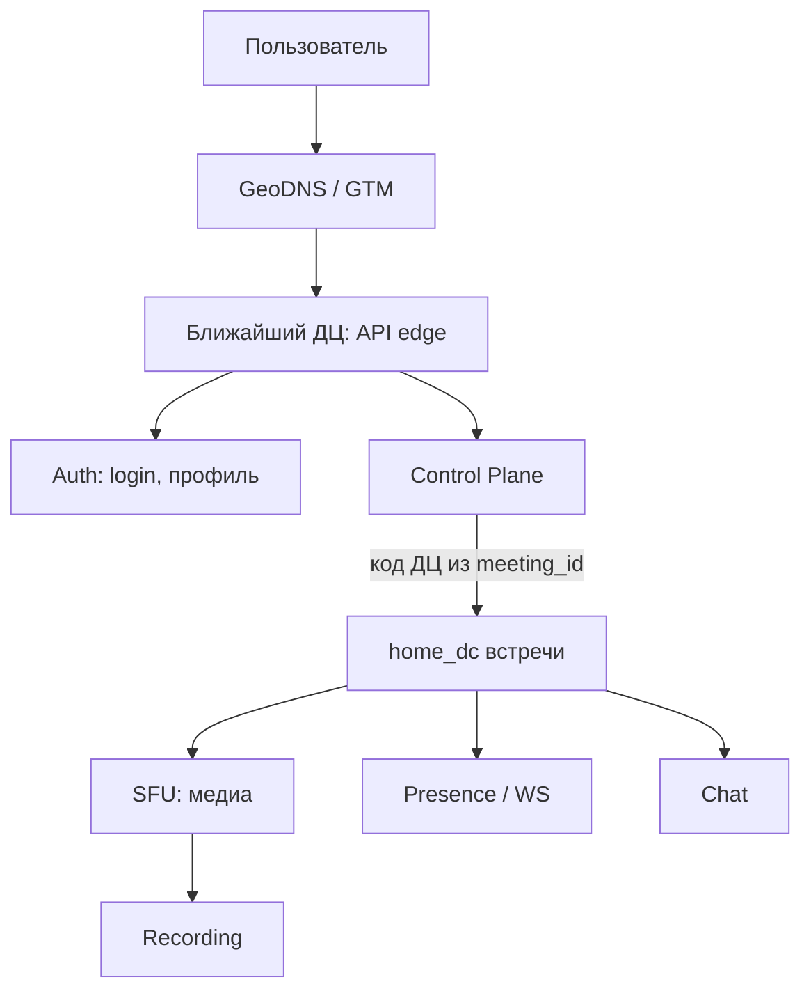
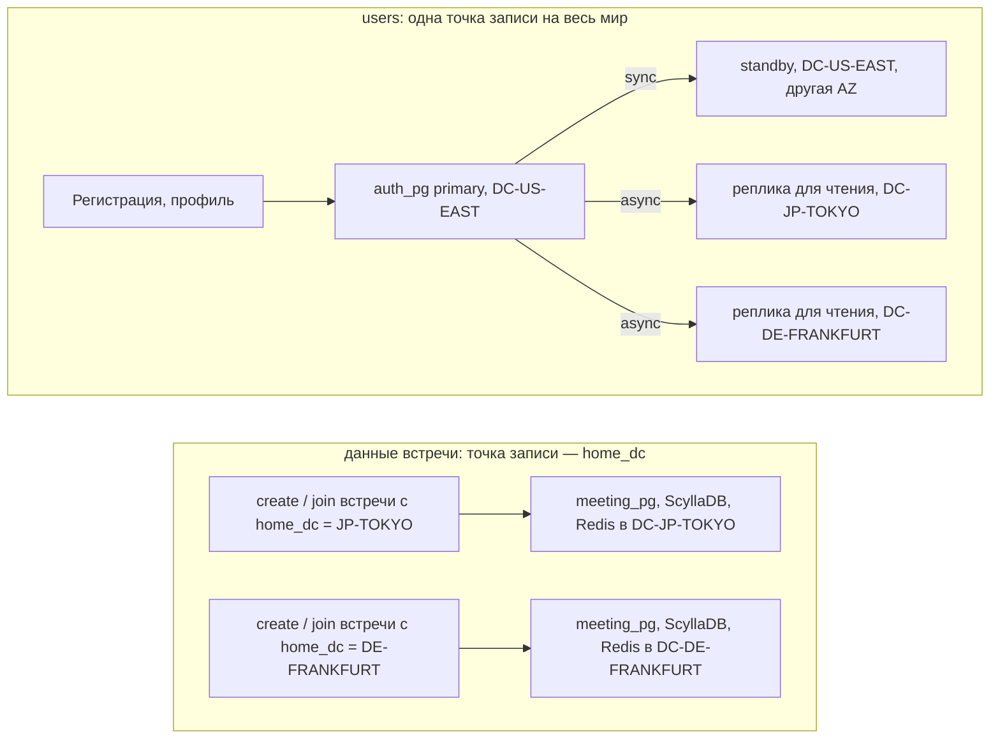
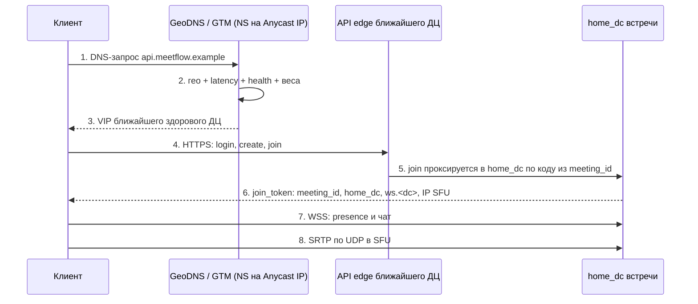
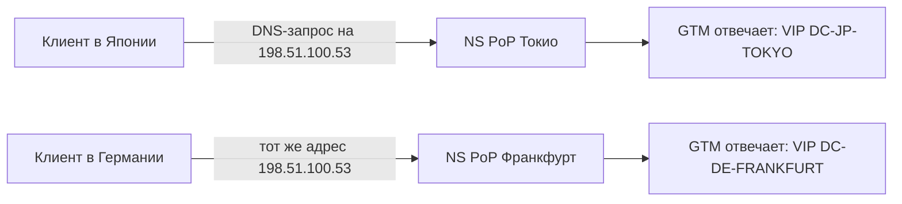
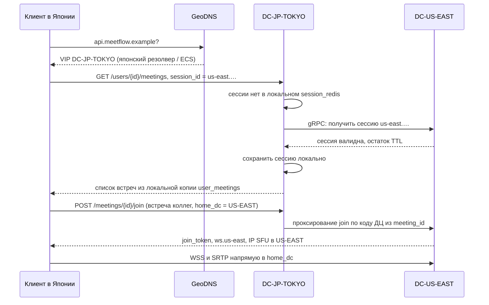
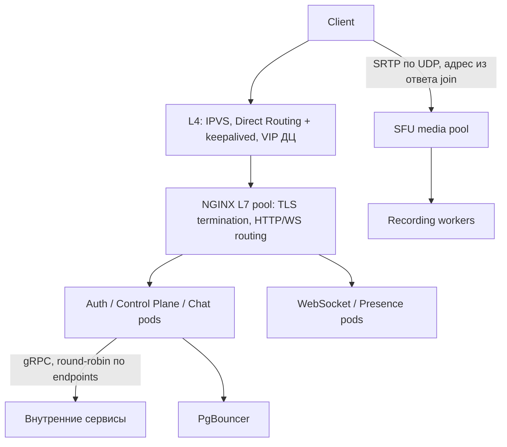
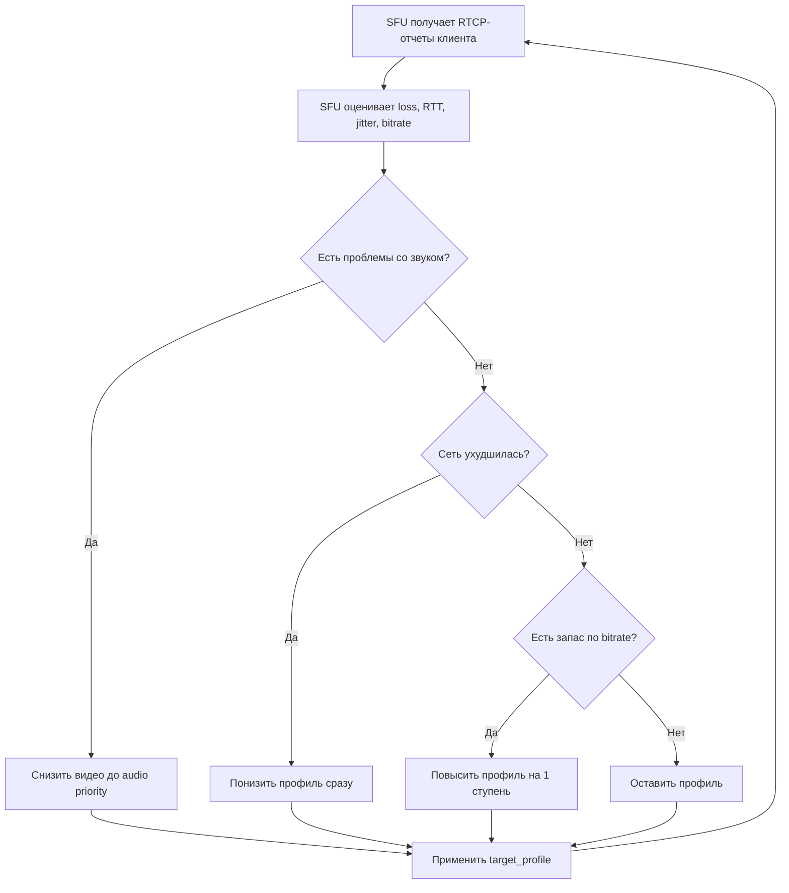
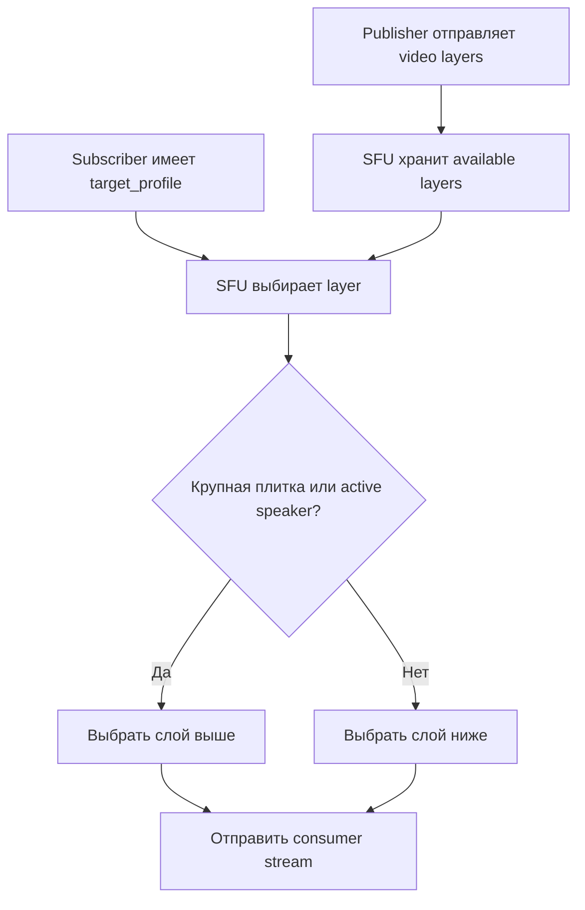

# Проектирование высоконагруженного Zoom-подобного сервиса видеовстреч

## Содержание

- [1. Тема и целевая аудитория](#1-тема-и-целевая-аудитория)
- [2. Расчет нагрузки](#2-расчет-нагрузки)
- [3. Глобальная балансировка нагрузки](#3-глобальная-балансировка-нагрузки)
- [4. Локальная балансировка нагрузки](#4-локальная-балансировка-нагрузки)
- [5. Логическая схема БД](#5-логическая-схема-бд)
- [6. Физическая схема БД](#6-физическая-схема-бд)
- [7. Алгоритмы](#7-алгоритмы)
- [8. Технологии](#8-технологии)
- [9. Обеспечение надежности](#9-обеспечение-надежности)
- [10. Схема проекта](#10-схема-проекта)
- [11. Список серверов](#11-список-серверов)
- [Список источников](#список-источников)

## 1. Тема и целевая аудитория

### 1.1. Тип сервиса

| Параметр | Значение |
| -------- | -------- |
| Учебное название | **MeetFlow** |
| Тип сервиса | Zoom-подобный сервис видеовстреч |
| Основной сценарий | Групповая онлайн-встреча: аудио, видео, демонстрация экрана, чат и запись |
| Реальные аналоги | Zoom, Microsoft Teams, Google Meet |

### 1.2. Рыночная ниша и реальные аналоги

| Аналог | Метрика | Что подтверждает |
| ------ | ------- | ---------------- |
| Microsoft Teams | 320 млн monthly active users, FY24 Q1 (октябрь 2023) [^1] | Масштаб аудитории коммуникационного сервиса |
| Microsoft Teams | 115 млн daily active users, октябрь 2020 [^2] | Дневную аудиторию для расчета |
| Zoom | Более 300 млн участий во встречах в день, апрель 2020 — проспект Zoom в SEC; это участия, а не уникальные пользователи [^3] | Ежедневную нагрузку именно на видеовстречи |
| Zoom | Средняя встреча — 54 минуты и 10 участников, данные за 15.11.2020–15.11.2021 [^4] | Базу продуктовой оценки |
| Zoom | $4.8688 млрд выручки за FY2026 и 4 468 клиентов с TTM-выручкой больше $100 000 [^10] | Актуальность ниши в 2026 году |

### 1.3. Функционал MVP

| № | Функция MVP | Кратко | Метрика для расчета |
| -: | ----------- | ------ | ------------------- |
| 1 | Создание встречи | Мгновенная или запланированная встреча | `MF_MEETINGS_DAY`, `POST /meetings` |
| 2 | Подключение к встрече | Вход по ссылке или приглашению | `MF_DMP`, `POST /meetings/{id}/join` |
| 3 | Групповая аудио- и видеосвязь | 720p group video | `MF_VIDEO_UP_MBPS`, `MF_VIDEO_DOWN_MBPS`, `MF_AUDIO_MBPS` |
| 4 | Демонстрация экрана | Участник показывает экран | `MF_SCREEN_MBPS_MAX` |
| 5 | Чат во время встречи | Текстовые сообщения участников | `MF_CHAT_MSG_LIMIT`, `MF_CHAT_PER_JOIN` |
| 6 | Облачная запись | Организатор включает запись встречи | `MF_RECORD_QUOTA_GB`, `MF_RECORDING_SIZE_GB` |

### 1.4. Ключевые продуктовые решения

| Решение | Значение для MVP | Что считается дальше |
| ------- | ---------------- | -------------------- |
| Расчет от групповой встречи | В средней встрече `MF_MEET_SIZE = 10` участников | Число встреч в сутки |
| Базовое качество — 720p group video | Требования Zoom к сети [^5] | Видеотрафик |
| Облачная запись | Сохраняет видео, аудио и текст чата [^7] | Хранилище записей |
| Квота на записи | У Zoom Pro/Business — 10 GB на пользователя [^8] | Верхняя граница хранилища |
| Частота чата — допущение | Есть лимит длины сообщения, но нет публичной частоты [^6]: берем 5 сообщений на участие | Нагрузка и хранилище чата |
| Данные встреч хранятся 30 дней | Метаданные, участники, чат и записи старше 30 дней удаляются | Объем хранения (2.3) |
| Худший случай для записей | Записывается каждая встреча: реальная доля публично неизвестна | Хранилище и его стоимость (2.3, 11.4) |
| Материковый Китай не обслуживаем | Нужен отдельный локальный контур: локализация данных и блокировки трафика | Доли ДЦ (3.2) |

### 1.5. Целевая аудитория

| Параметр | Значение |
| -------- | -------- |
| География | Весь мир, кроме материкового Китая. Zoom используют почти в 200 странах и территориях [^4]; крупнейшие экономики среди обслуживаемых стран — США, Германия, Япония, Великобритания, Индия [^11]. Обслуживаем из 8 ДЦ (п. 3.2) |
| Месячная аудитория | `MF_MAU = 320 000 000` |
| Дневная аудитория | `MF_DAU = 115 000 000` |
| Участий во встречах в день | `MF_DMP = 300 000 000` |
| Средняя встреча | `MF_MEET_SIZE = 10` участников, `MF_MEET_LEN_MIN = 54` минуты |

## 2. Расчет нагрузки

### 2.1. Исходные метрики и методика расчета

| Константа | Значение | Источник / основание |
| --------- | -------- | -------------------- |
| `MF_MAU` | 320 000 000 пользователей в месяц | Microsoft Teams, FY24 Q1 (2023); более новой публичной MAU-метрики нет [^1] |
| `MF_DAU` | 115 000 000 пользователей в день | Microsoft Teams, октябрь 2020; консервативная оценка дневной аудитории [^2] |
| `MF_DMP` | 300 000 000 участий во встречах в день | Zoom, апрель 2020; один пользователь может войти в несколько встреч [^3] |
| `MF_MEET_SIZE` | 10 участников | Средняя встреча Zoom, 15.11.2020–15.11.2021 [^4] |
| `MF_MEET_LEN_MIN` | 54 минуты | Там же [^4] |
| `MF_VIDEO_UP_MBPS` / `MF_VIDEO_DOWN_MBPS` | 2.6 / 1.8 Мбит/с на участника | 720p group video, требования Zoom [^5] |
| `MF_VIDEO_HQ_MBPS` | 1.0 / 0.6 Мбит/с | Group «high-quality video» ниже 720p [^5]; профиль при отказе ДЦ (п. 9.2) |
| `MF_AUDIO_MBPS` | 0.08 Мбит/с | Верхняя граница 60–80 kbps для VoIP [^5] |
| `MF_SCREEN_MBPS_MAX` | 0.15 Мбит/с | Верхняя граница 50–150 kbps для демонстрации экрана [^5] |
| `MF_CHAT_MSG_LIMIT` | 4 000 символов | Лимит сообщения Zoom Team Chat [^6] |
| `MF_CHAT_PER_JOIN` | 5 сообщений на участие | **Допущение**: публичной частоты нет [^6] |
| `MF_CHAT_MSG_SIZE` | 1 KB в среднем, до ≈ 10 KB | Допущение |
| `MF_LIST_PER_DAU` | 3 открытия списка встреч в сутки | Допущение |
| `MF_LOGIN_PER_DAU` | 1 логин в сутки | Допущение |
| `MF_CHAT_HISTORY_PER_JOIN` | 1 загрузка истории чата на участие | Допущение: при входе и после переподключения |
| `MF_REC_VIEWS_PER_REC` | не больше 1 открытия на запись | Допущение, верхняя оценка |
| `MF_REC_PART_MB` | 8 MB | Часть multipart upload: запись 0.761 GB — это ≈ 95 частей, S3 допускает до 10 000 [^46] |
| `MF_RECORD_QUOTA_GB` | 10 GB на пользователя | Квота Zoom Pro/Business [^8] |
| `MF_HEARTBEAT_SEC` | 25 секунд | `pingInterval` в Socket.IO по умолчанию [^9] |
| `MF_K_PEAK` | **1.5** | Пиковый час / среднее за сутки; одинаково для RPS, полосы и соединений. Сервис глобальный: часовые пояса сглаживают суточную кривую |

Все числа разделов 2–6, 9 и 11 считает скрипт [`resource/calc/meetflow_calc.py`](resource/calc/meetflow_calc.py): чтобы поменять допущение, достаточно изменить константу и перезапустить. ВВП для долей ДЦ (п. 3.2) — в [`imf_weo_2026apr_gdp_2025.json`](resource/calc/imf_weo_2026apr_gdp_2025.json).

### 2.2. Продуктовая оценка видеовстреч

| Название | Расчет | Значение |
| -------- | ------ | -------: |
| `MF_MEETINGS_DAY` | `MF_DMP / MF_MEET_SIZE` = `300 000 000 / 10` | **30 000 000 встреч/сутки** |
| `MF_JOINS_PER_DAU_DAY` | `MF_DMP / MF_DAU` = `300 000 000 / 115 000 000` | **2.61 подключения/DAU/день** |
| `MF_CREATED_MEETINGS_PER_DAU_DAY` | `MF_MEETINGS_DAY / MF_DAU` = `30 000 000 / 115 000 000` | **0.26 созданных встреч/DAU/день** |
| `MF_PARTICIPANT_MIN_DAY` | `MF_DMP * MF_MEET_LEN_MIN` = `300 000 000 * 54` | **16 200 000 000 participant-minutes/сутки** |
| `MF_AVG_ONLINE_PARTICIPANTS` | `MF_PARTICIPANT_MIN_DAY / 1440` | **11 250 000 участников online в среднем** |
| `MF_PEAK_ONLINE_PARTICIPANTS` | `MF_AVG_ONLINE_PARTICIPANTS * MF_K_PEAK` = `11 250 000 * 1.5` | **16 875 000 участников online в пик** |
| `MF_PEAK_WSS_CONNECTIONS` | `= MF_PEAK_ONLINE_PARTICIPANTS`, одно WSS-соединение на участника | **16 875 000 одновременных соединений** |
| `MF_PEAK_ACTIVE_MEETINGS` | `MF_PEAK_ONLINE_PARTICIPANTS / MF_MEET_SIZE` | **1 687 500 встреч одновременно** |
| `MF_HEARTBEAT_EVENTS_DAY` | `MF_PARTICIPANT_MIN_DAY * 60 / MF_HEARTBEAT_SEC` | **38 880 000 000 heartbeat-событий/сутки** |
| `MF_CHAT_MESSAGES_DAY` | `MF_DMP * MF_CHAT_PER_JOIN` = `300 000 000 * 5` | **1 500 000 000 сообщений/сутки** |
| `MF_MEETING_LIST_VIEWS_DAY` | `MF_DAU * MF_LIST_PER_DAU` = `115 000 000 * 3` | **345 000 000 открытий списка/сутки** |
| `MF_LOGINS_DAY` | `MF_DAU * MF_LOGIN_PER_DAU` | **115 000 000 логинов/сутки** |

Проверка по аналогу: на 31.10.2020 Zoom раскрывал годовой run rate более 3.5 трлн минут встреч [^3] — это ≈ 9.6 млрд минут в сутки. У нас 16.2 млрд, потому что каждый участник сидит во встрече все 54 минуты. Ошибка в безопасную сторону: онлайн, трафик и число SFU завышены, а не занижены.

#### Сводная таблица продуктовых метрик

| Метрика | Значение |
| ------- | -------: |
| Месячная аудитория (MAU) | **320 млн** [^1] |
| Дневная аудитория (DAU) | **115 млн** [^2] |

Средний размер хранилища пользователя — на одного MAU, данные за 30 дней:

| Тип данных | Штук на пользователя | Объем на пользователя | Расчет |
| ---------- | -------------------: | --------------------: | ------ |
| Профиль | 1 | 256 B | — |
| Созданные встречи (метаданные) | 2.81 | 720 B | 900 млн встреч за 30 дней / 320 млн MAU |
| Ссылки-приглашения | 2.81 | 360 B | одна ссылка на встречу, 128 B |
| Участия во встречах | 28.1 | 3.6 KB | 9 млрд участий за 30 дней / 320 млн MAU, 128 B |
| Строки списка встреч | 28.1 | 3.6 KB | одна строка на участие, 128 B |
| Сообщения чата | 140.6 | 140.6 KB | 45 млрд сообщений / 320 млн MAU, 1 KB |
| **Итого без записей** | — | **≈ 149 KB** | |
| Записи встреч, worst-case | 2.81 | **2.14 GB** | 2.81 записи × 0.761 GB; у аналога квота — 10 GB [^8] |

Среднее количество действий пользователя в сутки — на одного DAU:

| Действие | На DAU в сутки | Расчет |
| -------- | -------------: | ------ |
| Логин | 1.00 | `MF_LOGIN_PER_DAU` |
| Создание встречи | 0.26 | 30 млн / 115 млн |
| Вход во встречу (`join`) | 2.61 | 300 млн / 115 млн |
| Выход из встречи (`leave`) | 2.61 | одно на каждый вход |
| Сообщение в чат встречи | 13.04 | 1.5 млрд / 115 млн |
| Загрузка истории чата | 2.61 | одна на каждый вход |
| Открытие списка встреч | 3.00 | `MF_LIST_PER_DAU` |
| Метаданные записи | ≤ 0.26 | не больше одной записи на встречу |
| Открытие записи | ≤ 0.26 | `MF_REC_VIEWS_PER_REC` |
| Heartbeat, автоматически | 338.09 | 38.88 млрд / 115 млн |

### 2.3. Хранилище пользователя и техническое хранение

| Блок данных | Расчет | Штук | Общий объем |
| ----------- | ------ | ---: | ----------: |
| Профили пользователей | `MF_MAU * 256 B` | 320 млн | **81.92 GB** |
| Метаданные встреч, 30 дней | `MF_MEETINGS_DAY * 30 * 256 B` | 900 млн | **230.4 GB** |
| Ссылки-приглашения, 30 дней | `MF_MEETINGS_DAY * 30 * 128 B` | 900 млн | **115.2 GB** |
| Участники встреч, 30 дней | `MF_DMP * 30 * 128 B` | 9 млрд | **1.152 TB** |
| Списки встреч пользователей, 30 дней | `MF_DMP * 30 * 128 B` | 9 млрд | **1.152 TB** |
| Активные сессии | `MF_DAU * 128 B` | 115 млн | **14.72 GB** |
| Чат встречи, 30 дней | `MF_CHAT_MESSAGES_DAY * 30 * MF_CHAT_MSG_SIZE` | 45 млрд | **45 TB** |
| **Техническое хранение без записей** | сумма строк выше, без репликации | — | **47.75 TB** |
| Размер одной записи | `MF_RECORDING_SIZE_GB = (MF_VIDEO_DOWN_MBPS + MF_AUDIO_MBPS) * MF_MEET_LEN_MIN * 60 / 8 / 1000` | — | **0.761 GB** |
| Записи в сутки, worst-case | `MF_MEETINGS_DAY * MF_RECORDING_SIZE_GB` | 30 млн | **22.842 PB/сутки** |
| Записи за 30 дней, worst-case | `22.842 PB * 30` | 900 млн | **685.26 PB** |
| **Суммарное хранение, 30 дней** | записи + техническое хранение | — | **≈ 685.31 PB** |

Квота аналога (10 GB на пользователя, 3.2 EB на всех) — это лимит, а не занятое место. Object storage считаем по worst-case: каждая встреча записывается и хранится 30 дней.

### 2.4. Сетевой трафик и RPS

#### Сетевой трафик

| Тип трафика | Битрейт на участника | Суточный объем | Средний bandwidth | Пиковый bandwidth |
| ----------- | -------------------: | -------------: | ----------------: | ----------------: |
| Video upload | 2.6 Мбит/с | **315 900 000 GB** | **29 250 Gbps** | **43 875 Gbps** |
| Video download | 1.8 Мбит/с | **218 700 000 GB** | **20 250 Gbps** | **30 375 Gbps** |
| Audio VoIP | 0.08 Мбит/с | **9 720 000 GB** | **900 Gbps** | **1 350 Gbps** |
| Screen sharing, верхняя граница | 0.15 Мбит/с | **18 225 000 GB** | **1 687.5 Gbps** | **2 531.25 Gbps** |
| **Медиа клиент ↔ SFU, итого** | 4.63 Мбит/с | **562 545 000 GB** | **52 087.5 Gbps** | **78 131.25 Gbps** |
| Поток в запись SFU → recording workers, worst-case | 1.88 Мбит/с на встречу | **22 842 000 GB** (= объем записей) | **2 115 Gbps** | **3 172.5 Gbps** |

```text
суточный объем, GB  = MF_PARTICIPANT_MIN_DAY * 60 * битрейт_Мбит/с / 8 / 1000
avg_bandwidth_Gbps  = MF_AVG_ONLINE_PARTICIPANTS * битрейт_Мбит/с / 1000
peak_bandwidth_Gbps = avg_bandwidth_Gbps * MF_K_PEAK
rec_stream_Gbps     = (MF_AVG_ONLINE_PARTICIPANTS / MF_MEET_SIZE) * (1.8 + 0.08) / 1000 * K
запись, GB/сутки    = MF_PARTICIPANT_MIN_DAY / MF_MEET_SIZE * 60 * 1.88 / 8 / 1000   # битрейт на встречу
```

Поток в запись не уходит в интернет: SFU отправляет его recording workers внутри ДЦ как еще одному подписчику встречи. Он нагружает SFU и воркеры, поэтому учтен в разделе 11.

#### RPS по основным методам

| Метод / событие | Событий в сутки | Средний RPS | Пиковый RPS |
| --------------- | --------------: | ----------: | ----------: |
| `POST /auth/login` | `MF_LOGINS_DAY` = 115 000 000 | **1 331** | **1 997** |
| `POST /meetings` | `MF_MEETINGS_DAY` = 30 000 000 | **347** | **521** |
| `POST /meetings/{id}/join` | `MF_DMP` = 300 000 000 | **3 472** | **5 208** |
| `POST /meetings/{id}/leave` | `MF_DMP` = 300 000 000 | **3 472** | **5 208** |
| `WS /presence/heartbeat` | `MF_HEARTBEAT_EVENTS_DAY` = 38 880 000 000 | **450 000** | **675 000** |
| `POST /meeting-chat/messages` | `MF_CHAT_MESSAGES_DAY` = 1 500 000 000 | **17 361** | **26 042** |
| `GET /meeting-chat/messages?after_seq=N` | `MF_DMP * MF_CHAT_HISTORY_PER_JOIN` = 300 000 000 | **3 472** | **5 208** |
| `GET /users/{id}/meetings?limit=100` | `MF_MEETING_LIST_VIEWS_DAY` = 345 000 000 | **3 993** | **5 990** |
| `POST /recordings/metadata` | до `MF_MEETINGS_DAY` = 30 000 000 | **до 347** | **до 521** |
| `GET /recordings/{id}` — ссылка на скачивание | до `MF_MEETINGS_DAY * MF_REC_VIEWS_PER_REC` = 30 000 000 | **до 347** | **до 521** |
| WS push: чат и события join/leave остальным участникам | `(chat + join + leave) * (MF_MEET_SIZE − 1)` | **218 750** | **328 125** |

```text
avg_RPS  = events_per_day / 86400
peak_RPS = avg_RPS * MF_K_PEAK
```

Пики считаются от неокругленных значений, поэтому суммы округленных чисел в таблицах могут расходиться с итогом на единицу.

`GET /recordings/{id}` отдает только presigned URL: файл клиент скачивает напрямую из object storage `home_dc` (`rec.<dc>`, п. 3.5), мимо L7 и SFU. Частота просмотров неизвестна, поэтому трафик скачивания в таблицу не входит; его тариф — в п. 11.4.

## 3. Глобальная балансировка нагрузки

Глобальная балансировка отвечает на четыре вопроса. Короткие ответы:

| Вопрос | Решение в MeetFlow | Где подробно |
| ------ | ------------------ | ------------ |
| Где стоят дата-центры | 8 ДЦ: `DC-US-EAST`, `DC-US-WEST`, `DC-BR-SAOPAULO`, `DC-UK-LONDON`, `DC-DE-FRANKFURT`, `DC-IN-MUMBAI`, `DC-SG-SINGAPORE`, `DC-JP-TOKYO`. Абстрактного пула `OTHER` нет: каждая группа стран привязана к конкретному ДЦ | 3.2 |
| Как пользователь попадает в ДЦ и как ДЦ переключаются | **DNS**: GeoDNS/GTM выбирает ДЦ по гео, latency, health и весам. **Anycast** — только для доставки DNS-запросов к авторитетным NS-серверам. Медиа переключается на уровне приложения: control plane выдает новый SFU | 3.5–3.7 |
| Где точка записи | `users` — один primary в `DC-US-EAST`; все, что относится к встрече, — в `home_dc` встречи; список встреч пользователя — локально, с асинхронной репликацией во все ДЦ | 3.4 |
| Что при отказе ДЦ или переезде пользователя | ДЦ убирается из DNS, новые встречи уходят в резервные ДЦ. Переезд не требует ни миграции данных, ни повторного логина | 3.7, 3.8, 9.2 |

«ДЦ» в работе — регион провайдера из 3 зон доступности (AZ). Отказ одной AZ закрывается резервированием внутри ДЦ (разделы 4 и 9), отказ всего ДЦ — глобальной балансировкой.

### 3.1. Функциональное разбиение по доменам

| Домен | Основная нагрузка | Куда направляется запрос | Точка записи |
| ----- | ----------------- | ------------------------ | ------------ |
| `Auth / Users` | логин, профиль | ближайший ДЦ по GeoDNS | `users` — primary `auth_pg` в `DC-US-EAST`; `user_sessions` — ДЦ, где выполнен логин |
| `Meeting Control Plane` | `POST /meetings`, `join`, `leave`, список встреч | ближайший ДЦ; `join` и `leave` проксируются в `home_dc` встречи | `meetings`, `meeting_invite_links` — `home_dc` |
| `Media Plane / SFU` | видео, аудио, screen sharing | только SFU в `home_dc` встречи, адрес приходит в ответе `join` | не хранится, это поток |
| `Presence / Heartbeat` | `WS /presence/heartbeat` | WS-endpoint `home_dc` встречи | `meetings_runtime` — Redis `home_dc` |
| `Meeting Chat` | сообщения внутри встречи | `home_dc` встречи | `chat_messages` — ScyllaDB `home_dc` |
| `Recording` | запись встречи | SFU → recording workers в `home_dc` | файлы — S3 `home_dc`, метаданные — `recording_pg` `home_dc` |
| `User meetings list` | top-100 встреч пользователя | ближайший ДЦ, чтение локальной копии | `user_meetings` пишется в `home_dc` встречи, ScyllaDB реплицирует его во все ДЦ |

`home_dc` — ДЦ, за которым закреплена встреча: control plane выбирает его при `POST /meetings`, это ДЦ, принявший запрос, то есть ближайший к организатору. Код `home_dc` записан в `meeting_id` (UUIDv8, первый байт — код ДЦ [^85]) и в invite-токен, поэтому любой ДЦ знает, куда направить `join`, без глобального справочника встреч.



### 3.2. Выбор и расположение дата-центров

Сколько пользователей видеосвязи в каждой стране, первоисточники не публикуют, а SimilarWeb методичка запрещает как первоисточник. Поэтому нагрузку распределяем по официальной статистике:

1. **Доля страны = ее доля в ВВП** — IMF World Economic Outlook (апрель 2026), ВВП 2025 года [^11]. Видеовстречи — рабочий инструмент (10 участников на 54 минуты [^4]), поэтому их объем следует за экономикой, а не за населением. Без материкового Китая остается 194 экономики на 98 537.9 млрд $.
2. **Каждая страна — в ближайший по задержке ДЦ.** Полный список стран — в [`meetflow_calc.py`](resource/calc/meetflow_calc.py), ВВП — в [`imf_weo_2026apr_gdp_2025.json`](resource/calc/imf_weo_2026apr_gdp_2025.json).
3. **США делим на восток и запад по населению**: на регион West по переписи 2020 приходится 23.7% населения [^73]. Внутри одной страны деловая активность на человека примерно одинакова, поэтому здесь население, а не ВВП. Западу нужен свой ДЦ: путь до Вирджинии пересекает весь континент.

| ДЦ | Город | Какие страны обслуживает | ВВП 2025, млрд $ | Доля нагрузки |
| -- | ----- | ------------------------ | ---------------: | ------------: |
| `DC-US-EAST` | Ашберн, Вирджиния | США: Northeast, Midwest, South (76.3% населения); Канада; Мексика, Центральная Америка, Карибы | 23 475.3 + 2 319.9 + 2 622.8 = **28 418.0** | **28.84%** |
| `DC-US-WEST` | Сан-Хосе, Калифорния | США: West (23.7% населения) | **7 291.8** | **7.40%** |
| `DC-BR-SAOPAULO` | Сан-Паулу | Южная Америка | **4 576.1** | **4.65%** |
| `DC-UK-LONDON` | Лондон | Великобритания | **4 003.0** | **4.06%** |
| `DC-DE-FRANKFURT` | Франкфурт | Европа без Великобритании, СНГ, Ближний Восток, Африка | **35 168.5** | **35.69%** |
| `DC-IN-MUMBAI` | Мумбаи | Индия, Пакистан, Бангладеш, Шри-Ланка, Непал, Бутан, Мальдивы, Афганистан | **4 956.6** | **5.03%** |
| `DC-SG-SINGAPORE` | Сингапур | Юго-Восточная Азия, Австралия, Новая Зеландия, Океания, Гонконг, Макао | **6 870.9** | **6.97%** |
| `DC-JP-TOKYO` | Токио | Япония, Республика Корея, Тайвань, Монголия | **7 253.0** | **7.36%** |
| **Итого** | | 194 экономики без материкового Китая | **98 537.9** | **100%** |

Доля = ВВП группы / 98 537.9, округлена до 0.01 п. п. так, чтобы сумма была ровно 100%: у Южной Америки 4.644% → 4.65%.

#### Проверка долей и влияние на продуктовые метрики

**Проверка по аналогу.** По макрорегионам: Америка — 40.89%, EMEA — 39.75%, APAC — 19.36%. У Zoom доля Америки в выручке выше — 72.1% (EMEA — 15.8%, APAC — 12.1%) [^72]: Zoom исторически сильнее в США. Наш масштаб — масштаб лидера рынка (320 млн MAU у Teams [^1]), поэтому берем нейтральную оценку по экономике. Если доля Америки окажется выше, изменятся размеры пулов, а не архитектура: GTM перераспределит подключения весами (п. 3.7), запас дает резерв из п. 9.2.

Границы групп условные: GeoDNS выбирает ДЦ по фактической задержке, и, например, западная Канада может уйти в `DC-US-WEST`. Точные доли уточняются по GeoIP-аналитике после запуска.

| ДЦ | Парный ДЦ | На какие продуктовые метрики влияет |
| -- | --------- | ----------------------------------- |
| `DC-US-EAST` | `DC-US-WEST` | join latency и RTT медиа для востока США, Канады, Мексики |
| `DC-US-WEST` | `DC-US-EAST` | RTT медиа для западного побережья США |
| `DC-BR-SAOPAULO` | `DC-US-EAST` | без своего ДЦ медиа Южной Америки шло бы через подводные кабели в США |
| `DC-UK-LONDON` | `DC-DE-FRANKFURT` | latency для UK, отдельная юрисдикция после Brexit |
| `DC-DE-FRANKFURT` | `DC-UK-LONDON` | latency для Европы, СНГ, Ближнего Востока и Африки; самый большой ДЦ, его отказ разобран в п. 9.2 |
| `DC-IN-MUMBAI` | `DC-SG-SINGAPORE` | latency для Индии и Южной Азии, стабильность screen sharing |
| `DC-SG-SINGAPORE` | `DC-JP-TOKYO` | latency для Юго-Восточной Азии и Океании |
| `DC-JP-TOKYO` | `DC-SG-SINGAPORE` | RTT медиа и packet loss для Японии, Кореи и Тайваня |

Парный ДЦ хранит асинхронную реплику метаданных и бэкапы (п. 3.4, 6.12) и первым принимает нагрузку при отказе (п. 3.7). Control plane и media plane разделены: API обслуживает ближайший ДЦ, а медиа всегда идет в `home_dc` встречи. Так же устроен аналог: Zoom позволяет платным аккаунтам выбирать ДЦ для real-time медиа [^13].

### 3.3. Распределение нагрузки по дата-центрам

Метрика ДЦ = глобальная метрика × доля ДЦ. Встречи распределены по `home_dc` так же, как пользователи по ДЦ: организатор и большинство участников обычно из одного региона.

| ДЦ | Доля | DAU | Онлайн в пик = WSS-соединений | Пиковый RPS через L7 | Медиа в пик | Поток в запись | Записи за 30 дней |
| -- | ---: | --: | ----------: | ----------: | ----------: | ----------: | ----------: |
| `DC-US-EAST` | 28.84% | 33 166 000 | 4 866 750 | 304 072 | 22 533.1 Gbps | 914.9 Gbps | 197.63 PB |
| `DC-US-WEST` | 7.40% | 8 510 000 | 1 248 750 | 78 021 | 5 781.7 Gbps | 234.8 Gbps | 50.71 PB |
| `DC-BR-SAOPAULO` | 4.65% | 5 347 500 | 784 688 | 49 027 | 3 633.1 Gbps | 147.5 Gbps | 31.86 PB |
| `DC-UK-LONDON` | 4.06% | 4 669 000 | 685 125 | 42 806 | 3 172.1 Gbps | 128.8 Gbps | 27.82 PB |
| `DC-DE-FRANKFURT` | 35.69% | 41 043 500 | 6 022 688 | 376 294 | 27 885.0 Gbps | 1 132.3 Gbps | 244.57 PB |
| `DC-IN-MUMBAI` | 5.03% | 5 784 500 | 848 813 | 53 033 | 3 930.0 Gbps | 159.6 Gbps | 34.47 PB |
| `DC-SG-SINGAPORE` | 6.97% | 8 015 500 | 1 176 188 | 73 488 | 5 445.7 Gbps | 221.1 Gbps | 47.76 PB |
| `DC-JP-TOKYO` | 7.36% | 8 464 000 | 1 242 000 | 77 599 | 5 750.5 Gbps | 233.5 Gbps | 50.44 PB |
| **Итого** | **100%** | **115 000 000** | **16 875 000** | **1 054 340** | **78 131.25 Gbps** | **3 172.5 Gbps** | **685.26 PB** |

Пиковый RPS через L7 — REST API, heartbeat и WS push вместе (п. 4.5). Пик каждого метода в ДЦ = глобальный пик из п. 2.4 × доля ДЦ: например, heartbeat в `DC-DE-FRANKFURT` — 675 000 × 35.69% = 240 908 в секунду. В строке «Итого» — глобальное значение; сумма округленных ячеек может отличаться на единицу последнего знака.

### 3.4. Точки записи данных

Правило: **у каждого объекта одна точка записи** (primary), а чтение по возможности идет из локальной копии в ближайшем ДЦ. Тогда два ДЦ никогда не пишут один объект одновременно, и не нужен multi-master с разрешением конфликтов.

| Данные | Точка записи | Где читаются | Репликация между ДЦ | Почему так |
| ------ | ------------ | ------------ | ------------------- | ---------- |
| `users` (`auth_pg`) | **один primary на весь мир — `DC-US-EAST`**, синхронная standby в другой AZ | локальная асинхронная реплика в каждом ДЦ | streaming replication: primary → 7 реплик [^27][^89] | Глобальная уникальность `email`. Записей в пик ≤ 1 997/с (верхняя оценка: каждый DAU раз в сутки меняет профиль) — одного primary хватает |
| `user_sessions` (`session_redis`) | ДЦ логина; код ДЦ — префикс `session_id` (`us-east.<128 бит>`) | там же; другой ДЦ один раз забирает сессию по префиксу (п. 3.8) | нет, перенос по запросу | Сессия нужна там, где пользователь сейчас |
| `meetings`, `meeting_invite_links` (`meeting_pg`) | `home_dc` встречи | `home_dc` | асинхронная реплика в парный ДЦ | `join` должен видеть актуальный статус (п. 5.3) |
| `meeting_participants` (`meeting_scylla`) | `home_dc` | `home_dc` | нет: keyspace ДЦ с RF=3 по 3 AZ; снапшоты — в S3 парного ДЦ | Нужны во время встречи и для истории |
| `meetings_runtime` (`runtime_redis`) | `home_dc` | `home_dc` | нет | Эфемерное состояние, клиенты восстанавливают его при переподключении |
| `chat_messages` (`chat_scylla`) | `home_dc` | `home_dc` | нет; снапшоты — в S3 парного ДЦ | Порядок задает `chat_seq` в одном Redis `home_dc` |
| `recordings` и файлы (`recording_pg`, S3) | `home_dc` | `home_dc`, по presigned URL | метаданные — реплика в парный ДЦ; файлы — ≥ 3 копии в 3 AZ `home_dc` | Копия 685 PB в другом регионе удвоила бы самую дорогую статью расходов |
| `user_meetings` (`meeting_scylla`) | `home_dc` встречи, запись с `LOCAL_QUORUM` | ближайший ДЦ, локально | RF=3 **в каждом** ДЦ (NetworkTopologyStrategy) [^80][^81] | Read model с eventual consistency (п. 5.3): список встреч доступен в любой стране |

#### Как запись попадает в точку записи



1. Запрос приходит в ближайший ДЦ (GeoDNS, п. 3.5).
2. Сервис определяет точку записи: для `users` это всегда `DC-US-EAST`, для данных встречи — код ДЦ из `meeting_id`.
3. Если точка записи в другом ДЦ, запрос проксируется по gRPC с mTLS [^52]. Это добавляет RTT между ДЦ — например, ≈ 153 мс Токио ↔ восточное побережье США [^87], но только для редких записей.
4. После своей записи пользователь несколько секунд читает из primary (read-your-writes), пока реплика не догонит.

**Отказ точки записи.** Внутри `DC-US-EAST` Patroni автоматически переключает primary `auth_pg` на синхронную standby в соседней AZ без потери данных [^86]. При отказе всего `DC-US-EAST` primary становится реплика в `DC-US-WEST`, но по команде дежурного (runbook): в схеме с двумя площадками второй ДЦ не может сам отличить отказ первого от обрыва связи [^97]. RPO — секунды лага репликации. Логин продолжает работать на локальных репликах; на время переключения недоступны только регистрация и изменение профиля.

### 3.5. Схема DNS-балансировки — основной механизм переключения

**Ответ на вопрос «Anycast или DNS?»: ДЦ выбирается и переключается через DNS.** Используется GeoDNS/GTM — managed-сервис с геолокацией, latency-based routing, health checks и весами пулов [^15][^16][^17]. Anycast стоит только «под» DNS: авторитетные NS-серверы GTM доступны по Anycast IP (п. 3.6).

| DNS-имя | Что выбирает | Политика | TTL |
| ------- | ------------ | -------- | --: |
| `api.meetflow.example` | VIP API edge ближайшего здорового ДЦ | geo + latency + health + веса | 30 с |
| `ws.<dc>.meetflow.example` | WebSocket edge конкретного `home_dc` | фиксированное региональное имя, приходит в ответе `join` | 30 с |
| SFU, IP:port | конкретный SFU в `home_dc` | не DNS: адрес и ICE-кандидаты приходят в ответе `join` | — |
| `rec.<dc>.meetflow.example` | скачивание записей из object storage `home_dc` | региональное имя, presigned URL | 300 с |
| `static.meetflow.example` | веб-клиент и статика | CDN провайдера | по CDN |

GeoDNS определяет местоположение по IP рекурсивного резолвера или по подсети клиента из EDNS Client Subnet [^82]. Поэтому ДЦ выбирается по тому, где пользователь сейчас, а не где он регистрировался.



**Время переключения.** Monitor GTM опрашивает health-endpoint каждого ДЦ; минимальный интервал у Cloudflare — 60 с на Pro, 15 с на Business, 10 с на Enterprise [^17]. Берем Enterprise: интервал 10 с и 3 неудачи подряд — ДЦ выводится из ответов за ≈ 30 с, плюс TTL 30 с. Итого новые подключения уходят в здоровый ДЦ примерно за минуту. Если резолвер кеширует дольше TTL, срабатывает fallback клиента: при ошибке он заново резолвит имя, а затем идет на резервный региональный адрес из конфигурации приложения.

### 3.6. Схема Anycast-балансировки

Anycast — один IP-адрес, который анонсируется по BGP из многих точек; пакет приходит в ближайшую по маршрутизации точку [^83]. В MeetFlow Anycast используется **только для коротких запросов без состояния на сервере**:

| Трафик | Anycast | Почему |
| ------ | ------- | ------ |
| DNS-запросы к авторитетным NS-серверам GTM | **Да** | UDP «запрос — ответ» без сессии: ответ из ближайшего PoP, устойчивость к отказу точки и DDoS [^83] |
| Статика веб-клиента | Да, через CDN провайдера | короткие запросы, контент одинаковый во всех точках |
| API `api.meetflow.example` | Нет | BGP выбирает маршрут по AS-path, а не по задержке и загрузке ДЦ: нельзя задать веса и вывести ДЦ на обслуживание. Глобальный Anycast-балансировщик есть у крупных облаков [^18], но он привязывает к сети одного облака |
| WebSocket | Нет | долгое TCP-соединение: при перестроении BGP-маршрута пакеты уйдут в другой ДЦ, где нет состояния соединения [^83] |
| RTP/SRTP медиа | Нет | встреча живет на конкретном SFU в `home_dc`, смена маршрута рвет медиасессию |



Оба PoP анонсируют один и тот же адрес (в примере — документационный `198.51.100.53`). Итог: Anycast ускоряет и защищает **получение DNS-ответа**, а **в какой ДЦ идти, решает GTM** — это и есть механизм переключения.

### 3.7. Регулировка трафика и переключение между дата-центрами

Регулировка идет через веса пулов в GTM; monitors регулярно проверяют endpoints и выводят нездоровый пул из ротации [^16][^17].

```text
effective_weight = geo_match * health * capacity_weight * manual_weight
```

| Ситуация | Что делаем | Кого затрагивает |
| -------- | ---------- | ---------------- |
| Норма | Пользователь → ближайший здоровый ДЦ | — |
| ДЦ перегружен | Снижаем `capacity_weight`: новые пользователи и встречи уходят в резервные ДЦ | только новые |
| Плановые работы | `manual_weight = 0` (drain): новые встречи не создаются, текущие доживают | только новые |
| ДЦ недоступен | `health = 0`, ДЦ убирается из DNS-ответов | все, см. п. 9.2 |
| Деградация пула SFU | Control plane не назначает этот пул новым встречам. При отказе SFU клиент получает адрес нового SFU по WebSocket и заново устанавливает с ним медиасоединение: новое ICE-согласование и DTLS-рукопожатие [^84] | встречи на этом SFU |

| Основной ДЦ | Резерв 1 (парный ДЦ) | Резерв 2 | Почему |
| ----------- | -------------------- | -------- | ------ |
| `DC-US-EAST` | `DC-US-WEST` | `DC-UK-LONDON` | та же страна, затем ближайший ДЦ через Атлантику |
| `DC-US-WEST` | `DC-US-EAST` | `DC-JP-TOKYO` | та же страна, затем через Тихий океан |
| `DC-BR-SAOPAULO` | `DC-US-EAST` | `DC-DE-FRANKFURT` | прямые кабели в США и Европу |
| `DC-UK-LONDON` | `DC-DE-FRANKFURT` | `DC-US-EAST` | соседний европейский ДЦ |
| `DC-DE-FRANKFURT` | `DC-UK-LONDON` | `DC-US-EAST` | соседний европейский ДЦ, затем самый емкий ДЦ через Атлантику |
| `DC-IN-MUMBAI` | `DC-SG-SINGAPORE` | `DC-DE-FRANKFURT` | ближайший ДЦ в Азии |
| `DC-SG-SINGAPORE` | `DC-JP-TOKYO` | `DC-IN-MUMBAI` | ближайшие ДЦ в Азии |
| `DC-JP-TOKYO` | `DC-SG-SINGAPORE` | `DC-US-WEST` | ближайший ДЦ в Азии, затем через Тихий океан |

Резервный ДЦ может быть меньше основного: `DC-UK-LONDON` (4.06%) не вместит `DC-DE-FRANKFURT` (35.69%). Поэтому резервы задают **порядок предпочтения**: трафик отказавшего ДЦ GTM раздает по нескольким ДЦ пропорционально свободной емкости (`capacity_weight`). Что емкости хватит, показано в п. 9.2.

### 3.8. Сценарий: вход в США, затем поездка в Японию

Вопрос: пользователь залогинился в США, а потом улетел в Японию. Что происходит?



#### Шаги сценария

| Шаг | Что происходит | Почему так |
| --- | -------------- | ---------- |
| 1. Логин в США | Пароль проверяется по локальной реплике `auth_pg`; сессия `us-east.<id>` создается в `session_redis` `DC-US-EAST` | Логину не нужна запись в primary |
| 2. Прилет в Японию | GeoDNS видит японский резолвер или подсеть клиента из ECS [^82] и отдает VIP `DC-JP-TOKYO` | ДЦ выбирается по текущему местоположению, привязки к стране логина нет |
| 3. Первый запрос в `DC-JP-TOKYO` | Сессии нет в локальном Redis: по префиксу `us-east` Auth один раз забирает ее из `DC-US-EAST` (+≈ 153 мс [^87]) и сохраняет у себя. **Повторный логин не нужен** | Сессии переносятся по запросу, а не копируются во все ДЦ заранее |
| 4. Профиль | Чтение — из локальной реплики `auth_pg`, изменение — в primary `DC-US-EAST` | Одна точка записи `users` (п. 3.4) |
| 5. Список встреч | Из локальной копии `user_meetings` в `DC-JP-TOKYO` | Keyspace реплицирован во все ДЦ |
| 6. Встреча американских коллег | `home_dc = DC-US-EAST`: Токио проксирует `join` туда, WS и медиа идут в `DC-US-EAST`. RTT Токио ↔ Вашингтон ≈ 153 мс [^87], в одну сторону ≈ 77 мс. По ITU-T G.114 разговор не страдает, пока задержка «от рта до уха» меньше 150 мс [^88]; в этот бюджет входят еще путь SFU → собеседник в США, кодек и джиттер-буфер: звонок возможен, но близко к границе | Все участники встречи — на одном SFU. После MVP — каскад SFU: клиент подключается к SFU в Токио, тот пересылает потоки в `home_dc` |
| 7. Новая встреча, созданная в Японии | `home_dc = DC-JP-TOKYO`; американские участники подключаются к SFU в Токио | `home_dc` выбирается по организатору |
| 8. Пользователь остался жить в Японии | Мигрировать нечего: данные пользователя глобальные (реплики во всех ДЦ), встречи привязаны к своему `home_dc`. Старая сессия в `DC-US-EAST` истечет по TTL | «Домашнего ДЦ пользователя», который пришлось бы переносить, нет |
| 9. Logout | Сессия удаляется локально и в ДЦ из префикса, событие отзыва рассылается во все 8 ДЦ | Отозванная сессия не должна жить ни в одной копии |

## 4. Локальная балансировка нагрузки

### 4.1. Границы локальной балансировки

| Поток | Где балансируется | В расчете NGINX L7 |
| ----- | ----------------- | ------------------ |
| HTTPS API | L4 (IPVS) → NGINX L7 → поды сервисов | Да |
| WSS: heartbeat, доставка чата и presence-событий | L4 (IPVS) → NGINX L7 → WebSocket-поды | Да |
| Метаданные записей и ссылки на скачивание | L4 (IPVS) → NGINX L7 | Да |
| RTP/SRTP медиа | Напрямую на публичный IP:порт SFU из ответа `join`. Балансирует control plane: он выбирает SFU для встречи | Нет |
| Скачивание файла записи | Напрямую из object storage `home_dc` по presigned URL | Нет |
| Поток записи SFU → recording workers | Внутри ДЦ, по адресу из control plane | Нет |
| Межсервисные вызовы внутри ДЦ | gRPC, клиентская балансировка по endpoints Kubernetes Service | Нет |
| Межрегиональные вызовы: прокси `join` в `home_dc`, перенос сессии | gRPC с mTLS между ДЦ | Нет |

Медиа идет мимо L4 и L7: клиент получает адрес конкретного SFU в ответе `join` (п. 3.5). Так встреча остается на одном SFU, а балансировщикам не нужно пропускать 78 Тбит/с.

**Клиент за NAT и межсетевым экраном.** SFU работает как ICE-Lite с публичным адресом: сам соединение не начинает, а отвечает на проверки клиента [^102]. Поэтому клиенту за NAT не нужны ни STUN, ни TURN. Если UDP закрыт, клиент подключается к тому же SFU по TCP: SFU слушает и UDP, и TCP [^102], а ICE умеет предлагать TCP-кандидаты [^103]. Не поддерживаем в MVP только сети, где прокси пропускает исключительно TLS на порт 443: для них нужен TURN по TLS.

### 4.2. Схема локальной и межсервисной балансировки



**L4 — свой, на IPVS.** Директор принимает пакеты на VIP ДЦ и раздает TCP-соединения узлам NGINX; в режиме Direct Routing ответы идут к клиенту напрямую, мимо директора [^92]. Директоров два, active/standby: keepalived переносит VIP по VRRP и проверяет здоровье узлов NGINX [^93]. Облачный балансировщик провайдера не подходит: у самого мощного типа Selectel — 2 инстанса по 4 vCPU, до 3 Гбит/с (до 5 по заявке), а производительность HTTPS приведена для 10 000 соединений [^12]; в Kubernetes такой балансировщик создается для Service типа `LoadBalancer` [^21]. В одном нашем ДЦ одновременно до 6 млн WSS-соединений.

**Межсервисная балансировка.** gRPC-клиент получает список подов через headless Kubernetes Service и раздает вызовы round-robin [^52][^54]. Обычный L4 здесь не подходит: gRPC держит одно долгое HTTP/2-соединение, и все вызовы ушли бы в один под.

### 4.3. Механизмы резервирования

| Уровень | Что делает | Резервирование | Формула |
| ------- | ---------- | -------------- | ------- |
| L4: IPVS + keepalived | TCP-вход HTTPS/WSS в ДЦ, VIP | Active/standby: при отказе директора VIP переезжает по VRRP [^93] | `N+1` |
| NGINX L7 pool | HTTPS/WSS, TLS termination, routing | Active-active; keepalived исключает узел, не прошедший health check | `N+1` |
| NGINX L7 strict HA | Потеря AZ или стойки | Двойная емкость | `N*2` |
| SFU media pool | Видео, аудио, screen sharing | Sticky meeting + health checks; при отказе SFU клиент получает новый адрес и заново устанавливает медиасоединение | `N+1` |

### 4.4. Ограничители для расчета

| Ограничитель | Значение | Источник / расчет |
| ------------ | -------: | ----------------- |
| `LB_HTTPS_RPS` | **341 232 RPS** | NGINX Ingress Controller, HTTPS, ответ 1 KB по открытым keep-alive-соединениям, 16 CPU [^19] |
| `LB_TLS_CPS` | **6 676 новых TLS-соединений/с** | NGINX, полный TLS handshake на каждое соединение, RSA 2048, 16 CPU [^20]. С современным OpenSSL рукопожатия дешевле — значение консервативное |
| `LB_NET_GBPS` | **8.8 Gbps** | Throughput NGINX Ingress Controller; упор в 10GbE-карту стенда, а не в CPU [^19] |
| `MF_L7_MSG_SIZE` | **1 KB** | Размер ответа в RPS-тесте [^19] — средний размер сообщения API и WebSocket |
| `MF_L7_CONN_MEM` | **54 KB на WSS-соединение** | NGINX держит проксируемое WebSocket-соединение меньше чем в 20 KB: 50 000 соединений < 1 GB [^77]. Плюс до 34 KB TLS-буферов [^78]. Худший случай |
| Узел L7 | **24 vCPU / 64 GB / 100 GB SSD** | 56 GB под соединения: `56 GB / 54 KB ≈ 1.04 млн` WSS-соединений на узел |
| `IPVS_CONN_MEM` | **136 B на соединение** | Запись в таблице соединений IPVS — 128 B, элемент хеш-таблицы — 8 B [^91] |
| Узел L4 | **EL11-SSD-10GE: 6 ядер / 32 GB / 10GE** | Директор пропускает только входящий трафик (Direct Routing [^92]) |

Значения NGINX взяты для 16 CPU: в тестах это физические ядра, а облачный узел на 24 vCPU — около 12 ядер с Hyper-Threading. RPS и TLS все равно не ограничивают расчет: даже с поправкой 12/16 `N_rps` и `N_tls` в каждом ДЦ не больше `N_conn` (п. 4.5).

### 4.5. Расчет количества L7-балансировщиков

```text
MF_L7_REST_RPS  = login + create + join + leave + list + recording_meta + recording_view
                  + chat + chat_history                                                  = 51 215
MF_L7_WS_IN     = heartbeat                                                              = 675 000
MF_L7_WS_OUT    = (chat + join + leave) * (MF_MEET_SIZE - 1)                             = 328 125
MF_L7_PEAK_RPS  = MF_L7_REST_RPS + MF_L7_WS_IN + MF_L7_WS_OUT                            = 1 054 340
MF_L7_NEW_TLS   = MF_L7_REST_RPS + join                                                  = 56 424
                  # худший случай: каждый REST-запрос без keep-alive + новое WSS-соединение на каждый join
MF_L7_PEAK_GBPS = MF_L7_PEAK_RPS * 1 KB * 8 / 10^6                                       = 8.43
MF_L7_PEAK_CONN = MF_PEAK_WSS_CONNECTIONS                                                = 16 875 000

N_rps  = ceil(RPS_dc / 341 232)
N_tls  = ceil(NEW_TLS_dc / 6 676)
N_net  = ceil(GBPS_dc / 8.8)
N_conn = ceil(CONN_dc * 54 KB / 56 GB)
N_base = max(N_rps, N_tls, N_net, N_conn)

N+1 = N_base + 1
N*2 = N_base * 2
```

#### Расчет по ДЦ

| ДЦ | L7 peak RPS | Новых TLS/с | L7 Gbps | WSS-соединений |
| -- | ----------: | ----------: | ------: | -------------: |
| `DC-US-EAST` | **304 072** | 16 273 | 2.43 | **4 866 750** |
| `DC-US-WEST` | **78 021** | 4 175 | 0.62 | **1 248 750** |
| `DC-BR-SAOPAULO` | **49 027** | 2 624 | 0.39 | **784 688** |
| `DC-UK-LONDON` | **42 806** | 2 291 | 0.34 | **685 125** |
| `DC-DE-FRANKFURT` | **376 294** | 20 138 | 3.01 | **6 022 688** |
| `DC-IN-MUMBAI` | **53 033** | 2 838 | 0.42 | **848 813** |
| `DC-SG-SINGAPORE` | **73 488** | 3 933 | 0.59 | **1 176 188** |
| `DC-JP-TOKYO` | **77 599** | 4 153 | 0.62 | **1 242 000** |
| **Сумма по ДЦ** | **1 054 340** | **56 424** | **8.43** | **16 875 000** |

| ДЦ | `N_rps` | `N_tls` | `N_net` | `N_conn` | `N+1` | `N*2` |
| -- | ----: | ----: | ----: | ----: | ----: | ----: |
| `DC-US-EAST` | 1 | 3 | 1 | 5 | **6** | 10 |
| `DC-US-WEST` | 1 | 1 | 1 | 2 | **3** | 4 |
| `DC-BR-SAOPAULO` | 1 | 1 | 1 | 1 | **2** | 2 |
| `DC-UK-LONDON` | 1 | 1 | 1 | 1 | **2** | 2 |
| `DC-DE-FRANKFURT` | 2 | 4 | 1 | 6 | **7** | 12 |
| `DC-IN-MUMBAI` | 1 | 1 | 1 | 1 | **2** | 2 |
| `DC-SG-SINGAPORE` | 1 | 1 | 1 | 2 | **3** | 4 |
| `DC-JP-TOKYO` | 1 | 1 | 1 | 2 | **3** | 4 |
| **Сумма по ДЦ** | **9** | **13** | **8** | **20** | **28** | **40** |

**Главный ограничитель L7 — память под одновременные WSS-соединения** (16.9 млн в пик). RPS и TLS требуют 1–4 узла на ДЦ даже без keep-alive, сеть — 1 узел, а медиа через L4 и L7 не проходит.

### 4.6. Итоговое количество балансировщиков

| Режим | Количество NGINX L7 | Что закладываем |
| ----- | ------------------: | --------------- |
| Рабочий вариант | **28** | `N+1` в каждом ДЦ |
| Жесткое резервирование | **40** | `N*2` в каждом ДЦ: переживает потерю AZ |

Директоры L4 считаются по памяти под таблицу соединений и по входящему трафику, плюс резервный директор:

```text
L4_RAM_dc = CONN_dc * 136 B
N_L4      = max(1, ceil(GBPS_dc / 10)) + 1        # active + standby (keepalived, VRRP)
```

| ДЦ | Соединений в таблице IPVS | Память под таблицу | Входящий трафик, Gbps (не больше) | `N` | `N+1` |
| -- | --: | --: | --: | --: | --: |
| `DC-US-EAST` | 4 866 750 | 0.66 GB | 2.43 | 1 | **2** |
| `DC-US-WEST` | 1 248 750 | 0.17 GB | 0.62 | 1 | **2** |
| `DC-BR-SAOPAULO` | 784 688 | 0.11 GB | 0.39 | 1 | **2** |
| `DC-UK-LONDON` | 685 125 | 0.09 GB | 0.34 | 1 | **2** |
| `DC-DE-FRANKFURT` | 6 022 688 | 0.82 GB | 3.01 | 1 | **2** |
| `DC-IN-MUMBAI` | 848 813 | 0.12 GB | 0.42 | 1 | **2** |
| `DC-SG-SINGAPORE` | 1 176 188 | 0.16 GB | 0.59 | 1 | **2** |
| `DC-JP-TOKYO` | 1 242 000 | 0.17 GB | 0.62 | 1 | **2** |
| **Сумма по ДЦ** | **16 875 000** | **2.29 GB** | **8.43** | **8** | **16** |

Итого **16 узлов L4** — по паре в каждом ДЦ. Даже в самом большом ДЦ таблица соединений занимает 0.82 GB из 32 GB, а входящий трафик не больше 3.01 Гбит/с при карте 10GE: второй узел нужен ради отказоустойчивости.

## 5. Логическая схема БД

### 5.1. Список логических таблиц

Логическая схема не привязана к СУБД, шардированию и индексам: только основные сущности и связи между ними. Картинка построена в [dbdiagram](https://dbdiagram.io/) из [кода DBML](resource/logic-database-sql.md) ([интерактивная версия](https://dbdiagram.io/d/logic-database-6a3bcd543b9b0de59965ea98)).


| Таблица | Тип данных | Назначение | Ключ | Основные связи |
| ------- | ---------- | ---------- | ---- | -------------- |
| `users` | persistent | Аккаунт пользователя | `id` | Создает встречи, пишет чат, имеет сессии |
| `user_sessions` | session state | Авторизованные сессии | `session_id` | N:1 к `users` |
| `meetings` | persistent | Основная карточка встречи | `id` | N:1 к `users`, 1:N к участникам, чату и записям |
| `meeting_participants` | persistent | Участники встречи и их состояние | `meeting_id + user_id` | N:1 к `meetings`, N:1 к `users` |
| `meeting_invite_links` | persistent | Ссылки-приглашения во встречу | `id` | N:1 к `meetings`, N:1 к `users` |
| `user_meetings` | read model | Список встреч пользователя | `user_id + meeting_id` | N:1 к `users`, N:1 к `meetings` |
| `chat_messages` | persistent | Сообщения чата встречи | `id` | N:1 к `meetings`, N:1 к `users` |
| `recordings` | persistent / file metadata | Записи встреч и ссылки на файлы | `id` | N:1 к `meetings` |
| `recording_upload_buffer` | upload buffer | Части multipart upload до завершения записи | `chunk_id` | N:1 к `recordings` |

#### Кеши, счетчики и буферы

Это производные данные: на картинке их нет, но они хранятся и нагружают хранилища.

| Сущность | Тип данных | Что хранит | Ключ | Связь |
| -------- | ---------- | ---------- | ---- | ----- |
| `meetings_runtime` | hot state | Онлайн-состояние идущей встречи: статус, число участников онлайн, пул SFU, время последнего heartbeat | `meeting_id` | 1:1 к `meetings` |
| `chat_seq` | счетчик | Последний выданный номер сообщения в чате встречи | `meeting_id` | 1:1 к `meetings` |
| `chat_dedup` | ключ идемпотентности | Принятые `client_msg_id` за последние 60 с и выданный им `message_seq` | `meeting_id + client_msg_id` | N:1 к `meetings` |
| `active_invite_tokens` | кеш | Токены приглашений за последние сутки | `token` | кеш `meeting_invite_links` |
| `chat_last100` | буфер в памяти | Последние 100 сообщений идущей встречи | `meeting_id` | кеш `chat_messages` |

### 5.2. Размеры данных и QPS

Кроме допущений из п. 2.1: одна активная сессия на DAU, она создается при логине. Сессия проверяется при `create`, `join`, открытии списка встреч и записи. Трафик внутри встречи (`leave`, чат, WS, медиа) авторизуется подписанным `join_token` в `home_dc` без похода в `user_sessions`. На встречу — одна ссылка-приглашение; запись хранит видео, аудио и текст чата [^7].

| Таблица | Строки / окно | Байт / строка | Объем | Read QPS peak | Write QPS peak | Основание |
| ------- | :-----------: | ------------: | ----: | ------------: | -------------: | --------- |
| `users` | 320 000 000 | 256 B | 81.92 GB | 7 726 | ≤ 1 997 | Чтение при `login`, `create`, `join`; запись — регистрации и профиль, верхняя оценка — каждый DAU раз в сутки (п. 3.4) |
| `user_sessions` | 115 000 000 | 128 B | 14.72 GB | 12 240 | 1 997 | Проверка при `create`, `join`, `list` и открытии записи; запись при `login` |
| `meetings` | 900 000 000 / 30 дней | 256 B | 230.4 GB | 10 938 | 521 | Чтение при `join`, `leave`, метаданных записи; запись при `create` |
| `meeting_participants` | 9 000 000 000 / 30 дней | 128 B | 1.152 TB | 5 208 | 10 417 | `join + leave` |
| `meeting_invite_links` | 900 000 000 / 30 дней | 128 B | 115.2 GB | 5 208 | 521 | Одна ссылка на встречу |
| `user_meetings` | 9 000 000 000 / 30 дней | 128 B | 1.152 TB, копия в каждом ДЦ | 5 990 запросов, по 100 строк | 10 938 | Строка организатора при `create`, участника при `join`, статус при `leave` |
| `chat_messages` | 45 000 000 000 / 30 дней | 1 KB в среднем, до 10 KB | 45 TB | ≤ 5 208 запросов по 100 строк, только промахи буфера | 26 042 | Новые сообщения доставляются через WS без чтения из БД |
| `recordings` | 900 000 000 / 30 дней | 256 B + файл | 230.4 GB метаданных + 685.26 PB файлов | ≤ 521 | 521 | Метаданные пишутся в конце встречи, открытие — не больше одного на запись |
| `recording_upload_buffer` | ≈ 80 млн частей в пик | 8 MB | ≈ 642 TB в пик, входит в 685.26 PB | — | 49 570 PUT/с | 3 172.5 Гбит/с / 8 MB. Части не читаются: S3 сам собирает из них объект |

#### Кеши и счетчики

| Сущность | Записи / окно | Байт / запись | Объем | Read QPS peak | Write QPS peak | Основание |
| -------- | :-----------: | ------------: | ----: | ------------: | -------------: | --------- |
| `meetings_runtime` | 1 687 500 в пик | 512 B | 0.864 GB | — | 685 938 | heartbeat 675 000 + `join`/`leave` 10 417 + `create` 521 |
| `chat_seq` | 1 687 500 в пик | один счетчик на встречу | входит в `meetings_runtime` | — | 26 042 `INCR` | один номер на сообщение |
| `chat_dedup` | ≈ 1.56 млн ключей в пик | ≈ 100 B | ≈ 0.16 GB | — | 26 042 `SET NX` | ключ живет 60 с: 26 042 × 60 |
| `active_invite_tokens` | 30 000 000 | 128 B | 3.84 GB | 5 208 | 521 | токены встреч за сутки |
| `chat_last100` | 168.75 млн сообщений в пик | 1 KB | 168.75 GB | ≤ 5 208 запросов по 100 строк | 26 042 | 1 687 500 встреч × 100 сообщений |

### 5.3. Требования к консистентности

| Таблица | Консистентность | Почему |
| ------- | --------------- | ------ |
| `users` | Strong | Нельзя авторизовать несуществующего пользователя |
| `user_sessions` | Strong | Ошибка сессии ломает вход во встречу |
| `meetings` | Strong в `home_dc` | `join` должен видеть актуальный статус встречи |
| `meeting_participants` | Strong в `home_dc` | Нельзя дважды добавить одного участника |
| `meeting_invite_links` | Strong | Токен должен быть однозначно валиден или отозван |
| `user_meetings` | Eventual | Список встреч может обновиться с небольшой задержкой |
| `chat_messages` | Strong append внутри `meeting_id` | Внутри встречи важен порядок сообщений |
| `recordings` | Strong metadata + immutable file | UI должен видеть корректный статус записи |
| `recording_upload_buffer` | At-least-once + checksum | Часть можно перезалить под тем же номером, итоговый файл проверяется |
| `meetings_runtime` | Eventual, last write wins | Эфемерное состояние: после потери его восстанавливают heartbeat-ы клиентов |
| `chat_seq`, `chat_dedup` | Strong в одном шарде Redis: проверка и выдача номера — один атомарный скрипт | Номер выдается ровно один раз, повтор запроса не создает дубль |

### 5.4. Распределение нагрузки по ключам

| Ключ | Где используется | Распределение | Риск hot key | Что делаем логически |
| ---- | ---------------- | ------------- | ------------ | -------------------- |
| `user_id` | `users`, `user_sessions`, `user_meetings` | Почти равномерно | Низкий | Храним пользовательские данные отдельно от встреч |
| `meeting_id` | `meetings`, `participants`, `chat`, `recordings` | Неравномерно | Высокий на больших встречах | Встреча закрепляется за `home_dc`, код ДЦ — в первом байте `meeting_id` (п. 3.1) |
| `meeting_id + user_id` | `meeting_participants`, `user_meetings` | Равномернее, чем один `meeting_id` | Средний | Участники пишутся отдельными строками |
| `session_id` | `user_sessions` | Равномерно | Низкий | Сессия ищется по прямому ключу |
| `token` | `meeting_invite_links` | Равномерно | Низкий | Уникальный токен приглашения |
| `message_id` | `chat_messages` | Равномерно | Низкий | Порядок задается внутри `meeting_id` |
| `recording_id` | `recordings`, `recording_upload_buffer` | По созданным записям | Средний | Файл после финализации не изменяется |
| `storage_url` | `recordings` | Может перекоситься по ДЦ и дате | Средний | Путь строится как `home_dc/date/hash(recording_id)` |

## 6. Физическая схема БД

### 6.1. Физическая схема БД

Картинка построена в [dbdiagram](https://dbdiagram.io/) из [кода DBML](resource/physical-database-sql.md) ([интерактивная версия](https://dbdiagram.io/d/6a3beef2d0074fe75d15ee2c)): таблицы, поля, связи и привязка к хранилищам. Индексы dbdiagram не рисует — они в DBML и в п. 6.4. В Citus первичный ключ и UNIQUE обязаны включать колонку распределения [^94], поэтому физически ключи `recordings` и `meeting_invite_links` составные (п. 6.4), а на картинке показан логический `id`.


### 6.2. Где хранятся данные

| Таблица | Где хранится | Главный ключ доступа | Размещение по ДЦ (п. 3.4) |
| ------- | ------------ | -------------------- | ------------------------- |
| `users` | PostgreSQL, `auth_pg` | `id`, `email` | primary в `DC-US-EAST`, реплики во всех ДЦ |
| `user_sessions` | Redis Cluster, `session_redis` | `session_id` = `<dc>.<128 бит>` | ДЦ логина, перенос по запросу |
| `meetings` | PostgreSQL + Citus, `meeting_pg` | `id = meeting_id` | `home_dc` + реплика в парном ДЦ |
| `meeting_participants` | ScyllaDB, `meeting_scylla` | `meeting_id + bucket + user_id` | `home_dc` |
| `meeting_invite_links` | PostgreSQL + Citus, `meeting_pg` | `token_hash`, `token` | `home_dc` + реплика в парном ДЦ |
| `user_meetings` | ScyllaDB, `meeting_scylla` | `user_id + scheduled_start` | все ДЦ, RF=3 в каждом |
| `meetings_runtime` | Redis Cluster, `runtime_redis` | `meeting_id` | `home_dc` |
| `chat_messages` | ScyllaDB, `chat_scylla` | `meeting_id + bucket + message_seq` | `home_dc` |
| `recordings` | PostgreSQL + Citus, `recording_pg` | `meeting_id`, `id` | `home_dc` + реплика в парном ДЦ |
| `recording_upload_buffer` | S3-compatible Object Storage | `recording_id + chunk_number` | `home_dc` |
| `chat_seq`, `chat_dedup`, `active_invite_tokens` | Redis Cluster, `runtime_redis` | `meeting_id`, `token` | `home_dc` |
| `chat_last100` | Память Chat-сервиса | `meeting_id` | `home_dc` |

`meeting_pg` и `recording_pg` — две схемы одной базы на Citus-кластере ДЦ: co-location работает только внутри одной базы. У `meetings` и `recordings` одна колонка распределения — `meeting_id`, поэтому шарды встречи и ее записей лежат на одном узле [^30].

### 6.3. Выбор СУБД по таблицам

| СУБД | Таблицы | Почему |
| ---- | ------- | ------ |
| PostgreSQL | `users` | Транзакции, уникальный `email`, индексы |
| PostgreSQL + Citus | `meetings`, `meeting_invite_links`, `recordings` | SQL-метаданные со статусами, точечный lookup по токену и шардирование по `meeting_id` |
| ScyllaDB | `meeting_participants`, `user_meetings`, `chat_messages` | Много записей (`join`/`leave`, сообщения), чтение по ключу и диапазону без JOIN, мультиДЦ-репликация `user_meetings` |
| Redis Cluster | `user_sessions`, `meetings_runtime`, `chat_seq`, `chat_dedup`, `active_invite_tokens` | TTL и быстрый доступ по ключу; на `runtime_redis` ≈ 738 000 ops/s в пик: heartbeat 675 000 + `join`/`leave`/`create` + `INCR chat_seq` + `SET NX` ключа идемпотентности |
| S3-compatible Object Storage | файлы записей, `recording_upload_buffer` | Большие неизменяемые файлы и части загрузки не хранятся в SQL |
| Память Chat-сервиса | `chat_last100` | Буфер последних сообщений идущей встречи |

### 6.4. Индексы

| Таблица | Индекс | Для какого запроса |
| ------- | ------ | ------------------ |
| `users` | `PK(id)` | Получение пользователя по `user_id` |
| `users` | `UNIQUE(email)` | Логин и проверка дубля |
| `users` | `INDEX(created_at)` | Админские выборки по дате |
| `user_sessions` | `KEY session:{session_id}` | Проверка сессии |
| `user_sessions` | `TTL(expires_at)` | Автоудаление сессий |
| `meetings` | `PK(id)` | `join`, `leave`, метаданные записи |
| `meetings` | `INDEX(owner_id, scheduled_start)` | Список встреч владельца |
| `meetings` | `INDEX(home_dc, status)` | Выбор активных встреч в ДЦ |
| `meeting_participants` | `PK(meeting_id, bucket, user_id)` | Вход и выход участника |
| `meeting_participants` | `INDEX(user_id, last_joined_at)` | История участника |
| `meeting_invite_links` | `PK(token_hash, id)` | Колонка распределения `token_hash = hash(token)`: Citus сразу идет в нужный шард, PK обязан ее включать [^94] |
| `meeting_invite_links` | `UNIQUE(token_hash, token)` | Вход по ссылке; `token_hash` вычисляется из `token`, поэтому это та же уникальность токена |
| `meeting_invite_links` | `INDEX(expires_at)` | Удаление истекших ссылок |
| `user_meetings` | `PK(user_id, scheduled_start, meeting_id)` | Top-100 встреч пользователя |
| `meetings_runtime` | `KEY runtime:{meeting_id}` + TTL, его продлевает heartbeat | Heartbeat и счетчики; брошенная встреча удаляется сама [^22] |
| `chat_seq`, `chat_dedup` | `KEY chat_seq:{meeting_id}`, `KEY chat_dedup:{meeting_id}:{client_msg_id}` | Hash tag `{meeting_id}` кладет ключи встречи в один слот Redis Cluster [^31]: проверка повтора и выдача номера — один атомарный скрипт |
| `chat_messages` | `PK(meeting_id, bucket, message_seq)` | Чтение сообщений по порядку |
| `chat_messages` | Ключ идемпотентности в Redis: `SET chat_dedup:{meeting_id}:{client_msg_id} <seq> NX EX 60` [^98] | Повтор с тем же `client_msg_id` получает уже выданный `message_seq` и не создает дубль [^45]. В ScyllaDB нет UNIQUE: `INSERT` с тем же ключом перезаписывает строку [^101], а повтор получил бы новый `message_seq`, то есть другой ключ, — дубль |
| `recordings` | `PK(meeting_id, id)` | Карточка записи; таблица распределена по `meeting_id`, PK обязан ее включать [^94] |
| `recordings` | `INDEX(meeting_id, created_at)` | Список записей встречи |
| `recordings` | `INDEX(status, created_at)` | Очередь обработки |
| `recording_upload_buffer` | `UNIQUE(recording_id, chunk_number)` | Повторная загрузка части под тем же номером ее перезаписывает [^46] |
| `recording_upload_buffer` | `TTL(expires_at)` | Брошенные загрузки удаляет правило lifecycle `AbortIncompleteMultipartUpload` [^46] |

Индекс в шардированной таблице работает внутри шарда, поэтому запрос сначала должен попасть в нужный шард по `meeting_id`, `user_id` или `token_hash`.

### 6.5. Шардирование и размещение по дата-центрам

Шардирование двухуровневое. **Уровень 1 — по ДЦ:** все, что относится к встрече, лежит в ее `home_dc`, код которого записан в `meeting_id` (п. 3.1, 3.4). **Уровень 2 — внутри ДЦ:** по ключам из таблицы.

| Таблица | Шардируем | Ключ шардинга | Резервирование | Почему |
| ------- | --------- | ------------- | -------------- | ------ |
| `users` | Нет на MVP | `id` | Синхронная standby в другой AZ + реплика в каждом ДЦ | 81.92 GB, записей мало; один primary на весь мир (п. 3.4) |
| `user_sessions` | Да | `session_id` | Redis Cluster: у каждого master — replica на другом узле | 115 млн активных сессий, кластер в каждом ДЦ |
| `meetings` | Да: по `home_dc`, затем по `meeting_id` | `meeting_id` | Citus: синхронная standby в другой AZ + реплика в парном ДЦ | 900 млн строк за 30 дней; в самом большом ДЦ ≈ 321 млн |
| `meeting_participants` | Да | `meeting_id + bucket` | ScyllaDB, RF=3 по 3 AZ `home_dc` | 9 млрд строк за 30 дней |
| `meeting_invite_links` | Да | `token_hash` | Как у `meetings` | `join` начинается с токена |
| `user_meetings` | Да | `user_id` | ScyllaDB, RF=3 в каждом ДЦ | Свой список пользователь читает без fan-out |
| `meetings_runtime` | Да | `meeting_id` | Redis replica; потерю восстанавливают heartbeat-ы | ≈ 0.74 млн ops/s на весь мир вместе с `chat_seq` и `chat_dedup` |
| `chat_messages` | Да | `meeting_id + bucket` | ScyllaDB, RF=3 по 3 AZ `home_dc` + снапшоты (п. 6.12) | Чат читается по встрече и диапазону `seq` |
| `recordings` | Да | `meeting_id` | Как у `meetings` | Записи читаются по встрече |
| `recording_upload_buffer` | Да | `recording_id` | S3: ≥ 3 копии в 3 AZ | Части собираются в одну запись |

Метаданных в одном ДЦ немного: в самом большом, `DC-DE-FRANKFURT`, ≈ 206 GB и ≈ 5 950 чтений/с. Поэтому Citus в каждом ДЦ работает в режиме single-node — координатор сам хранит шарды [^90]. Колонка распределения `meeting_id` задана сразу: при росте добавляются worker-узлы с ребалансировкой шардов без смены схемы [^29][^30].

Репликация масштабирует чтение, шардирование — запись. JOIN на горячем пути нет: таблицы разных СУБД связаны логически, без физических FK, а каждый запрос идет по ключу шарда (п. 6.9).

### 6.6. Нагрузка на строки

| API / событие | Peak RPS | Что трогаем | Строк / ключей на запрос | Строк в секунду |
| ------------- | -------: | ----------- | ------------------------: | --------------: |
| `POST /auth/login` | **1 997** | `users` (чтение реплики), `user_sessions` (запись) | 2 | **3 993** |
| `POST /meetings` | **521** | `meetings`, `meeting_invite_links`, `user_meetings`, `meetings_runtime` | 4 | **2 083** |
| `POST /meetings/{id}/join` | **5 208** | `user_sessions`, `meeting_invite_links`, `meetings`, `meeting_participants`, `user_meetings`, `meetings_runtime` | 6 | **31 250** |
| `POST /meetings/{id}/leave` | **5 208** | `meeting_participants`, `user_meetings`, `meetings_runtime` | 3 | **15 625** |
| `WS /presence/heartbeat` | **675 000** | `meetings_runtime` | 1 | **675 000** |
| `POST /meeting-chat/messages` | **26 042** | `chat_dedup` и `chat_seq` (один скрипт Redis), `chat_messages` | 3 | **78 125** |
| `GET /meeting-chat/messages?after_seq=N` | **5 208** | `chat_last100` в памяти; `chat_messages` в ScyllaDB — только при промахе | 100 | **520 833** |
| `GET /users/{id}/meetings?limit=100` | **5 990** | `user_meetings` | 100 | **598 958** |
| `POST /recordings/metadata` | **521** | `recordings`, `meetings` | 2 | **1 042** |
| `GET /recordings/{id}` | **521** | `user_sessions`, `recordings` | 2 | **1 042** |

История чата читается из буфера комнаты в памяти Chat-сервиса (п. 6.8): 520 833 строк/с — это память, в ScyllaDB идут только промахи. Heartbeat трогает только `meetings_runtime`: WSS-соединение авторизуется один раз при подключении по `join_token`, поэтому `user_sessions` на каждом heartbeat не читается.

### 6.7. API -> запрос -> БД

| API | Запросы к БД | Где выполняется |
| --- | ------------ | --------------- |
| `POST /meetings` | `INSERT INTO meetings`, `INSERT INTO meeting_invite_links`; `INSERT INTO user_meetings` — строка организатора; `HSET runtime:{meeting_id}` | Citus; ScyllaDB; Redis |
| `POST /meetings/{id}/join` | `GET session:{session_id}` (если сессии нет локально — один gRPC-запрос в ДЦ из префикса, п. 3.8); `SELECT meeting_id FROM meeting_invite_links WHERE token_hash = hash(?) AND token = ?`; `SELECT id, status, home_dc FROM meetings WHERE id = ?`; `INSERT INTO meeting_participants`, `INSERT INTO user_meetings`; `HINCRBY runtime:{meeting_id} participants_online_count 1` | Redis; Citus; ScyllaDB; Redis |
| `POST /meetings/{id}/leave` | `UPDATE meeting_participants`, `UPDATE user_meetings SET status`; `HINCRBY runtime:{meeting_id} participants_online_count -1` | ScyllaDB; Redis |
| `WS /presence/heartbeat` | `HSET runtime:{meeting_id} updated_at` и продление TTL | Redis |
| `POST /meeting-chat/messages` | Скрипт: `SET chat_dedup:{meeting_id}:{client_msg_id} NX EX 60`, при успехе `INCR chat_seq:{meeting_id}`; `INSERT INTO chat_messages` | Redis, один слот; ScyllaDB |
| `GET /meeting-chat/messages?after_seq=N` | Из буфера комнаты; при промахе `SELECT ... WHERE meeting_id=? AND bucket=? AND message_seq>? LIMIT 100` | Память Chat-сервиса / ScyllaDB |
| `GET /users/{id}/meetings?limit=100` | `SELECT ... WHERE user_id=? LIMIT 100` | ScyllaDB |
| `POST /recordings/metadata` | Чтение `meetings` по `id`; `INSERT INTO recordings` | Citus |
| `GET /recordings/{id}` | `GET session:{session_id}`; `SELECT storage_bucket, storage_key FROM recordings WHERE meeting_id = ? AND id = ?` и выдача presigned URL | Redis; Citus |
| Воркер записи | `UploadPart`: часть `n` multipart upload, 8 MB | S3 |

Запросы к таблицам встречи выполняются в `home_dc`: если `join` пришел в другой ДЦ, control plane проксирует его туда по коду ДЦ в `meeting_id` (п. 3.4).

### 6.8. Кеш

| Кеш | Объем | Пиковые операции | Как посчитано | Решение |
| --- | ----: | ---------------: | ------------- | ------- |
| `meetings_runtime` | **0.864 GB** | **685 938 ops/s** | 1 687 500 встреч × 512 B; heartbeat 675 000 + join 5 208 + leave 5 208 + create 521 | Redis `runtime_redis` |
| `chat_seq` + `chat_dedup` | **≈ 0.16 GB** | **52 083 ops/s** | `INCR` 26 042 + `SET NX` 26 042; ключи живут 60 с: ≈ 1.56 млн × 100 B | Тот же `runtime_redis` (всего 738 021 ops/s), ключи встречи в одном слоте |
| `user_sessions` | **14.72 GB** | **14 236 ops/s** | Проверки при create, join, list и открытии записи (12 240) + логины (1 997) | Redis `session_redis` |
| `active_invite_tokens` | **3.84 GB** | **5 208 ops/s** | 30 000 000 встреч в сутки × 128 B | Redis, источник правды — PostgreSQL |
| `user_meetings_top100` | **1.472 TB** | **598 958 строк/с** | 115 000 000 DAU × 100 × 128 B | Не кешируем целиком: read model в ScyllaDB |
| `chat_last100` | **168.75 GB** | **≤ 520 833 строк/с** чтения, 26 042 записей/с | 1 687 500 встреч × 100 × 1 KB | Буфер комнаты в памяти Chat-сервиса, не общий Redis |

### 6.9. Денормализация и отказ от JOIN

| Денормализация | Где хранится | Зачем |
| -------------- | ------------ | ----- |
| `topic`, `scheduled_start`, `status`, `role` в `user_meetings` | ScyllaDB | Список встреч пользователя без JOIN с `meetings` |
| `participants_online_count` в `meetings_runtime` | Redis | Не считать `COUNT(*)` по участникам |
| `home_dc` в `meetings` | PostgreSQL + Citus | Быстро направлять трафик встречи |
| `storage_bucket`, `storage_key` в `recordings` | PostgreSQL + Citus | Ссылка на файл без обхода object storage |
| `message_seq` в `chat_messages` | ScyllaDB | Клиент читает лог от `last_seen_seq` до `head_seq` |

Каждый горячий сценарий читает одну таблицу по одному ключу: свои встречи — `user_meetings` по `user_id`; события и участники встречи — по `meeting_id`; новые сообщения — `chat_messages` по `meeting_id + bucket + message_seq`.

### 6.10. Клиентские библиотеки

| Хранилище | C++-клиент | Источник |
| --------- | ---------- | -------- |
| PostgreSQL | `libpqxx` — C++ API, `libpq` — C API PostgreSQL | [^35][^36] |
| PostgreSQL + Citus | `libpqxx`: Citus — расширение PostgreSQL | [^29] |
| Redis Cluster | `hiredis` — официальный C-клиент, `redis-plus-plus` — C++-обертка | [^37][^38] |
| ScyllaDB | ScyllaDB CPP-RS Driver — замена прежнего C/C++ драйвера, который больше не развивается | [^34] |
| S3-compatible storage | AWS SDK for C++ | [^39] |
| PgBouncer | Для приложения это обычный PostgreSQL endpoint | [^32] |

### 6.11. Балансировка запросов и мультиплексирование подключений

| Хранилище | Как запрос попадает на нужный узел | Мультиплексирование подключений |
| --------- | ---------------------------------- | ------------------------------- |
| PostgreSQL `auth_pg` | Запись — в primary `DC-US-EAST` через gRPC-прокси (п. 3.4), чтение — из реплики своего ДЦ | PgBouncer, transaction pooling: соединение с БД выдается только на время транзакции [^32]. Тысячи соединений подов сводятся к десяткам соединений с PostgreSQL |
| PostgreSQL + Citus | Координатор направляет запрос в шард по колонке распределения: `meeting_id` или `token_hash` [^29] | Тот же PgBouncer перед координатором |
| Redis Cluster | Клиент сам вычисляет слот ключа (16 384 слота) и идет сразу в нужный master; hash tag `{meeting_id}` держит ключи встречи в одном слоте [^31] | Одно долгое соединение с каждым узлом из каждого пода |
| ScyllaDB | Драйвер отправляет запрос прямо на узел и ядро CPU с данными (shard-awareness); DC-aware политика держит запросы в своем ДЦ [^100] | Пул соединений драйвера к каждому узлу |
| S3-compatible storage | Клиент скачивает запись по presigned URL напрямую из `home_dc`; воркеры записи загружают части туда же | Обычный HTTPS, без своего балансировщика |

### 6.12. Резервное копирование

| Хранилище | Как копируем | Частота и хранение | Куда | RPO при потере всего ДЦ |
| --------- | ------------ | ------------------ | ---- | ----------------------- |
| PostgreSQL `auth_pg` | Непрерывный архив WAL + базовая копия для восстановления на момент времени (PITR) [^28] | WAL — непрерывно, сегмент уходит не реже раза в 60 с (`archive_timeout`); базовая копия — раз в сутки; хранение 14 дней | S3 в `DC-US-WEST` | ≈ 1 мин по архиву; обычный отказ закрывает реплика (п. 3.4) |
| PostgreSQL + Citus (`meeting_pg`, `recording_pg`) | То же для каждого узла [^28] | Так же, как у `auth_pg` | S3 парного ДЦ | ≈ 1 мин по архиву; раньше срабатывает реплика в парном ДЦ |
| ScyllaDB `meeting_scylla`, `chat_scylla` | Снапшоты через ScyllaDB Manager в S3-совместимое хранилище [^96] | Раз в сутки, хранение 7 дней | S3 парного ДЦ | До 24 ч для истории участников и чата: осознанный компромисс, отказы узлов и AZ закрывает RF=3 (п. 9.1) |
| Redis `session_redis`, `runtime_redis` | Не копируем: данные эфемерные | — | — | Сессии — повторный логин; состояние встреч восстанавливают heartbeat-ы |
| S3, файлы записей | Отдельной копии нет: ≥ 3 копии в 3 AZ `home_dc` | — | — | Записи `home_dc` теряются: копия 685 PB в другом регионе удвоила бы самую дорогую статью расходов |

Бэкапы баз — сотни терабайт, доли процента от 685 PB записей: на стоимость (п. 11.4) они не влияют.

## 7. Алгоритмы

В раздел включены алгоритмы, которые влияют на нагрузку и media plane.

### 7.1. Список алгоритмов

| Алгоритм | Где используется | Коротко | На что влияет |
| -------- | ---------------- | ------- | ------------- |
| Adaptive Bitrate | Media Plane / SFU | меняем качество под сеть участника | bandwidth, CPU клиента, SFU-routing |
| Выбор SFU-слоя видео | SFU | подписчику отдается нужный слой 720p/360p/180p | исходящий трафик SFU |

### 7.2. Adaptive Bitrate

**Задача** — подобрать качество видео под текущую сеть участника. **Вход:** `packet_loss`, `RTT`, `jitter`, `available_bitrate`, `frames_dropped`, `audio_quality`. **Результат:** `target_profile = 720p / 360p / 180p / audio_only`. **Ограничение:** звук важнее видео; понижение быстрое, повышение плавное.

Метрики сети SFU получает из RTCP внутри медиасессии: отчеты о приеме с потерями и джиттером [^44] и feedback о времени доставки пакетов для congestion control [^41]; клиент видит те же метрики через WebRTC stats API [^40]. Отдельных запросов к API ради статистики нет, поэтому в расчет нагрузки она не входит. Верхний профиль — 720p: на нем построен расчет трафика [^5]. 1080p в MVP нет: он требует 3.8/3.0 Мбит/с [^5] и увеличил бы трафик и число SFU.

| Альтернатива | Минус | Решение |
| ------------ | ----- | ------- |
| Всегда 720p | При плохой сети звонок рвется | Не подходит |
| Только клиент решает качество | SFU хуже управляет исходящим трафиком | Не выбираем |
| Server-guided ABR | SFU видит подписчиков и управляет слоями | **Выбрано** |

#### Как работает ABR

1. SFU получает RTCP-отчеты клиента — обычно несколько раз в секунду.
2. SFU оценивает сеть: потери, RTT, jitter, доступную полосу.
3. Сеть ухудшилась — профиль снижается сразу.
4. Сеть стабильна — профиль повышается на одну ступень.
5. Страдает звук — первым снижается видео.
6. Новый профиль применяется к подписке участника.



Состояние живет в памяти SFU: `participant_network_stats` (`meeting_id`, `user_id`, `loss`, `rtt`, `jitter`, `bitrate`) и `participant_media_profile` (`meeting_id`, `user_id`, `target_profile`, `updated_at`). Постоянные таблицы и Redis не меняются, метрики качества уходят в Prometheus. Эффект — меньше video download у участников с плохой сетью.

### 7.3. Выбор SFU-слоя видео

**Задача** — не транскодировать видео, а выбирать готовый слой. **Вход:** `target_profile`, `viewport`, `active_speaker`, доступные encodings. **Результат:** `selected_layer` для каждого подписчика. **Ограничение:** SFU не должен превращаться в MCU с высоким CPU.

SFU маршрутизирует RTP-потоки [^44] между участниками, а не смешивает их в один поток [^14]. Для нескольких качеств используется simulcast / SVC: отправитель публикует несколько encodings, SFU выбирает нужный слой [^42].

| Альтернатива | Минус | Решение |
| ------------ | ----- | ------- |
| Single stream | Всем отдается одно качество | Плохо для слабой сети |
| MCU transcoding | Высокая CPU-нагрузка | Не подходит для highload |
| SFU + simulcast/SVC | Больше upload от отправителя, зато сервер не перекодирует видео | **Выбрано** |

#### Как выбирается слой

1. Клиент публикует несколько слоев видео.
2. SFU хранит список доступных слоев каждого отправителя.
3. Для каждого подписчика считается `target_profile`.
4. Видео активного говорящего (его определяет active speaker detection [^43]) и крупной плитки отдается слоем выше.
5. Миниатюры отдаются слоем ниже.
6. При деградации сети SFU переключает подписчика на слой ниже.



Состояние живет в памяти SFU: `producer_layers` (`producer_id`, `rid`, `width`, `height`, `max_bitrate`), `consumer_subscription` (`consumer_id`, `producer_id`, `selected_layer`) и `participant_media_profile` (`user_id`, `target_profile`, `reason`). Новых постоянных таблиц нет. Эффект — меньше исходящего трафика SFU и никакого перекодирования на сервере.

## 8. Технологии

### 8.1. Языки

| Язык / стандарт | Где используется | Почему |
| --------------- | ---------------- | ------ |
| `C++23` | Backend, control plane, SFU, recording workers | Низкая latency, контроль памяти, строгая типизация, современный стандарт [^47] |
| `TypeScript` | Web-клиент и админка | Типизированный frontend, удобная работа с WebRTC API [^48] |
| `SQL` | PostgreSQL / Citus | Транзакционные метаданные: уровни изоляции [^26], составные индексы [^25] |
| `CQL` | ScyllaDB | Запросы по partition key для чата и участников [^62] |

### 8.2. Сводная таблица технологий

| Технология | Область применения | Почему |
| ---------- | ------------------ | ------ |
| `CMake` + `Conan 2` | Сборка C++-сервисов и зависимости | Target-based сборка, зафиксированные версии библиотек [^49][^50] |
| `Boost.Asio / Boost.Beast` | HTTP, WSS, асинхронная сеть | Асинхронная сеть в C++ без лишнего runtime [^51] |
| `gRPC + Protobuf` | Внутренние вызовы между сервисами | Строгие контракты, генерация C++ client/server кода [^52] |
| `OpenSSL` | TLS / mTLS | Шифрование HTTPS/WSS и внутренних соединений [^61] |
| `WebRTC` | Аудио, видео, screen sharing | Стек real-time media, RTCP feedback и media stats [^40][^41] |
| `SFU` | Media Plane | Маршрутизация потоков без смешивания видео, simulcast/SVC [^14][^42] |
| `GeoDNS / GTM (managed)` | Выбор ДЦ и переключение между ДЦ | Geo + latency routing, health checks, веса пулов; NS-серверы провайдера на Anycast [^15][^16][^17][^83] |
| `IPVS + keepalived` | L4 в каждом ДЦ | Балансировка TCP в ядре Linux; Direct Routing — ответы мимо директора; VIP переезжает по VRRP [^91][^92][^93] |
| `NGINX L7` | HTTPS/WSS edge | TLS termination, L7 routing, балансировка API [^19][^20] |
| `Kubernetes`, `Docker / OCI`, `Helm` | Оркестрация, упаковка и деплой сервисов | Scaling, service discovery, self-healing; один образ для всех сред; версионируемые шаблоны деплоя [^53][^54][^55] |
| `PostgreSQL` | `users`, метаданные встреч и записей | Транзакции с изоляцией (strong consistency) [^26], составные индексы [^25] |
| `Citus` | Шардирование PostgreSQL | Распределение таблиц по `meeting_id` / `token_hash` [^29] |
| `PgBouncer` | Пул соединений PostgreSQL | Меньше постоянных соединений к PostgreSQL [^32] |
| `Patroni` | Failover PostgreSQL (`auth_pg`, Citus) | Внутри ДЦ автоматически переключает на синхронную standby [^86]; между ДЦ standby-кластер повышают вручную [^97] |
| `Redis Cluster` | Сессии, `meetings_runtime`, счетчики | TTL, hot state, быстрый доступ по ключу [^22][^31] |
| `ScyllaDB` | Участники, чат, `user_meetings` | Высокая нагрузка на запись, чтение по ключу без JOIN, мультиДЦ-репликация `user_meetings` [^33][^34][^80] |
| `S3-compatible Object Storage` | Записи встреч и части загрузки | Большие неизменяемые файлы, multipart upload [^23][^46] |
| `Prometheus`, `Grafana`, `OpenTelemetry`, `Loki`, `Jaeger` | Метрики, дашборды, логи, трассировка | Единый сбор метрик, логов и трасс; дашборды и поиск узких мест между сервисами [^56][^57][^58][^59][^60] |

## 9. Обеспечение надежности

### 9.1. Резервирование компонентов

#### Сеть и сервисы

| Компонент | Что резервируем | Способ резервирования | Формула | При отказе |
| --------- | --------------- | --------------------- | ------- | ---------- |
| `GeoDNS / GTM` | Выбор ДЦ и переключение между ДЦ | Managed-сервис: health checks, geo/latency routing, веса пулов [^15][^16][^17] | 8 ДЦ, резервы по п. 3.7 | ДЦ убирается из DNS-ответов, новые подключения идут в здоровые ДЦ |
| `Anycast DNS` | NS-серверы GTM | Один Anycast IP из многих PoP провайдера [^83] | `N_PoP >= 2` | DNS-запросы уходят в ближайший живой PoP |
| `L4: IPVS + keepalived` | TCP-вход HTTPS/WSS в ДЦ | Пара директоров active/standby: VIP переезжает по VRRP, keepalived проверяет узлы NGINX [^91][^92][^93] | `N+1`: 2 на ДЦ | VIP за секунды переходит на резервный директор; оборванные соединения клиенты открывают заново |
| `NGINX L7 pool` | HTTPS/WSS, TLS termination | Active-active, health checks, запас по памяти под соединения [^19][^20][^77] | `N+1`, для strict HA — `N*2` | Клиенты переподключаются на живые L7-узлы |
| `Kubernetes` | Поды и узлы | Replicas, reschedule, self-healing [^54][^63] | `replicas >= 2`, `N+1` узлов | Под пересоздается, нагрузка переезжает на живой узел |
| Auth, Control Plane, Chat, WebSocket / Presence | Логин, встречи, чат, heartbeat | Stateless-поды: состояние — в БД и Redis, буфер чата собирается заново из ScyllaDB [^31][^54] | `N+1` в каждом ДЦ | Запрос уходит на живой под, WS-клиент переподключается |
| `SFU media pool` | Аудио, видео, screen sharing | Sticky meeting + health checks, SFU без смешивания потоков [^14][^42] | `N+1` в каждом ДЦ | Новые встречи не назначаются на плохой SFU; при отказе SFU клиент получает новый SFU и заново устанавливает с ним медиасоединение (ICE + DTLS) [^84] |
| `Recording workers` | Сборка и финализация записи | Пул воркеров, retry, multipart upload [^46] | `N+1` в каждом ДЦ | Незавершенную запись дописывает другой воркер: список загруженных частей он читает из S3 [^46] |

#### Хранилища

| Компонент | Что резервируем | Способ резервирования | Формула | При отказе |
| --------- | --------------- | --------------------- | ------- | ---------- |
| `PostgreSQL auth_pg` | `users` | Primary в `DC-US-EAST` + синхронная standby в другой AZ + 7 реплик в остальных ДЦ, WAL/PITR, Patroni внутри ДЦ [^27][^28][^86][^89] | `1 primary + 1 sync standby + 7 async` | Standby становится primary без потери данных; при отказе всего `DC-US-EAST` дежурный повышает реплику `DC-US-WEST` [^97] |
| `PostgreSQL + Citus` (`meeting_pg`, `recording_pg`) | Встречи, ссылки, метаданные записей | В ДЦ координатор с шардами + синхронная standby; реплика в парном ДЦ; WAL/PITR [^27][^29][^90] | `2 в ДЦ + 1 в парном ДЦ` | Standby в соседней AZ; при отказе ДЦ дежурный повышает реплику в парном ДЦ [^97] |
| `PgBouncer` | Пул соединений PostgreSQL | Несколько инстансов перед БД [^32] | 3 на ДЦ | Приложение переключается на живой pooler |
| `Redis session_redis` | `user_sessions` | Redis Cluster: 3 master + 3 replica. Оба кластера ДЦ живут на 3 общих серверах: на каждом master одного шарда и replica другого (п. 11.3) [^31] | `3 master + 3 replica` на ДЦ | Replica становится master; потерянные сессии — повторный логин |
| `Redis runtime_redis` | `meetings_runtime`, `chat_seq`, `chat_dedup` | Redis Cluster + TTL для hot state [^22][^31] | `3 master + 3 replica` на ДЦ | Состояние встреч восстанавливают heartbeat-ы клиентов |
| `ScyllaDB meeting_scylla` | `meeting_participants`, `user_meetings` | Один кластер на все ДЦ: у participants keyspace ДЦ с RF=3, у `user_meetings` RF=3 в каждом ДЦ, `LOCAL_QUORUM` [^33][^80][^81] | `RF=3` | Отказ узла не останавливает чтение и запись, пока жив кворум ДЦ |
| `ScyllaDB chat_scylla` | `chat_messages` | Кластер в каждом ДЦ, append-only log, снапшоты в S3 парного ДЦ [^33] | `RF=3` | Чтение и запись работают при отказе узла |
| `S3-compatible Object Storage` | Записи встреч и части загрузки | Multipart upload, strong consistency, ≥ 3 копии в 3 AZ `home_dc` [^23][^24][^46] | `>=3 copies` | Файл доступен, незавершенные части можно дозагрузить |
| Наблюдаемость | Метрики, логи, трассы | Prometheus, OpenTelemetry, Loki в каждом ДЦ; Grafana, Jaeger центрально [^56][^57][^58][^59][^60] | 2 узла на ДЦ + 2 центральных | Сервис работает, деградируют алерты и дашборды |

### 9.2. Отказ целого дата-центра

Отказ одной AZ закрывается внутри ДЦ (п. 9.1). Отказ всего ДЦ редок, но для него есть явный план. Худший случай по емкости — отказ самого большого ДЦ, `DC-DE-FRANKFURT` (35.69% нагрузки).

| Шаг | Что происходит | Время |
| --- | -------------- | ----- |
| 1 | Monitors GTM фиксируют отказ, `DC-DE-FRANKFURT` убирается из DNS-ответов (п. 3.5) | ≈ 30 с + TTL 30 с |
| 2 | Новые подключения GTM раздает по `capacity_weight`: сначала `DC-UK-LONDON`, затем `DC-US-EAST`, остальное — по свободной емкости других ДЦ (п. 3.7) | сразу после шага 1 |
| 3 | Встречи `DC-DE-FRANKFURT` обрываются, клиенты переподключаются через `api` со случайной задержкой, чтобы не устроить шторм. Подписанный `join_token` (`meeting_id`, роль, срок) проверяется в любом ДЦ, поэтому комната пересоздается в резервном ДЦ без похода в недоступную БД | десятки секунд |
| 4 | Дежурный повышает реплику Citus `DC-DE-FRANKFURT` в `DC-UK-LONDON` до primary [^97]. Код ДЦ `de-frankfurt` из `meeting_id` начинает указывать на `DC-UK-LONDON` — в маршрутизации control plane и в GTM для имени `ws.de-frankfurt`. Запланированные встречи снова доступны | минуты, RPO — секунды |
| 5 | Чат и история участников встреч `DC-DE-FRANKFURT` недоступны до восстановления ДЦ или до восстановления из снапшотов в S3 парного ДЦ (п. 6.12) | осознанный компромисс |

**Особенность `DC-US-EAST`.** Шаги те же, реплику Citus повышают в `DC-US-WEST`. Кроме того, здесь primary `auth_pg`: логин все время работает на локальных репликах, а регистрация и правка профиля несколько минут ждут, пока дежурный повысит реплику в `DC-US-WEST` (п. 3.4).

#### Хватит ли емкости

Холодный резерв ×2 не закладываем: это +100% к стоимости SFU. Вместо него на время инцидента SFU во всех ДЦ, которые принимают нагрузку, ограничивают видео профилем group «high-quality video»: 1.0/0.6 Мбит/с вместо 2.6/1.8 для 720p [^5]. Поток в запись при этом не уменьшается.

```text
трафик участника, 720p              = 2.6 + 1.8 + 0.08 + 0.15 = 4.63 Мбит/с
трафик участника, high-quality      = 1.0 + 0.6 + 0.08 + 0.15 = 1.83 Мбит/с  → 39.5% от 720p
с потоком в запись (1.88 / 10 = 0.188 Мбит/с на участника):
  720p = 4.818, high-quality = 2.018 Мбит/с                              → 41.9% от 720p
емкость SFU без DC-DE-FRANKFURT     = 100% − 35.69% = 64.31% штатной
нагрузка при профиле high-quality   = 41.9% штатного пика  <  64.31%     → помещается
```

Это верно даже при худшем допущении, что пики всех ДЦ совпали; на деле они разнесены по часовым поясам. Отказ `DC-US-EAST` проверяется так же: 41.9% < 100% − 28.84% = 71.16%.

Stateless-слои (NGINX L7, WS-поды) работают на облачных VM и подах Kubernetes и досоздаются за минуты. Но и без этого запас есть:

- **Соединения.** У 21 узла L7 вне `DC-DE-FRANKFURT` — 21.8 млн соединений при пике 16.9 млн; у 22 узлов вне `DC-US-EAST` — 22.8 млн.
- **Шторм переподключений.** 6.0 млн клиентов Франкфурта открывают новые TLS-соединения: 6 022 688 / (21 узел × 6 676 в секунду) ≈ 43 с. Поэтому клиент переподключается со случайной задержкой в пределах минуты.

## 10. Схема проекта

### 10.1. Общая схема взаимодействия


Схема открывается с масштабированием и слоями в diagrams.net: [открыть для просмотра](https://viewer.diagrams.net/?nav=1&title=full-scheme.drawio#Uhttps%3A%2F%2Fraw.githubusercontent.com%2FDanykrane%2Fsystem_design%2Fmain%2Fresource%2Fschemes%2Ffull-scheme.drawio) · [открыть в редакторе](https://app.diagrams.net/#Uhttps%3A%2F%2Fraw.githubusercontent.com%2FDanykrane%2Fsystem_design%2Fmain%2Fresource%2Fschemes%2Ffull-scheme.drawio) · [исходник `.drawio`](resource/schemes/full-scheme.drawio). Все схемы работы со ссылками — в п. 10.5.

### 10.2. Как читать схему

| Цвет | Что это | Компоненты |
| ---- | ------- | ---------- |
| Зеленый | Сеть и балансировка | `GeoDNS / GTM`, `Anycast DNS`, `L4: IPVS + keepalived`, `Ingress L7` |
| Синий | Сервисы приложения (stateless, C++23) | `Auth/Users API`, `Meeting Control Plane`, `WebSocket/Presence`, `Meeting Chat`, `Recording workers`, `SFU`, `PgBouncer` |
| Оранжевый | Долговременные хранилища | `PostgreSQL`, `PostgreSQL + Citus`, `ScyllaDB`, `Object Storage` |
| Фиолетовый | Кеш и hot state | `Redis session_redis`, `Redis runtime_redis` |
| Белый | Внешний участник и список ДЦ | `Клиент`, плашки 8 ДЦ |
| Серая стрелка | Поток данных | направление запроса или данных |

Детально показан один ДЦ — `DC-US-EAST`: в нем, кроме обычного набора, стоит primary `auth_pg` (точка записи `users`). Остальные 7 ДЦ устроены так же, но вместо primary `auth_pg` в них асинхронная реплика.

### 10.3. Потоки данных

Медиа (RTP/SRTP) намеренно идет мимо L4 и `Ingress L7` — прямо на публичный адрес `SFU` из ответа `join`: балансировщикам не нужно пропускать 78 Тбит/с, а встреча остается на одном SFU.

| № | Поток | Путь | Хранилище |
| -: | ----- | ---- | --------- |
| 1 | Авторизация | `Client -> L4 -> Ingress L7 -> Auth API` в ближайшем ДЦ | реплика `auth_pg` + `Redis session_redis` |
| 2 | Создание / вход во встречу | `Client -> L4 -> Ingress L7 -> Control Plane -> PgBouncer`; `join` выполняется в `home_dc` | `PG+Citus meeting_pg`, `ScyllaDB meeting_scylla`, `Redis runtime_redis` |
| 3 | Presence / heartbeat | `Client -> L4 -> Ingress L7 -> WebSocket/Presence` в `home_dc` | `Redis runtime_redis` |
| 4 | Чат встречи | `Client -> L4 -> Ingress L7 -> Meeting Chat` в `home_dc`, доставка через WS | `Redis` (seq, идемпотентность) + `ScyllaDB chat_scylla` |
| 5 | Media: видео / аудио / screen | `Client -> SFU` в `home_dc`, напрямую по адресу из ответа `join` | поток |
| 6 | Запись встречи | `SFU -> Recording workers -> Object Storage`; скачивание — `Client -> Object Storage` по presigned URL | `Object Storage` (файлы) + `PG+Citus recording_pg` (метаданные) |
| 7 | Межрегиональный прокси | `Control Plane ближайшего ДЦ -> gRPC/mTLS -> Control Plane home_dc` | — |
| 8 | Межрегиональная репликация | `auth_pg primary -> реплики во всех ДЦ`; `user_meetings -> все ДЦ`; `Citus -> парный ДЦ` | `auth_pg`, `meeting_scylla`, `meeting_pg`, `recording_pg` |

### 10.4. Балансировка: внешняя и внутренняя

| Уровень | Назначение | Граница балансировки |
| ------- | ---------- | -------------------- |
| Глобальный | Выбор ближайшего здорового ДЦ | Внешняя: GeoDNS/GTM; Anycast только у DNS-серверов |
| ДЦ / Kubernetes | Прием трафика и stateless-сервисы | Внутренняя: L4 (IPVS) → Ingress L7; медиа — напрямую в SFU, его выбирает control plane; gRPC round-robin между сервисами |
| Межрегиональный | Запись в точку записи другого ДЦ | gRPC с mTLS: прокси `join`, перенос сессии, репликация |
| Слой данных | Хранение и hot state | Шардирование по `home_dc` и ключам + репликация, не L7 |
| Наблюдаемость | Метрики, логи, трассы | Отдельный стек с резервированием |

### 10.5. Исходники и ссылки на схемы

Все схемы открываются без авторизации. Ссылки diagrams.net берут файл из ветки `main`, поэтому новую схему они покажут после слияния изменений в `main`.

| Схема | Где в работе | Открыть | Исходник |
| ----- | ------------ | ------- | -------- |
| Общая схема проекта | 10.1 | [diagrams.net viewer](https://viewer.diagrams.net/?nav=1&title=full-scheme.drawio#Uhttps%3A%2F%2Fraw.githubusercontent.com%2FDanykrane%2Fsystem_design%2Fmain%2Fresource%2Fschemes%2Ffull-scheme.drawio) · [SVG](resource/icons/images/full-scheme.svg) | [`resource/schemes/full-scheme.drawio`](resource/schemes/full-scheme.drawio) |
| Логическая схема БД | 5.1 | [dbdiagram](https://dbdiagram.io/d/logic-database-6a3bcd543b9b0de59965ea98) · [SVG](resource/icons/images/logic-database.svg) | [`resource/logic-database-sql.md`](resource/logic-database-sql.md) (DBML) |
| Физическая схема БД | 6.1 | [dbdiagram](https://dbdiagram.io/d/6a3beef2d0074fe75d15ee2c) · [SVG](resource/icons/images/physical-database.svg) | [`resource/physical-database-sql.md`](resource/physical-database-sql.md) (DBML) |
| Домены и `home_dc`, точки записи, DNS, Anycast, сценарий «США → Япония» | 3.1–3.8 | рендерятся прямо в README на GitHub | Mermaid в тексте README; правится в [mermaid.live](https://mermaid.live) |
| Локальная балансировка, алгоритмы ABR и выбора SFU-слоя | 4.2, 7.2, 7.3 | рендерятся в README | Mermaid в тексте README |

## 11. Список серверов

Серверы считаются **по каждому ДЦ**: данные встречи живут в ее `home_dc` (п. 3.4), поэтому в каждом ДЦ свой набор кластеров. Общее правило — `ceil(нагрузка_ДЦ / емкость_узла) + 1` (`N+1` в каждом ДЦ) с минимальным размером кластера, которого требует технология.

### 11.1. Начальные нормативы для расчета ресурсов

#### Нормативы и бенчмарки

| Компонент | Норматив / бенчмарк | Как используется | Источник |
| --------- | ------------------- | ---------------- | -------- |
| 8 ДЦ | ДЦ из п. 3.2; у Selectel 6 регионов в 4 странах, наших 8 городов среди них нет | Цены Selectel — ориентир для всех ДЦ: на 11.10.2026 с НДС 22%, курс ЦБ РФ на 10.10.2026 — 84.90 ₽ за $1 | [^64][^65][^99] |
| `Kubernetes-кластер/3 зоны доступности` | Managed Kubernetes HA: 3 master-ноды | один HA-кластер на ДЦ | [^69] |
| `L4: IPVS + keepalived` | EL11-SSD-10GE: 10GE, 32 GB; 136 B на соединение в таблице IPVS | 2 директора на ДЦ, active/standby (п. 4.6) | [^66][^91][^93] |
| `Ingress L7 (NGINX)` | 341 232 HTTPS RPS; 6 676 новых TLS/с; 8.8 Gbps; 54 KB на WSS-соединение | расчет узлов L7, п. 4.5 | [^19][^20][^77][^78] |
| Ядро SFU | Jitsi Videobridge: 550.4 Мбит/с при 20.3% CPU 4-ядерного сервера, CPU растет почти линейно с битрейтом. Экстраполяция до 100% — наше допущение: `550.4 / 0.203 / 4 ≈ 0.678 Гбит/с на ядро` | целевая загрузка CPU 70% → 0.4745 Гбит/с на ядро | [^74] |
| `Пул SFU (медиа)` | EL11-SSD-10GE, 6 ядер: `min(10 Gbps NIC; 6 × 0.4745) = 2.847 Gbps` на узел | ограничитель — CPU, а не сетевая карта; SFU масштабируется по ядрам: один mediasoup worker = одно ядро [^76] | [^66][^74][^75][^76] |
| `Воркеры записи` | те же 2.847 Gbps на узел: расшифровка SRTP и упаковка потока без перекодирования — допущение по аналогии с SFU | расчет по потоку в запись (п. 2.4) | [^66][^74] |
| WebSocket-под | 4 CPU / 8 GB, 6 GB под соединения, ≤ 20 KB на соединение по аналогии с замером NGINX → **300 000 соединений на под** | heartbeat на под ≈ 12 000/с | [^77] |
| Поды Auth / Control Plane / Chat | 1 000 / 1 500 / 5 000 запросов/с на под 4 CPU / 8 GB | проектный норматив для C++-сервиса с точечными запросами без JOIN | — |
| Redis | один шард ≈ 120 000 ops/s: redis-benchmark без пайплайнинга дает 72–180 тыс. запросов/с | `max(3, ceil(ops_ДЦ / 120 000))` master | [^31][^79] |
| ScyllaDB | CL34-NVMe: 2×1 TB NVMe. Заполняем не больше 50%: при compaction со стратегией STCS в худшем случае нужна свободной половина диска [^95] → ≤ 1 TB данных на узел | `max(3, ceil(объем_с_RF / 1 TB))`; отдельный `+1` не нужен: при RF=3 данные каждого узла есть еще на двух | [^33][^66][^95] |

**Сверка SFU с LiveKit.** LiveKit тестировал свой SFU на 16-ядерном инстансе Google Cloud `c2-standard-16` [^75]. С пакетами размером с видео (≈ 950 байт) — 4.25 Гбит/с при 92% CPU, то есть ≈ 0.29 Гбит/с на ядро. С мелкими пакетами (≈ 120 байт, встреча 150 × 150) — лишь ≈ 0.08 Гбит/с на ядро: SFU нагружают пакеты в секунду, а не биты. Во встрече на 10 человек основной трафик — пакеты видео 720p, поэтому за основу взят замер Jitsi. Оценка оптимистичная: если пакеты окажутся мельче, SFU понадобится больше.

#### Цены Selectel

| Позиция | Цена и параметры | Где используется | Источник |
| ------- | ---------------- | ---------------- | -------- |
| `Объектное хранилище S3 / ≥3 копий` | ледяное хранение — 0.89 ₽/GB в месяц, исходящий трафик — 1.96 ₽/GB | записи встреч: 685.26 PB / 30 дней | [^70] |
| `Cloud Server custom flavor` | 1 vCPU = 735.19 ₽/мес; 1 GB RAM = 267.34 ₽/мес; 1 GB SSD = 10.48 ₽/мес | узлы L7 | [^67][^68] |
| `EL11-SSD-10GE` | 6 ядер, 32 GB RAM, 2×480 GB SSD, 10GE, 14 000 ₽/мес | SFU, recording workers, L4 | [^66] |
| `CL34-NVMe` | 14 ядер, 64 GB RAM, 2×1 TB NVMe, 13 600 ₽/мес | app pool, Redis, ScyllaDB, наблюдаемость | [^66] |
| `BL18-NVMe` | 16 ядер, 128 GB RAM, 2×1920 GB + 1000 GB NVMe, 34 900 ₽/мес | PostgreSQL `auth_pg` и Citus | [^66] |
| Трафик выделенного сервера | при порте больше 1 Гбит/с — 300 TB в месяц без ограничения полосы (или 1 Гбит/с без учета объема); сверх лимита — 336 ₽/мес за шаг 3 TB; при среднем потоке больше 100 Мбит/с — индивидуальные условия | оценка внешнего трафика SFU, п. 11.4 | [^71][^66] |


### 11.2. Расчет ресурсов по сервисам

#### Балансировка, медиа и сервисы

| Сервис | Пиковая нагрузка, весь мир | Правило на ДЦ | Итоговые ресурсы | Источник |
| ------ | -------------------------- | ------------- | ---------------- | -------- |
| `GeoDNS / GTM` | 8 ДЦ | managed-сервис | 0 серверов | [^16][^17] |
| `Anycast DNS` | NS-серверы GTM | managed у DNS-провайдера | 0 серверов | [^83] |
| `L4: IPVS + keepalived` | 16 875 000 соединений (2.29 GB таблиц IPVS), входящий трафик ≤ 8.43 Gbps | `max(1, ceil(Gbps_ДЦ / 10)) + 1`, п. 4.6 | 16 узлов EL11-SSD-10GE | [^91][^92][^93] |
| `Ingress L7 (NGINX)` | 1 054 340 RPS, 56 424 новых TLS/с, 8.43 Gbps, 16 875 000 WSS | п. 4.5, `N+1` | 28 узлов × `24 vCPU / 64 GB` | [^19][^20][^77][^78] |
| `Пул SFU (медиа)` | 78 131.25 Gbps media + 3 172.5 Gbps поток в запись = **81 303.75 Gbps** | `ceil(Gbps_ДЦ / 2.847) + 1` | 28 570 серверов × `6 CPU / 32 GB / 10GE` | [^66][^74] |
| `Воркеры записи` | 3 172.5 Gbps | `ceil(Gbps_ДЦ / 2.847) + 1` | 1 127 серверов × `6 CPU / 32 GB / 10GE` | [^66][^74] |
| `Аутентификация Users API` | 7 726 RPS: login + чтение `users` при create/join | `ceil(RPS_ДЦ / 1 000) + 1` | 20 подов × `4 CPU / 8 GB` | расчет по п. 5.2 |
| `Управление встречами` | 17 969 RPS: create + join + leave + list + метаданные записи + открытие записи | `ceil(RPS_ДЦ / 1 500) + 1` | 23 пода × `4 CPU / 8 GB` | расчет по п. 2.4 |
| `WebSocket / присутствие` | 16 875 000 соединений, 675 000 heartbeat/с | `ceil(соединений_ДЦ / 300 000) + 1` | 69 подов × `4 CPU / 8 GB` | расчет по п. 2.2 |
| `Чат встречи` | 31 250 запросов/с: сообщения 26 042 + история 5 208 | `ceil(RPS_ДЦ / 5 000) + 1` | 19 подов × `4 CPU / 8 GB` | расчет по п. 2.4 |
| `PgBouncer` | соединения к `auth_pg`, `meeting_pg`, `recording_pg` | 3 пода на ДЦ | 24 пода × `2 CPU / 2 GB` | [^32] |
| `Kubernetes app pool` | 572 CPU подов | `ceil(CPU_ДЦ / 12) + 1` (2 из 14 ядер — ОС и kubelet) | 59 узлов CL34-NVMe | [^66] |

#### Хранилища и наблюдаемость

| Сервис | Пиковая нагрузка, весь мир | Правило на ДЦ | Итоговые ресурсы | Источник |
| ------ | -------------------------- | ------------- | ---------------- | -------- |
| `Redis` (session + runtime) | runtime: 738 021 ops/s; sessions: 14 236 ops/s. Сессии — 14.72 GB, в самом большом ДЦ ≈ 5.3 GB, с репликой ≈ 10.5 GB | `max(3, ceil(ops_ДЦ / 120 000))` узлов; оба кластера на одних серверах: на каждом master одного шарда и replica другого | 24 узла CL34-NVMe | [^31][^79] |
| `PostgreSQL auth_pg` | 81.92 GB, 7 726 чтений/с, ≤ 1 997 записей/с | primary + sync standby в `DC-US-EAST`, по одной реплике в остальных ДЦ | 9 узлов BL18-NVMe | [^27][^86] |
| `PostgreSQL + Citus` (`meeting_pg` + `recording_pg`) | 576 GB метаданных, 16 667 чтений/с; в самом большом ДЦ — 206 GB и ≈ 5 950 чтений/с | в ДЦ координатор с локальными шардами + standby, плюс реплика парного ДЦ | 24 узла BL18-NVMe | [^29][^90] |
| `ScyllaDB meeting_scylla/RF=3` | 31.10 TB с репликацией: копия `user_meetings` в каждом ДЦ + participants своего ДЦ | `max(3, ceil(TB_ДЦ / 1))` | 34 узла CL34-NVMe | [^33][^80] |
| `ScyllaDB chat_scylla/RF=3` | 135 TB с репликацией | `max(3, ceil(TB_ДЦ / 1))` | 138 узлов CL34-NVMe | [^33] |
| `Объектное хранилище S3 / ≥3 копий` | 685.26 PB / 30 дней | хранение в `home_dc` | Managed S3 | [^70] |
| `Наблюдаемость` | метрики, логи, трассы | 2 узла на ДЦ + 2 центральных в `DC-US-EAST` | 18 узлов CL34-NVMe | [^56][^57][^58][^59][^60] |

### 11.3. Итоговая таблица серверов

#### Серверы по ДЦ

| ДЦ | SFU | Запись | L4 | L7 | App | Redis | auth_pg | Citus | Scylla meeting | Scylla chat | Набл. | Всего |
| -- | --: | --: | --: | --: | --: | --: | --: | --: | --: | --: | --: | --: |
| `DC-US-EAST` | 8 238 | 323 | 2 | 6 | 12 | 3 | 2 | 4 | 5 | 39 | 4 | **8 638** |
| `DC-US-WEST` | 2 115 | 84 | 2 | 3 | 6 | 3 | 1 | 3 | 4 | 10 | 2 | **2 233** |
| `DC-BR-SAOPAULO` | 1 329 | 53 | 2 | 2 | 5 | 3 | 1 | 2 | 4 | 7 | 2 | **1 410** |
| `DC-UK-LONDON` | 1 161 | 47 | 2 | 2 | 5 | 3 | 1 | 3 | 4 | 6 | 2 | **1 236** |
| `DC-DE-FRANKFURT` | 10 194 | 399 | 2 | 7 | 14 | 3 | 1 | 3 | 5 | 49 | 2 | **10 679** |
| `DC-IN-MUMBAI` | 1 438 | 58 | 2 | 2 | 5 | 3 | 1 | 2 | 4 | 7 | 2 | **1 524** |
| `DC-SG-SINGAPORE` | 1 992 | 79 | 2 | 3 | 6 | 3 | 1 | 4 | 4 | 10 | 2 | **2 106** |
| `DC-JP-TOKYO` | 2 103 | 84 | 2 | 3 | 6 | 3 | 1 | 3 | 4 | 10 | 2 | **2 221** |
| **Итого** | **28 570** | **1 127** | **16** | **28** | **59** | **24** | **9** | **24** | **34** | **138** | **18** | **30 047** |

`Citus` = координатор + standby своего ДЦ + реплики парных ДЦ: в `DC-US-EAST` хранятся реплики `DC-US-WEST` и `DC-BR-SAOPAULO`, в `DC-SG-SINGAPORE` — `DC-IN-MUMBAI` и `DC-JP-TOKYO`.

#### Поды Kubernetes по ДЦ

| ДЦ | Auth | Control Plane | WebSocket | Chat | PgBouncer | CPU подов | Узлы app pool |
| -- | --: | --: | --: | --: | --: | --: | --: |
| `DC-US-EAST` | 4 | 5 | 18 | 3 | 3 | 126 | 12 |
| `DC-US-WEST` | 2 | 2 | 6 | 2 | 3 | 54 | 6 |
| `DC-BR-SAOPAULO` | 2 | 2 | 4 | 2 | 3 | 46 | 5 |
| `DC-UK-LONDON` | 2 | 2 | 4 | 2 | 3 | 46 | 5 |
| `DC-DE-FRANKFURT` | 4 | 6 | 22 | 4 | 3 | 150 | 14 |
| `DC-IN-MUMBAI` | 2 | 2 | 4 | 2 | 3 | 46 | 5 |
| `DC-SG-SINGAPORE` | 2 | 2 | 5 | 2 | 3 | 50 | 6 |
| `DC-JP-TOKYO` | 2 | 2 | 6 | 2 | 3 | 54 | 6 |
| **Итого** | **20** | **23** | **69** | **19** | **24** | **572** | **59** |

#### Объем ScyllaDB по ДЦ

| ДЦ | meeting_scylla, с RF | Узлов | chat_scylla, с RF | Узлов |
| -- | --: | --: | --: | --: |
| `DC-US-EAST` | 4.45 TB | 5 | 38.93 TB | 39 |
| `DC-US-WEST` | 3.71 TB | 4 | 9.99 TB | 10 |
| `DC-BR-SAOPAULO` | 3.62 TB | 4 | 6.28 TB | 7 |
| `DC-UK-LONDON` | 3.60 TB | 4 | 5.48 TB | 6 |
| `DC-DE-FRANKFURT` | 4.69 TB | 5 | 48.18 TB | 49 |
| `DC-IN-MUMBAI` | 3.63 TB | 4 | 6.79 TB | 7 |
| `DC-SG-SINGAPORE` | 3.70 TB | 4 | 9.41 TB | 10 |
| `DC-JP-TOKYO` | 3.71 TB | 4 | 9.94 TB | 10 |
| **Итого** | **31.10 TB** | **34** | **135.00 TB** | **138** |

#### Сводка по конфигурациям

| Пул / сервис | Конфигурация одного сервера | Кол-во | Итого CPU | Итого RAM | Сеть | Что размещается |
| ------------ | --------------------------- | -----: | --------: | --------: | ---- | --------------- |
| `Kubernetes-кластер/3 зоны доступности` | Managed Kubernetes HA | 8 | — | — | сеть провайдера | master-ноды Kubernetes, по одному кластеру на ДЦ |
| `L4: IPVS + keepalived` | `EL11-SSD-10GE`: 6 CPU, 32 GB RAM, 10GE | 16 | 96 | 512 GB | ≤ 3.01 Gbps входящего на ДЦ при 10GE | директоры IPVS, keepalived |
| `Ingress L7 (NGINX)` | `24 vCPU / 64 GB / 100 GB SSD` | 28 | 672 | 1 792 GB | `8.43 Gbps / 28 ≈ 0.30 Gbps` на узел | `Ingress L7 (NGINX)` |
| `Kubernetes app pool` | `CL34-NVMe`: 14 CPU, 64 GB RAM | 59 | 826 | 3 776 GB | 1 Gbps на узел достаточно для control plane | Auth, Control Plane, WebSocket, Chat, PgBouncer |
| `Пул SFU (медиа)` | `EL11-SSD-10GE`: 6 CPU, 32 GB RAM, 10GE | 28 570 | 171 420 | 914 240 GB | 2.847 Gbps на узел при NIC 10 Gbps; оптический порт по заявке [^71] | `Пул SFU (медиа)` |
| `Воркеры записи` | `EL11-SSD-10GE`: 6 CPU, 32 GB RAM, 10GE | 1 127 | 6 762 | 36 064 GB | 2.847 Gbps на узел | `Воркеры записи` |
| `Redis` (session + runtime) | `CL34-NVMe`: 14 CPU, 64 GB RAM | 24 | 336 | 1 536 GB | 1 Gbps на узел | `session_redis`, `runtime_redis` |
| `PostgreSQL auth_pg` | `BL18-NVMe`: 16 CPU, 128 GB RAM | 9 | 144 | 1 152 GB | 1 Gbps на узел | primary, standby, реплики |
| `PostgreSQL + Citus` | `BL18-NVMe`: 16 CPU, 128 GB RAM | 24 | 384 | 3 072 GB | 1 Gbps на узел | `meeting_pg`, `recording_pg` |
| `ScyllaDB meeting_scylla/RF=3` | `CL34-NVMe`: 14 CPU, 64 GB, 2×1 TB NVMe | 34 | 476 | 2 176 GB | 1 Gbps на узел | `meeting_participants`, `user_meetings` |
| `ScyllaDB chat_scylla/RF=3` | `CL34-NVMe`: 14 CPU, 64 GB, 2×1 TB NVMe | 138 | 1 932 | 8 832 GB | 1 Gbps на узел | `chat_messages` |
| `Объектное хранилище S3 / ≥3 копий` | Managed S3 | — | — | — | сеть object storage | записи встреч |
| `Наблюдаемость (HA)` | `CL34-NVMe`: 14 CPU, 64 GB RAM | 18 | 252 | 1 152 GB | 1 Gbps на узел | Prometheus, OpenTelemetry, Loki в ДЦ; Grafana, Jaeger центрально |

### 11.4. Оценка стоимости инфраструктуры

Цены Selectel на 11.10.2026 с НДС 22% (п. 11.1). В доллары пересчитано по курсу ЦБ РФ на 10.10.2026: 84.90 ₽ за $1 [^99].

| Пул / сервис | Кол-во | Ближайшая публичная конфигурация Selectel | Цена за 1 узел / мес. | Итого / мес. | Комментарий |
| ------------ | -----: | ----------------------------------------- | --------------------: | -----------: | ----------- |
| `Kubernetes-кластер/3 зоны доступности` | 8 | Managed Kubernetes HA, 3 master-ноды | 17 085.59 ₽ | 136 684.72 ₽ | по одному HA-кластеру на ДЦ [^69] |
| `L4: IPVS + keepalived` | 16 | `EL11-SSD-10GE` | 14 000 ₽ | 224 000 ₽ | active/standby в каждом ДЦ [^66] |
| `Ingress L7 (NGINX)` | 28 | Cloud Server custom flavor | 35 802.32 ₽ | 1 002 464.96 ₽ | `24*735.19 + 64*267.34 + 100*10.48` [^67] |
| `Kubernetes app pool` | 59 | `CL34-NVMe` | 13 600 ₽ | 802 400 ₽ | API, WS, chat, PgBouncer [^66] |
| `Пул SFU (медиа)` | 28 570 | `EL11-SSD-10GE` | 14 000 ₽ ≈ $164.90 | 399 980 000 ₽ | без внешнего трафика, он оценен ниже [^66] |
| `Воркеры записи` | 1 127 | `EL11-SSD-10GE` | 14 000 ₽ ≈ $164.90 | 15 778 000 ₽ | поток в запись идет внутри ДЦ [^66] |
| `Redis` (session + runtime) | 24 | `CL34-NVMe` | 13 600 ₽ | 326 400 ₽ | узкое место — ops/s [^31][^66] |
| `PostgreSQL auth_pg` | 9 | `BL18-NVMe` | 34 900 ₽ | 314 100 ₽ | профили и auth [^66] |
| `PostgreSQL + Citus` | 24 | `BL18-NVMe` | 34 900 ₽ | 837 600 ₽ | метаданные встреч и записей [^66] |
| `ScyllaDB meeting_scylla/RF=3` | 34 | `CL34-NVMe` | 13 600 ₽ | 462 400 ₽ | participants + user meetings [^33][^66] |
| `ScyllaDB chat_scylla/RF=3` | 138 | `CL34-NVMe` | 13 600 ₽ | 1 876 800 ₽ | chat append-only log [^66] |
| `Объектное хранилище S3 / ≥3 копий` | 685 260 000 GB | S3 ледяное хранение | 0.89 ₽/GB | 609 881 400 ₽ | только хранение, без запросов и исходящего трафика [^70] |
| `Наблюдаемость (HA)` | 18 | `CL34-NVMe` | 13 600 ₽ | 244 800 ₽ | 2 узла на ДЦ + 2 центральных [^66] |
| **Итого: серверы и хранение** | — | — | — | **1 031 867 049.68 ₽/мес** | **≈ $12 153 911.07/мес** |

| Структура расходов | Сумма / мес. | Доля |
| ------------------ | -----------: | ---: |
| Хранение записей, S3 | 609.88 млн ₽ | 59.1% |
| Медиа, SFU | 399.98 млн ₽ | 38.8% |
| Воркеры записи | 15.78 млн ₽ | 1.5% |
| Все остальное: балансировка, сервисы, БД, наблюдаемость | 6.23 млн ₽ | 0.6% |

#### Внешний трафик

Цены выделенных серверов не покрывают наш трафик: при порте больше 1 Гбит/с Selectel дает 300 TB в месяц без ограничения полосы, а расширение стоит 336 ₽/мес за шаг 3 TB [^71][^66]. Через порты SFU проходит весь медиатрафик:

```text
медиа за месяц     = 562 545 000 GB/сутки * 30 = 16 876 350 TB ≈ 16.9 EB  (≈ 591 TB на узел SFU)
входит в тарифы    = 300 TB * 28 570 узлов     = 8 571 000 TB
сверх лимита       = 8 305 350 TB → 2 768 450 шагов по 3 TB * 336 ₽ ≈ 930.20 млн ₽/мес
```

Это верхняя оценка по публичному тарифу: на таком объеме трафик покупают по индивидуальному договору (транзит и пиринг), и он выходит дешевле. Поэтому в итог выше трафик не включен. С ним по публичному тарифу итог — **≈ 1 962.07 млн ₽/мес (≈ $23.11 млн)**, и трафик становится крупнейшей статьей. Исходящий трафик S3 при скачивании записей (1.96 ₽/GB [^70]) тоже не включен: частота просмотров неизвестна (п. 2.4).

Стоимость определяют те же блоки, что и нагрузку: хранение записей, медиа и внешний трафик медиа.

## Список источников

[^1]: [Microsoft Investor Relations — Earnings Conference Call FY24 Q1 (транскрипт: «more than 320 million monthly active users» у Teams)](https://www.microsoft.com/en-us/investor/events/fy-2024/earnings-fy-2024-q1)

[^2]: [Microsoft 365 Blog — Microsoft Teams reaches 115 million DAU](https://www.microsoft.com/en-us/microsoft-365/blog/2020/10/28/microsoft-teams-reaches-115-million-dau-plus-a-new-daily-collaboration-minutes-metric-for-microsoft-365/)

[^3]: [Zoom Video Communications — Prospectus Supplement (Form 424B5), SEC, 13.01.2021: «In April 2020, our platform surpassed more than 300 million daily meeting participants»; run rate более 3.5 трлн минут встреч в год на 31.10.2020](https://www.sec.gov/Archives/edgar/data/1585521/000119312521008153/d919929d424b5.htm)

[^4]: [Zoom Blog — Here’s How You Zoomed Over the Past Year](https://www.zoom.com/en/blog/how-you-zoomed-over-the-past-year-2021/)

[^5]: [Zoom Support — Zoom system requirements: Zoom Web App](https://support.zoom.com/hc/en/article?id=zm_kb&sysparm_article=KB0058323)

[^6]: [Zoom Support — Zoom Chat specifications and limitations](https://support.zoom.com/hc/en/article?id=zm_kb&sysparm_article=KB0079326)

[^7]: [Zoom Support — Starting a cloud recording](https://support.zoom.com/hc/en/article?id=zm_kb&sysparm_article=KB0062627)

[^8]: [Zoom Support — Cloud recording storage capacity](https://support.zoom.com/hc/en/article?id=zm_kb&sysparm_article=KB0067670)

[^9]: [Socket.IO Documentation — Server options](https://socket.io/docs/v4/server-options/)

[^10]: [Zoom Investor Relations — Zoom Communications Reports Fourth Quarter and Fiscal Year 2026 Financial Results](https://investors.zoom.us/news-releases/news-release-details/zoom-communications-reports-fourth-quarter-and-fiscal-year-2026)

[^11]: [IMF — World Economic Outlook (April 2026): GDP, current prices (NGDPD), млрд долларов США, данные 2025 года](https://www.imf.org/external/datamapper/NGDPD@WEO/OEMDC/ADVEC/WEOWORLD)

[^12]: [Selectel Documentation — Cloud load balancers: типы балансировщиков и их производительность](https://docs.selectel.ru/en/cloud-servers/load-balancers/about-load-balancers/)

[^13]: [Zoom Support — Selecting data center for meetings, webinars, whiteboards, notes and docs](https://support.zoom.com/hc/en/article?id=zm_kb&sysparm_article=KB0060026)

[^14]: [mediasoup Documentation — SFU overview](https://mediasoup.org/documentation/overview/)

[^15]: [AWS Route 53 Documentation — Latency-based routing](https://docs.aws.amazon.com/Route53/latest/DeveloperGuide/routing-policy-latency.html)

[^16]: [Cloudflare Docs — Global traffic steering policies](https://developers.cloudflare.com/load-balancing/understand-basics/traffic-steering/steering-policies/)

[^17]: [Cloudflare Docs — Create a monitor (минимальный интервал: 60 с Pro, 15 с Business, 10 с Enterprise; consecutive_down через API)](https://developers.cloudflare.com/load-balancing/monitors/create-monitor/)

[^18]: [Google Cloud Documentation — Cloud Load Balancing overview](https://docs.cloud.google.com/load-balancing/docs/load-balancing-overview)

[^19]: [NGINX Community Blog — Testing the Performance of NGINX Ingress Controller for Kubernetes](https://blog.nginx.org/blog/testing-performance-nginx-ingress-controller-kubernetes)

[^20]: [NGINX Community Blog — Testing the Performance of NGINX and NGINX Plus Web Servers](https://blog.nginx.org/blog/testing-the-performance-of-nginx-and-nginx-plus-web-servers)

[^21]: [Kubernetes Documentation — Service type LoadBalancer](https://kubernetes.io/docs/concepts/services-networking/service/#loadbalancer)

[^22]: [Redis Docs — Key expiration](https://redis.io/docs/latest/develop/using-commands/keyspace/)

[^23]: [Amazon S3 — Strong Consistency](https://aws.amazon.com/s3/consistency/)

[^24]: [Google Cloud Storage — Consistency](https://docs.cloud.google.com/storage/docs/consistency)

[^25]: [PostgreSQL Documentation — Multicolumn Indexes](https://www.postgresql.org/docs/current/indexes-multicolumn.html)

[^26]: [PostgreSQL Documentation — Transaction Isolation](https://www.postgresql.org/docs/current/transaction-iso.html)

[^27]: [PostgreSQL Documentation — Replication](https://www.postgresql.org/docs/current/runtime-config-replication.html)

[^28]: [PostgreSQL Documentation — Continuous Archiving and Point-in-Time Recovery](https://www.postgresql.org/docs/current/continuous-archiving.html)

[^29]: [Citus Documentation — Choosing Distribution Column](https://docs.citusdata.com/en/stable/sharding/data_modeling.html)

[^30]: [Citus Documentation — Table Co-Location](https://docs.citusdata.com/en/stable/sharding/data_modeling.html#table-co-location)

[^31]: [Redis Documentation — Redis Cluster Specification](https://redis.io/docs/latest/operate/oss_and_stack/reference/cluster-spec/)

[^32]: [PgBouncer Documentation — Features](https://www.pgbouncer.org/features.html)

[^33]: [ScyllaDB Documentation — Fault Tolerance](https://docs.scylladb.com/manual/stable/architecture/architecture-fault-tolerance.html)

[^34]: [ScyllaDB CPP-RS Driver — API-совместимая замена C/C++ Driver, который больше не развивается](https://cpp-rs-driver.docs.scylladb.com/stable/)

[^35]: [PostgreSQL Documentation — libpq C Library](https://www.postgresql.org/docs/current/libpq.html)

[^36]: [libpqxx — C++ connector for PostgreSQL](https://pqxx.org/libpqxx/)

[^37]: [Redis Documentation — hiredis guide](https://redis.io/docs/latest/develop/clients/hiredis/)

[^38]: [redis-plus-plus — C++ Redis client](https://github.com/sewenew/redis-plus-plus)

[^39]: [AWS Documentation — AWS SDK for C++](https://docs.aws.amazon.com/sdk-for-cpp/v1/developer-guide/welcome.html)

[^40]: [W3C — Identifiers for WebRTC's Statistics API](https://www.w3.org/TR/webrtc-stats/)

[^41]: [RFC 8888 — RTP Control Protocol Feedback for Congestion Control](https://www.rfc-editor.org/rfc/rfc8888.html)

[^42]: [mediasoup Documentation — RTP Parameters and Capabilities](https://mediasoup.org/documentation/v3/mediasoup/rtp-parameters-and-capabilities/)

[^43]: [mediasoup Documentation — ActiveSpeakerObserver API](https://mediasoup.org/documentation/v3/mediasoup/api/#ActiveSpeakerObserver)

[^44]: [RFC 3550 — RTP: A Transport Protocol for Real-Time Applications](https://datatracker.ietf.org/doc/html/rfc3550)

[^45]: [Stripe Docs — Idempotent requests](https://docs.stripe.com/api/idempotent_requests)

[^46]: [Amazon S3 Documentation — Multipart upload overview](https://docs.aws.amazon.com/AmazonS3/latest/userguide/mpuoverview.html)

[^47]: [cppreference — Compiler support for C++23](https://en.cppreference.com/w/cpp/compiler_support/23)

[^48]: [TypeScript Documentation — The TypeScript Handbook](https://www.typescriptlang.org/docs/handbook/intro.html)

[^49]: [CMake Documentation — cmake-buildsystem(7)](https://cmake.org/cmake/help/latest/manual/cmake-buildsystem.7.html)

[^50]: [Conan Documentation — Conan 2 C/C++ Package Manager](https://docs.conan.io/)

[^51]: [Boost.Beast Documentation — WebSocket](https://www.boost.org/doc/libs/latest/libs/beast/doc/html/beast/using_websocket.html)

[^52]: [gRPC Documentation — C++](https://grpc.io/docs/languages/cpp/)

[^53]: [Docker Docs — Docker overview](https://docs.docker.com/get-started/docker-overview/)

[^54]: [Kubernetes Documentation — Overview](https://kubernetes.io/docs/concepts/overview/)

[^55]: [Helm Documentation — Docs Home](https://helm.sh/docs/)

[^56]: [Prometheus Documentation — Overview](https://prometheus.io/docs/introduction/overview/)

[^57]: [Grafana Documentation — Grafana OSS and Enterprise](https://grafana.com/docs/grafana/latest/)

[^58]: [OpenTelemetry Documentation](https://opentelemetry.io/docs/)

[^59]: [Grafana Loki OSS — Log aggregation system](https://grafana.com/oss/loki/)

[^60]: [Jaeger Documentation — Introduction](https://www.jaegertracing.io/docs/latest/)

[^61]: [OpenSSL Documentation — openssl command summary](https://docs.openssl.org/3.5/man1/openssl/)

[^62]: [ScyllaDB Documentation — CQL Reference](https://docs.scylladb.com/manual/stable/cql/)

[^63]: [Kubernetes Documentation — Self-Healing](https://kubernetes.io/docs/concepts/architecture/self-healing/)

[^64]: [Selectel Documentation — Локации: страны, регионы, зоны доступности, пулы и адреса дата-центров](https://docs.selectel.ru/infrastructure/locations/)

[^65]: [Selectel Documentation — Product availability by location](https://docs.selectel.ru/en/infrastructure/product-availability-by-location/)

[^66]: [Selectel — Тарифы и цены на услуги: выделенные серверы](https://selectel.ru/prices/)

[^67]: [Selectel — Тарифы и цены на услуги: облачные серверы и балансировщики](https://selectel.ru/prices/)

[^68]: [Selectel Documentation — Cloud Server Configurations](https://docs.selectel.ru/en/cloud-servers/create/configurations/)

[^69]: [Selectel — Тарифы и цены на услуги: Managed Kubernetes](https://selectel.ru/prices/)

[^70]: [Selectel — Тарифы и цены на услуги: S3](https://selectel.ru/prices/)

[^71]: [Selectel Documentation — Dedicated server traffic consumption model](https://docs.selectel.ru/en/dedicated/networks/traffic-plans/)

[^72]: [Zoom Communications — Form 10-K за FY2026 (выручка по регионам: Americas 72.1%, APAC 12.1%, EMEA 15.8%)](https://www.sec.gov/Archives/edgar/data/1585521/000158552126000030/zm-20260131.htm)

[^73]: [U.S. Census Bureau — Age and Sex Composition: 2020 (регион West — 78.6 млн, 23.7% населения)](https://www2.census.gov/library/publications/decennial/2020/census-briefs/c2020br-06.pdf)

[^74]: [Jitsi — Jitsi Videobridge Performance Evaluation](https://jitsi.org/jitsi-videobridge-performance-evaluation)

[^75]: [LiveKit Docs — Benchmarks](https://docs.livekit.io/transport/self-hosting/benchmark/)

[^76]: [mediasoup Documentation — Scalability](https://mediasoup.org/documentation/v3/scalability/)

[^77]: [NGINX (F5) Blog — NGINX WebSocket Performance](https://www.f5.com/company/blog/nginx/nginx-websockets-performance)

[^78]: [OpenSSL Documentation — SSL_CTX_set_mode, SSL_MODE_RELEASE_BUFFERS](https://docs.openssl.org/3.5/man3/SSL_CTX_set_mode/)

[^79]: [Redis Docs — Redis benchmark](https://redis.io/docs/latest/operate/oss_and_stack/management/optimization/benchmarks/)

[^80]: [ScyllaDB Documentation — Create a ScyllaDB Cluster: Multi Data Centers](https://docs.scylladb.com/manual/stable/operating-scylla/procedures/cluster-management/create-cluster-multidc.html)

[^81]: [ScyllaDB Documentation — Production Readiness Guidelines](https://docs.scylladb.com/manual/stable/operating-scylla/procedures/tips/production-readiness.html)

[^82]: [RFC 7871 — Client Subnet in DNS Queries](https://datatracker.ietf.org/doc/html/rfc7871)

[^83]: [RFC 4786 — Operation of Anycast Services](https://datatracker.ietf.org/doc/html/rfc4786)

[^84]: [RFC 8445 — Interactive Connectivity Establishment (ICE)](https://datatracker.ietf.org/doc/html/rfc8445)

[^85]: [RFC 9562 — Universally Unique IDentifiers (UUIDs), UUIDv8](https://datatracker.ietf.org/doc/html/rfc9562)

[^86]: [Patroni Documentation](https://patroni.readthedocs.io/en/latest/)

[^87]: [WonderNetwork — Ping time between Tokyo and Washington](https://wondernetwork.com/pings/Tokyo/Washington)

[^88]: [ITU-T Recommendation G.114 (05/2003) — One-way transmission time: при сквозной задержке в одну сторону меньше 150 мс большинство приложений не страдают](https://www.itu.int/rec/T-REC-G.114-200305-I/en)

[^89]: [PostgreSQL Documentation — Log-Shipping Standby Servers, synchronous replication](https://www.postgresql.org/docs/current/warm-standby.html)

[^90]: [Citus Documentation — Single-Node Citus](https://docs.citusdata.com/en/stable/installation/single_node.html)

[^91]: [Linux kernel — net/netfilter/ipvs/Kconfig: запись в таблице соединений IPVS занимает 128 B, элемент хеш-таблицы — 8 B](https://github.com/torvalds/linux/blob/master/net/netfilter/ipvs/Kconfig)

[^92]: [Linux Virtual Server — Virtual Server via Direct Routing](https://www.linuxvirtualserver.org/VS-DRouting.html)

[^93]: [Keepalived Documentation — Introduction: IPVS, health checks, VRRP](https://keepalived.readthedocs.io/en/latest/introduction.html)

[^94]: [Citus Documentation — Creating and Modifying Distributed Objects (DDL): первичные ключи и UNIQUE должны включать колонку распределения](https://docs.citusdata.com/en/stable/develop/reference_ddl.html)

[^95]: [ScyllaDB Documentation — Compaction Strategies: STCS в худшем случае требует свободной половины диска](https://docs.scylladb.com/manual/stable/architecture/compaction/compaction-strategies.html)

[^96]: [ScyllaDB Manager Documentation — Backup](https://manager.docs.scylladb.com/stable/backup/)

[^97]: [Patroni Documentation — HA multi datacenter: standby-кластер во втором ДЦ повышают вручную](https://patroni.readthedocs.io/en/latest/ha_multi_dc.html)

[^98]: [Redis Documentation — SET (опции NX, EX)](https://redis.io/docs/latest/commands/set/)

[^99]: [Банк России — Официальные курсы валют на 10.10.2026: 84.9048 ₽ за $1](https://www.cbr.ru/currency_base/daily/?UniDbQuery.Posted=True&UniDbQuery.To=10.10.2026)

[^100]: [ScyllaDB CPP-RS Driver — Load balancing: token-aware, datacenter-aware, shard-awareness](https://cpp-rs-driver.docs.scylladb.com/stable/topics/configuration/load-balancing.html)

[^101]: [ScyllaDB Documentation — CQL INSERT: в отличие от SQL, INSERT не проверяет, существует ли строка](https://docs.scylladb.com/manual/stable/cql/dml/insert.html)

[^102]: [mediasoup Documentation — API: WebRtcTransport (ICE Lite: транспорт не начинает ICE, а ждет ICE Binding Requests от клиента; listenInfos с протоколом udp или tcp)](https://mediasoup.org/documentation/v3/mediasoup/api/)

[^103]: [RFC 6544 — TCP Candidates with Interactive Connectivity Establishment (ICE)](https://datatracker.ietf.org/doc/html/rfc6544)
