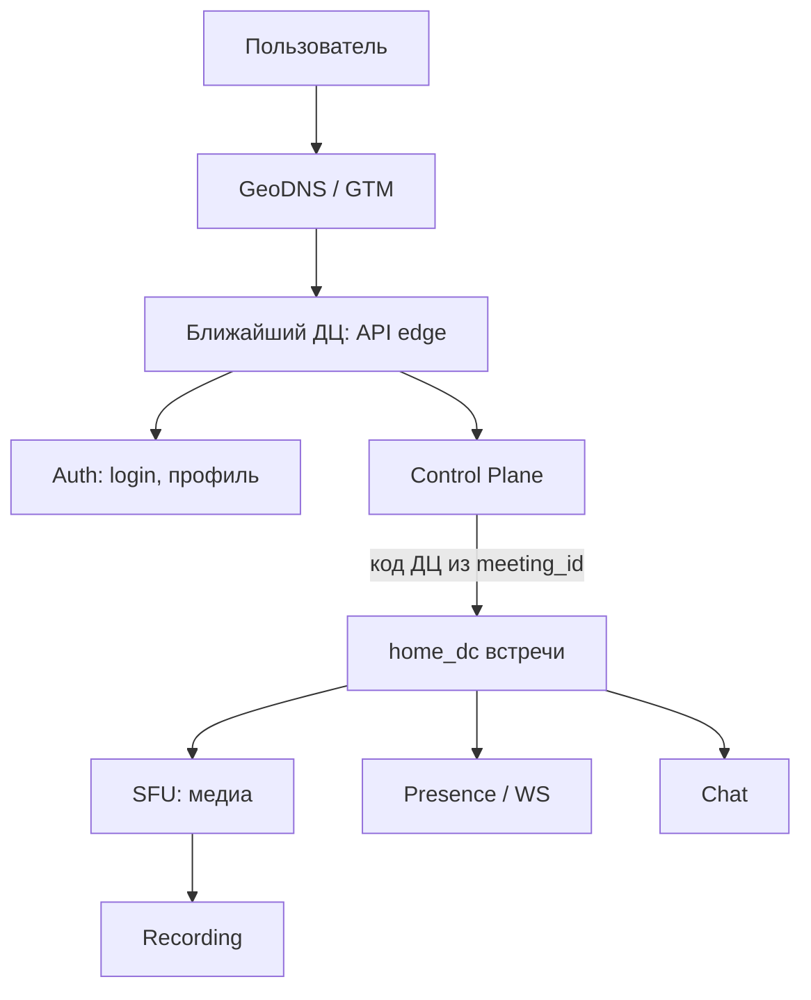
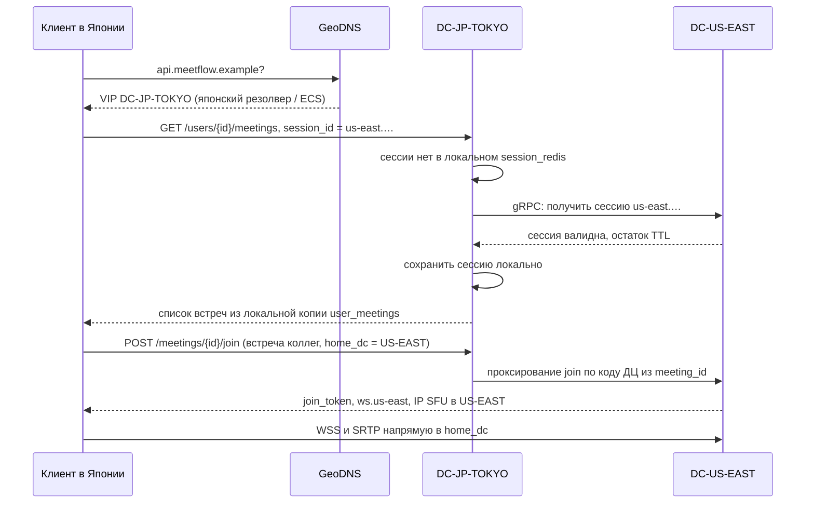

# Приложение 3. Глобальная балансировка: методика и подробности

К основной части: [раздел 3](../README.md#3-глобальная-балансировка-нагрузки). Номера «п. X.Y» — пункты основной части.

## Домены и home_dc

`home_dc` — ДЦ, за которым закреплена встреча: control plane выбирает его при `POST /meetings`, это ДЦ, принявший запрос, то есть ближайший к организатору. Код `home_dc` записан в `meeting_id` (UUIDv8, первый байт — код ДЦ [^85]) и в invite-токен, поэтому любой ДЦ знает, куда направить `join`, без глобального справочника встреч.

## Как получены доли дата-центров

Сколько пользователей видеосвязи в каждой стране, первоисточники не публикуют, а SimilarWeb методичка запрещает как первоисточник. Поэтому нагрузку распределяем по официальной статистике:

1. **Доля страны = ее доля в ВВП** — IMF World Economic Outlook (апрель 2026), ВВП 2025 года [^11]. Видеовстречи — рабочий инструмент (10 участников на 54 минуты [^4]), поэтому их объем следует за экономикой, а не за населением. Без материкового Китая остается 194 экономики на 98 537.9 млрд $.
2. **Каждая страна — в ближайший по задержке ДЦ.** Полный список стран — в [`meetflow_calc.py`](../resource/calc/meetflow_calc.py), ВВП — в [`imf_weo_2026apr_gdp_2025.json`](../resource/calc/imf_weo_2026apr_gdp_2025.json).
3. **США делим на восток и запад по населению**: на регион West по переписи 2020 приходится 23.7% населения [^73]. Внутри одной страны деловая активность на человека примерно одинакова, поэтому здесь население, а не ВВП. Западу нужен свой ДЦ: путь до Вирджинии пересекает весь континент.

| ДЦ | Город | Какие страны обслуживает | ВВП 2025, млрд $ | Доля нагрузки |
| -- | ----- | ------------------------ | ---------------: | ------------: |
| `DC-US-EAST` | Ашберн, Вирджиния | США: Northeast, Midwest, South (76.3% населения); Канада; Мексика, Центральная Америка, Карибы | 23 475.3 + 2 319.9 + 2 622.8 = **28 418.0** | **28.84%** |
| `DC-US-WEST` | Сан-Хосе, Калифорния | США: West (23.7% населения) | **7 291.8** | **7.40%** |
| `DC-BR-SAOPAULO` | Сан-Паулу | Южная Америка | **4 576.1** | **4.65%** |
| `DC-UK-LONDON` | Лондон | Великобритания | **4 003.0** | **4.06%** |
| `DC-DE-FRANKFURT` | Франкфурт | Европа без Великобритании, СНГ, Ближний Восток, Африка | **35 168.5** | **35.69%** |
| `DC-IN-MUMBAI` | Мумбаи | Индия, Пакистан, Бангладеш, Шри-Ланка, Непал, Бутан, Мальдивы, Афганистан | **4 956.6** | **5.03%** |
| `DC-SG-SINGAPORE` | Сингапур | Юго-Восточная Азия, Австралия, Новая Зеландия, Океания, Гонконг, Макао | **6 870.9** | **6.97%** |
| `DC-JP-TOKYO` | Токио | Япония, Республика Корея, Тайвань, Монголия | **7 253.0** | **7.36%** |
| **Итого** | | 194 экономики без материкового Китая | **98 537.9** | **100%** |

Доля = ВВП группы / 98 537.9, округлена до 0.01 п. п. так, чтобы сумма была ровно 100%: у Южной Америки 4.644% → 4.65%.

**Проверка по аналогу.** По макрорегионам: Америка — 40.89%, EMEA — 39.75%, APAC — 19.36%. У Zoom доля Америки в выручке выше — 72.1% (EMEA — 15.8%, APAC — 12.1%) [^72]: Zoom исторически сильнее в США. Наш масштаб — масштаб лидера рынка (320 млн MAU у Teams [^1]), поэтому берем нейтральную оценку по экономике. Если доля Америки окажется выше, изменятся размеры пулов, а не архитектура: GTM перераспределит подключения весами (п. 3.7), запас дает резерв из п. 9.2.

Границы групп условные: GeoDNS выбирает ДЦ по фактической задержке, и, например, западная Канада может уйти в `DC-US-WEST`. Точные доли уточняются по GeoIP-аналитике после запуска.

Парный ДЦ хранит асинхронную реплику метаданных и бэкапы (п. 3.4, 6.8) и первым принимает нагрузку при отказе (п. 3.7). Control plane и media plane разделены: API обслуживает ближайший ДЦ, а медиа всегда идет в `home_dc` встречи. Так же устроен аналог: Zoom позволяет платным аккаунтам выбирать ДЦ для real-time медиа [^13].

## Нагрузка по ДЦ: формула, DAU и записи

Метрика ДЦ = глобальная метрика × доля ДЦ. Встречи распределены по `home_dc` так же, как пользователи по ДЦ: организатор и большинство участников обычно из одного региона.

| ДЦ | DAU | Записи за 30 дней |
| -- | --: | ----------: |
| `DC-US-EAST` | 33 166 000 | 197.63 PB |
| `DC-US-WEST` | 8 510 000 | 50.71 PB |
| `DC-BR-SAOPAULO` | 5 347 500 | 31.86 PB |
| `DC-UK-LONDON` | 4 669 000 | 27.82 PB |
| `DC-DE-FRANKFURT` | 41 043 500 | 244.57 PB |
| `DC-IN-MUMBAI` | 5 784 500 | 34.47 PB |
| `DC-SG-SINGAPORE` | 8 015 500 | 47.76 PB |
| `DC-JP-TOKYO` | 8 464 000 | 50.44 PB |
| **Итого** | **115 000 000** | **685.26 PB** |

Пиковый RPS через L7 — REST API, heartbeat и WS push вместе (приложение 4). Пик каждого метода в ДЦ = глобальный пик из п. 2.5 × доля ДЦ: например, heartbeat в `DC-DE-FRANKFURT` — 675 000 × 35.69% = 240 908 в секунду. В строке «Итого» — глобальное значение; сумма округленных ячеек может отличаться на единицу последнего знака.

## Точки записи:

| Данные | Почему так |
| ------ | ---------- |
| `users` (`auth_pg`) | Глобальная уникальность `email`. Записей в пик ≤ 1 997/с (верхняя оценка: каждый DAU раз в сутки меняет профиль) — одного primary хватает |
| `user_sessions` (`session_redis`) | Сессия нужна там, где пользователь сейчас |
| `meetings`, `meeting_invite_links` (`meeting_pg`) | `join` должен видеть актуальный статус (п. 5.3) |
| `meeting_participants` (`meeting_scylla`) | Нужны во время встречи и для истории |
| `meetings_runtime` (`runtime_redis`) | Эфемерное состояние, клиенты восстанавливают его при переподключении |
| `chat_messages` (`chat_scylla`) | Порядок задает `chat_seq` в одном Redis `home_dc` |
| `recordings` и файлы (`recording_pg`, S3) | Копия 685 PB в другом регионе удвоила бы самую дорогую статью расходов |
| `user_meetings` (`meeting_scylla`) | Read model с eventual consistency (п. 5.3): список встреч доступен в любой стране |

**Отказ точки записи.** Внутри `DC-US-EAST` Patroni автоматически переключает primary `auth_pg` на синхронную standby в соседней AZ без потери данных [^86]. При отказе всего `DC-US-EAST` primary становится реплика в `DC-US-WEST`, но по команде дежурного (runbook): в схеме с двумя площадками второй ДЦ не может сам отличить отказ первого от обрыва связи [^97]. RPO — секунды лага репликации. Логин продолжает работать на локальных репликах; на время переключения недоступны только регистрация и изменение профиля.

## DNS: местоположение и время переключения

GeoDNS определяет местоположение по IP рекурсивного резолвера или по подсети клиента из EDNS Client Subnet [^82]. Поэтому ДЦ выбирается по тому, где пользователь сейчас, а не где он регистрировался.

**Время переключения.** Monitor GTM опрашивает health-endpoint каждого ДЦ; минимальный интервал у Cloudflare — 60 с на Pro, 15 с на Business, 10 с на Enterprise [^17]. Берем Enterprise: интервал 10 с и 3 неудачи подряд — ДЦ выводится из ответов за ≈ 30 с, плюс TTL 30 с. Итого новые подключения уходят в здоровый ДЦ примерно за минуту. Если резолвер кеширует дольше TTL, срабатывает fallback клиента: при ошибке он заново резолвит имя, а затем идет на резервный региональный адрес из конфигурации приложения.

## Регулировка: почему такой порядок резервов

| Основной ДЦ | Почему |
| ----------- | ------ |
| `DC-US-EAST` | та же страна, затем ближайший ДЦ через Атлантику |
| `DC-US-WEST` | та же страна, затем через Тихий океан |
| `DC-BR-SAOPAULO` | прямые кабели в США и Европу |
| `DC-UK-LONDON` | соседний европейский ДЦ |
| `DC-DE-FRANKFURT` | соседний европейский ДЦ, затем самый емкий ДЦ через Атлантику |
| `DC-IN-MUMBAI` | ближайший ДЦ в Азии |
| `DC-SG-SINGAPORE` | ближайшие ДЦ в Азии |
| `DC-JP-TOKYO` | ближайший ДЦ в Азии, затем через Тихий океан |

Резервный ДЦ может быть меньше основного: `DC-UK-LONDON` (4.06%) не вместит `DC-DE-FRANKFURT` (35.69%). Поэтому резервы задают **порядок предпочтения**: трафик отказавшего ДЦ GTM раздает по нескольким ДЦ пропорционально свободной емкости (`capacity_weight`). Что емкости хватит, показано в п. 9.2.

## Сценарий: вход в США, затем поездка в Японию

Вопрос: пользователь залогинился в США, а потом улетел в Японию. Что происходит?

### Шаги сценария

| Шаг | Что происходит | Почему так |
| --- | -------------- | ---------- |
| 1. Логин в США | Пароль проверяется по локальной реплике `auth_pg`; сессия `us-east.<id>` создается в `session_redis` `DC-US-EAST` | Логину не нужна запись в primary |
| 2. Прилет в Японию | GeoDNS видит японский резолвер или подсеть клиента из ECS [^82] и отдает VIP `DC-JP-TOKYO` | ДЦ выбирается по текущему местоположению, привязки к стране логина нет |
| 3. Первый запрос в `DC-JP-TOKYO` | Сессии нет в локальном Redis: по префиксу `us-east` Auth один раз забирает ее из `DC-US-EAST` (+≈ 153 мс [^87]) и сохраняет у себя. **Повторный логин не нужен** | Сессии переносятся по запросу, а не копируются во все ДЦ заранее |
| 4. Профиль | Чтение — из локальной реплики `auth_pg`, изменение — в primary `DC-US-EAST` | Одна точка записи `users` (п. 3.4) |
| 5. Список встреч | Из локальной копии `user_meetings` в `DC-JP-TOKYO` | Keyspace реплицирован во все ДЦ |
| 6. Встреча американских коллег | `home_dc = DC-US-EAST`: Токио проксирует `join` туда, WS и медиа идут в `DC-US-EAST`. RTT Токио ↔ Вашингтон ≈ 153 мс [^87], в одну сторону ≈ 77 мс. По ITU-T G.114 разговор не страдает, пока задержка «от рта до уха» меньше 150 мс [^88]; в этот бюджет входят еще путь SFU → собеседник в США, кодек и джиттер-буфер: звонок возможен, но близко к границе | Все участники встречи — на одном SFU. После MVP — каскад SFU: клиент подключается к SFU в Токио, тот пересылает потоки в `home_dc` |
| 7. Новая встреча, созданная в Японии | `home_dc = DC-JP-TOKYO`; американские участники подключаются к SFU в Токио | `home_dc` выбирается по организатору |
| 8. Пользователь остался жить в Японии | Мигрировать нечего: данные пользователя глобальные (реплики во всех ДЦ), встречи привязаны к своему `home_dc`. Старая сессия в `DC-US-EAST` истечет по TTL | «Домашнего ДЦ пользователя», который пришлось бы переносить, нет |
| 9. Logout | Сессия удаляется локально и в ДЦ из префикса, событие отзыва рассылается во все 8 ДЦ | Отозванная сессия не должна жить ни в одной копии |

## Источники

[^1]: [Microsoft Investor Relations — Earnings Conference Call FY24 Q1 (транскрипт: «more than 320 million monthly active users» у Teams)](https://www.microsoft.com/en-us/investor/events/fy-2024/earnings-fy-2024-q1)

[^4]: [Zoom Blog — Here’s How You Zoomed Over the Past Year](https://www.zoom.com/en/blog/how-you-zoomed-over-the-past-year-2021/)

[^11]: [IMF — World Economic Outlook (April 2026): GDP, current prices (NGDPD), млрд долларов США, данные 2025 года](https://www.imf.org/external/datamapper/NGDPD@WEO/OEMDC/ADVEC/WEOWORLD)

[^13]: [Zoom Support — Selecting data center for meetings, webinars, whiteboards, notes and docs](https://support.zoom.com/hc/en/article?id=zm_kb&sysparm_article=KB0060026)

[^17]: [Cloudflare Docs — Create a monitor (минимальный интервал: 60 с Pro, 15 с Business, 10 с Enterprise; consecutive_down через API)](https://developers.cloudflare.com/load-balancing/monitors/create-monitor/)

[^18]: [Google Cloud Documentation — Cloud Load Balancing overview](https://docs.cloud.google.com/load-balancing/docs/load-balancing-overview)

[^52]: [gRPC Documentation — C++](https://grpc.io/docs/languages/cpp/)

[^72]: [Zoom Communications — Form 10-K за FY2026 (выручка по регионам: Americas 72.1%, APAC 12.1%, EMEA 15.8%)](https://www.sec.gov/Archives/edgar/data/1585521/000158552126000030/zm-20260131.htm)

[^73]: [U.S. Census Bureau — Age and Sex Composition: 2020 (регион West — 78.6 млн, 23.7% населения)](https://www2.census.gov/library/publications/decennial/2020/census-briefs/c2020br-06.pdf)

[^82]: [RFC 7871 — Client Subnet in DNS Queries](https://datatracker.ietf.org/doc/html/rfc7871)

[^83]: [RFC 4786 — Operation of Anycast Services](https://datatracker.ietf.org/doc/html/rfc4786)

[^85]: [RFC 9562 — Universally Unique IDentifiers (UUIDs), UUIDv8](https://datatracker.ietf.org/doc/html/rfc9562)

[^86]: [Patroni Documentation](https://patroni.readthedocs.io/en/latest/)

[^87]: [WonderNetwork — Ping time between Tokyo and Washington](https://wondernetwork.com/pings/Tokyo/Washington)

[^88]: [ITU-T Recommendation G.114 (05/2003) — One-way transmission time: при сквозной задержке в одну сторону меньше 150 мс большинство приложений не страдают](https://www.itu.int/rec/T-REC-G.114-200305-I/en)

[^97]: [Patroni Documentation — HA multi datacenter: standby-кластер во втором ДЦ повышают вручную](https://patroni.readthedocs.io/en/latest/ha_multi_dc.html)
