# MeetFlow: подготовка к защите

**Системный дизайн с нуля — и вся работа по шагам: откуда каждое число, куда идут данные, что говорить**

Документ для автора работы. Он написан для новичка: после него нужно понимать каждое решение работы и уметь объяснить его своими словами. Числа совпадают с [README.md](../README.md) ветки `review-fixes` (коммит `226cba1`), все расчёты повторяет скрипт [`meetflow_calc.py`](../resource/calc/meetflow_calc.py).

---

## Часть 0. Как пользоваться документом

### 0.1. Что внутри

| Часть | О чём | Когда читать |
| ----- | ----- | ------------ |
| 1. Системный дизайн простыми словами | Что это за дисциплина, как устроено рассуждение, что требует методичка курса | Первой, целиком |
| 2. Работа на одной странице | Что такое MeetFlow, главные числа, общая схема, главные идеи | Сразу после части 1 |
| 3. Откуда что берётся | Каждое исходное число: источник, кто его опубликовал, почему ему можно верить | Перед частью 5 |
| 4. Путь данных | Пошагово: что происходит при логине, создании встречи, входе, видео, чате, записи, отказе ДЦ, переезде пользователя | Главная часть для понимания |
| 5. Разбор работы по разделам 1–11 | Что требует методичка, что сделано, как посчитано, почему так, **что говорить**, какие вопросы зададут | С README рядом |
| 6. Замечания ревьюера | Что спросили, что изменили, как отвечать | Перед защитой |
| 7. Словарь терминов | Все термины работы простыми словами | По мере необходимости |
| 8. Вопросы и ответы | Вопросы, которые вероятнее всего зададут, с готовыми ответами | Перед защитой |
| 9. Шпаргалка и речь на 5 минут | Числа на одну страницу и текст выступления | В день защиты |
| Приложения (в PDF-версии) | Полный текст работы со всеми схемами, ревью, исходники схем БД, скрипт расчёта | Как справочник |

### 0.2. Как проходит защита

По методичке курса ([init/highload](https://github.com/init/highload/blob/main/homework_architecture.md)) защита — это:

- **5 минут презентации** (5–15 слайдов) и **5 минут ответов** на вопросы преподавателя;
- презентуете **другому преподавателю**, не тому, кто проверял работу;
- две оценки по 0–10 баллов: **качество проекта** (инженерные решения, глубина проработки, правильность расчётов) и **качество презентации** (понятная подача, правильный фокус, правильные данные на слайдах).

Отсюда главное правило подготовки: **проверяют понимание, а не память**. Если вы можете объяснить, *почему* число такое и *что будет, если оно изменится*, вы отвечаете на любой вариант вопроса.

### 0.3. Где лежат файлы работы

| Файл | Что это |
| ---- | ------- |
| `README.md` | Сама работа — расчётно-пояснительная записка по разделам 1–11 и список источников |
| `resource/calc/meetflow_calc.py` | Скрипт, который считает все числа работы. Меняешь допущение — получаешь все таблицы заново |
| `resource/calc/imf_weo_2026apr_gdp_2025.json` | ВВП стран из базы МВФ — на нём построены доли дата-центров |
| `resource/schemes/full-scheme.drawio` | Исходник общей схемы проекта (раздел 10), открывается в diagrams.net |
| `resource/icons/images/full-scheme.svg` | Картинка общей схемы |
| `resource/logic-database-sql.md`, `resource/physical-database-sql.md` | Код логической и физической схем БД на языке DBML (для dbdiagram.io) |
| `resource/icons/images/logic-database.svg`, `physical-database.svg` | Картинки схем БД |
| `docs/ревью.md` | Что было неверно в прошлой версии и что исправлено |
| `docs/подготовка-к-защите.md` | Этот документ |

---

## Часть 1. Системный дизайн простыми словами

### 1.1. Что это за дисциплина

**Системный дизайн** — это проектирование системы, которая выдержит заданную нагрузку. Нужно пройти путь от вопроса «сколько у нас пользователей?» до ответа «какие нужны компоненты, сколько серверов, где они стоят, что будет при поломке и сколько это стоит».

Код в системном дизайне почти не пишут. Пишут **расчёты и обоснования**. Хорошая работа отличается от плохой тем, что каждое решение в ней следует из числа:

- слабо: «Возьмём Redis, потому что он быстрый»;
- сильно: «Нужно 738 тысяч операций в секунду с маленькими ключами, которые должны сами удаляться по таймеру. Один шард Redis даёт около 120 тысяч операций в секунду, значит, нужно не меньше 7 шардов на весь мир».

### 1.2. Цепочка рассуждений

Любая работа по системному дизайну устроена как одна цепочка. В MeetFlow она выглядит так:

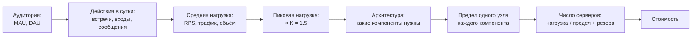

Если на защите вы потеряли нить, вернитесь к этой цепочке: любой вопрос относится к одному из её звеньев.

### 1.3. Шесть главных идей

**1. Нагрузку описывают четыре числа.**

| Число | Что значит | Пример в MeetFlow |
| ----- | ---------- | ----------------- |
| **RPS** (requests per second) | Сколько запросов в секунду приходит к сервису | 675 000 heartbeat-сообщений в секунду в пик |
| **Трафик**, Гбит/с | Сколько данных в секунду идёт по сети | 78 131 Гбит/с видео и аудио в пик ≈ 78 Тбит/с |
| **Объём хранения**, ТБ/ПБ | Сколько данных лежит на дисках | 685 ПБ записей встреч за 30 дней |
| **Одновременные соединения** | Сколько клиентов держат открытое соединение | 16.9 млн WebSocket-соединений в пик |

**2. Считаем пик, а не среднее.** Днём пользователей больше, ночью меньше. Серверы должны выдержать самый нагруженный час. Отношение пикового часа к среднему за сутки называют **коэффициентом пика K**. В работе K = 1.5: пиковый час в полтора раза нагруженнее среднего.

**3. У каждого сервера есть предел, и он что-то одно.** Сервер упирается либо в процессор (CPU), либо в память (RAM), либо в сеть, либо в диск. Этот предел называют **ограничителем**. Число серверов = нагрузка / предел одного сервера, округлённое вверх, плюс резерв. Главный навык — найти, во что именно упирается компонент. Пример из работы: балансировщик NGINX упирается не в число запросов, а в **память под одновременные соединения**; медиасервер SFU — не в сетевую карту, а в **процессор**.

**4. Всё ломается, и у каждой поломки свой масштаб.**

| Что сломалось | Как переживаем |
| ------------- | -------------- |
| Один сервер | Запасной сервер (**N+1**) |
| Здание, стойка, зона доступности (AZ) | Серверы разнесены по 3 зонам; копии данных — в разных зонах |
| Целый регион (дата-центр) | Глобальная балансировка уводит пользователей в другие регионы |

**5. Данные — самое сложное.** Сервис без данных можно просто запустить в двух экземплярах. С данными нужно решить: где они лежат, сколько копий, **кто может писать** (точка записи), насколько свежие копии видят читатели (**консистентность**), как разрезать данные на части, когда они не помещаются на один сервер (**шардирование**).

**6. Всё — компромиссы.** Надёжность стоит денег, скорость — сложности, свежесть данных — задержки. Сильный ответ на защите называет компромисс вслух: «Записи не копируем в другой регион: копия 685 ПБ удвоила бы самую дорогую статью. Цена решения — при гибели целого региона его записи потеряются».

### 1.4. Что требует методичка курса

Методичка — [homework_architecture.md](https://github.com/init/highload/blob/main/homework_architecture.md). Ниже — её требования своими словами и где они выполнены.

| Раздел | Что требует методичка | Где в работе |
| ------ | --------------------- | ------------ |
| Общее | README.md в публичном репозитории GitHub, пронумерованный список источников в конце | Весь README, 103 источника |
| 1. Тема и аудитория | Тип сервиса, реальные аналоги, аудитория от 1 млн в день, её размер и местоположение, 3–7 ключевых функций MVP, ключевые продуктовые решения | 1.1–1.5 |
| 2. Расчёт нагрузки | MAU, DAU, средний объём хранилища пользователя по типам (в штуках и ГБ), действия пользователя в день по типам — **сводной таблицей**. Объём хранения по типам (в штуках и ТБ), пиковый и суточный трафик по типам, RPS по методам — средний и пиковый, сводной таблицей. **SimilarWeb запрещён как первоисточник**, для перепечаток нужен оригинал | 2.1–2.4 |
| 3. Глобальная балансировка | Разбиение по доменам, обоснование расположения ДЦ (влияние на продуктовые метрики), распределение запросов по ДЦ, схемы DNS- и Anycast-балансировки, механизм регулировки трафика между ДЦ | 3.1–3.9 |
| 4. Локальная балансировка | Схема балансировки со всеми уровнями и механизмами резервирования, формула резервирования (N×2 или N+1), расчёт числа балансировщиков (ограничители — SSL termination и сеть) | 4.1–4.6 |
| 5. Логическая схема БД | Картинка без привязки к СУБД, таблица с описанием таблиц, **все** данные — включая файлы, кеши и буферы, — размеры, QPS на чтение и запись, требования к консистентности, распределение нагрузки по ключам | 5.1–5.4 |
| 6. Физическая схема БД | Картинка с привязкой к СУБД, индексы, денормализация, выбор СУБД по таблицам, шардирование и резервирование по таблицам, клиентские библиотеки, балансировка запросов и мультиплексирование подключений, **схема резервного копирования** | 6.1–6.12 |
| 7. Алгоритмы | Необязательный раздел. Для каждого алгоритма: задача, входные данные, шаги, структуры данных, альтернативы, обоснование параметров, влияние на нагрузку и схему БД | 7.1–7.3 |
| 8. Технологии | Сводная таблица: технология, где применяется, почему выбрана | 8.1–8.2 |
| 9. Надёжность | Сводная таблица по всем компонентам со способами резервирования | 9.1–9.2 |
| 10. Схема проекта | Картинка взаимодействия сервисов, пояснения, потоки данных, внутренняя и внешняя балансировка | 10.1–10.5 |
| 11. Список серверов | Конфигурации, количество серверов, что на них работает; для Kubernetes — контейнеры с ресурсами | 11.1–11.4 |

---

## Часть 2. Работа на одной странице

### 2.1. Что такое MeetFlow

**MeetFlow** — учебный проект сервиса групповых видеовстреч, как Zoom, Microsoft Teams или Google Meet. Шесть функций MVP (минимального продукта):

1. создать встречу — сразу или запланировать;
2. войти во встречу по ссылке-приглашению;
3. групповая аудио- и видеосвязь в качестве 720p;
4. демонстрация экрана;
5. чат во время встречи;
6. облачная запись встречи.

Аудитория — весь мир, кроме материкового Китая. Масштаб взят у реальных аналогов: **320 млн пользователей в месяц** (Teams), **115 млн в день** (Teams), **300 млн участий во встречах в день** (Zoom).

### 2.2. Главные числа

| Что | Число | Откуда |
| --- | ----: | ------ |
| Пользователей в месяц / в день | 320 млн / 115 млн | Microsoft (Teams) |
| Участий во встречах в сутки | 300 млн | Zoom, документ в SEC |
| Средняя встреча | 10 человек, 54 минуты | Блог Zoom |
| Встреч в сутки | 30 млн | 300 млн / 10 |
| Коэффициент пика K | 1.5 | Замечание ревьюера |
| Участников онлайн в среднем / в пик | 11.25 млн / 16.9 млн | Расчёт, п. 2.2 |
| Видео и аудио в пик | 78 Тбит/с | Онлайн × битрейт по требованиям Zoom |
| Heartbeat в пик | 675 тыс. в секунду | Сообщение «я ещё здесь» раз в 25 с |
| Записи встреч | 685 ПБ за 30 дней | Худший случай: записывается каждая встреча |
| Дата-центров | 8 | Доли по ВВП стран (МВФ) |
| Серверов | 30 047, из них 28 570 — медиасерверы SFU | Раздел 11 |
| Стоимость | ≈ 1 032 млн ₽/мес ≈ $12.2 млн | Цены Selectel, раздел 11.4 |

### 2.3. Общая схема


Как читать: **зелёное** — сеть и балансировка, **синее** — сервисы на C++23, **оранжевое** — постоянные хранилища, **фиолетовое** — Redis (быстрые данные в памяти). Подробно нарисован один дата-центр, `DC-US-EAST`; остальные 7 устроены так же. Клиент сначала спрашивает DNS, в какой ДЦ идти, затем идёт в балансировщик L4, оттуда в NGINX L7 и в сервисы. Видео идёт отдельно и напрямую — в медиасервер SFU.

### 2.4. Восемь главных идей архитектуры

| Идея | Суть | Зачем |
| ---- | ---- | ----- |
| Control plane ≠ media plane | Управляющие запросы (вход, чат, heartbeat) идут через балансировщики, видео — напрямую в SFU | Балансировщикам не нужно пропускать 78 Тбит/с; встреча живёт на одном SFU |
| `home_dc` — «домашний» ДЦ встречи | Встреча закреплена за ДЦ, где её создали; код ДЦ зашит в `meeting_id` | Все участники встречи — на одном SFU, все её данные — в одном месте |
| Одна точка записи на объект | `users` пишутся в один основной сервер на весь мир, данные встречи — в `home_dc` | Не бывает двух одновременных записей одного объекта в разных ДЦ |
| ДЦ выбирает DNS | GeoDNS отвечает каждому пользователю адресом ближайшего здорового ДЦ; Anycast — только у самих DNS-серверов | Можно управлять весами и выводить ДЦ из работы |
| SFU, а не MCU | Сервер пересылает видеопотоки, а не склеивает их | Нет дорогого перекодирования на сервере |
| Simulcast и ABR | Клиент шлёт видео в нескольких качествах, сервер отдаёт каждому подходящее и снижает качество при плохой сети | Меньше трафика, звонок не рвётся на плохой сети |
| Своя СУБД под каждый тип данных | PostgreSQL — где нужны транзакции, ScyllaDB — где много записей, Redis — горячие данные, S3 — файлы | Каждое хранилище делает то, что умеет лучше всего |
| Резерв без двойного комплекта | При отказе ДЦ на время аварии снижаем качество видео вместо того, чтобы держать вторую копию всех серверов | Двойной комплект SFU стоил бы ещё ≈ 400 млн ₽ в месяц |

### 2.5. Три самые тяжёлые вещи

Архитектуру и бюджет определяют три блока, а не API-запросы:

1. **Медиа**: 78 Тбит/с → 28 570 серверов SFU → 400 млн ₽ в месяц.
2. **Записи**: 685 ПБ → хранилище S3 → 610 млн ₽ в месяц.
3. **Присутствие (presence)**: 16.9 млн открытых соединений и 675 тыс. heartbeat в секунду → Redis, WebSocket-поды и NGINX, упирающийся в память.

Всё остальное — вход, чат, списки встреч — это тысячи или десятки тысяч запросов в секунду и меньше 1% бюджета.

---

## Часть 3. Откуда что берётся

На защите почти любое число могут спросить: «А это откуда?». На этот вопрос есть всего три ответа:

- **из первоисточника** — официальный отчёт компании, официальная документация, стандарт, государственная статистика;
- **из бенчмарка** — опубликованный замер производительности;
- **из нашего допущения** — тогда нужно назвать его допущением и сказать, чем оно ограничено.

### 3.1. Какие бывают источники и почему им верят

| Тип источника | Примеры в работе | Почему ему можно верить |
| ------------- | ---------------- | ----------------------- |
| Отчётность публичной компании | Стенограмма звонка Microsoft с инвесторами, проспект Zoom в SEC, годовой отчёт Zoom 10-K, пресс-релиз Zoom о выручке | За ложь в отчётности перед инвесторами компании отвечают по закону. SEC — комиссия по ценным бумагам США |
| Официальная документация продукта | Требования Zoom к сети, лимиты чата Zoom, документация Redis, PostgreSQL, ScyllaDB, Citus, NGINX, Kubernetes, mediasoup | Производитель описывает свой продукт |
| Стандарты | RFC (стандарты интернета), ITU-T G.114 | Принятые международные документы |
| Государственная и межгосударственная статистика | МВФ (ВВП стран), перепись США, курс ЦБ РФ | Официальные данные |
| Бенчмарки | NGINX (запросы и TLS на ядро), Jitsi и LiveKit (пропускная способность SFU), redis-benchmark | Опубликованный замер с описанием стенда |
| Прайс-лист | Selectel: серверы, облако, S3, трафик | Реальные цены, по которым можно купить |
| Проектное допущение | K = 1.5, 5 сообщений чата на участие, 3 открытия списка встреч в день | Публичных данных нет — значение выбрано и подписано как допущение |

**Важное правило методички.** Данные SimilarWeb запрещено использовать как первоисточник: у этого сервиса слишком большая погрешность. Перепечатки (новостные статьи, форумы) нужно заменять оригиналом. В прошлой версии работы доли дата-центров строились на SimilarWeb, а аудитория Teams и Zoom цитировалась по форуму и Reuters. Сейчас это исправлено: доли считаются по ВВП (МВФ), аудитория — по отчётности Microsoft и Zoom.

### 3.2. Исходные числа аудитории

| Число | Значение | Источник | Что сказать, если спросят |
| ----- | -------: | -------- | ------------------------- |
| MAU — пользователей в месяц | 320 млн | Microsoft, звонок с инвесторами по итогам квартала FY24 Q1 (октябрь 2023): у Teams «more than 320 million monthly active users» [^1] | «Это масштаб лидера рынка — Teams. Более свежей публичной цифры MAU нет» |
| DAU — пользователей в день | 115 млн | Блог Microsoft 365, октябрь 2020: у Teams 115 млн DAU [^2] | «Это публичное число октября 2020 года, год подписываем. Берём его как консервативную оценку: DAU влияет только на лёгкие запросы — логин и список встреч, а тяжёлую нагрузку задают участия» |
| DMP — участий во встречах в день | 300 млн | Проспект Zoom в SEC (январь 2021): в апреле 2020 платформа превысила 300 млн ежедневных участников встреч [^3] | «Это не уникальные пользователи, а участия: один человек за день может побывать на трёх встречах и посчитается три раза. Поэтому участий больше, чем DAU» |
| Средняя встреча | 10 участников, 54 минуты | Блог Zoom, данные за 15.11.2020–15.11.2021 [^4] | «Средние значения Zoom за год. От них считается вся нагрузка на встречи» |
| Актуальность ниши | $4.87 млрд выручки Zoom за FY2026, 4 468 крупных клиентов | Пресс-релиз Zoom [^10] | «Старые числа использования подписаны годом, а актуальность ниши подтверждаем финансами 2026 года» |

**Почему числа разных лет и разных компаний.** Публично раскрыты только отдельные цифры: Microsoft даёт MAU и DAU, Zoom — участия и длительность встреч. Мы берём каждую там, где она есть, и подписываем год. На вопрос «не смешиваете ли вы разное?» ответ: «Каждая метрика взята из своего источника и используется только для своей цели: MAU — для объёма профилей, DAU — для действий пользователя, участия — для нагрузки на встречи».

### 3.3. Технические исходные числа

| Число | Значение | Источник | Зачем нужно |
| ----- | -------: | -------- | ----------- |
| Видео 720p в групповом звонке | отправка 2.6 Мбит/с, приём 1.8 Мбит/с | Требования Zoom к сети [^5] | Трафик видео |
| Видео «high-quality» (ниже 720p) | 1.0 / 0.6 Мбит/с | Там же [^5] | Профиль, до которого снижаем качество при отказе ДЦ |
| Аудио | 60–80 кбит/с, берём 0.08 Мбит/с | Там же [^5] | Трафик аудио |
| Демонстрация экрана | 50–150 кбит/с, берём 0.15 Мбит/с | Там же [^5] | Трафик демонстрации, верхняя граница |
| Интервал heartbeat | 25 секунд | Значение по умолчанию `pingInterval` в Socket.IO [^9] | Число heartbeat-сообщений |
| Лимит сообщения чата | 4 000 символов | Zoom Team Chat [^6] | Максимальный размер сообщения |
| Квота записей | 10 ГБ на платного пользователя | Zoom [^8] | Сравнение с нашим объёмом записей |
| ВВП стран, 2025 год | 194 экономики, 98 537.9 млрд $ без Китая | МВФ, World Economic Outlook, апрель 2026 [^11] | Доли дата-центров |
| Население запада США | 23.7% | Перепись США 2020 [^73] | Деление США на два ДЦ |
| Выручка Zoom по регионам | Америка 72.1%, EMEA 15.8%, APAC 12.1% | Годовой отчёт Zoom 10-K за FY2026 [^72] | Только для сверки долей ДЦ |
| Пинг Токио ↔ Вашингтон | ≈ 153 мс | WonderNetwork [^87] | Сценарий «США → Япония» |

### 3.4. Бенчмарки — пределы одного сервера

| Компонент | Предел | Источник | Как использован |
| --------- | -----: | -------- | --------------- |
| NGINX, HTTPS-запросы по открытым соединениям | 341 232 в секунду на 16 ядрах | Тест NGINX Ingress Controller [^19] | Число узлов L7 по запросам |
| NGINX, новые TLS-соединения | 6 676 в секунду на 16 ядрах | Тест NGINX [^20] | Число узлов L7 по рукопожатиям |
| NGINX, сеть | 8.8 Гбит/с | Тест NGINX Ingress [^19] | Число узлов L7 по трафику |
| NGINX, память на WebSocket-соединение | меньше 20 КБ (50 000 соединений < 1 ГБ) | Тест NGINX WebSocket [^77] | Число узлов L7 по памяти |
| TLS-буферы OpenSSL | до 34 КБ на соединение | Документация OpenSSL [^78] | Худший случай памяти на соединение |
| SFU на ядро процессора | ≈ 0.678 Гбит/с при 100% CPU — наша линейная экстраполяция замера | Тест Jitsi Videobridge: 550.4 Мбит/с при 20.3% CPU четырёхъядерного сервера [^74] | Число медиасерверов |
| SFU, сверка | ≈ 0.29 Гбит/с на ядро для видеопакетов, ≈ 0.08 для мелких | Тест LiveKit [^75] | Показывает, что оценка Jitsi оптимистичная |
| Redis, один шард | 72–180 тыс. запросов в секунду без пайплайнинга, берём 120 тыс. | Документация redis-benchmark [^79] | Число узлов Redis |
| ScyllaDB, заполнение диска | не больше 50%: при compaction STCS в худшем случае нужна свободной половина диска | Документация ScyllaDB [^95] | ≤ 1 ТБ данных на узел с дисками 2 × 1 ТБ |
| IPVS, память на соединение | 136 байт | Исходный код ядра Linux [^91] | Размер таблицы соединений балансировщика L4 |

### 3.5. Цены

| Что | Цена | Источник |
| --- | ---: | -------- |
| Сервер EL11-SSD-10GE (6 ядер, 32 ГБ, 10 Гбит/с) — SFU, запись, L4 | 14 000 ₽/мес | Selectel [^66] |
| Сервер CL34-NVMe (14 ядер, 64 ГБ, 2 × 1 ТБ NVMe) — сервисы, Redis, ScyllaDB, мониторинг | 13 600 ₽/мес | Selectel [^66] |
| Сервер BL18-NVMe (16 ядер, 128 ГБ) — PostgreSQL | 34 900 ₽/мес | Selectel [^66] |
| Облачный сервер L7: vCPU / ГБ RAM / ГБ SSD | 735.19 / 267.34 / 10.48 ₽/мес | Selectel [^67] |
| Managed Kubernetes с 3 master-нодами | 17 085.59 ₽/мес | Selectel [^69] |
| S3, ледяное хранение | 0.89 ₽ за ГБ в месяц | Selectel [^70] |
| Курс доллара | 84.90 ₽ | ЦБ РФ на 10.10.2026 [^99] |

Selectel — **ценовой ориентир**: его дата-центров в наших восьми городах нет, но публичный прайс даёт реальные цены на сопоставимое железо. Если спросят: «У Selectel нет ДЦ в Вирджинии» — ответ: «Да, это ориентир цены сопоставимого оборудования. Для оценки порядка стоимости этого достаточно».

### 3.6. Проектные допущения

Там, где публичных данных нет, работа принимает **явное допущение**. Правило: допущение подписано, используется одинаково во всей работе и его влияние понятно.

| Допущение | Значение | Почему такое | Что поменяется, если оно неверно |
| --------- | -------: | ------------ | -------------------------------- |
| Коэффициент пика K | 1.5 | Замечание ревьюера. Сервис глобальный: когда в Америке день, в Азии ночь, часовые пояса сглаживают общую кривую | Линейно меняются пиковые RPS, трафик, соединения и число серверов. Объём хранения не меняется |
| Сообщений чата на участие | 5 | Частоты нет ни у одного аналога, есть только лимит длины | Нагрузка на чат и его хранилище (45 ТБ) |
| Средний размер сообщения | 1 КБ | Лимит — 4 000 символов (≈ 10 КБ), но большинство сообщений короткие | Хранилище чата |
| Открытий списка встреч | 3 на DAU в сутки | Типичный рабочий день: утром, перед встречей, после | Нагрузка на `user_meetings` |
| Логинов | 1 на DAU в сутки | Упрощённая модель: одна сессия в день | Нагрузка на сессии |
| Загрузок истории чата | 1 на участие | При входе во встречу или переподключении | Нагрузка на чат |
| Просмотров записи | не больше 1 на запись | Верхняя оценка | Трафик скачивания записей |
| Часть записи при загрузке | 8 МБ | Запись 0.761 ГБ — это 95 частей, S3 допускает до 10 000 частей | Число операций записи в S3 |
| Хранение данных | 30 дней | Продуктовое решение | Все объёмы хранения |
| Записывается каждая встреча | 100% | Худший случай: реальная доля неизвестна | 59% бюджета; это главный рычаг экономии |
| Материковый Китай | не обслуживаем | Нужен отдельный локальный контур: локализация данных, блокировки | Доли ДЦ |
| Загрузка CPU медиасервера | 70% | Запас на пики пакетов и ключевые кадры видео | Число SFU |
| Ёмкость подов сервисов | 1 000 / 1 500 / 5 000 запросов/с (Auth / встречи / чат) | Проектный норматив для C++-сервиса с точечными запросами | Число подов — это меньше 1% бюджета |

---

## Часть 4. Путь данных: откуда куда что идёт

Эта часть — главная для понимания. Здесь каждое действие пользователя разобрано по шагам: через какие компоненты идёт запрос, что и куда записывается, сколько таких запросов в пик. Если вы понимаете эти 12 сценариев, вы понимаете всю работу.

Сначала короткая карта компонентов — кто есть кто:

| Компонент | Что делает | Аналогия |
| --------- | ---------- | -------- |
| **GeoDNS / GTM** | Отвечает клиенту, в какой ДЦ идти: выбирает ближайший здоровый | Справочная, которая говорит, в какой филиал ехать |
| **L4-балансировщик (IPVS)** | Принимает TCP-соединения на общий адрес ДЦ и раздаёт их по узлам NGINX, не заглядывая внутрь | Охранник на входе, который распределяет людей по окнам, не читая документы |
| **NGINX L7** | Расшифровывает HTTPS (TLS termination), смотрит путь запроса и отправляет его нужному сервису | Администратор, который читает заявление и решает, в какой отдел его нести |
| **Auth API** | Логин, профиль, сессии | Отдел пропусков |
| **Control Plane** | Создание встречи, вход, выход, список встреч | Отдел бронирования переговорных |
| **WebSocket / Presence** | Держит постоянное соединение с каждым участником: heartbeat, доставка событий и чата | Телефонная линия, которая всё время на связи |
| **Chat** | Принимает сообщения, выдаёт им номера, хранит историю | Секретарь, который ведёт протокол |
| **SFU** | Медиасервер: принимает видео каждого участника и пересылает остальным | Коммутатор, который соединяет видеопотоки |
| **Recording workers** | Записывают встречу в файл | Стенографист |
| **PostgreSQL / Citus** | Таблицы с транзакциями: пользователи, встречи, записи | Архив с договорами |
| **ScyllaDB** | Быстрая запись огромного числа строк: участники, чат, списки встреч | Журнал посещений |
| **Redis** | Данные в памяти: сессии, онлайн-состояние встреч | Доска с магнитами: быстро, но может стереться |
| **S3** | Объектное хранилище файлов: записи встреч | Склад |

### 4.1. Как клиент находит дата-центр

Клиент знает только имя `api.meetflow.example`. Чтобы получить IP-адрес, он делает DNS-запрос. Спрашивает он не наш DNS-сервер, а **рекурсивный резолвер** — DNS-сервер своего провайдера или публичный, например 8.8.8.8. Уже резолвер обращается к нашему авторитетному DNS-серверу (GTM).

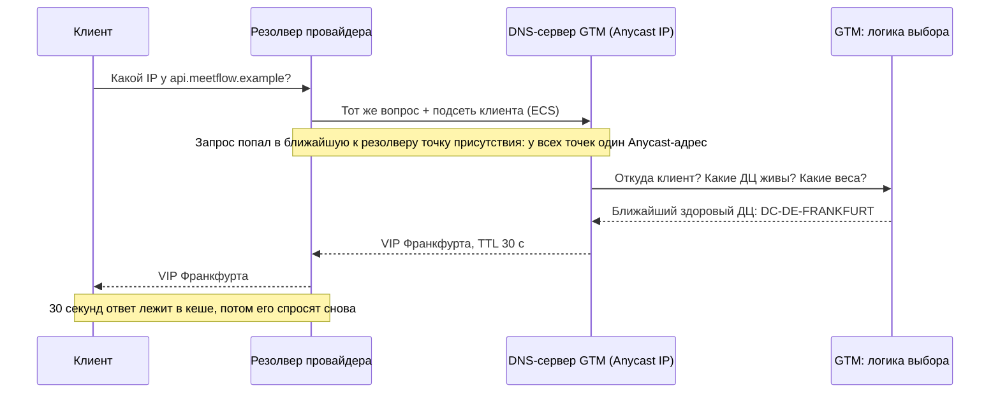

| Шаг | Что происходит | Термин |
| --- | -------------- | ------ |
| 1 | Клиент спрашивает резолвер, резолвер — наш DNS-сервер. Адрес DNS-сервера — **Anycast**: одинаковый у многих точек по всему миру, поэтому запрос сам попадает в ближайшую к резолверу | Anycast, BGP, PoP |
| 2 | **GTM** смотрит, откуда пришёл запрос: по IP резолвера или по подсети клиента, если резолвер её передал (ECS) | GeoDNS, ECS |
| 3 | GTM берёт ближайший ДЦ, который прошёл проверки здоровья и у которого есть свободная ёмкость | health check, веса |
| 4 | Резолвер возвращает клиенту **VIP** — общий адрес входа в ДЦ. Ответ хранится в кеше 30 секунд (**TTL**) | VIP, TTL |

**Что говорить:** «ДЦ выбирает DNS. GeoDNS отдаёт каждому пользователю адрес ближайшего здорового ДЦ с учётом весов. Anycast используется только для самих DNS-серверов, чтобы DNS-ответ приходил из ближайшей точки».

### 4.2. Логин

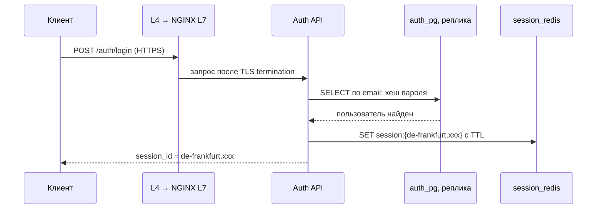

- Пароль проверяется по **локальной реплике** `auth_pg`: в каждом ДЦ есть копия таблицы пользователей только для чтения. Писать в основную базу для логина не нужно.
- Сессия создаётся в Redis этого ДЦ. В начале её идентификатора — **код ДЦ** (`de-frankfurt.…`). По нему любой другой ДЦ поймёт, где сессия родилась.
- В пик **1 997 логинов в секунду**: 115 млн DAU × 1 логин / 86 400 с × 1.5.

### 4.3. Создание встречи

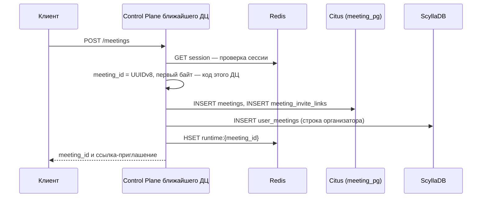

- Встреча закрепляется за ДЦ, который обработал запрос. Это **`home_dc`** — «домашний» ДЦ встречи. Обычно это ближайший к организатору ДЦ.
- Код `home_dc` записан прямо в `meeting_id` (формат UUIDv8 позволяет занять первые биты своими данными) и в ссылку-приглашение. Поэтому любой ДЦ мира, получив `meeting_id`, сразу знает, где «живёт» встреча, без глобального справочника.
- Одна операция трогает 4 строки, в пик **521 создание в секунду** → 2 083 строк в секунду.

### 4.4. Вход во встречу (join)

Это самый «развилочный» сценарий: участник может войти из другой страны.

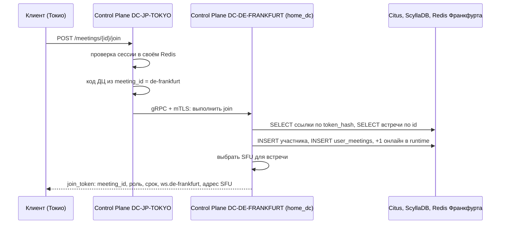

| Шаг | Что происходит | Зачем |
| --- | -------------- | ----- |
| 1 | Запрос приходит в ближайший ДЦ (здесь — Токио) | Так решил DNS |
| 2 | Проверяется сессия в локальном Redis | Только авторизованные входят во встречи |
| 3 | По первому байту `meeting_id` определяется `home_dc` | Без обращения к справочнику |
| 4 | Если `home_dc` другой, запрос **проксируется** туда по защищённому каналу gRPC + mTLS | Все данные встречи — в одном ДЦ |
| 5 | В `home_dc`: проверка ссылки и статуса встречи (Citus), запись участника и строки его списка встреч (ScyllaDB), +1 к числу участников онлайн (Redis) | 6 строк на вход |
| 6 | Control Plane выбирает SFU для встречи: все участники одной встречи — на одном SFU | Иначе участники не увидят друг друга |
| 7 | Клиент получает **`join_token`** — подписанный пропуск. Дальше WebSocket, чат и медиа проверяют подпись и не ходят за сессией | Меньше нагрузки на хранилище сессий |

В пик **5 208 входов в секунду**: 300 млн участий / 86 400 × 1.5. Каждый вход трогает 6 строк → **31 250 строк в секунду**.

**Что говорить:** «Запрос приходит в ближайший ДЦ. По коду ДЦ в `meeting_id` он понимает, где живёт встреча, и проксирует `join` туда. Все данные встречи пишутся в её `home_dc`, а клиент получает подписанный `join_token` с адресом WebSocket и SFU этого ДЦ».

### 4.5. Видео и звук (медиа)

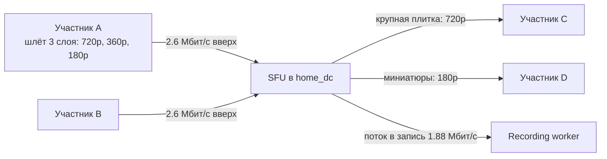

- Видео идёт **напрямую** на публичный адрес SFU, который клиент получил в `join_token`. Балансировщики L4 и L7 в этом не участвуют: им не нужно пропускать 78 Тбит/с.
- **SFU** (Selective Forwarding Unit) пересылает пакеты, а не перекодирует видео. Перекодирование — работа **MCU**, и это очень дорого по процессору.
- **Simulcast**: каждый клиент отправляет своё видео сразу в нескольких качествах. SFU каждому зрителю отдаёт подходящий слой: видео говорящего в крупной плитке — 720p, миниатюры — низким слоем.
- **ABR** (adaptive bitrate): SFU по отчётам RTCP видит потери, задержку и джиттер у каждого зрителя. При плохой сети он сразу переключает зрителя на слой ниже, при стабильной — плавно повышает. Звук важнее видео.
- **NAT и межсетевые экраны.** SFU — ICE-Lite с публичным адресом: соединение начинает клиент, поэтому для связи с SFU не нужны ни STUN, ни TURN. Если UDP закрыт, клиент подключается к тому же SFU по TCP. Не поддерживаем в MVP только сети, где прокси пропускает исключительно TLS на порт 443: там нужен TURN по TLS — это улучшение после MVP.
- На одного участника: 2.6 Мбит/с вверх + 1.8 вниз + 0.08 аудио + 0.15 демонстрация = 4.63 Мбит/с. В пик 16.875 млн участников → **78 131 Гбит/с**. Плюс поток в запись 3 172.5 Гбит/с → SFU обрабатывают **81 304 Гбит/с**.
- Один SFU-сервер на 6 ядер тянет **2.847 Гбит/с** (упирается в процессор) → **28 570 серверов**.

**Что говорить:** «Медиа — самый тяжёлый блок: 78 Тбит/с в пик. Поэтому SFU, а не MCU, simulcast и ABR. Видео идёт мимо балансировщиков, напрямую на адрес SFU из ответа `join`. SFU упирается в процессор: 2.85 Гбит/с на сервер по замеру Jitsi, отсюда 28.6 тысячи серверов».

### 4.6. Присутствие и heartbeat

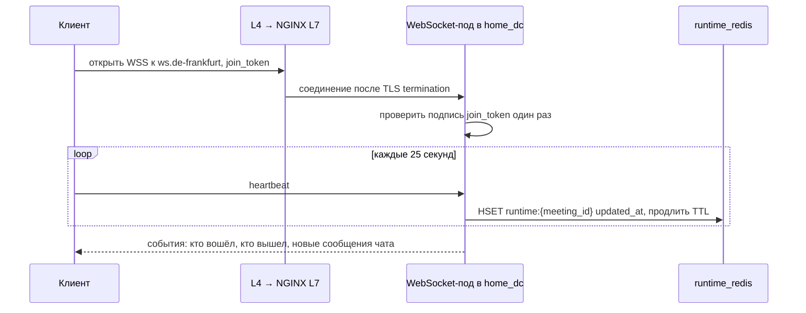

- У каждого участника одно постоянное **WebSocket**-соединение (WSS — с шифрованием) с WebSocket-подом в `home_dc` встречи.
- **Heartbeat** — сообщение «я ещё здесь» раз в 25 секунд. По нему сервис понимает, кто онлайн. Если heartbeat-ы перестали приходить, у ключа встречи в Redis истекает **TTL**, и брошенная встреча удаляется сама.
- Числа: 16.2 млрд участие-минут × 60 / 25 = 38.88 млрд heartbeat-ов в сутки → **675 000 в секунду** в пик. Обратно сервер рассылает события: (чат + вход + выход) × 9 остальных участников = **328 125 сообщений в секунду**.
- **Одновременных соединений 16.9 млн.** Именно это число определяет размер NGINX L7 и WebSocket-подов: каждое соединение занимает память.

### 4.7. Чат

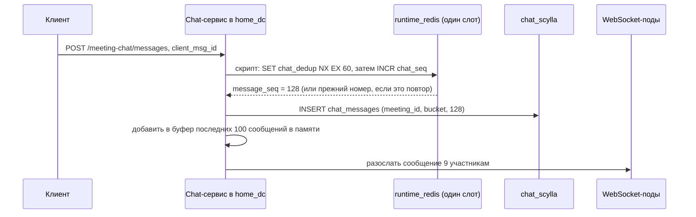

- **Порядок сообщений.** Номер `message_seq` выдаёт счётчик в Redis (`INCR`), один на встречу. Клиент читает чат «от последнего увиденного номера».
- **Идемпотентность.** Если сеть оборвалась и клиент повторил отправку, у повтора тот же `client_msg_id`. Скрипт в Redis проверяет его (`SET … NX` — «записать, только если ключа нет») и возвращает уже выданный номер вместо нового. Дубля не будет. Проверку пришлось сделать в Redis: в ScyllaDB нет `UNIQUE`, повторный `INSERT` с тем же ключом просто перезаписывает строку.
- Ключи встречи в Redis лежат в **одном слоте** благодаря hash tag `{meeting_id}`. Поэтому проверка повтора и выдача номера — один атомарный скрипт.
- История чата при входе отдаётся из **буфера в памяти** Chat-сервиса. В ScyllaDB идут только промахи.
- Числа: 300 млн участий × 5 сообщений = 1.5 млрд сообщений в сутки → **26 042 в секунду** в пик. Хранилище — 45 ТБ за 30 дней.

### 4.8. Запись встречи

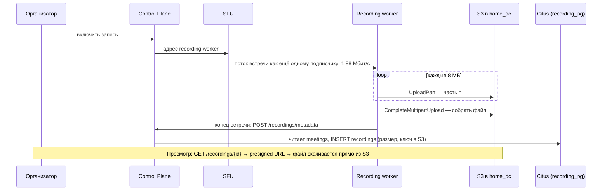

- Запись делает отдельный **recording worker**, а не клиент. SFU отправляет ему потоки встречи, как обычному участнику.
- Файл загружается в S3 частями по 8 МБ (**multipart upload**). Если сбой — воркер дозагружает только недостающие части. Одна запись ≈ 0.761 ГБ ≈ 95 частей.
- Метаданные записи пишутся в БД **один раз — в конце встречи**: `POST /recordings/metadata` добавляет строку в `recordings`. В пик это не больше 521 записи в секунду.
- Просмотр: сервис отдаёт **presigned URL** — временную подписанную ссылку. Файл скачивается из S3 напрямую, мимо наших серверов.
- Числа: 30 млн встреч × 0.761 ГБ = **22.8 ПБ в сутки**, **685 ПБ за 30 дней** — если записывать каждую встречу. В пик поток в запись 3 172.5 Гбит/с → **1 127 воркеров** и 49 570 загрузок частей в секунду.

### 4.9. Список встреч пользователя

- Запрос `GET /users/{id}/meetings?limit=100` идёт в ближайший ДЦ и читает таблицу **`user_meetings`** из локальной копии ScyllaDB.
- `user_meetings` — **read model**: таблица, заточенная под один вопрос «покажи 100 последних встреч пользователя». Строки в неё пишет `home_dc` встречи при создании, входе и выходе. ScyllaDB копирует таблицу **во все ДЦ** (RF=3 в каждом). Поэтому список доступен локально в любой стране, без JOIN и без обхода всех шардов.
- Копия в другом ДЦ может немного отставать — это **eventual consistency**. Для списка встреч это нормально.
- Числа: 3 открытия на DAU в день → **5 990 запросов в секунду** в пик по 100 строк → 598 958 строк в секунду.

### 4.10. Что копируется между дата-центрами

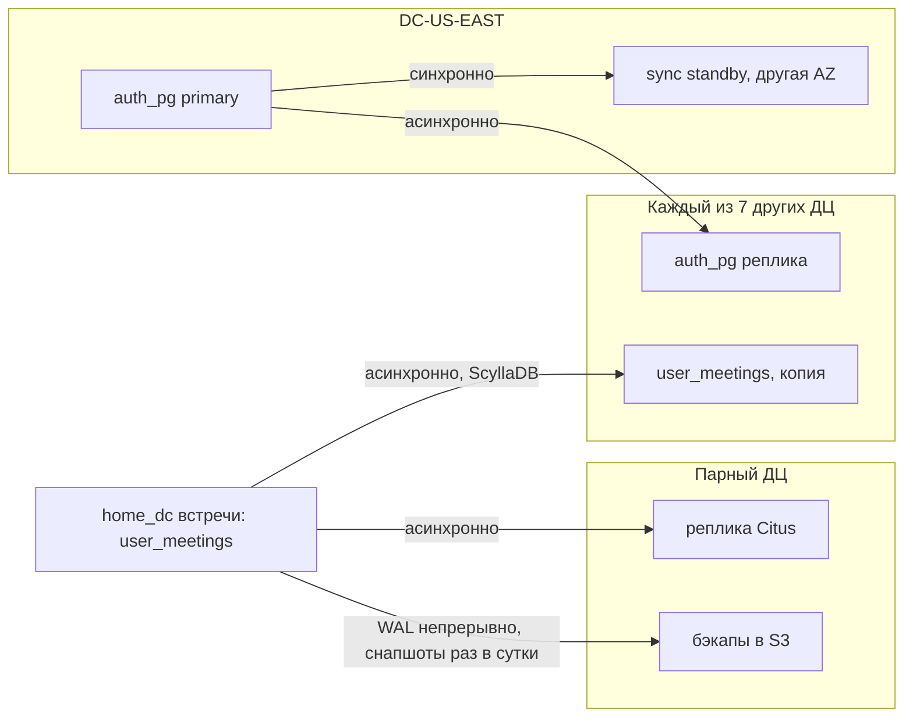

| Данные | Куда копируются | Как |
| ------ | --------------- | --- |
| `users` | Во все ДЦ | Primary в `DC-US-EAST` пишет синхронно в standby в соседней зоне и асинхронно — напрямую в реплики 7 остальных ДЦ |
| `user_meetings` | Во все ДЦ | ScyllaDB сама реплицирует keyspace: RF=3 в каждом ДЦ |
| Встречи, ссылки, метаданные записей (Citus) | В парный ДЦ | Асинхронная реплика + архив WAL в S3 парного ДЦ |
| Участники, чат (ScyllaDB `home_dc`) | Только бэкап | Снапшоты раз в сутки в S3 парного ДЦ |
| Сессии, онлайн-состояние (Redis) | Никуда | Данные эфемерные: потеряется — восстановится |
| Файлы записей (S3) | Никуда | ≥ 3 копии внутри ДЦ в 3 зонах; копия 685 ПБ в другом регионе удвоила бы главную статью расходов |

### 4.11. Что происходит при поломках

| Что сломалось | Что видит пользователь | Что делает система |
| ------------- | ---------------------- | ------------------ |
| Под сервиса (Auth, Control Plane, Chat, WebSocket) | Почти ничего: повтор запроса или переподключение | Kubernetes пересоздаёт под; запрос уходит в соседний. Сервисы **stateless** — не хранят состояние у себя |
| Узел NGINX L7 | Переподключение WebSocket | keepalived исключает узел; клиенты открывают соединение на живой узел (резерв N+1) |
| Директор L4 | HTTPS- и WSS-соединения рвутся, клиенты переподключаются | keepalived за секунды переносит адрес VIP на резервный директор по протоколу VRRP |
| Сервер SFU | Короткое замирание видео и звука | Control plane назначает встрече новый SFU, клиент получает адрес по WebSocket и заново устанавливает медиасоединение (ICE + DTLS) |
| Узел Redis | `runtime_redis`: часть онлайн-состояния пропадает до следующих heartbeat-ов. `session_redis`: часть свежих сессий может потеряться — эти пользователи войдут заново | Реплика становится master; онлайн-состояние восстанавливают heartbeat-ы |
| Узел ScyllaDB | Ничего | RF=3: данные есть ещё на двух узлах, кворум жив |
| Основной узел PostgreSQL | Ничего | Patroni автоматически делает синхронную standby основной — без потери данных |
| **Целый ДЦ** | Звонки этого ДЦ обрываются, переподключение за минуту | См. ниже |

**Отказ целого ДЦ.** Худший случай — самый большой ДЦ, Франкфурт (35.69% нагрузки):

1. GTM видит, что ДЦ не отвечает на проверки, и убирает его из DNS-ответов: 3 проверки по 10 с + TTL 30 с ≈ **1 минута**.
2. Новые подключения уходят в Лондон, затем в US-EAST и другие ДЦ — по свободной ёмкости.
3. Клиенты оборванных встреч переподключаются **со случайной задержкой в пределах минуты**, чтобы не устроить шторм. Без задержки 6 млн клиентов открыли бы новые TLS-соединения разом; 21 оставшийся узел NGINX справился бы за ≈ 43 секунды.
4. `join_token` подписан, его проверит любой ДЦ, поэтому комната пересоздаётся в резервном ДЦ без обращения к упавшей базе.
5. Дежурный по инструкции повышает реплику Citus в парном ДЦ до основной: запланированные встречи снова доступны через минуты.
6. **Хватит ли ёмкости?** Двойной комплект серверов не держим. На время аварии все SFU снижают видео до профиля «high-quality» (1.0/0.6 Мбит/с вместо 2.6/1.8). Нагрузка на участника падает до 41.9% от обычной — с учётом потока в запись. Оставшиеся ДЦ имеют 64.31% штатной ёмкости. 41.9% < 64.31% — помещается, даже если пики всех ДЦ совпали.

### 4.12. Пользователь залогинился в США и улетел в Японию

Это вопрос Быкова с прошлой защиты. Ответ — сценарий по шагам:

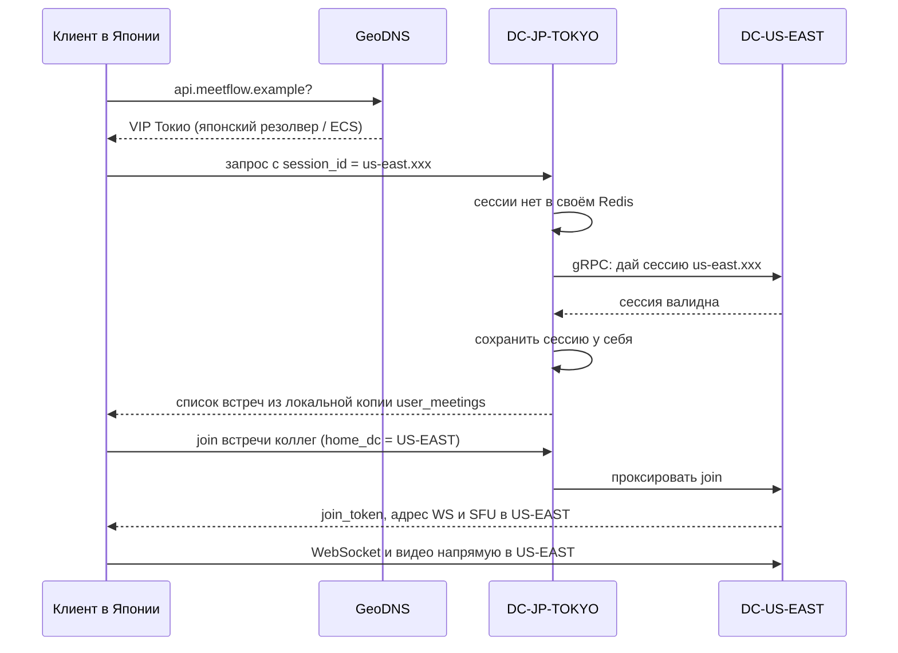

1. **В США** пользователь залогинился, сессия `us-east.xxx` лежит в Redis `DC-US-EAST`.
2. **В Японии** DNS видит японский адрес и отправляет его в Токио. ДЦ выбирается по тому, где пользователь сейчас, а не где он логинился.
3. В Токио этой сессии нет. По префиксу `us-east` Токио **один раз** забирает её из США (+153 мс) и сохраняет у себя. **Перелогиниваться не нужно.**
4. Профиль читается из локальной реплики. Если пользователь меняет профиль, запись уходит в основную базу в США.
5. Список встреч читается из локальной копии: `user_meetings` есть во всех ДЦ.
6. Встреча американских коллег по-прежнему живёт в США. Токио проксирует `join` туда, а видео идёт на SFU в США. Сеть в одну сторону ≈ 77 мс. Норма разговора по ITU-T G.114 — до 150 мс «от рта до уха», и в неё входят ещё кодек и путь до собеседника. **Разговор возможен, но близко к границе нормы.** Улучшение после MVP — каскад SFU: клиент подключается к SFU в Токио, а тот пересылает поток в SFU США по магистрали.
7. Если пользователь сам создаст встречу в Японии, её `home_dc` будет Токио.
8. Если он остался жить в Японии, **ничего мигрировать не нужно**: данные пользователя есть во всех ДЦ, а встречи привязаны к своим ДЦ, а не к людям.

**Что говорить (коротко):** «DNS отправит его в Токио. Сессия переедет один раз по префиксу `session_id`, перелогиниваться не нужно. Профиль и список встреч читаются локально. Старые встречи живут в своём ДЦ в США — `join` проксируется туда. Новые встречи будут в Токио. Мигрировать ничего не надо, потому что в системе нет домашнего ДЦ пользователя — есть домашний ДЦ встречи».

---

## Часть 5. Разбор работы по разделам

Каждый раздел разобран по одной схеме: **что требует методичка → что сделано → как посчитано → почему так → что говорить → какие вопросы зададут**. Номера пунктов (2.1, 3.4…) — это номера в README.

### Раздел 1. Тема и целевая аудитория

**Что требует методичка.** Тип сервиса и реальные аналоги, аудитория не меньше 1 млн в день, её размер и местоположение, 3–7 ключевых функций MVP, ключевые продуктовые решения.

**Что сделано.**

- **1.1–1.2.** Сервис — Zoom-подобные видеовстречи. Аналоги: Zoom, Microsoft Teams, Google Meet. Масштаб: 320 млн MAU, 115 млн DAU, 300 млн участий в день.
- **1.3.** Шесть функций MVP: создание встречи, вход по ссылке, групповое видео 720p, демонстрация экрана, чат, облачная запись. Для каждой указано, какая метрика из раздела 2 её описывает.
- **1.4.** Ключевые продуктовые решения: считаем от групповой встречи; базовое качество — 720p; запись в облако с квотой; частота чата — явное допущение; данные хранятся 30 дней; записывается каждая встреча (худший случай); материковый Китай не обслуживаем.
- **1.5.** Аудитория — весь мир кроме материкового Китая, 8 дата-центров.

**Почему так.**

- **MVP** — минимальный набор функций, без которого продукт не имеет смысла. Методичка просит урезать функционал, чтобы проектировать ядро системы, а не вспомогательные службы.
- **Ключевые продуктовые решения** меняют архитектуру. «Записываем каждую встречу» даёт 685 ПБ и 59% бюджета. «Храним 30 дней» ограничивает все объёмы. «Без Китая» меняет доли ДЦ.
- **Китай исключён**, потому что для него нужен отдельный локальный контур: требования к локализации данных и блокировки трафика. Это решение продукта, его можно пересмотреть.

**Что говорить.** «MeetFlow — сервис групповых видеовстреч, как Zoom. Масштаб взят у лидеров рынка: 320 миллионов пользователей в месяц и 115 миллионов в день у Teams, 300 миллионов участий во встречах в день у Zoom. В MVP шесть функций: создание встречи, вход по ссылке, видео 720p, демонстрация экрана, чат и облачная запись».

**Вопросы.**

- *Почему аудитория Teams, а встречи Zoom?* — Каждая компания раскрывает свои числа: Microsoft — пользователей, Zoom — участия и длительность встреч. Берём каждое число там, где оно опубликовано, и подписываем год.
- *Почему числа 2020 года?* — MAU свежий, за 2023 год. Дневные числа — DAU Teams и участия Zoom — публичные значения 2020 года; берём их как консервативную оценку и подписываем год. Если спросят про 145 млн DAU, которые Microsoft называла в апреле 2021 года: DAU у нас влияет только на лёгкие запросы. С 145 млн логинов станет ≈ 2 517 в секунду вместо 1 997, а число серверов почти не изменится — тяжёлую нагрузку задают 300 млн участий. Актуальность ниши подтверждаем финансами Zoom за 2026 год: $4.87 млрд выручки.
- *Чем DMP отличается от DAU?* — DAU — уникальные люди за день, DMP — участия во встречах. Один человек на трёх встречах — это 1 DAU и 3 участия.

### Раздел 2. Расчёт нагрузки

**Что требует методичка.** Пересчитать аудиторию в продуктовые и технические метрики. Продуктовые — MAU, DAU, средний объём хранилища пользователя по типам (в штуках и ГБ), действия пользователя в день по типам, сводной таблицей. Технические — объём хранения по типам (в штуках и ТБ), трафик по типам (пиковый в Гбит/с и суточный в ГБ), RPS по методам (средний и пиковый, сводной таблицей). SimilarWeb как первоисточник запрещён.

#### 2.1. Исходные данные

Все входные числа собраны в одну таблицу с источниками (см. часть 3). Обратите внимание на коэффициент пика **K = 1.5**: он умножает все пиковые значения.

#### 2.2. Продуктовые метрики — вывод по шагам

Этот вывод нужно уметь повторить устно:

```text
Шаг 1. Встреч в сутки        = 300 млн участий / 10 участников         = 30 млн встреч
Шаг 2. Участие-минут в сутки = 300 млн × 54 мин                        = 16.2 млрд
Шаг 3. Онлайн в среднем      = 16.2 млрд / 1 440 минут в сутках         = 11.25 млн человек
Шаг 4. Онлайн в пик          = 11.25 млн × K 1.5                        = 16.875 млн
                               = одновременных WebSocket-соединений
Шаг 5. Встреч одновременно   = 16.875 млн / 10                          = 1.6875 млн
```

Почему шаг 3 работает: если за сутки набирается 16.2 млрд «человеко-минут» во встречах, а в сутках 1 440 минут, то в каждую минуту в среднем во встречах сидят 16.2 млрд / 1 440 = 11.25 млн человек. Это **закон Литтла**: среднее число объектов в системе = поток × время пребывания.

**Проверка по аналогу.** Zoom раскрывал годовой темп более 3.5 трлн минут встреч на конец октября 2020 года, это ≈ 9.6 млрд минут в сутки. У нас 16.2 млрд: мы считаем, что каждый участник сидит все 54 минуты. **Ошибка в безопасную сторону**: онлайн, трафик и число серверов завышены, а не занижены.

**Сводная таблица (требование методички).** Работа даёт:

- **хранилище на пользователя** (на MAU за 30 дней): профиль — 256 Б, 2.81 созданной встречи — 720 Б, 2.81 ссылки-приглашения — 360 Б, 28.1 участия — 3.6 КБ, 28.1 строки списка встреч — 3.6 КБ, 140.6 сообщения чата — 140.6 КБ, итого без записей ≈ 149 КБ. Записи — 2.14 ГБ в худшем случае при квоте аналога 10 ГБ;
- **действия на DAU в сутки**: логин — 1, создание встречи — 0.26, вход — 2.61, выход — 2.61, сообщений в чат — 13.04, загрузка истории чата — 2.61, открытие списка встреч — 3, heartbeat — 338 (автоматически).

Как получено «2.81 встречи на пользователя»: 900 млн встреч за 30 дней / 320 млн MAU = 2.81.

#### 2.3. Хранение

| Данные | Штук | Объём | Как посчитано |
| ------ | ---: | ----: | ------------- |
| Профили | 320 млн | 81.92 ГБ | 320 млн × 256 Б |
| Метаданные встреч, 30 дней | 900 млн | 230.4 ГБ | 30 млн × 30 × 256 Б |
| Ссылки-приглашения | 900 млн | 115.2 ГБ | 30 млн × 30 × 128 Б |
| Участники встреч | 9 млрд | 1.152 ТБ | 300 млн × 30 × 128 Б |
| Списки встреч | 9 млрд | 1.152 ТБ | так же |
| Сессии | 115 млн | 14.72 ГБ | 115 млн × 128 Б |
| Чат | 45 млрд | 45 ТБ | 1.5 млрд × 30 × 1 КБ |
| **Итого без записей** | | **47.75 ТБ** | |
| Одна запись | | 0.761 ГБ | (1.8 + 0.08) Мбит/с × 54 мин × 60 с / 8 / 1000 |
| Записи за 30 дней | 900 млн | **685.26 ПБ** | 30 млн × 0.761 ГБ × 30 |

**Почему запись = 1.88 Мбит/с × 54 минуты.** Запись — это то, что видит участник: видео на приём (1.8 Мбит/с) и звук (0.08). Делим на 8, чтобы перевести биты в байты.

**Объём хранения не зависит от K.** Пик меняет скорость, а не суточный объём: за пиковый час пишется больше, за ночь — меньше, а за сутки — столько же.

#### 2.4. Трафик и RPS

**Трафик.** Средний трафик = онлайн в среднем × битрейт; пиковый = средний × 1.5.

| Тип | Средний | Пиковый |
| --- | ------: | ------: |
| Видео вверх: 11.25 млн × 2.6 Мбит/с | 29 250 Гбит/с | 43 875 Гбит/с |
| Видео вниз: × 1.8 | 20 250 | 30 375 |
| Аудио: × 0.08 | 900 | 1 350 |
| Демонстрация экрана: × 0.15 | 1 687.5 | 2 531.25 |
| **Медиа итого** | **52 087.5** | **78 131.25** |
| Поток в запись (внутри ДЦ): 1.125 млн встреч × 1.88 Мбит/с | 2 115 | 3 172.5 |

> Единицы: **бит ≠ байт**. Мбит/с (мегабиты) делим на 8, чтобы получить МБ/с (мегабайты). Сетевые карты меряют в битах (10 Гбит/с), диски — в байтах.

**Почему вверх больше, чем вниз.** Из-за simulcast: каждый отправляет своё видео сразу в нескольких качествах, а получает от каждого собеседника только одно, обычно маленькое.

**RPS.** Формула одна для всех методов:

```text
средний RPS = событий в сутки / 86 400 секунд
пиковый RPS = средний × 1.5
```

| Метод | Событий в сутки | Средний | Пиковый |
| ----- | --------------: | ------: | ------: |
| Логин | 115 млн | 1 331 | 1 997 |
| Создание встречи | 30 млн | 347 | 521 |
| Вход / выход | по 300 млн | 3 472 | 5 208 |
| **Heartbeat** | 38.88 млрд | 450 000 | **675 000** |
| Сообщение в чат | 1.5 млрд | 17 361 | 26 042 |
| История чата | 300 млн | 3 472 | 5 208 |
| Список встреч | 345 млн | 3 993 | 5 990 |
| Метаданные записи / открытие записи | до 30 млн | до 347 | до 521 |
| Рассылка событий по WebSocket | (чат + вход + выход) × 9 | 218 750 | 328 125 |

**Главный вывод раздела.** Основная нагрузка — не API-запросы, а медиа (78 Тбит/с) и присутствие (675 тыс. heartbeat в секунду и 16.9 млн соединений). API — тысячи запросов в секунду.

**Что говорить.** «300 миллионов участий при встрече в 10 человек — это 30 миллионов встреч в сутки. Умножаем участия на 54 минуты и делим на минуты в сутках — получаем 11.25 миллиона человек онлайн в среднем, в пик с коэффициентом 1.5 — 16.9 миллиона. Умножаем на битрейт Zoom — 78 терабит в секунду медиа в пик. Heartbeat раз в 25 секунд даёт 675 тысяч сообщений в секунду. Записи всех встреч за 30 дней — 685 петабайт».

**Вопросы.**

- *Почему K = 1.5?* — Это отношение пикового часа к среднему. Сервис глобальный: когда в Америке рабочий день, в Азии ночь, и общая кривая сглажена. Значение задал ревьюер; в прошлой версии было 3, и все пики были вдвое больше.
- *Почему пик не влияет на хранилище?* — Пик — это скорость, а не объём за сутки.
- *Почему heartbeat раз в 25 секунд?* — Это значение по умолчанию в Socket.IO, популярной библиотеке WebSocket. Чаще — больше нагрузки, реже — дольше замечаем, что участник пропал.
- *Откуда 5 сообщений чата?* — Это явное допущение: частоту чата никто не публикует. Она влияет только на нагрузку и хранилище чата, это меньше 1% бюджета.
- *Почему каждая встреча записывается?* — Худший случай: реальная доля записываемых встреч неизвестна. Из-за этого записи — 59% бюджета, и ретеншн записей — главный рычаг экономии.

### Раздел 3. Глобальная балансировка

**Что требует методичка.** Разбиение по доменам; обоснование расположения ДЦ через влияние на продуктовые метрики; распределение запросов по ДЦ; схема DNS-балансировки; схема Anycast-балансировки; механизм регулировки трафика между ДЦ.

#### 3.1. Домены

Сервис разбит на домены: Auth/Users, Meeting Control Plane, Media/SFU, Presence, Chat, Recording, список встреч. Для каждого указано, **куда идёт запрос** (ближайший ДЦ или `home_dc` встречи) и **где точка записи**. Главное правило: API обслуживает ближайший ДЦ, всё, что относится к встрече, — `home_dc` встречи.

#### 3.2. Где стоят 8 дата-центров и почему такие доли

**Почему не один ДЦ.**

1. **Задержка.** Свет в оптоволокне не мгновенный: пинг Токио ↔ Вашингтон ≈ 153 мс. Для видеозвонка сервер должен быть близко.
2. **Отказоустойчивость.** Один ДЦ — одна точка отказа.
3. **Законы о данных.** Например, отдельный ДЦ для Великобритании после Brexit.

**Как посчитаны доли — три шага.**

1. **Доля страны = её доля в мировом ВВП** (МВФ, 2025 год). Логика: видеовстречи — рабочий инструмент, поэтому их объём следует за экономикой страны, а не за численностью населения. Материковый Китай исключён. Остаётся 194 экономики на 98 537.9 млрд $.
2. **Каждую страну относим к ближайшему по задержке ДЦ.**
3. **США делим на восток и запад по населению** (перепись 2020: запад — 23.7%). Внутри одной страны деловая активность на человека примерно одинакова.

| ДЦ | Город | Кого обслуживает | Доля |
| -- | ----- | ---------------- | ---: |
| `DC-DE-FRANKFURT` | Франкфурт | Европа без Великобритании, СНГ, Ближний Восток, Африка | **35.69%** |
| `DC-US-EAST` | Ашберн, Вирджиния | Восток и центр США, Канада, Мексика, Центральная Америка, Карибы | **28.84%** |
| `DC-US-WEST` | Сан-Хосе | Запад США | 7.40% |
| `DC-JP-TOKYO` | Токио | Япония, Корея, Тайвань, Монголия | 7.36% |
| `DC-SG-SINGAPORE` | Сингапур | Юго-Восточная Азия, Австралия, Океания, Гонконг | 6.97% |
| `DC-IN-MUMBAI` | Мумбаи | Индия и Южная Азия | 5.03% |
| `DC-BR-SAOPAULO` | Сан-Паулу | Южная Америка | 4.65% |
| `DC-UK-LONDON` | Лондон | Великобритания | 4.06% |

**Сверка.** По макрорегионам получается Америка 40.89%, EMEA 39.75%, APAC 19.36%. У Zoom в выручке Америка — 72.1%. Расхождение объясняется тем, что Zoom исторически сильнее всего в США. Наш масштаб — масштаб лидера рынка (Teams), поэтому берём нейтральную оценку по экономике.

**Почему не SimilarWeb.** Методичка прямо запрещает его как первоисточник из-за погрешности. В прошлой версии доли были на SimilarWeb, и 42.5% нагрузки попадало в абстрактный «прочий пул» без места и серверов. Ревьюеру это не понравилось.

#### 3.3. Нагрузка по ДЦ

Любая метрика ДЦ = глобальная метрика × доля ДЦ. Пример: heartbeat во Франкфурте = 675 000 × 35.69% = 240 908 в секунду. Предполагаем, что встречи распределены по `home_dc` так же, как пользователи: организатор и большинство участников обычно из одного региона.

#### 3.4. Точки записи — ответ на замечание ревьюера

Правило: **у каждого объекта одна точка записи** (primary), читать по возможности из ближайшей копии. Тогда не бывает двух одновременных записей одного объекта в разных ДЦ и не нужен сложный multi-master.

| Данные | Где пишутся | Где читаются |
| ------ | ----------- | ------------ |
| `users` | Один primary на весь мир — `DC-US-EAST` | Локальная реплика в каждом ДЦ |
| Сессии | ДЦ, где был логин | Там же; другой ДЦ переносит сессию по префиксу |
| Встречи, ссылки, участники, чат, онлайн-состояние, записи | `home_dc` встречи | `home_dc` |
| Список встреч `user_meetings` | `home_dc` встречи | Локальная копия в любом ДЦ |

**Почему `users` — один primary.** Нужна глобальная уникальность email: два человека в разных ДЦ не должны зарегистрировать один адрес. Записей мало — даже если каждый DAU раз в сутки меняет профиль, это не больше 1 997 записей в секунду, и один сервер справляется.

**Если запись в другом ДЦ.** Запрос проксируется туда по gRPC с mTLS. Это плюс сетевая задержка, но только для редких записей. После своей записи пользователь пару секунд читает из primary (**read-your-writes**), пока реплика не догонит.

**Отказ точки записи.** Внутри ДЦ Patroni автоматически переключает primary на синхронную standby в соседней зоне — без потери данных. При отказе всего `DC-US-EAST` реплику в `DC-US-WEST` повышает **дежурный по инструкции**, а не автомат: второй ДЦ не может сам отличить отказ первого от обрыва связи между ними. Логин всё это время работает на локальных репликах.

#### 3.5–3.6. DNS или Anycast — ответ на замечание ревьюера

**Ответ: ДЦ выбирает и переключает DNS.** GeoDNS/GTM — managed-сервис, который отвечает каждому пользователю адресом ближайшего здорового ДЦ с учётом весов.

| Имя | Как выбирается |
| --- | -------------- |
| `api.meetflow.example` | GeoDNS: гео + задержка + здоровье + веса, TTL 30 с |
| `ws.<dc>.meetflow.example` | Фиксированное имя ДЦ встречи, приходит в ответе `join` |
| Адрес SFU | Не DNS: приходит в ответе `join` |
| `rec.<dc>.meetflow.example` | Скачивание записей из ДЦ встречи |
| `static.meetflow.example` | CDN провайдера |

**Где Anycast и почему только там.** Anycast — один IP, который анонсируется по BGP из многих точек; пакет приходит в ближайшую по маршрутам. Он хорош для **коротких запросов без состояния** — DNS и статика. Для API, WebSocket и медиа он не подходит:

1. BGP выбирает путь по своим правилам (AS-path), а не по загрузке ДЦ. Нельзя задать веса или вывести ДЦ из работы.
2. Если маршрут перестроится посреди звонка, пакеты долгого соединения уйдут в другой ДЦ, где о нём ничего не знают, и соединение порвётся.

**Время переключения.** Проверка здоровья раз в 10 секунд (минимум на тарифе Enterprise у Cloudflare), 3 неудачи подряд — ДЦ выведен (≈ 30 с), плюс TTL 30 с. Итого ≈ **1 минута**. На случай резолверов, которые кешируют дольше TTL, у приложения есть свой запасной список адресов.

#### 3.7. Регулировка трафика

Вес ДЦ в GTM = совпадение по географии × здоровье × вес ёмкости × ручной вес. Перегруз — снижаем вес ёмкости. Плановые работы — ручной вес 0 (**drain**): новые встречи не создаются, текущие доживают. Отказ — здоровье 0. У каждого ДЦ есть порядок резервных ДЦ, но трафик упавшего ДЦ раздаётся по нескольким ДЦ пропорционально свободной ёмкости: Лондон (4%) не вместит Франкфурт (36%).

#### 3.8. Переезд пользователя — см. часть 4.12.

**Что говорить по разделу 3.** «Восемь ДЦ, доли — по ВВП стран из базы МВФ без Китая, США делим по переписи. Самые крупные — Франкфурт, 36%, и восток США, 29%. ДЦ выбирает DNS: GeoDNS с проверками здоровья и весами, переключение за минуту. Anycast только у DNS-серверов, потому что BGP не знает о загрузке ДЦ и при смене маршрута рвёт долгие соединения. Точка записи у каждого объекта одна: пользователи — в Вирджинии с репликами везде, встреча — в своём домашнем ДЦ, код которого зашит в идентификатор встречи».

**Вопросы.**

- *Почему по ВВП, а не по населению?* — Видеовстречи — рабочий инструмент. По населению Индия и Африка получили бы больше всего нагрузки, что не соответствует реальному использованию.
- *А если реальные доли другие?* — Меняются только размеры пулов в ДЦ, не архитектура. GTM перераспределит подключения весами, а после запуска доли уточняются по GeoIP-аналитике.
- *Зачем Лондон, если Франкфурт рядом?* — Отдельная юрисдикция после Brexit и пара для резерва Франкфурта.
- *Почему у Франкфурта 36%?* — Он обслуживает всю Европу без Великобритании, СНГ, Ближний Восток и Африку — на эти страны приходится 35.69% ВВП 194 экономик без Китая (35 168.5 из 98 537.9 млрд $).
- *Что, если упадёт Франкфурт?* — См. часть 4.11: DNS уберёт его за минуту, нагрузка уйдёт в Лондон и другие ДЦ, на время аварии видео снижается до «high-quality», и ёмкости хватает.

### Раздел 4. Локальная балансировка

**Что требует методичка.** Схема балансировки со всеми уровнями и механизмами резервирования, формула резервирования (N×2 или N+1), расчёт числа балансировщиков; ограничители — SSL termination и пропускная способность сети.

#### 4.1–4.2. Уровни

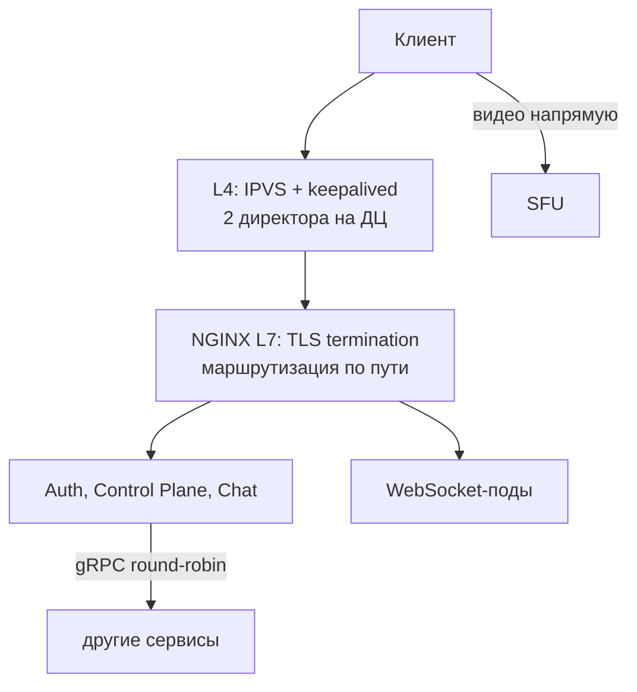

| Уровень | Что делает | Почему такой |
| ------- | ---------- | ------------ |
| **L4** — IPVS + keepalived | Принимает TCP-соединения на общий адрес ДЦ (VIP) и раздаёт по узлам NGINX, не расшифровывая | Облачный балансировщик Selectel тестирован на 10 000 соединений и до 3–5 Гбит/с, а у нас в одном ДЦ до 6 млн соединений. Поэтому свой L4 на ядре Linux |
| **L7** — NGINX | Расшифровывает HTTPS, смотрит имя хоста и путь (`api.meetflow.example` + `/meetings/…`, `ws.<dc>.meetflow.example`) и отправляет в нужный сервис | Нужно читать содержимое запроса |
| **Медиа** | Идёт мимо L4 и L7 напрямую в SFU | 78 Тбит/с не нужно пропускать через балансировщики; встреча живёт на одном SFU |
| **Между сервисами** | gRPC, клиент сам раздаёт вызовы по подам (round-robin) | gRPC держит одно долгое соединение: L4 отправил бы все вызовы в один под |

**Direct Routing** — режим IPVS, в котором ответ идёт от NGINX к клиенту напрямую, мимо директора. Поэтому директор видит только входящий трафик и не упирается в сеть. **keepalived** проверяет здоровье узлов NGINX и при отказе директора переносит адрес VIP на резервный по протоколу **VRRP**.

#### 4.4. Ограничители NGINX

| Ограничитель | Значение на узел | Что значит |
| ------------ | ---------------: | ---------- |
| HTTPS-запросы по открытым соединениям | 341 232 RPS | Сколько запросов в секунду проходит через уже открытые соединения |
| Новые TLS-соединения | 6 676 в секунду | Сколько **рукопожатий** (handshake) в секунду: установка шифрования — самая дорогая операция TLS |
| Сеть | 8.8 Гбит/с | Пропускная способность |
| Память | 54 КБ на соединение | 20 КБ на проксирование WebSocket + до 34 КБ буферов TLS, худший случай |

Значения взяты для 16 ядер, а не для 24: в тестах NGINX «CPU» — это физические ядра, а облачный узел на 24 vCPU — это примерно 12 физических ядер с Hyper-Threading.

**Ошибка прошлой версии.** Раньше весь поток запросов, включая heartbeat, делился на скорость **новых** TLS-рукопожатий. Но heartbeat идёт по уже открытому WebSocket-соединению — рукопожатия у него нет. Теперь у каждого ограничителя своя метрика.

#### 4.5. Расчёт

```text
Запросов в секунду  = REST 51 215 + heartbeat 675 000 + рассылка 328 125 = 1 054 340
Новых TLS в секунду = 56 424   (худший случай: каждый REST-запрос без keep-alive + новое WSS на каждый join)
Трафик              = 1 054 340 × 1 КБ × 8 ≈ 8.43 Гбит/с
Соединений          = 16 875 000

Узлов по памяти в ДЦ = соединений_ДЦ × 54 КБ / 56 ГБ
Узел: 24 vCPU / 64 ГБ, из них 56 ГБ под соединения ≈ 1.04 млн соединений
```

Пример для Франкфурта: 6.02 млн соединений × 54 КБ = 325 ГБ / 56 ГБ = 5.8 → **6 узлов** по памяти. По запросам — 2, по TLS — 4, по сети — 1. Берём максимум (6) и добавляем 1 в резерв: **7 узлов**.

Итого **28 узлов NGINX** в режиме N+1 и 40 в режиме N×2. **Главный ограничитель — память под одновременные соединения**, потому что WebSocket держит соединение весь звонок.

#### 4.6. L4

Директор IPVS хранит таблицу соединений: 136 байт на соединение. Во Франкфурте 6.02 млн соединений → 0.82 ГБ при 32 ГБ памяти; входящий трафик ≤ 3 Гбит/с при карте 10 Гбит/с. Один директор справляется, второй — резерв. Итого **16 директоров**, по два на ДЦ.

**Резервирование.** **N+1** — нужно N узлов, ставим на один больше: переживаем отказ одного узла. **N×2** — двойной комплект: переживаем потерю целой зоны доступности.

**Что говорить.** «На входе ДЦ — свой L4 на IPVS с keepalived, два директора на ДЦ. Облачный балансировщик провайдера рассчитан на тысячи соединений, а у нас миллионы. Дальше NGINX: расшифровывает TLS и маршрутизирует по пути. NGINX упирается не в запросы, а в память под 16.9 миллиона одновременных WebSocket-соединений: 54 КБ на соединение, отсюда 28 узлов с резервом N+1. Видео идёт мимо балансировщиков — напрямую на SFU».

**Вопросы.**

- *Почему медиа мимо L7?* — SRTP уже зашифрован, а расшифровывать 78 Тбит/с на балансировщике дорого и бессмысленно. И встреча должна оставаться на одном SFU.
- *Как клиент находит SFU без балансировщика?* — Control Plane при `join` выбирает SFU для встречи и отдаёт его адрес. Балансирует именно Control Plane.
- *Что такое TLS termination?* — Расшифровка HTTPS на балансировщике. Дальше внутри ДЦ запрос идёт к сервису уже по внутренней сети.
- *Почему 54 КБ на соединение?* — 20 КБ — замер NGINX для WebSocket, 34 КБ — буферы OpenSSL, если они не освобождены. Это худший случай, реальные цифры меньше.

### Раздел 5. Логическая схема БД

**Что требует методичка.** Картинка таблиц, полей и связей **без привязки к СУБД**; таблица с описанием; **все** данные, включая файлы, кеши и буферы; размеры (строки, байты) и нагрузка (QPS) на чтение и запись; требования к консистентности; особенности распределения нагрузки по ключам.

**Что такое логическая схема.** Это ответ на вопрос «какие данные у нас есть и как они связаны», пока без ответа «в какой базе они лежат». Физическая схема (раздел 6) отвечает на второй вопрос.

#### 5.1. Таблицы

| Таблица | Что хранит | Ключ | Тип данных |
| ------- | ---------- | ---- | ---------- |
| `users` | Аккаунт пользователя | `id` | Постоянные |
| `user_sessions` | Сессии после логина | `session_id` | Состояние сессии, с TTL |
| `meetings` | Карточка встречи: владелец, тема, время, статус, `home_dc` | `id` | Постоянные |
| `meeting_participants` | Кто во встрече, роль, когда вошёл и вышел | `meeting_id + user_id` | Постоянные |
| `meeting_invite_links` | Ссылки-приглашения (токены) | `id` | Постоянные |
| `user_meetings` | Готовый список встреч пользователя | `user_id + meeting_id` | **Read model** |
| `chat_messages` | Сообщения чата | `id` | Постоянные, только добавление |
| `recordings` | Метаданные записи и ссылка на файл | `id` | Метаданные файла |
| `recording_upload_buffer` | Части файла записи до сборки | `chunk_id` | Буфер |

Кеши, счётчики и буферы — их тоже требует методичка:

| Сущность | Что хранит |
| -------- | ---------- |
| `meetings_runtime` | Онлайн-состояние идущей встречи: статус, сколько участников онлайн, какой SFU, когда был последний heartbeat |
| `chat_seq` | Последний выданный номер сообщения в чате встречи |
| `chat_dedup` | Уже принятые `client_msg_id` за последние 60 секунд — защита от дублей |
| `active_invite_tokens` | Кеш токенов приглашений за сутки |
| `chat_last100` | Последние 100 сообщений идущей встречи в памяти |

**Связи.** Пользователь создаёт встречи (1 ко многим), участвует во встречах (многие ко многим через `meeting_participants`), пишет сообщения. У встречи много участников, сообщений, записей и ссылок.

#### 5.2. Размеры и нагрузка

| Таблица | Строк | Объём | Чтений/с в пик | Записей/с в пик |
| ------- | ----: | ----: | -------------: | --------------: |
| `users` | 320 млн | 81.92 ГБ | 7 726 | ≤ 1 997 |
| `user_sessions` | 115 млн | 14.72 ГБ | 12 240 | 1 997 |
| `meetings` | 900 млн за 30 дней | 230.4 ГБ | 10 938 | 521 |
| `meeting_participants` | 9 млрд | 1.152 ТБ | 5 208 | 10 417 |
| `meeting_invite_links` | 900 млн | 115.2 ГБ | 5 208 | 521 |
| `user_meetings` | 9 млрд | 1.152 ТБ, копия в каждом ДЦ | 5 990 запросов по 100 строк | 10 938 |
| `chat_messages` | 45 млрд | 45 ТБ | ≤ 5 208 запросов, только промахи буфера | 26 042 |
| `recordings` | 900 млн | 230.4 ГБ + 685.26 ПБ файлов | ≤ 521 | 521 |
| `meetings_runtime` | 1.69 млн в пик | 0.864 ГБ | — | 685 938 |

Как читать строку: «`meeting_participants` пишется 10 417 раз в секунду в пик — это вход + выход (по 5 208), а читается 5 208 раз — при входе проверяем, не в комнате ли уже участник».

#### 5.3. Консистентность

**Консистентность** — насколько свежие данные видит читатель.

- **Strong (строгая)** — всегда последняя версия. Нужна, где ошибка недопустима: `users` (нельзя зарегистрировать два аккаунта на один email), `meetings` (нельзя впустить во встречу, которую уже завершили), `meeting_participants` (нельзя добавить участника дважды), ссылки-приглашения (токен либо действует, либо отозван).
- **Eventual (в конечном счёте)** — данные доедут, но с задержкой. Подходит для `user_meetings` (новая встреча появится в списке с небольшой задержкой) и `meetings_runtime` (потерянное состояние восстановят heartbeat-ы).
- **Strong внутри встречи** — чат: порядок сообщений задаёт один счётчик.

#### 5.4. Распределение по ключам

| Ключ | Риск горячего ключа | Что делаем |
| ---- | ------------------- | ---------- |
| `user_id` | Низкий: пользователи примерно одинаковы | Данные пользователя отдельно от встреч |
| `meeting_id` | **Высокий** на больших встречах | Встреча закреплена за `home_dc`; участников большой встречи разбиваем по **bucket** |
| `session_id`, `token` | Низкий | Случайные идентификаторы распределяются равномерно |

**Горячий ключ** (hot key) — ключ, на который приходится непропорционально много нагрузки. Встреча на 1 000 человек даёт в 100 раз больше записей, чем средняя.

**Что говорить.** «Девять основных таблиц и пять производных: кеши, счётчики, буферы. Для каждой посчитаны строки, объём и нагрузка в пик. Строгая консистентность — там, где ошибка недопустима: пользователи, встречи, участники, ссылки. Eventual — для списка встреч и онлайн-состояния. Горячий ключ — большая встреча, поэтому участников разбиваем по bucket».

**Вопросы.**

- *Зачем `user_meetings`, если есть `meeting_participants`?* — `meeting_participants` разложена по встречам. Чтобы собрать список встреч одного пользователя, пришлось бы обойти все шарды. `user_meetings` разложена по пользователю: список читается одним запросом.
- *Почему у `users` записей «≤ 1 997»?* — Регистрации и правки профиля редки. Верхняя оценка: каждый DAU раз в сутки, в пик — 1 997 в секунду.

### Раздел 6. Физическая схема БД

**Что требует методичка.** Картинка с привязкой к СУБД, индексами и шардированием; индексы; денормализация; выбор СУБД по таблицам; шардирование и резервирование по таблицам; клиентские библиотеки; балансировка запросов и мультиплексирование подключений; схема резервного копирования.

#### 6.2–6.3. Какая СУБД для чего

| Хранилище | Таблицы | Почему именно оно |
| --------- | ------- | ----------------- |
| **PostgreSQL** (`auth_pg`) | `users` | Нужны транзакции и уникальный email. 82 ГБ помещаются на один сервер |
| **PostgreSQL + Citus** (`meeting_pg`, `recording_pg`) | `meetings`, `meeting_invite_links`, `recordings` | SQL и транзакции для метаданных + шардирование по `meeting_id`, когда данных станет много |
| **ScyllaDB** (`meeting_scylla`, `chat_scylla`) | Участники, списки встреч, чат | Очень много записей, чтение по ключу, JOIN не нужен; умеет копировать данные между ДЦ |
| **Redis Cluster** (`session_redis`, `runtime_redis`) | Сессии, онлайн-состояние, счётчики | Всё в памяти: сотни тысяч операций в секунду, ключи сами удаляются по TTL |
| **S3** | Файлы записей | Огромные неизменяемые файлы, дёшево за гигабайт |

**Что такое Citus.** Расширение PostgreSQL для шардирования: таблица режется на части по **колонке распределения** (у нас `meeting_id`), части лежат на разных узлах, а координатор сам направляет запрос в нужную часть. Сейчас в каждом ДЦ данных немного (самый большой — Франкфурт, ≈ 206 ГБ и ≈ 5 950 чтений в секунду), поэтому Citus работает в режиме **одного узла**: координатор сам хранит шарды. Колонка распределения задана сразу, и при росте добавляются узлы без переделки приложения.

**Что такое ScyllaDB.** Распределённая NoSQL-база, совместимая с Cassandra. Сильна в записи: данные сначала пишутся в память и журнал, потом сбрасываются на диск большими файлами. Нет JOIN и нет транзакций сразу над несколькими ключами раздела (partition key) — есть только «лёгкие» транзакции LWT вида `IF NOT EXISTS` внутри одного раздела. Зато линейно масштабируется добавлением узлов.

#### 6.4. Индексы и ограничения конкретных СУБД

**Индекс** — «оглавление» таблицы: по нему база находит строку, не просматривая всю таблицу.

Три технические тонкости, которые исправлены во втором проходе. Их стоит знать: это проверка понимания:

1. **Citus.** Первичный ключ и UNIQUE в распределённой таблице обязаны включать колонку распределения. Поэтому у `recordings` ключ `PK(meeting_id, id)`, у ссылок — `PK(token_hash, id)` и `UNIQUE(token_hash, token)`. Так как `token_hash` вычисляется из `token`, это та же уникальность токена.
2. **ScyllaDB.** В ней нет UNIQUE: повторный `INSERT` с тем же ключом просто перезаписывает строку. Поэтому защиту от дублей сообщений сделали в Redis через `SET … NX` (п. 4.7 этого документа).
3. **Redis.** Вторичных индексов нет, доступ только по ключу. Поэтому брошенные встречи не ищем «по времени последнего heartbeat», а ставим ключу TTL, который продлевает каждый heartbeat.

#### 6.5. Шардирование и резервирование

**Шардирование** — деление данных на части (шарды) по разным серверам по **ключу шардирования**. Строки одной встречи лежат вместе, потому что ключ — `meeting_id`.

**Двухуровневое шардирование в работе:**

1. **По ДЦ.** Всё, что относится к встрече, лежит в её `home_dc`.
2. **Внутри ДЦ.** По ключу: `meeting_id`, `user_id`, `token_hash`, `session_id`.

**Репликация масштабирует чтение, шардирование — запись.** Реплики могут отвечать на чтения, но каждая запись копируется на все реплики. В PostgreSQL она проходит через один основной узел. В ScyllaDB основного узла нет, но запись всё равно ложится на все RF копий. Поэтому копии не добавляют ёмкости на запись. Чтобы писать больше, данные делят на шарды.

| Хранилище | Резервирование |
| --------- | -------------- |
| PostgreSQL `auth_pg` | Синхронная standby в другой зоне + асинхронная реплика в каждом ДЦ |
| Citus | Синхронная standby в другой зоне + асинхронная реплика в парном ДЦ |
| ScyllaDB | RF=3: три копии в трёх зонах ДЦ; `user_meetings` — RF=3 в каждом ДЦ |
| Redis | У каждого master есть replica на другом сервере |
| S3 | Не меньше 3 копий в трёх зонах |

**RF = 3** (replication factor) — каждая строка хранится в трёх копиях. **Кворум** — большинство копий, 2 из 3: пока живо большинство, данные можно читать и писать. **LOCAL_QUORUM** — кворум внутри своего ДЦ, без ожидания других континентов.

#### 6.6–6.7. Нагрузка на строки и запросы

Один запрос API трогает несколько таблиц. Например, `join` — 6 строк: сессия, ссылка, встреча, участник, список встреч, онлайн-счётчик. Поэтому 5 208 входов в секунду дают 31 250 обращений к строкам. Самое «широкое» чтение — список встреч: 5 990 запросов × 100 строк = 598 958 строк в секунду из ScyllaDB.

#### 6.8. Кеш

| Кеш | Объём | Операций в секунду |
| --- | ----: | -----------------: |
| `meetings_runtime` | 0.864 ГБ | 685 938 |
| `chat_seq` + `chat_dedup` | 0.16 ГБ | 52 083 |
| `user_sessions` | 14.72 ГБ | 14 236 |
| `chat_last100` (в памяти Chat-сервиса) | 168.75 ГБ | до 520 833 строк чтения |

Вывод: `meetings_runtime` весит меньше гигабайта, но получает почти 700 тысяч операций в секунду. Это классический случай для Redis: мало данных, очень много операций, данные эфемерные.

#### 6.9. Денормализация

**Денормализация** — сознательное дублирование данных ради скорости чтения. Например, тема, время и статус встречи хранятся и в `meetings`, и в `user_meetings`: список встреч читается одним запросом, без **JOIN** (объединения таблиц). На больших нагрузках JOIN дорогой, а между разными СУБД он вообще невозможен.

#### 6.10–6.11. Библиотеки и подключения

- C++-клиенты: `libpqxx` для PostgreSQL и Citus, `redis-plus-plus` и `hiredis` для Redis, **ScyllaDB CPP-RS Driver** (прежний C/C++ драйвер больше не развивается), AWS SDK for C++ для S3.
- **PgBouncer** — пул соединений к PostgreSQL в режиме transaction pooling: соединение с базой выдаётся клиенту только на время транзакции. Тысячи соединений подов сводятся к десяткам соединений с базой.
- **Redis Cluster**: клиент сам вычисляет **слот** ключа (их 16 384) и идёт сразу в нужный master.
- **ScyllaDB**: драйвер отправляет запрос прямо на узел с данными и даже на нужное ядро (**shard-aware**), а DC-aware политика держит запросы в своём ДЦ.

#### 6.12. Резервное копирование

| Хранилище | Как | Сколько можно потерять при гибели ДЦ (RPO) |
| --------- | --- | ------------------------------------------ |
| PostgreSQL, Citus | Непрерывный архив WAL (журнала изменений): сегмент уходит в архив не реже раза в минуту (`archive_timeout` = 60 с) + базовая копия раз в сутки, хранение 14 дней, в S3 парного ДЦ | ≈ 1 минута по архиву; раньше срабатывает асинхронная реплика |
| ScyllaDB | Снапшоты раз в сутки через ScyllaDB Manager в S3 парного ДЦ, хранение 7 дней | До 24 часов истории чата и участников — осознанный компромисс |
| Redis | Не копируем | Сессии — повторный логин; онлайн-состояние восстанавливают heartbeat-ы |
| S3, записи | Отдельной копии нет, 3 копии внутри ДЦ | Записи ДЦ теряются: копия 685 ПБ удвоила бы главную статью расходов |

**WAL** (write-ahead log) — журнал PostgreSQL, куда каждое изменение пишется до того, как попадёт в таблицу. По архиву WAL базу можно восстановить на любой момент времени — это **PITR** (point-in-time recovery).

**Что говорить.** «Каждому паттерну доступа — своя СУБД. PostgreSQL — пользователи: транзакции и уникальный email. Citus — метаданные встреч и записей с шардированием по `meeting_id`. ScyllaDB — то, что много пишется: участники, чат, списки встреч. Redis — горячее состояние и сессии. S3 — записи. JOIN в горячем пути нет: вместо него денормализованные проекции вроде `user_meetings`. Бэкапы: непрерывный архив WAL с отставанием не больше минуты и снапшоты ScyllaDB раз в сутки — в S3 парного ДЦ».

**Вопросы.**

- *Почему не одна PostgreSQL на всё?* — 45 ТБ чата и десятки тысяч записей в секунду без транзакций — это работа для ScyllaDB. 700 тысяч операций в секунду над эфемерными данными — для Redis.
- *Зачем Citus, если данные помещаются на один сервер?* — Сейчас помещаются, поэтому Citus в режиме одного узла. Он нужен для роста: колонка распределения задана сразу, и узлы добавляются без переделки приложения.
- *Как не создать дубль сообщения при повторе запроса?* — Redis-скрипт: `SET chat_dedup NX`. Повтор с тем же `client_msg_id` получает уже выданный номер.
- *Что такое PgBouncer и зачем он?* — Пул соединений. У PostgreSQL каждое соединение — отдельный процесс, тысячи соединений от подов база не выдержит.

### Раздел 7. Алгоритмы

**Что требует методичка.** Раздел необязательный. Если он есть, для каждого алгоритма: задача, входные данные, шаги, структуры данных, альтернативы, обоснование, влияние на нагрузку и схему БД.

#### 7.2. Adaptive Bitrate (ABR)

**Задача.** Подобрать качество видео под текущую сеть каждого участника, чтобы звонок не рвался.

**Шаги.**

1. SFU получает от клиента **RTCP-отчёты** — служебные сообщения внутри самой медиасессии с потерями, джиттером и временем доставки пакетов.
2. Если сеть плохая — профиль снижается **сразу**.
3. Если сеть стабильна — профиль повышается **на одну ступень**: понижаем быстро, повышаем плавно, чтобы качество не «прыгало».
4. Если страдает звук — первым снижается видео: звук важнее.

Профили: 720p → 360p → 180p → только звук. Верхний профиль — 720p, потому что на нём построен расчёт трафика. 1080p в MVP нет: он требует 3.8/3.0 Мбит/с и увеличил бы трафик и число SFU.

**Почему server-guided ABR.** SFU видит всех подписчиков и управляет исходящим трафиком. Альтернативы: всегда 720p — звонок рвётся на плохой сети; решает только клиент — SFU хуже управляет трафиком.

**Влияние на нагрузку.** Статистика идёт внутри медиасессии (RTCP), отдельных запросов к API нет, поэтому в расчёт RPS она не входит.

#### 7.3. Выбор слоя SFU (simulcast)

**Задача.** Не перекодировать видео, а выбирать готовый слой.

**Шаги.** Клиент публикует несколько слоёв видео. SFU помнит доступные слои каждого отправителя. Для каждого зрителя считается нужный профиль: видео активного говорящего в крупной плитке — слоем выше, миниатюры — ниже. При ухудшении сети зритель переключается на слой ниже.

**Альтернативы.**

| Вариант | Как работает | Минус |
| ------- | ------------ | ----- |
| Single stream | Каждый отправляет одно качество, всем отдаётся оно же | Зрителю со слабой сетью оно не по силам, а снизить его — значит ухудшить картинку всем |
| MCU transcoding | Сервер декодирует все видео, склеивает и кодирует заново | Огромный расход CPU — для highload не подходит |
| **SFU + simulcast/SVC** | Сервер пересылает готовые слои, ничего не перекодируя | Больше исходящего трафика от каждого участника; CPU сервера уходит только на пересылку пакетов — **выбрано** |

Ещё бывает **P2P** (mesh): каждый шлёт видео каждому напрямую, без сервера. На 10 участниках это 9 исходящих потоков с каждого клиента, поэтому для групповых встреч не подходит.

**Что говорить.** «Два алгоритма прямо снижают 78 терабит. ABR: SFU по RTCP-отчётам видит потери и задержку и снижает качество сразу, а повышает плавно, звук важнее видео. Выбор слоя: клиент шлёт несколько качеств, SFU каждому отдаёт нужное без перекодирования — видео говорящего в 720p, миниатюры низким слоем».

### Раздел 8. Технологии

**Что требует методичка.** Сводная таблица: технология, область применения, мотивация.

| Группа | Технологии | Почему |
| ------ | ---------- | ------ |
| Язык | C++23 | Низкие задержки, контроль памяти — важно для медиа и control plane |
| Сеть и API | Boost.Asio / Boost.Beast, gRPC + Protobuf, OpenSSL | Асинхронная сеть в C++, строгие контракты между сервисами, шифрование |
| Медиа | WebRTC, SFU (как mediasoup) | Стандарт браузера для звонков, пересылка без перекодирования |
| Балансировка | GeoDNS/GTM (managed), IPVS + keepalived, NGINX | Выбор ДЦ, L4 в ядре Linux, L7 с TLS termination |
| Инфраструктура | Kubernetes, Docker, Helm, CMake, Conan 2 | Запуск и автоперезапуск сервисов, сборка C++ |
| Данные | PostgreSQL, Citus, PgBouncer, Patroni, Redis Cluster, ScyllaDB, S3 | См. раздел 6 |
| Наблюдаемость | Prometheus, Grafana, OpenTelemetry, Loki, Jaeger | Метрики, дашборды, сбор телеметрии, логи, трассировки |

**Что говорить.** «Основной язык — C++23: медиа и control plane чувствительны к задержкам. Между сервисами — gRPC. Всё в Kubernetes. Данные — PostgreSQL с Citus, ScyllaDB, Redis и S3. Наблюдаемость — Prometheus, Grafana, Loki и Jaeger через OpenTelemetry».

### Раздел 9. Надёжность

**Что требует методичка.** Сводная таблица по всем компонентам со способами резервирования.

**Три уровня отказа** и как работа их переживает:

| Уровень | Пример | Как переживаем |
| ------- | ------ | -------------- |
| Сервер или под | Упал сервер SFU, под Chat, узел Redis | **N+1**: запасной узел в каждом ДЦ. Kubernetes пересоздаёт поды. Копии данных: ScyllaDB — 3 (RF=3), Redis — master и реплика, PostgreSQL — синхронная standby |
| Зона доступности (AZ) | Пропало питание в одном здании ДЦ | Серверы и копии данных разнесены по 3 зонам. Синхронная standby PostgreSQL — в другой зоне, переключение без потери данных. L7 в расчёте — N+1 (28 узлов); пережить потерю целой зоны без перегрузки позволяет N×2 (40 узлов) — вариант жёсткого резервирования, в стоимость не заложен |
| Целый ДЦ | Регион недоступен | DNS уводит пользователей за минуту, видео временно понижается до «high-quality», дежурный повышает реплики в парном ДЦ |

**Ключевые термины.**

- **Failover** — переключение на резерв при отказе. Автоматическое — внутри ДЦ (Patroni, Redis, ScyllaDB). Ручное по инструкции (**runbook**) — между ДЦ: второй ДЦ не может сам отличить падение первого от обрыва связи между ними, а автоматическое переключение в такой ситуации даёт **split brain** — две основные базы одновременно.
- **RPO** (recovery point objective) — сколько данных можно потерять. Для асинхронной реплики — секунды отставания.
- **RTO** (recovery time objective) — за сколько восстанавливаемся. Переключение ДЦ — минуты.
- **Stateless-сервис** — не хранит состояние у себя: любой экземпляр обработает любой запрос. Все API-сервисы stateless, состояние — в Redis и базах.
- **Graceful degradation** — работать хуже, но работать: снизить качество видео вместо отключения звонков.

**Отказ самого большого ДЦ (Франкфурт, 35.69%) — расчёт ёмкости.**

```text
трафик участника, 720p             = 2.6 + 1.8 + 0.08 + 0.15 = 4.63 Мбит/с
трафик участника, high-quality     = 1.0 + 0.6 + 0.08 + 0.15 = 1.83 Мбит/с  → 39.5% от 720p
с потоком в запись (0.188 Мбит/с на участника): 2.018 / 4.818              → 41.9%
ёмкость SFU без Франкфурта         = 100% − 35.69% = 64.31%
41.9% < 64.31%                                                              → помещается
```

Двойной комплект серверов (холодный резерв) не держим: это ещё ≈ 400 млн ₽ в месяц на одни SFU.

**Шторм переподключений.** 6 млн клиентов Франкфурта одновременно открывают новые TLS-соединения. 21 оставшийся узел NGINX × 6 676 рукопожатий в секунду ≈ 140 тыс. в секунду → все переподключатся за ≈ 43 с. Поэтому клиент переподключается со **случайной задержкой** в пределах минуты.

**Что говорить.** «Три уровня. Отказ сервера — N+1 и три копии данных. Отказ зоны — серверы и копии разнесены по трём зонам, синхронная standby в другой зоне. Отказ целого ДЦ — DNS уводит пользователей за минуту, а чтобы хватило ёмкости, на время аварии видео понижается до high-quality: нагрузка падает до 42%, а у оставшихся ДЦ 64% ёмкости. Двойной комплект серверов не держим — это плюс 400 миллионов рублей в месяц».

**Вопросы.**

- *Почему между ДЦ переключение ручное?* — Документация Patroni: standby-кластер во втором ДЦ повышают вручную. Автомат не отличит падение ДЦ от обрыва связи и может сделать две основные базы — split brain.
- *Что теряется при гибели ДЦ?* — Записи встреч этого ДЦ и до суток истории чата. Это осознанный компромисс ради денег; метаданные встреч сохраняются через реплику в парном ДЦ.
- *Почему пики разных ДЦ не совпадают?* — Часовые пояса: когда во Франкфурте пик, в Токио вечер, в Калифорнии раннее утро. Но расчёт ёмкости проверен даже для худшего случая — совпадения пиков.

### Раздел 10. Схема проекта

**Что требует методичка.** Картинка взаимодействия сервисов, пояснения, потоки данных, внутренняя и внешняя балансировка.

Схема — в части 2.3 этого документа и в приложении А PDF-версии. Её можно открыть с масштабированием в diagrams.net по ссылке из README (после слияния ветки в `main`).

| № | Поток | Путь |
| -: | ----- | ---- |
| 1 | Авторизация | Клиент → L4 → NGINX L7 → Auth API в ближайшем ДЦ → реплика `auth_pg` + `session_redis` |
| 2 | Создание и вход | Клиент → L4 → NGINX L7 → Control Plane → PgBouncer → Citus, ScyllaDB, Redis; `join` выполняется в `home_dc` |
| 3 | Присутствие | Клиент → L4 → NGINX L7 → WebSocket-под в `home_dc` → `runtime_redis` |
| 4 | Чат | Клиент → L4 → NGINX L7 → Chat в `home_dc` → Redis (номер, идемпотентность) + `chat_scylla`; доставка — через WebSocket |
| 5 | Медиа | Клиент → SFU в `home_dc`, напрямую по адресу из `join` |
| 6 | Запись | SFU → воркер записи → S3; скачивание — клиент ← S3 по presigned URL |
| 7 | Межрегиональный прокси | Control Plane ближайшего ДЦ → gRPC/mTLS → Control Plane `home_dc` |
| 8 | Репликация | `auth_pg` → все ДЦ; `user_meetings` → все ДЦ; Citus → парный ДЦ |

**Внешняя и внутренняя балансировка:** глобально — GeoDNS/GTM (Anycast только у DNS-серверов); в ДЦ — L4 (IPVS) → NGINX L7, медиа — напрямую в SFU, его выбирает Control Plane; между сервисами — gRPC round-robin; между ДЦ — gRPC с mTLS.

**Что говорить.** «Клиент через DNS попадает в ближайший ДЦ, дальше L4 и NGINX, оттуда в сервисы. Зелёное — сеть, синее — сервисы на C++, оранжевое — хранилища, фиолетовое — Redis. Медиа идёт отдельно, напрямую в SFU. Подробно показан один ДЦ, остальные семь такие же; в нарисованном стоит ещё основная база пользователей».

### Раздел 11. Серверы и стоимость

**Что требует методичка.** Таблица с конфигурациями, количеством серверов и сервисами на них; для Kubernetes — контейнеры с выделенными ресурсами.

**Общее правило.** Для каждого компонента в каждом ДЦ:

```text
серверов = ceil(нагрузка_ДЦ / предел_одного_сервера) + 1
```

Здесь `ceil` — округление вверх (нельзя купить 2.3 сервера), а `+1` — запасной сервер, резерв N+1. Для баз добавляется минимальный размер кластера: Redis Cluster — 3 master, ScyllaDB с RF=3 — 3 узла. Отдельный `+1` для ScyllaDB не нужен: при RF=3 данные каждого узла есть ещё на двух.

**Почему считаем по каждому ДЦ.** Данные встречи живут в её `home_dc`, поэтому в каждом ДЦ свой набор кластеров. Сумма по ДЦ больше, чем «один расчёт на весь мир»: в каждом ДЦ своё округление вверх и свой запасной сервер.

#### Как получено число SFU — по шагам

```text
1. Замер Jitsi: 550.4 Мбит/с при 20.3% загрузки 4-ядерного процессора
2. На ядро при 100% загрузки: 550.4 / 0.203 / 4 ≈ 678 Мбит/с ≈ 0.678 Гбит/с   (допущение: CPU растёт почти линейно)
3. Грузим CPU на 70% — запас на пики: 0.678 × 0.7 ≈ 0.4745 Гбит/с на ядро
4. Сервер EL11 — 6 ядер: 6 × 0.4745 ≈ 2.847 Гбит/с  (сетевая карта 10 Гбит/с — не ограничитель)
5. Трафик SFU в пик: 78 131.25 медиа + 3 172.5 поток в запись = 81 303.75 Гбит/с
6. По каждому ДЦ: ceil(Гбит/с_ДЦ / 2.847) + 1  →  всего 28 570 серверов
```

**Сверка с LiveKit.** На видеопакетах LiveKit даёт ≈ 0.29 Гбит/с на ядро, на мелких пакетах — ≈ 0.08. SFU нагружают **пакеты в секунду**, а не биты: мелкие пакеты дороже. Поэтому оценка Jitsi **оптимистичная**: если реальные пакеты окажутся мельче, SFU-серверов понадобится больше. Это честно отмечено в работе.

**Прошлая ошибка.** Раньше на сервер закладывали 10 Гбит/с — по сетевой карте, без проверки процессора. Это в 2.5–6 раз больше, чем дают замеры Jitsi и LiveKit в пересчёте на 6 ядер.

#### Сколько всего серверов

| Компонент | Серверов | Чем ограничен |
| --------- | -------: | ------------- |
| SFU | 28 570 | CPU: 2.847 Гбит/с на сервер |
| Воркеры записи | 1 127 | CPU: так же, по аналогии |
| ScyllaDB чат / встречи | 138 / 34 | Диск: ≤ 1 ТБ данных на сервер |
| Узлы Kubernetes под сервисы | 59 | CPU подов: 572 ядра |
| NGINX L7 | 28 | Память под соединения |
| PostgreSQL + Citus / `auth_pg` | 24 / 9 | Минимальный кластер: основной узел + standby + реплики |
| Redis | 24 | Операции в секунду, минимум 3 на ДЦ |
| Мониторинг | 18 | 2 на ДЦ + 2 центральных |
| L4 (IPVS) | 16 | Резерв: 2 на ДЦ |
| **Итого** | **30 047** | |

**Поды Kubernetes.** WebSocket-поды считаются по **соединениям**: 300 тысяч соединений на под (6 ГБ / 20 КБ) → 69 подов. Auth — 1 000 запросов в секунду на под → 20 подов. Control Plane — 1 500 → 23 пода. Chat — 5 000 → 19 подов. PgBouncer — 3 пода на ДЦ → 24.

#### Сколько это стоит

| Статья | ₽ в месяц | Доля |
| ------ | --------: | ---: |
| Хранение записей, S3: 685 260 000 ГБ × 0.89 ₽ | 609.88 млн | 59.1% |
| SFU: 28 570 × 14 000 ₽ | 399.98 млн | 38.8% |
| Воркеры записи | 15.78 млн | 1.5% |
| Всё остальное: балансировщики, сервисы, базы, мониторинг | 6.23 млн | 0.6% |
| **Итого: серверы и хранение** | **1 031.87 млн ₽ ≈ $12.15 млн** | |

**Внешний трафик — отдельно.** Через порты SFU за месяц проходит ≈ 16.9 ЭБ. По публичному тарифу Selectel трафик сверх лимита стоил бы ещё ≈ 930 млн ₽ в месяц. Это **верхняя оценка**: на таком объёме трафик покупают по отдельному договору (транзит и пиринг), и выходит дешевле. Поэтому в итог он не включён и показан отдельно.

**Изменения относительно версии, которую смотрел ревьюер (800 млн ₽):** K = 1.5 вместе с новыми долями ДЦ — минус ≈ 120 млн ₽; проверка SFU по процессору — плюс ≈ 297 млн; рост цен Selectel с июля 2026 — плюс ≈ 55 млн.

**Как удешевить.** Ограничить хранение записей: 30 дней → 7 дней уменьшает главную статью в 4 раза. Записывать не каждую встречу. Агрессивнее понижать качество (ABR). Взять более эффективный видеокодек. Оптимизировать «всё остальное» бессмысленно — это 0.6%.

**Что говорить.** «Серверы считаются по каждому ДЦ: нагрузка делить на предел сервера, вверх, плюс один в резерв. Главное — SFU: в тесте Jitsi сервер прокачал 550 мегабит при 20% загрузки четырёх ядер; отсюда 0.68 гигабита на ядро, и шестиядерный сервер при загрузке 70% тянет 2.85 гигабита. На 81 терабит это 28.6 тысячи серверов. Всего 30 тысяч серверов, около миллиарда рублей в месяц: 59% — хранение записей, 39% — SFU, полтора процента — воркеры записи, всё остальное — меньше процента. Стоимость определяют те же блоки, что и нагрузку».

**Вопросы.**

- *Почему серверы Selectel, если его ДЦ нет в этих городах?* — Это ценовой ориентир для сопоставимого железа; для оценки порядка стоимости достаточно.
- *Почему именно EL11 для SFU?* — Это сервер из публичного прайса с сетевой картой 10 Гбит/с. SFU упирается в процессор, поэтому считаем по ядрам: 14 000 ₽ за 2.847 Гбит/с — около 4 900 ₽ за гигабит в секунду. Сетевая карта при этом загружена меньше чем на треть.
- *Почему трафик не в итоге?* — Публичный тариф на таком объёме неприменим, трафик покупают по договору. Показываем верхнюю оценку отдельно, чтобы было честно.
- *Что будет, если K = 3?* — Пиковые значения вырастут ровно вдвое, а число серверов SFU, NGINX и подов — примерно вдвое: мешают округление вверх и минимальные размеры кластеров. Хранение не изменится. Скрипт пересчитает всё за секунду.

---

## Часть 6. Замечания ревьюера: что спросили и как отвечать

На прошлой защите ревьюер сделал шесть замечаний. Все закрыты. Если преподаватель спросит «что изменилось после ревью?», отвечайте по этой таблице.

| Замечание | Что было не так | Что сделано | Где в README |
| --------- | --------------- | ----------- | ------------ |
| **K = 1.5** | Пик считался с K = 3, все пиковые значения были вдвое больше | K = 1.5, всё пересчитано одним скриптом | 2.1, 11 |
| **other_pool не понравился** | 42.5% нагрузки уходило в абстрактный «прочий пул»: без города, без состава стран, без серверов. Доли брались из SimilarWeb, который методичка запрещает | 8 конкретных ДЦ. Доли — по ВВП стран из базы МВФ без Китая, США делятся по переписи | 3.2 |
| **Зашарить схемы** | Общую схему нельзя было открыть и увеличить, исходника не было | Исходник `.drawio` в репозитории, ссылки на просмотр в diagrams.net, таблица всех схем | 10.1, 10.5 |
| **Где точка записи** | Не было сказано, куда идут записи; для `users` стояло «любой здоровый ДЦ» — тогда нельзя гарантировать уникальность email | Отдельный подраздел: одна точка записи на каждый объект | 3.4 |
| **Логин в США, потом Япония** (вопрос Быкова) | Сценария не было | Пошаговый сценарий с диаграммой | 3.8 |
| **Anycast или DNS** | Для API были заявлены сразу оба механизма — противоречие | Однозначно DNS; Anycast — только у DNS-серверов; медиа переключает приложение | 3.5–3.7 |

**Короткие ответы для устной защиты.**

1. **K.** «Коэффициент пика — отношение пикового часа к среднему за сутки. Для глобального сервиса кривая сглажена часовыми поясами, поэтому 1.5. От K линейно зависят пиковые нагрузки, но не объём хранения».
2. **Other pool.** «Абстрактного пула больше нет: каждая страна отнесена к ближайшему по задержке ДЦ, доля страны — её доля в ВВП по данным МВФ. Получилось 8 ДЦ в конкретных городах, у каждого есть резервный».
3. **Схемы.** «Исходник общей схемы лежит в репозитории, по ссылке она открывается в diagrams.net с масштабированием. Схемы БД — в dbdiagram без логина. Все ссылки собраны в одной таблице».
4. **Точка записи.** «У каждого объекта одна точка записи. Пользователи — одна основная база в Вирджинии, реплики во всех ДЦ. Встреча — в своём домашнем ДЦ, код которого зашит в идентификатор встречи. Список встреч пишется в домашнем ДЦ встречи и асинхронно копируется во все ДЦ».
5. **Япония.** «DNS отправит пользователя в Токио. Сессия один раз переедет по префиксу, перелогиниваться не нужно. Профиль и список встреч читаются локально, старые встречи живут в США — `join` проксируется туда. Мигрировать ничего не нужно».
6. **DNS или Anycast.** «DNS. GTM выбирает ДЦ с учётом здоровья и весов, переключение — около минуты. Anycast только у DNS-серверов: BGP не знает о загрузке ДЦ и при смене маршрута рвёт долгие соединения».

**Что ещё найдено и исправлено сверх замечаний** (на случай вопроса «а что ещё меняли?»):

- NGINX считался не той метрикой: весь поток делился на скорость новых TLS-рукопожатий, а память под миллионы WebSocket-соединений не учитывалась;
- SFU не был проверен по процессору: 10 Гбит/с на шестиядерный сервер — в 2.5–6 раз больше, чем дают замеры Jitsi и LiveKit в пересчёте на 6 ядер;
- серверы баз данных считались одной суммой на весь мир, хотя данные встречи живут в её ДЦ;
- облачный L4 провайдера не выдержал бы миллионы соединений — заменён своим на IPVS;
- в схеме БД были конструкции, которые не работают в этих СУБД: UNIQUE без колонки распределения в Citus, UNIQUE в ScyllaDB, вторичные индексы в Redis;
- добавлены метрики на пользователя, объёмы в штуках, кеши и буферы, балансировка запросов к БД и резервное копирование — их требует методичка;
- источники заменены первоисточниками, цены и курс обновлены.

Полный список — в [ревью.md](ревью.md).

---

## Часть 7. Словарь терминов

### 7.1. Нагрузка и расчёты

| Термин | Что значит |
| ------ | ---------- |
| **MAU** (monthly active users) | Уникальные пользователи за месяц. У нас 320 млн |
| **DAU** (daily active users) | Уникальные пользователи за день. У нас 115 млн |
| **DMP** (daily meeting participants) | Участия во встречах за день. Один человек на трёх встречах — 3 участия. У нас 300 млн |
| **MVP** | Минимальный набор функций, без которого продукт не имеет смысла |
| **RPS** (requests per second) | Запросов в секунду к сервису |
| **QPS** (queries per second) | Запросов в секунду к базе данных. Один запрос API может дать несколько запросов к БД |
| **Пиковый коэффициент K** | Во сколько раз пиковый час нагруженнее среднего за сутки. У нас 1.5 |
| **Средняя / пиковая нагрузка** | Среднее за сутки / в самый нагруженный час. Серверы считаем по пиковой |
| **Bandwidth, трафик** | Объём данных в секунду по сети |
| **бит / байт** | 1 байт = 8 бит. Сеть меряют в битах (Мбит/с, Гбит/с), диски — в байтах (МБ, ГБ) |
| **Мбит/с, Гбит/с, Тбит/с** | Мегабиты, гигабиты, терабиты в секунду; каждая следующая единица в 1 000 раз больше |
| **ГБ, ТБ, ПБ, ЭБ** | Гига-, тера-, пета-, эксабайт; каждая следующая в 1 000 раз больше |
| **Participant-minutes** | Сумма минут, проведённых всеми участниками во встречах |
| **Закон Литтла** | Среднее число объектов в системе = поток × время пребывания. Отсюда «онлайн в среднем» |
| **Heartbeat** | Сообщение «я ещё здесь», у нас раз в 25 секунд |
| **Presence** | Знание о том, кто сейчас онлайн во встрече |
| **Fan-out** | Рассылка одного события многим: сообщение чата уходит 9 участникам |
| **Worst case, верхняя оценка** | Расчёт для худшего случая: например, «записывается каждая встреча» |
| **Допущение** | Значение, которое мы приняли сами, потому что публичных данных нет |
| **ceil** | Округление вверх: 2.3 сервера → 3 |
| **Ограничитель** | Ресурс, в который упирается сервер первым: CPU, память, сеть или диск |
| **Горячий ключ (hot key)** | Ключ с непропорционально большой нагрузкой, например огромная встреча |

### 7.2. Сеть и балансировка

| Термин | Что значит |
| ------ | ---------- |
| **ДЦ (дата-центр), регион** | Площадка с серверами. В работе ДЦ — регион провайдера из 3 зон доступности |
| **AZ (availability zone)** | Зона доступности: отдельное здание внутри региона со своим питанием и сетью |
| **RTT** (round-trip time) | Время «туда и обратно» для пакета. Токио ↔ Вашингтон ≈ 153 мс |
| **Задержка (latency)** | Время доставки данных. Для разговора важно не больше 150 мс в одну сторону «от рта до уха» (ITU-T G.114) |
| **DNS** | Система, которая превращает имя (`api.meetflow.example`) в IP-адрес |
| **GeoDNS** | DNS, который отвечает разным пользователям по-разному в зависимости от того, где они |
| **GTM** (global traffic manager) | Сервис глобальной балансировки поверх DNS: учитывает здоровье ДЦ, задержку и веса |
| **TTL в DNS** | Сколько секунд клиент может помнить DNS-ответ. У нас 30 с |
| **ECS** (EDNS Client Subnet) | Подсказка DNS-серверу о подсети клиента, чтобы точнее определить его местоположение |
| **Health check** | Регулярная проверка «жив ли сервис» |
| **Веса, drain** | Веса задают, какую долю трафика получает ДЦ. Drain — плавный вывод из работы: новых не пускаем, старые доживают |
| **Anycast** | Один IP-адрес, объявленный из многих точек мира; пакет приходит в ближайшую по маршрутам |
| **BGP** | Протокол, которым сети интернета договариваются о маршрутах |
| **AS-path** | Цепочка сетей (автономных систем) на пути пакета; по ней BGP выбирает маршрут |
| **PoP** (point of presence) | Точка присутствия сети провайдера |
| **VIP** (virtual IP) | Общий адрес входа в ДЦ, за которым стоят несколько серверов |
| **L4 / L7** | Уровни модели OSI: L4 — транспортный (адреса и порты), L7 — прикладной (содержимое HTTP) |
| **L4-балансировщик** | Раздаёт соединения по серверам, не заглядывая внутрь |
| **L7-балансировщик** | Читает запрос (путь, заголовки) и решает, в какой сервис его отправить |
| **IPVS** | Балансировщик L4 в ядре Linux |
| **Direct Routing** | Режим IPVS: ответ идёт от сервера к клиенту напрямую, мимо балансировщика |
| **keepalived** | Программа, которая проверяет здоровье серверов и переносит VIP на резервный балансировщик |
| **VRRP** | Протокол, по которому резервный балансировщик забирает адрес VIP у упавшего |
| **NGINX** | Веб-сервер и L7-балансировщик |
| **TLS / SSL** | Шифрование соединения. HTTPS = HTTP + TLS. SSL — старое название |
| **TLS handshake** | «Рукопожатие» при открытии защищённого соединения: самая дорогая по CPU часть TLS |
| **TLS termination** | Расшифровка TLS на балансировщике |
| **CPS / TPS** | Новых соединений в секунду / новых TLS-соединений в секунду |
| **Keep-alive** | Повторное использование открытого соединения для многих запросов |
| **TCP / UDP** | TCP — надёжная доставка с подтверждениями; UDP — быстрая без гарантий, нужна для живого видео |
| **WebSocket, WSS** | Постоянное двустороннее соединение браузера с сервером; WSS — с шифрованием |
| **gRPC** | Протокол вызовов между сервисами поверх HTTP/2 |
| **mTLS** | TLS, в котором и клиент, и сервер предъявляют сертификаты |
| **round-robin** | Раздача запросов по кругу: первому, второму, третьему, снова первому |
| **CDN** | Сеть серверов по миру, которая раздаёт статику из ближайшей точки |
| **Presigned URL** | Временная подписанная ссылка на файл в S3: скачать можно без нашего сервера |

### 7.3. Медиа

| Термин | Что значит |
| ------ | ---------- |
| **WebRTC** | Стандарт браузера для звонков в реальном времени |
| **RTP / SRTP** | Протокол передачи аудио и видео поверх UDP / то же с шифрованием |
| **RTCP** | Служебные сообщения внутри медиасессии: потери, джиттер, время доставки |
| **SFU** (selective forwarding unit) | Медиасервер, который пересылает видеопотоки, не перекодируя |
| **MCU** (multipoint control unit) | Медиасервер, который склеивает все потоки в одну картинку: дорого по CPU |
| **P2P** | Каждый с каждым напрямую, без сервера |
| **Simulcast** | Отправка видео сразу в нескольких качествах (слоях) |
| **SVC** | То же одним потоком со слоями внутри |
| **ABR** (adaptive bitrate) | Подстройка качества видео под текущую сеть |
| **Профиль, слой** | Конкретное качество видео: 720p, 360p, 180p |
| **Битрейт** | Сколько бит в секунду занимает поток |
| **Jitter** | Неравномерность задержки пакетов |
| **Packet loss** | Доля потерянных пакетов |
| **Кодек** | Алгоритм сжатия видео или звука |
| **NAT** | Механизм, при котором много устройств выходят в интернет через один адрес |
| **ICE** | Механизм WebRTC для поиска рабочего сетевого пути между клиентом и сервером |
| **ICE-Lite** | Упрощённый ICE на сервере с публичным адресом: сервер отвечает на проверки клиента |
| **ICE restart** | Повторный поиск сетевого пути внутри того же медиасоединения — например, когда телефон перешёл с Wi-Fi на мобильную сеть. Для перехода на другой SFU его мало: нужно новое медиасоединение |
| **DTLS** | Рукопожатие, которым клиент и SFU договариваются о ключах шифрования медиа (DTLS-SRTP). С новым SFU оно проходит заново |
| **STUN / TURN** | STUN помогает клиенту узнать свой внешний адрес; TURN — релей, который пересылает медиа, если напрямую нельзя |
| **Каскад SFU** | Цепочка SFU в разных ДЦ: клиент подключается к ближайшему, тот пересылает потоки в SFU встречи |
| **Active speaker** | Участник, который сейчас говорит; его видео остальным отдают слоем выше |

### 7.4. Данные

| Термин | Что значит |
| ------ | ---------- |
| **Primary / replica** | Основная копия, принимает записи / копия для чтения |
| **Точка записи** | Место, где находится primary для данного объекта |
| **Синхронная репликация** | Запись подтверждается, только когда её сохранила и реплика: надёжно, медленнее |
| **Асинхронная репликация** | Запись подтверждается сразу, реплика догоняет позже: быстро, но при аварии можно потерять последние секунды |
| **Standby** | Резервная копия, готовая стать основной |
| **Read-your-writes** | Пользователь сразу видит свои изменения: после записи пару секунд читает из primary |
| **Strong consistency** | Читатель всегда видит последнюю версию |
| **Eventual consistency** | Читатель увидит последнюю версию с небольшой задержкой |
| **Multi-master** | Запись разрешена в нескольких местах сразу; требует разрешения конфликтов. В работе не используется |
| **Шардирование, шард** | Деление данных на части по разным серверам / одна часть |
| **Ключ шардирования, колонка распределения** | Поле, по которому решается, в какой шард идёт строка (`meeting_id`) |
| **Bucket** | Дополнительная часть ключа, чтобы разбить большую встречу на части |
| **Репликация** | Хранение копий данных на нескольких серверах |
| **RF** (replication factor) | Сколько копий хранится. У нас RF = 3 |
| **Кворум** | Большинство копий: 2 из 3 |
| **LOCAL_QUORUM** | Кворум внутри своего ДЦ, без ожидания других континентов |
| **NetworkTopologyStrategy** | Настройка ScyllaDB: сколько копий хранить в каждом ДЦ |
| **Keyspace** | В ScyllaDB — аналог базы данных со своими настройками репликации |
| **Индекс** | «Оглавление» таблицы для быстрого поиска |
| **PK / UNIQUE** | Первичный ключ / ограничение уникальности |
| **JOIN** | Объединение строк нескольких таблиц в одном запросе |
| **Денормализация** | Сознательное дублирование данных ради быстрого чтения |
| **Read model** | Таблица, заточенная под один запрос на чтение (`user_meetings`) |
| **Кеш** | Копия горячих данных в памяти |
| **TTL в Redis** | Время жизни ключа: потом ключ удаляется сам |
| **Идемпотентность** | Повтор операции не меняет результат: повторная отправка сообщения не создаёт дубль |
| **SET NX** | Команда Redis «записать, только если ключа ещё нет» |
| **Hash tag, слот** | В Redis Cluster ключи делятся на 16 384 слота; часть ключа в фигурных скобках кладёт связанные ключи в один слот |
| **PostgreSQL** | Реляционная база данных с транзакциями |
| **Citus** | Расширение PostgreSQL для шардирования |
| **Co-location** | В Citus: шарды связанных таблиц с одинаковым ключом лежат на одном узле |
| **ScyllaDB** | Распределённая NoSQL-база, совместимая с Cassandra, сильна в записи |
| **CQL** | Язык запросов ScyllaDB и Cassandra, похож на SQL |
| **Compaction, STCS** | В ScyllaDB — слияние файлов данных на диске; стратегия STCS в худшем случае требует половину диска свободной |
| **Redis, Redis Cluster** | База данных в памяти / её вариант с шардами и репликами |
| **PgBouncer** | Пул соединений к PostgreSQL |
| **Transaction pooling** | Режим PgBouncer: соединение с базой выдаётся клиенту только на время транзакции |
| **S3, объектное хранилище** | Хранилище файлов по ключу, «бесконечный диск» с оплатой за гигабайт |
| **Multipart upload** | Загрузка большого файла частями, с возможностью дозагрузить упавшую часть |
| **Lifecycle** | Правила S3: что удалять или переносить в более дешёвый класс хранения со временем |
| **Ледяное хранение** | Самый дешёвый класс хранения S3 у Selectel — 0.89 ₽ за ГБ в месяц. Хранить дёшево, а запросы к файлам дороже, чем в стандартном классе; подходит для данных, которые читают редко |
| **WAL** (write-ahead log) | Журнал PostgreSQL: изменение сначала пишется в журнал, потом в таблицу |
| **PITR** | Восстановление базы на любой момент времени по архиву WAL |
| **Снапшот** | Мгновенный снимок данных узла для бэкапа |
| **UUID, UUIDv8** | 128-битный идентификатор; в версии 8 часть битов можно занять своими данными — у нас кодом ДЦ |
| **DBML** | Язык описания схем БД для dbdiagram.io |

### 7.5. Инфраструктура и надёжность

| Термин | Что значит |
| ------ | ---------- |
| **Kubernetes** | Система, которая запускает контейнеры на кластере серверов и сама их перезапускает |
| **Под (pod) / узел (node)** | Запущенный экземпляр сервиса / сервер кластера |
| **Контейнер, Docker** | Упаковка программы со всеми зависимостями |
| **Helm** | Шаблоны для развёртывания сервисов в Kubernetes |
| **Stateless** | Сервис не хранит состояние у себя: любой экземпляр обработает любой запрос |
| **N+1 / N×2** | Один запасной узел / двойной комплект |
| **HA** (high availability) | Высокая доступность: работа без простоя при отказе части системы |
| **Failover** | Переключение на резерв при отказе |
| **Runbook** | Пошаговая инструкция дежурному на случай аварии |
| **Split brain** | Две части системы одновременно считают себя главными — например, две основные базы |
| **Patroni** | Инструмент автоматического failover для PostgreSQL |
| **RPO / RTO** | Сколько данных можно потерять / за сколько восстанавливаемся |
| **Graceful degradation** | Работать хуже, но не падать |
| **Шторм переподключений** | Миллионы клиентов одновременно переподключаются после аварии; лечится случайной задержкой |
| **Observability, наблюдаемость** | Метрики, логи, трассировки |
| **Prometheus / Grafana / Loki / Jaeger / OpenTelemetry** | Метрики / дашборды / логи / трассировки запросов / единый сбор телеметрии |
| **Managed-сервис** | Сервис, который обслуживает провайдер: DNS, Kubernetes, S3 |
| **vCPU, Hyper-Threading** | Виртуальное ядро; Hyper-Threading делает из одного физического ядра два логических |
| **10GE** | Сетевая карта 10 Гбит/с |
| **Транзит, пиринг** | Транзит — доступ ко всему интернету, купленный у магистрального оператора по договору; на больших объёмах дешевле публичного тарифа. Пиринг — прямой обмен трафиком с другой сетью, часто без оплаты |

### 7.6. Источники и экономика

| Термин | Что значит |
| ------ | ---------- |
| **SEC** | Комиссия по ценным бумагам США; туда публичные компании подают отчётность |
| **10-K** | Годовой отчёт публичной компании в SEC |
| **Проспект (424B5)** | Документ для инвесторов при выпуске акций; у Zoom там число участников встреч |
| **Earnings call** | Звонок компании с инвесторами по итогам квартала; у Microsoft там 320 млн MAU |
| **FY** (fiscal year) | Финансовый год компании; у Zoom FY2026 закончился 31 января 2026 |
| **Run rate** | Годовой темп: показатель за период, пересчитанный на год |
| **ВВП** | Стоимость всего, что произвела экономика страны за год |
| **IMF WEO** | База МВФ World Economic Outlook с ВВП всех стран |
| **ARPU** | Средняя выручка на пользователя |
| **НДС** | Налог; цены Selectel указаны с НДС 22% |
| **Egress** | Исходящий трафик, за который берут плату |

---

## Часть 8. Вопросы и ответы

Вопросы, которые вероятнее всего зададут, сгруппированы по темам. Отвечайте коротко: сначала вывод, потом одно-два обоснования, потом число.

### 8.1. Нагрузка

1. **Откуда 30 млн встреч?** — 300 млн участий в день у Zoom делим на 10 участников средней встречи.
2. **Откуда 16.9 млн онлайн в пик?** — 300 млн участий × 54 минуты = 16.2 млрд участие-минут; делим на 1 440 минут в сутках — 11.25 млн в среднем; × 1.5 в пик.
3. **Откуда 78 Тбит/с?** — 16.875 млн участников в пик × 4.63 Мбит/с на участника по требованиям Zoom к 720p.
4. **Почему вверх больше, чем вниз?** — Simulcast: каждый отправляет несколько качеств, а получает от каждого собеседника одно.
5. **Какой запрос самый частый?** — Heartbeat: 675 тысяч в секунду, в 130 раз чаще входа во встречу.
6. **Не завышены ли числа?** — Завышены, и это осознанно: мы считаем, что каждый участник сидит все 54 минуты. По данным Zoom реальный объём минут ≈ 9.6 млрд в сутки против наших 16.2 млрд. Ошибка в безопасную сторону.
7. **Почему K = 1.5?** — Глобальный сервис: часовые пояса сглаживают общую кривую. Значение задал ревьюер.

### 8.2. Дата-центры и балансировка

8. **Почему 8 ДЦ и такие доли?** — Доля страны — её доля в ВВП (МВФ), каждая страна отнесена к ближайшему ДЦ, США делятся по переписи. Китай не обслуживаем.
9. **Почему не SimilarWeb?** — Методичка запрещает его как первоисточник из-за погрешности.
10. **Почему у Zoom Америка — 72% выручки, а у вас 41% нагрузки?** — Zoom исторически сильнее в США, а наш масштаб — масштаб лидера рынка. Мы берём нейтральную оценку по экономике. Если доля Америки выше, меняются только размеры пулов, а не архитектура.
11. **Как пользователь попадает в ДЦ?** — Через DNS: GeoDNS отвечает адресом ближайшего здорового ДЦ.
12. **Anycast или DNS?** — DNS. Anycast — только у DNS-серверов.
13. **Почему не Anycast для API?** — BGP не знает о загрузке ДЦ: нельзя задать веса и drain. Смена маршрута рвёт долгие соединения.
14. **За сколько переключается ДЦ?** — Около минуты: 3 проверки по 10 с + TTL 30 с.
15. **А если резолвер игнорирует TTL?** — У клиента свой fallback: при ошибке он заново резолвит имя, затем идёт на резервный адрес из конфигурации.
16. **Что такое `home_dc`?** — ДЦ, за которым закреплена встреча: тот, что обработал её создание. Код зашит в `meeting_id`.
17. **Зачем закреплять встречу за ДЦ?** — Все участники должны быть на одном SFU, а данные встречи — в одном месте со строгой консистентностью.
18. **Участники из разных стран в одной встрече?** — Все подключаются к SFU в `home_dc`. Улучшение после MVP — каскад SFU.

### 8.3. Точки записи и консистентность

19. **Где точка записи пользователей?** — Один primary в `DC-US-EAST`, реплики во всех ДЦ.
20. **Не узкое место?** — Нет: записей не больше 1 997 в секунду даже в худшем случае, чтения идут из локальных реплик.
21. **Что, если реплика отстаёт?** — После своей записи пользователь пару секунд читает из primary (read-your-writes).
22. **Что при отказе `DC-US-EAST`?** — Логин работает на репликах. Регистрация и правка профиля ждут, пока дежурный повысит реплику в `DC-US-WEST` — минуты.
23. **Почему переключение между ДЦ ручное?** — Иначе возможен split brain: автомат не отличит падение ДЦ от обрыва связи.
24. **Пользователь улетел из США в Японию?** — DNS отправит в Токио, сессия переедет по префиксу, перелогиниваться не нужно, старые встречи — в США, новые — в Токио, мигрировать ничего не надо.

### 8.4. Медиа

25. **Почему SFU, а не MCU?** — MCU перекодирует видео — огромный CPU. SFU только пересылает пакеты.
26. **Почему медиа мимо балансировщиков?** — 78 Тбит/с не нужно пропускать через L4 и L7, SRTP уже зашифрован, встреча должна жить на одном SFU.
27. **Как клиент за NAT подключается к SFU?** — У SFU публичный адрес, он работает как ICE-Lite: соединение начинает клиент, поэтому для связи с SFU STUN и TURN не нужны. Если UDP закрыт — подключение к тому же SFU по TCP. Не поддерживаем в MVP только сети, где прокси пропускает исключительно TLS на порт 443: для них нужен TURN по TLS, это после MVP.
28. **Что при отказе SFU?** — Control plane назначает встрече новый SFU и присылает клиентам его адрес по WebSocket. Клиенты заново устанавливают медиасоединение — новое ICE-согласование и DTLS-рукопожатие — и заново публикуют свои потоки. ICE restart тут не подходит: он ищет новый путь к тому же серверу.
29. **Почему 2.85 Гбит/с на сервер?** — Замер Jitsi: 550.4 Мбит/с при 20.3% загрузки четырёх ядер. CPU растёт почти линейно с битрейтом, поэтому экстраполируем — это наше допущение: ≈ 0.678 Гбит/с на ядро при 100%. Грузим на 70% → 0.4745 на ядро, × 6 ядер = 2.847 Гбит/с. Сетевая карта 10 Гбит/с не ограничитель — упираемся в CPU.
30. **Не оптимистично ли?** — Оптимистично: на мелких пакетах LiveKit даёт меньше. Это отмечено в работе; если пакеты окажутся мельче, серверов понадобится больше.
31. **Почему верхний профиль 720p?** — На нём построен расчёт трафика. 1080p требует 3.8/3.0 Мбит/с и увеличил бы трафик и число SFU.

### 8.5. Балансировщики

32. **Почему NGINX упирается в память?** — WebSocket держит соединение весь звонок: 16.9 млн соединений по 54 КБ.
33. **Почему свой L4, а не облачный?** — Облачный балансировщик Selectel тестирован на 10 тысяч соединений и до 3–5 Гбит/с, а у нас до 6 млн соединений в одном ДЦ.
34. **Как L4 переживает отказ?** — Два директора на ДЦ: keepalived переносит VIP на резервный по VRRP.
35. **Почему значения NGINX для 16 ядер, а сервер 24 vCPU?** — В тесте «CPU» — физические ядра; 24 vCPU — это примерно 12 физических ядер с Hyper-Threading, ближайшая точка теста — 16.

### 8.6. Базы данных

36. **Почему разные СУБД?** — Каждому паттерну доступа своя: транзакции — PostgreSQL, много записей — ScyllaDB, горячие данные — Redis, файлы — S3.
37. **Зачем Citus?** — Шардирование PostgreSQL по `meeting_id` на вырост. Сейчас в каждом ДЦ Citus работает в режиме single-node: координатор сам хранит шарды. Рядом синхронная standby, плюс реплика в парном ДЦ — всего 24 сервера. При росте добавляются worker-узлы без переделки приложения.
38. **Почему нет JOIN?** — На больших нагрузках JOIN дорогой, а между разными СУБД невозможен. Вместо него — денормализованные проекции.
39. **Как избежать дублей сообщений?** — `client_msg_id` проверяется в Redis через `SET NX`; повтор получает тот же номер.
40. **Почему не UNIQUE в ScyllaDB?** — Его там нет: `INSERT` с тем же ключом перезаписывает строку.
41. **Что такое RF=3 и кворум?** — Три копии; пока живы две из трёх, можно читать и писать.
42. **Как бэкапите?** — PostgreSQL — непрерывный архив WAL (отстаёт не больше чем на минуту) и базовая копия раз в сутки; ScyllaDB — снапшоты раз в сутки; всё в S3 парного ДЦ. Redis не бэкапим — данные эфемерные.

### 8.7. Деньги

43. **Сколько стоит?** — ≈ 1 032 млн ₽ в месяц, ≈ $12.15 млн: 59% — хранение записей, 39% — SFU.
44. **Почему записи — главный расход?** — 30 млн встреч × 0.761 ГБ × 30 дней = 685 ПБ. Даже в самом дешёвом, ледяном классе S3 по 0.89 ₽ за ГБ это 610 млн ₽ в месяц — 59% бюджета.
45. **Как удешевить?** — Ретеншн и квоты на записи — главный рычаг; записывать не каждую встречу; ABR; более эффективный кодек.
46. **Почему трафик не включён в итог?** — По публичному тарифу это ещё ≈ 930 млн ₽, но на таком объёме трафик покупают по договору. Показываем отдельно как верхнюю оценку.
47. **Почему цены Selectel?** — Реальный публичный прайс сопоставимого железа как ориентир цены.

---

## Часть 9. Шпаргалка и речь на 5 минут

### 9.1. Числа на одну страницу

| Что | Число |
| --- | ----: |
| MAU / DAU / участий в день | 320 млн / 115 млн / 300 млн |
| Средняя встреча | 10 человек, 54 мин |
| K | 1.5 |
| Встреч в сутки / одновременно в пик | 30 млн / 1.69 млн |
| Онлайн в среднем / в пик (= WebSocket-соединений) | 11.25 млн / 16.9 млн |
| Медиа в пик | 78 Тбит/с (+3.2 Тбит/с поток в запись) |
| Heartbeat в пик | 675 тыс./с |
| Вход во встречу в пик | 5 208/с, 31 250 строк/с |
| Чат в пик | 26 042 сообщений/с |
| Записи | 0.761 ГБ на встречу, 22.8 ПБ в сутки, 685 ПБ за 30 дней |
| Хранение без записей | 47.75 ТБ |
| ДЦ | 8: Франкфурт 35.69%, Вирджиния 28.84%, Сан-Хосе 7.40%, Токио 7.36%, Сингапур 6.97%, Мумбаи 5.03%, Сан-Паулу 4.65%, Лондон 4.06% |
| Переключение ДЦ | ≈ 1 минута |
| Токио ↔ Вашингтон | ≈ 153 мс туда-обратно |
| NGINX L7 | 28 узлов (N+1), 40 (N×2); ограничитель — память |
| L4 | 16 директоров IPVS, по 2 на ДЦ |
| SFU | 2.847 Гбит/с на сервер, 28 570 серверов |
| Серверов всего | 30 047 |
| Стоимость | ≈ 1 032 млн ₽/мес ≈ $12.15 млн; S3 59%, SFU 39% |
| Внешний трафик (верхняя оценка, не в итоге) | ≈ 930 млн ₽/мес |

### 9.2. Речь на 5 минут

По методичке на презентацию 5 минут и 5–15 слайдов. Ниже текст по слайдам, ≈ 30 секунд на слайд. Числа в нём — текущие; в старых слайдах `MeetFlow_10min.pptx` и `MeetFlow_presentation.pptx` числа устарели (K = 3, 5 ДЦ, 156 Тбит/с), их нужно сверить с этой шпаргалкой.

1. **Титул.** «MeetFlow — сервис групповых видеовстреч, как Zoom. Масштаб лидеров рынка: 320 миллионов пользователей в месяц, 115 миллионов в день, 300 миллионов участий во встречах в сутки».
2. **Функции и допущения.** «Шесть функций MVP: создание встречи, вход по ссылке, видео 720p, демонстрация экрана, чат, запись. Средняя встреча — 10 человек на 54 минуты, значит 30 миллионов встреч в сутки. Коэффициент пика — 1.5».
3. **Нагрузка.** «Главная нагрузка — не API. В пик онлайн 16.9 миллиона человек: это 78 терабит в секунду медиа, 675 тысяч heartbeat в секунду и 16.9 миллиона открытых соединений. Записи за 30 дней — 685 петабайт».
4. **Глобальная балансировка.** «Восемь ДЦ, доли по ВВП стран из базы МВФ. ДЦ выбирает DNS — GeoDNS с проверками здоровья и весами, переключение за минуту. Anycast только у DNS-серверов: BGP не знает о загрузке ДЦ и рвёт долгие соединения».
5. **Точки записи.** «У каждого объекта одна точка записи. Пользователи — основная база в Вирджинии, реплики везде. Встреча — в своём домашнем ДЦ, код которого зашит в её идентификатор. Пользователь, улетевший в Японию, работает без перелогина и без миграции данных».
6. **Control plane ≠ media plane.** «Управляющие запросы идут через L4 на IPVS и NGINX. NGINX упирается в память под соединения — 28 узлов. Видео идёт мимо балансировщиков, напрямую в SFU».
7. **Медиа.** «SFU, а не MCU: пересылаем, а не перекодируем. Simulcast и адаптивный битрейт. Сервер SFU упирается в процессор — 2.85 гигабита, отсюда 28.6 тысячи серверов».
8. **Данные.** «Каждому паттерну — своя СУБД: PostgreSQL для пользователей, Citus для метаданных встреч, ScyllaDB для участников и чата, Redis для онлайн-состояния, S3 для записей. JOIN в горячем пути нет».
9. **Надёжность.** «N+1 на серверах, три копии данных в трёх зонах. При отказе целого ДЦ DNS уводит пользователей, а видео временно понижается — нагрузка падает до 42% при оставшихся 64% ёмкости».
10. **Стоимость и вывод.** «30 тысяч серверов, около миллиарда рублей в месяц: 59% — хранение записей, 39% — SFU. Стоимость определяют те же блоки, что и нагрузку: медиа и записи. Спасибо, готов к вопросам».

### 9.3. Как отвечать, если не знаете ответ

- Вернитесь к цепочке «аудитория → нагрузка → пик → компоненты → предел узла → серверы → деньги» и найдите звено, о котором вопрос.
- Скажите, от какого допущения это зависит и в какую сторону изменится результат.
- Честное «это допущение, вот чем оно ограничено» лучше уверенной ошибки.

---

## Источники

Нумерация совпадает со списком источников в README.

[^1]: [Microsoft Investor Relations — Earnings Conference Call FY24 Q1 (транскрипт: «more than 320 million monthly active users» у Teams)](https://www.microsoft.com/en-us/investor/events/fy-2024/earnings-fy-2024-q1)

[^2]: [Microsoft 365 Blog — Microsoft Teams reaches 115 million DAU](https://www.microsoft.com/en-us/microsoft-365/blog/2020/10/28/microsoft-teams-reaches-115-million-dau-plus-a-new-daily-collaboration-minutes-metric-for-microsoft-365/)

[^3]: [Zoom Video Communications — Prospectus Supplement (Form 424B5), SEC, 13.01.2021: «In April 2020, our platform surpassed more than 300 million daily meeting participants»; run rate более 3.5 трлн минут встреч в год на 31.10.2020](https://www.sec.gov/Archives/edgar/data/1585521/000119312521008153/d919929d424b5.htm)

[^4]: [Zoom Blog — Here’s How You Zoomed Over the Past Year](https://www.zoom.com/en/blog/how-you-zoomed-over-the-past-year-2021/)

[^5]: [Zoom Support — Zoom system requirements: Zoom Web App](https://support.zoom.com/hc/en/article?id=zm_kb&sysparm_article=KB0058323)

[^6]: [Zoom Support — Zoom Chat specifications and limitations](https://support.zoom.com/hc/en/article?id=zm_kb&sysparm_article=KB0079326)

[^8]: [Zoom Support — Cloud recording storage capacity](https://support.zoom.com/hc/en/article?id=zm_kb&sysparm_article=KB0067670)

[^9]: [Socket.IO Documentation — Server options](https://socket.io/docs/v4/server-options/)

[^10]: [Zoom Investor Relations — Zoom Communications Reports Fourth Quarter and Fiscal Year 2026 Financial Results](https://investors.zoom.us/news-releases/news-release-details/zoom-communications-reports-fourth-quarter-and-fiscal-year-2026)

[^11]: [IMF — World Economic Outlook (April 2026): GDP, current prices (NGDPD), млрд долларов США, данные 2025 года](https://www.imf.org/external/datamapper/NGDPD@WEO/OEMDC/ADVEC/WEOWORLD)

[^19]: [NGINX Community Blog — Testing the Performance of NGINX Ingress Controller for Kubernetes](https://blog.nginx.org/blog/testing-performance-nginx-ingress-controller-kubernetes)

[^20]: [NGINX Community Blog — Testing the Performance of NGINX and NGINX Plus Web Servers](https://blog.nginx.org/blog/testing-the-performance-of-nginx-and-nginx-plus-web-servers)

[^66]: [Selectel — Тарифы и цены на услуги: выделенные серверы](https://selectel.ru/prices/)

[^67]: [Selectel — Тарифы и цены на услуги: облачные серверы и балансировщики](https://selectel.ru/prices/)

[^69]: [Selectel — Тарифы и цены на услуги: Managed Kubernetes](https://selectel.ru/prices/)

[^70]: [Selectel — Тарифы и цены на услуги: S3](https://selectel.ru/prices/)

[^72]: [Zoom Communications — Form 10-K за FY2026 (выручка по регионам: Americas 72.1%, APAC 12.1%, EMEA 15.8%)](https://www.sec.gov/Archives/edgar/data/1585521/000158552126000030/zm-20260131.htm)

[^73]: [U.S. Census Bureau — Age and Sex Composition: 2020 (регион West — 78.6 млн, 23.7% населения)](https://www2.census.gov/library/publications/decennial/2020/census-briefs/c2020br-06.pdf)

[^74]: [Jitsi — Jitsi Videobridge Performance Evaluation](https://jitsi.org/jitsi-videobridge-performance-evaluation)

[^75]: [LiveKit Docs — Benchmarks](https://docs.livekit.io/transport/self-hosting/benchmark/)

[^77]: [NGINX (F5) Blog — NGINX WebSocket Performance](https://www.f5.com/company/blog/nginx/nginx-websockets-performance)

[^78]: [OpenSSL Documentation — SSL_CTX_set_mode, SSL_MODE_RELEASE_BUFFERS](https://docs.openssl.org/3.5/man3/SSL_CTX_set_mode/)

[^79]: [Redis Docs — Redis benchmark](https://redis.io/docs/latest/operate/oss_and_stack/management/optimization/benchmarks/)

[^87]: [WonderNetwork — Ping time between Tokyo and Washington](https://wondernetwork.com/pings/Tokyo/Washington)

[^91]: [Linux kernel — net/netfilter/ipvs/Kconfig: запись в таблице соединений IPVS занимает 128 B, элемент хеш-таблицы — 8 B](https://github.com/torvalds/linux/blob/master/net/netfilter/ipvs/Kconfig)

[^95]: [ScyllaDB Documentation — Compaction Strategies: STCS в худшем случае требует свободной половины диска](https://docs.scylladb.com/manual/stable/architecture/compaction/compaction-strategies.html)

[^99]: [Банк России — Официальные курсы валют на 10.10.2026: 84.9048 ₽ за $1](https://www.cbr.ru/currency_base/daily/?UniDbQuery.Posted=True&UniDbQuery.To=10.10.2026)
