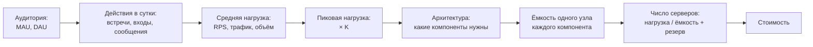
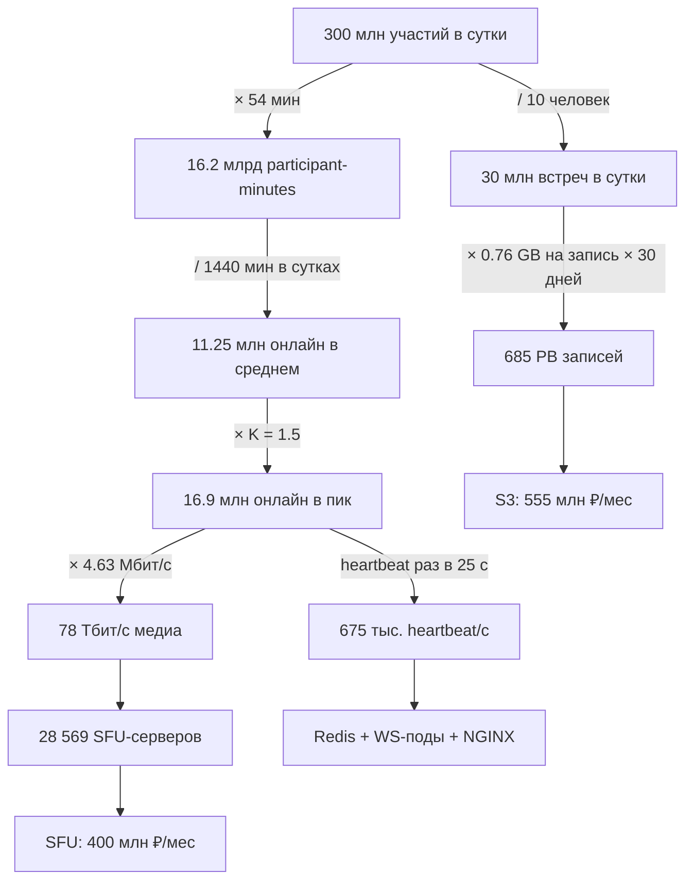

# Разбор работы MeetFlow: системный дизайн простыми словами

Этот документ — учебник по собственной работе. Как читать:

1. Части 1 и 2 — один раз целиком: что такое системный дизайн и как устроена работа.
2. Часть 3 — параллельно с [README.md](../README.md), раздел за разделом.
3. Часть 4 (словарь) — как справочник, когда встречается незнакомое слово.
4. Части 5–7 — перед защитой: ответы ревьюеру, вероятные вопросы, шпаргалка чисел.

Что изменилось после прошлой защиты — в [ревью.md](ревью.md).

---

## Часть 1. Что такое системный дизайн

**Системный дизайн** — проектирование системы, которая выдержит заданную нагрузку. Нужно пройти путь от вопроса «сколько у нас пользователей?» до ответа «сколько нужно серверов, где они стоят, что будет при поломке и сколько это стоит».

Главный принцип: **каждое решение должно следовать из чисел**. «Возьмём Redis, потому что он быстрый» — слабый ответ. Сильный: «нужно 712 тыс. операций в секунду с ключ-значением и автоудалением по TTL; один шард Redis даёт около 120 тыс., значит, нужно 6 шардов».

Цепочка рассуждений всегда одна и та же:



В каждом разделе стоит задавать себе два вопроса: **«сколько?»** (нагрузка и ресурсы) и **«что будет, если сломается?»** (надёжность).

Работа сделана по стандартному шаблону курса из 11 разделов. Каждый отвечает на свой вопрос:

| № | Раздел | На какой вопрос отвечает |
| -: | ------ | ------------------------ |
| 1 | Тема и аудитория | Что за сервис, для кого и насколько он большой |
| 2 | Расчёт нагрузки | Сколько запросов, трафика и данных в среднем и в пик |
| 3 | Глобальная балансировка | В каких ДЦ стоим, как пользователь попадает в нужный ДЦ, куда пишутся данные |
| 4 | Локальная балансировка | Как трафик распределяется внутри одного ДЦ и сколько нужно балансировщиков |
| 5 | Логическая схема БД | Какие сущности есть и как они связаны, без привязки к СУБД |
| 6 | Физическая схема БД | В каких СУБД это лежит, как шардируется, какие индексы и кеши |
| 7 | Алгоритмы | Какие нетривиальные алгоритмы снижают нагрузку |
| 8 | Технологии | Чем это реализуется и почему |
| 9 | Надёжность | Что резервируется и что будет при отказах |
| 10 | Схема проекта | Как всё соединено на одной картинке |
| 11 | Серверы | Сколько железа нужно и сколько оно стоит |

---

## Часть 2. Работа на одной странице

**MeetFlow** — сервис видеовстреч вроде Zoom: аудио, видео, демонстрация экрана, чат, облачная запись.

**Масштаб** взят у реальных аналогов: 320 млн MAU и 115 млн DAU (Microsoft Teams), 300 млн участий во встречах в сутки (Zoom). Средняя встреча — 10 человек на 54 минуты (Zoom).



**Три самые тяжёлые вещи** — они и определяют архитектуру и бюджет:

1. **Медиа** — 78 Тбит/с видео и аудио в пик.
2. **Presence** — 16.9 млн одновременных WebSocket-соединений и 675 тыс. heartbeat в секунду.
3. **Записи** — 685 PB за 30 дней, если записывать каждую встречу (худший случай).

API-запросы (создать встречу, войти) на этом фоне — мелочь: тысячи в секунду.

**Шесть главных архитектурных идей:**

| Идея | Суть | Зачем |
| ---- | ---- | ----- |
| Control plane ≠ media plane | API и WebSocket идут через NGINX L7, видео — напрямую в SFU мимо L7 | Не расшифровывать TLS на 78 Тбит/с; встреча живёт на одном SFU |
| `home_dc` | Каждая встреча закреплена за одним ДЦ, его код зашит в `meeting_id` | Все участники на одном SFU, данные встречи в одном месте |
| Одна точка записи на объект | `users` пишутся в один primary, данные встречи — в `home_dc` | Нет конфликтов одновременных записей в разных ДЦ |
| DNS переключает ДЦ | GeoDNS/GTM выбирает ближайший здоровый ДЦ; Anycast — только у DNS-серверов | Можно управлять весами и выводить ДЦ из работы |
| SFU + simulcast + ABR | Сервер пересылает потоки, а не смешивает; клиент шлёт несколько качеств; качество подстраивается под сеть | Нет перекодирования на сервере, меньше трафика |
| СУБД под паттерн доступа | PostgreSQL — транзакции, ScyllaDB — много записей, Redis — горячее состояние, S3 — файлы | Каждое хранилище делает то, что умеет лучше всего |

---

## Часть 3. Разбор по разделам

### Раздел 1. Тема и целевая аудитория

**Что здесь делается.** Выбираем сервис, его MVP (минимальный набор функций) и масштаб.

**Ключевые понятия:**

- **MAU** (Monthly Active Users) — уникальные пользователи за месяц: 320 млн.
- **DAU** (Daily Active Users) — уникальные пользователи за день: 115 млн.
- **DMP** (Daily Meeting Participants) — участия во встречах за день: 300 млн. Это не пользователи: один человек за день может побывать на 3 встречах и посчитается 3 раза. Поэтому DMP > DAU, и на одного DAU приходится 2.61 участия.

**Почему цифры старые (2020–2023).** Новее публичных метрик использования нет. Все числа подписаны годом, а актуальность ниши подтверждена финансами Zoom за 2026 год: $4.87 млрд выручки.

**Что могут спросить:** «Почему DAU от Teams, а участия — от Zoom?» Ответ: это публичные метрики аналогов разного типа. Teams даёт аудиторию, Zoom — нагрузку именно на видеовстречи. В работе это явно оговорено.

### Раздел 2. Расчёт нагрузки

Здесь вся арифметика. Её стоит уметь пересказать без бумажки.

**Шаг 1. Встречи в сутки.** 300 млн участий / 10 человек = **30 млн встреч**.

**Шаг 2. Сколько людей онлайн в среднем.** Каждое участие длится 54 минуты: 300 млн × 54 = **16.2 млрд participant-minutes** в сутки. В сутках 1440 минут, значит, в среднем онлайн 16.2 млрд / 1440 = **11.25 млн человек**.

> Интуиция: если в магазин за день заходит 1440 человек и каждый проводит внутри ровно минуту, то в среднем внутри один человек. В теории очередей это называется законом Литтла: среднее число объектов в системе = поток × время пребывания.

**Шаг 3. Пик.** Нагрузка неравномерна: днём больше, ночью меньше. Пиковый час больше среднего в **K** раз. В работе **K = 1.5** (так попросил ревьюер; раньше было 3). Пик онлайн: 11.25 млн × 1.5 = **16.875 млн**. Это же число одновременных WebSocket-соединений: у каждого участника одно.

> Почему 1.5, а не 3: сервис глобальный. Когда в Америке рабочий день, в Азии ночь, поэтому общая мировая кривая сглажена.

**Шаг 4. Трафик.** У каждого участника 720p-видео по требованиям Zoom: отправка 2.6 Мбит/с, приём 1.8 Мбит/с, плюс аудио 0.08 и демонстрация экрана 0.15. Средний трафик = онлайн × битрейт:

```text
upload:   11.25 млн × 2.6  Мбит/с = 29 250 Гбит/с
download: 11.25 млн × 1.8  Мбит/с = 20 250 Гбит/с
audio:    11.25 млн × 0.08 Мбит/с =    900 Гбит/с
screen:   11.25 млн × 0.15 Мбит/с =  1 687.5 Гбит/с
итого                             = 52 087.5 Гбит/с, в пик × 1.5 = 78 131.25 Гбит/с ≈ 78 Тбит/с
```

> Почему отправка больше приёма: благодаря simulcast клиент шлёт серверу несколько версий своего видео — высокое, среднее и низкое качество. А получает от каждого собеседника только одну нужную версию, обычно маленькую плитку.

> Единицы: Мбит/с (мегабиты) ≠ МБ/с (мегабайты). В байте 8 бит. Поэтому в формулах объёма встречается «/ 8».

**Шаг 5. RPS** (requests per second — запросов в секунду). Формула для любого метода одна:

```text
средний RPS = событий в сутки / 86 400 секунд
пиковый RPS = средний × K
```

Пример с heartbeat. Клиент каждые 25 секунд сообщает «я ещё здесь». За сутки это 16.2 млрд мин × 60 / 25 = **38.88 млрд** событий. Средний RPS: 38.88 млрд / 86 400 = 450 000, в пик × 1.5 = **675 000 heartbeat в секунду**. Это самый частый запрос в системе: в 130 раз чаще, чем `join` (5 208 в пик).

Часть частот публично неизвестна, поэтому они заданы **явными допущениями**: 5 сообщений чата на одно участие, 3 открытия списка встреч на DAU в сутки, 1 логин на DAU в сутки. Это нормально, если допущение подписано и используется одинаково во всей работе.

**Шаг 6. Хранение.** Объём = число строк × байт на строку. Профили: 320 млн × 256 B = 81.92 GB. Метаданные — десятки ГБ и единицы ТБ, чат — 45 TB за 30 дней. Главное — записи: одна встреча ≈ 0.761 GB (1.88 Мбит/с × 54 мин). Если записывать все 30 млн встреч, это 22.8 PB в сутки, или **685 PB за 30 дней**. Такой худший случай задаёт размер объектного хранилища.

**Что могут спросить:** «Почему пик не влияет на хранилище?» Пик — это скорость, а объём за сутки тот же: за час пика пишется больше, за ночные часы меньше.

### Раздел 3. Глобальная балансировка

#### Что такое ДЦ, регион и AZ

- **ДЦ (дата-центр)** в этой работе — регион облачного провайдера, например Франкфурт.
- **AZ (availability zone, зона доступности)** — отдельное здание внутри региона со своим питанием и сетью. В регионе 3 AZ.
- Отказ одного здания (AZ) переживается внутри ДЦ. Отказ всего региона переживает глобальная балансировка.

#### Зачем много ДЦ

1. **Задержка.** Свет в оптоволокне не мгновенный: пинг Токио ↔ Вашингтон ≈ 153 мс туда и обратно. Для видеозвонка важно, чтобы сервер был близко.
2. **Отказоустойчивость.** Один ДЦ — одна точка отказа.
3. **Законы о данных.** Например, отдельный ДЦ для Великобритании после Brexit.

#### Как получилось 8 ДЦ (замечание про `OTHER`)

SimilarWeb даёт доли только пяти стран: США 40.73%, Япония 5%, Индия 4.35%, Великобритания 3.72%, Канада 3.69%. Остальные 42.51% — «Other». Раньше Other был одним абстрактным «пулом», и ревьюеру это не понравилось: нельзя поставить серверы в «прочие страны». Теперь Other разложен так:

1. Латинской Америке — 7.5% (допущение; каждая её страна меньше 3.69%, иначе попала бы в топ-5).
2. Остаток (48.08%) делится между Европой/Ближним Востоком/Африкой (EMEA) и Азией (APAC) в пропорции выручки Zoom: 15.8 : 12.1.
3. Вычитаем известные страны: остаток EMEA — 23.51%, остаток APAC — 11.50%.
4. США делим на восток и запад по населению: на запад приходится 23.7%.

Итог — 8 ДЦ:

| ДЦ | Доля | Кого обслуживает |
| -- | ---: | ---------------- |
| `DC-US-EAST` | 37.27% | восток и центр США, Канада, Мексика |
| `DC-DE-FRANKFURT` | 23.51% | континентальная Европа, СНГ, Ближний Восток, Африка |
| `DC-SG-SINGAPORE` | 11.50% | Юго-Восточная Азия, Океания, Корея, Тайвань |
| `DC-US-WEST` | 9.65% | запад США |
| `DC-BR-SAOPAULO` | 5.00% | Южная Америка |
| `DC-JP-TOKYO` | 5.00% | Япония |
| `DC-IN-MUMBAI` | 4.35% | Индия |
| `DC-UK-LONDON` | 3.72% | Великобритания |

Дальше любая метрика по ДЦ = глобальная метрика × доля ДЦ.

#### Как пользователь попадает в ДЦ: DNS

Когда приложение обращается к `api.meetflow.example`, оно сначала спрашивает у **DNS**, какой IP-адрес у этого имени. **GeoDNS / GTM** (Global Traffic Manager) — «умный» DNS. Он смотрит, откуда пришёл запрос (по IP резолвера или подсети клиента), какие ДЦ живы (health checks) и насколько они загружены (веса). В ответ он отдаёт IP ближайшего здорового ДЦ.

- **TTL** — сколько секунд клиент может помнить ответ, не спрашивая заново. У нас 30 с.
- **Переключение при отказе:** GTM проверяет ДЦ каждые 10 с. После 3 неудач ДЦ убирается из ответов (≈ 30 с), плюс TTL 30 с — итого около минуты. На случай резолверов, которые кешируют дольше, у приложения есть запасной список адресов.

#### Что такое Anycast и почему он только у DNS

**Anycast** — один IP-адрес объявлен сразу из многих точек мира. Протокол маршрутизации интернета **BGP** доставляет пакет в «ближайшую» по маршрутам точку. Как будто у всех филиалов банка один номер телефона, и звонок попадает в ближайший филиал.

- Для **DNS** это идеально: запрос и ответ занимают один короткий пакет, состояние на сервере не хранится. Ответ приходит быстро, отказ одной точки незаметен.
- Для **API, WebSocket и медиа** — плохо, по двум причинам:
  1. BGP выбирает маршрут по своим правилам, а не по загрузке ДЦ. Нельзя сказать «отправь в Франкфурт поменьше, он перегружен».
  2. Если маршрут перестроится посреди звонка, пакеты долгого соединения уйдут в другой ДЦ, где о нём ничего не знают, и звонок оборвётся.

**Итог — ответ на вопрос «Anycast или DNS?»:** ДЦ выбирается и переключается **через DNS**. Anycast нужен, только чтобы быстро и надёжно получить DNS-ответ. Медиа переключается на уровне приложения: сервер говорит клиенту «твой новый SFU — вот этот», и клиент переподключается (ICE restart).

#### `home_dc` — дом встречи

Встреча — как переговорная в конкретном офисе. Все участники должны прийти в одну комнату (на один SFU), иначе не увидят друг друга. Поэтому при создании встреча закрепляется за **`home_dc`** — ДЦ, ближайшим к организатору. Код этого ДЦ зашит прямо в `meeting_id`. Любой ДЦ по идентификатору понимает, где «дом» встречи, и перенаправляет туда запрос `join`.

#### Точка записи (замечание ревьюера)

**Точка записи** — место, куда идут изменения данных (primary). Если разрешить писать один и тот же объект в двух ДЦ одновременно, получатся конфликты. Например, два человека в разных ДЦ одновременно регистрируют один `email`. Поэтому правило — **у каждого объекта одна точка записи**:

- **`users`** — один primary на весь мир, в `DC-US-EAST`. В остальных ДЦ лежат **реплики** — копии только для чтения. Записей мало (регистрация, смена профиля): даже при самой щедрой оценке — не больше 2 тыс. в секунду. Одна машина с этим справляется.
- **Данные встречи** (участники, чат, состояние, записи) пишутся в `home_dc`.
- **Список встреч пользователя** (`user_meetings`) пишется в `home_dc` встречи. ScyllaDB сама копирует его во все ДЦ, поэтому список виден в любой стране. Копия может отставать на секунды — это **eventual consistency**, для списка допустимо.

**Синхронная и асинхронная репликация:**

- **Синхронная**: primary подтверждает запись только после того, как реплика тоже её сохранила. Надёжно, но медленно — подходит для соседнего здания.
- **Асинхронная**: primary подтверждает сразу, реплика догоняет через миллисекунды или секунды. Быстро, но при аварии последние секунды можно потерять — подходит для других континентов.

У `auth_pg` есть синхронная standby в соседней AZ (без потерь) и асинхронные реплики в остальных ДЦ.

**Read-your-writes:** после того как пользователь что-то изменил, он пару секунд читает из primary. Иначе он мог бы увидеть старые данные с ещё не догнавшей реплики.

#### Сценарий «вошёл в США, улетел в Японию» (вопрос Быкова)

1. В США пользователь залогинился. Сессия с идентификатором `us-east.xxxx` создана в Redis `DC-US-EAST`.
2. В Японии GeoDNS видит японский адрес и отправляет пользователя в `DC-JP-TOKYO`. Где был логин, для DNS неважно.
3. В Токио сессии нет. По префиксу `us-east` сервер один раз спрашивает её у `DC-US-EAST` (+153 мс) и копирует к себе. **Перелогиниваться не нужно.**
4. Профиль читается из локальной реплики. Если пользователь меняет профиль, запись уходит в primary в США.
5. Список встреч читается из локальной копии.
6. Встреча коллег из США по-прежнему живёт в `DC-US-EAST`. Токио пересылает туда `join`, видео тоже идёт в США. 153 мс туда-обратно — 76 мс в одну сторону, это меньше 150 мс, которые стандарт ITU-T G.114 считает нормой для разговора.
7. Если пользователь сам создаст встречу в Японии, её `home_dc` будет Токио.
8. Если пользователь остался жить в Японии, мигрировать ничего не нужно. Данные пользователя есть во всех ДЦ, а встречи привязаны к своим ДЦ, а не к людям.

#### Что будет, если упадёт целый ДЦ

Возьмём худший случай — падает самый большой ДЦ, `DC-US-EAST` (37% нагрузки). GTM убирает его из DNS, новые встречи распределяются по другим ДЦ. Активные встречи пересоздаются в резервных ДЦ: подписанный `join_token` проверяется в любом ДЦ.

Хватит ли места? Держать двойной запас всех серверов дорого. Вместо этого на время аварии видео понижается до профиля «high-quality» (1.0/0.6 Мбит/с вместо 2.6/1.8). Трафик на участника падает до 39.5% от обычного, а у оставшихся ДЦ 62.7% штатной ёмкости. Значит, помещается — с запасом.

### Раздел 4. Локальная балансировка

**L4 и L7** — уровни модели OSI, на которых работает балансировщик:

- **L4 (транспортный)** видит только IP-адреса и порты, как почтальон, который смотрит на адрес на конверте. Быстрый, не расшифровывает трафик. У нас это managed-балансировщик провайдера.
- **L7 (прикладной)** «вскрывает конверт»: видит HTTP-путь, заголовки, cookies и может отправить `/api/chat` в одни поды, а `/ws` — в другие. Для этого ему нужно расшифровать TLS. У нас это NGINX.

**TLS termination (SSL-терминация)** — расшифровка HTTPS на балансировщике. Дальше внутри ДЦ трафик идёт к сервисам. Расшифровка стоит CPU, особенно **рукопожатие (handshake)** при открытии нового соединения.

**Почему медиа идёт мимо L7.** Видео передаётся по UDP в протоколе SRTP, оно и так зашифровано. Расшифровывать на балансировщике 78 Тбит/с бессмысленно и очень дорого. Поэтому `L4 → SFU` напрямую.

**Сколько нужно NGINX.** У балансировщика несколько независимых пределов. Считаем узлы для каждого и берём максимум:

| Предел | Значение на узел | Наша нагрузка (весь мир) |
| ------ | ---------------: | ----------------------: |
| HTTPS-запросы по открытым соединениям | 342 785 RPS | 1 048 611 RPS |
| Новые TLS-соединения (рукопожатия) | 10 274 в секунду | 24 653 в секунду |
| Сеть | 8.8 Гбит/с | 8.4 Гбит/с |
| Память под одновременные соединения | 1.04 млн соединений на узел с 64 GB | 16.9 млн соединений |

Пример для `DC-US-EAST`: 6.29 млн соединений × 54 KB = 340 GB, делим на 56 GB на узел — 6.06, округляем вверх до 7, плюс 1 в резерв = **8 узлов**. По RPS хватило бы двух. Значит, **главный ограничитель — память под соединения**, потому что WebSocket держит соединение весь звонок.

> В прошлой версии здесь была ошибка: весь RPS делился на «SSL TPS» — скорость новых рукопожатий. Но heartbeat идёт по уже открытому соединению, нового рукопожатия у него нет. Ревьюер мог бы спросить: «а почему heartbeat у вас делает handshake?»

**Резервирование:**

- **N+1** — нужно N узлов, ставим на один больше. Переживает отказ одного узла.
- **N×2** — двойной комплект. Переживает потерю целой AZ.

Итог: 27 NGINX-узлов в режиме N+1 или 38 в режиме N×2.

**Межсервисная балансировка.** Сервисы общаются по gRPC, а он держит одно долгое HTTP/2-соединение. Если балансировать на L4, все вызовы уйдут в один под. Поэтому клиент gRPC сам получает список подов и раздаёт вызовы по кругу (round-robin).

### Раздел 5. Логическая схема БД

**Что здесь делается.** Описываем сущности и связи, не думая пока о конкретных СУБД: `users`, `user_sessions`, `meetings`, `meeting_participants`, `meeting_invite_links`, `user_meetings`, `chat_messages`, `recordings`, `recording_upload_buffer`.

**Read model** (`user_meetings`) — специальная таблица, которая хранит данные в виде, удобном для одного запроса: «покажи последние 100 встреч пользователя». Без неё пришлось бы собирать список из нескольких таблиц.

**Консистентность** — насколько свежие данные видит читатель:

- **Strong (строгая)** — всегда последняя версия. Нужна для `meetings`: нельзя впустить во встречу, которую уже завершили. И для `users`: нельзя зарегистрировать два аккаунта на один `email`.
- **Eventual (в конечном счёте)** — данные доедут, но с задержкой. Подходит для `user_meetings`: если новая встреча появится в списке через секунду, ничего страшного.

### Раздел 6. Физическая схема БД

**Почему разные СУБД:**

| Хранилище | Что у нас в нём | Почему именно оно |
| --------- | --------------- | ----------------- |
| PostgreSQL | `users` | Транзакции, уникальный `email`, привычный SQL |
| PostgreSQL + Citus | `meetings`, ссылки, метаданные записей | SQL плюс шардирование по `meeting_id`, когда данных станет много |
| ScyllaDB | участники, чат, списки встреч | Очень много записей, чтение по ключу, JOIN не нужен; умеет реплицировать между ДЦ |
| Redis | сессии, онлайн-состояние встречи | Всё в памяти: сотни тысяч операций в секунду, автоудаление по TTL |
| S3 (объектное хранилище) | файлы записей | Огромные неизменяемые файлы, дёшево за гигабайт |

**Шардирование** — деление данных на части (шарды) по разным серверам по **ключу шардирования**. Строки одной встречи лежат вместе, потому что ключ — `meeting_id`. Запрос по `meeting_id` идёт сразу в нужный шард.

- **Hot key (горячий ключ)** — ключ, на который приходится непропорционально много нагрузки, например огромная встреча на 1000 человек. Поэтому в ключе есть **bucket**: участники одной большой встречи раскладываются по нескольким разделам.
- В работе шардирование двухуровневое: сначала по ДЦ (`home_dc`), потом внутри ДЦ по ключу.

**Репликация масштабирует чтение, шардирование — запись.** Реплики могут отвечать на чтения, но каждая запись всё равно проходит через primary. Чтобы писать больше, данные делят на шарды.

**Индекс** — «оглавление» таблицы, чтобы не просматривать её целиком. В шардированной таблице индекс работает внутри шарда, поэтому запрос сначала должен попасть в нужный шард.

**Денормализация** — сознательное дублирование данных ради скорости. Например, `topic` и `status` встречи хранятся и в `meetings`, и в `user_meetings`, чтобы список встреч читался одним запросом, без **JOIN** (объединения таблиц). На больших RPS JOIN дорогой, а между разными СУБД он вообще невозможен.

**Нагрузка на строки** (п. 6.6): один запрос API может трогать несколько таблиц. `join` трогает 6 строк, поэтому 5 208 запросов `join` в секунду дают 31 250 обращений к строкам в секунду.

**Кеш** (п. 6.8) — горячие данные в памяти. `meetings_runtime` — онлайн-состояние всех идущих встреч: всего 0.86 GB, но 712 тыс. операций в секунду. Поэтому только Redis.

### Раздел 7. Алгоритмы

**Как устроен групповой звонок — три варианта:**

| Вариант | Как работает | Минус |
| ------- | ------------ | ----- |
| P2P (каждый с каждым) | Каждый шлёт видео всем остальным напрямую | На 10 человек каждому нужно отправлять 9 потоков — не вытянет сеть клиента |
| MCU | Сервер принимает все потоки, склеивает в одну картинку и отправляет каждому | Склейка — это декодирование и кодирование видео, огромный расход CPU на сервере |
| **SFU** (наш выбор) | Сервер принимает потоки и пересылает каждому нужные, ничего не перекодируя | Сервер просто маршрутизирует пакеты — дёшево |

**Simulcast / SVC.** Клиент отправляет своё видео сразу в нескольких качествах: 1080p, 720p, 480p. SFU отдаёт каждому подписчику нужное: активному говорящему — высокое, маленьким плиткам — низкое.

**ABR (Adaptive Bitrate).** Клиент раз в секунду сообщает о потерях пакетов, задержке и джиттере. Если сеть плохая, профиль сразу понижается. Если стабильная — плавно повышается на ступень. Звук важнее видео: при проблемах со звуком сначала режется видео.

### Раздел 8. Технологии

Основной язык — C++23 (низкие задержки, контроль памяти). Сеть — Boost.Asio/Beast. Сервисы общаются по gRPC. Всё работает в Kubernetes. Наблюдаемость — Prometheus (метрики), Loki (логи), Jaeger (трейсы), Grafana (дашборды). Новое в этой версии: managed GeoDNS/GTM и Patroni (автоматическое переключение PostgreSQL на резервную копию).

### Раздел 9. Надёжность

- **Failover** — автоматическое переключение на резерв при отказе.
- **RF = 3** (replication factor) — каждая запись хранится в 3 копиях.
- **Кворум** — большинство копий (2 из 3). Пока живо большинство, данные можно читать и писать.
- **RPO** (Recovery Point Objective) — сколько данных можно потерять при аварии. Для асинхронной реплики это секунды.
- **RTO** (Recovery Time Objective) — за сколько система восстанавливается. Для переключения ДЦ — минуты.
- **Graceful degradation** — работать хуже, но работать. Например, понизить качество видео вместо того, чтобы отключить звонки.
- **Stateless-сервис** — не хранит состояние у себя. Если под упал, запрос просто идёт в другой под. Поэтому все API-сервисы stateless, а состояние лежит в Redis и БД.

### Раздел 10. Схема проекта

На схеме один ДЦ (`DC-US-EAST`) нарисован подробно, остальные 7 устроены так же.

- Зелёным отмечены сеть и балансировка.
- Синим — наши сервисы.
- Оранжевым — хранилища.
- Фиолетовым — Redis.

Путь клиента: DNS-запрос → Anycast NS → GTM даёт IP ДЦ → L4 → NGINX L7 → сервисы. Видео идёт отдельно: L4 → SFU. Сверху — межрегиональная связь: прокси `join` и репликация. Ссылки на редактируемую версию — в п. 10.5 README.

### Раздел 11. Серверы и деньги

**Метод:** для каждого компонента в каждом ДЦ `ceil(нагрузка / ёмкость одного узла) + 1`. Здесь `ceil` — округление вверх, а `+1` — резерв N+1. У некоторых технологий есть минимальный размер кластера: Redis Cluster — 3 мастера, ScyllaDB с RF=3 — 3 узла.

**SFU — самая интересная часть.** Сервер ограничен двумя вещами: сетевой картой (10 Гбит/с) и процессором. Бенчмарк Jitsi показал 550 Мбит/с при загрузке 20% четырёхъядерного процессора, то есть ≈ 0.68 Гбит/с на ядро при 100%. Держим запас и грузим CPU на 70%: 6 ядер × 0.68 × 0.7 ≈ **2.85 Гбит/с на сервер**. Это меньше 10 Гбит/с сетевой карты, значит, **ограничитель — CPU**. Итого 81 304 / 2.85 ≈ 28 500 серверов, а с резервом по ДЦ — **28 569**.

> В прошлой версии на узел ставили 10 Гбит/с, не проверяя CPU. Это в 2.5–6 раз выше реальных замеров.

**WebSocket-поды** считаются не по запросам, а по соединениям. Одно соединение — до 20 KB памяти, на под 4 CPU / 8 GB помещается 300 тыс. соединений. 16.9 млн соединений → 68 подов с резервом.

**Деньги:**

| Статья | ₽/мес | Доля |
| ------ | ----: | ---: |
| Хранение записей (S3) | 555 млн | 56.8% |
| SFU (медиа) | 400 млн | 41.0% |
| Воркеры записи | 16 млн | 1.6% |
| Всё остальное | 6 млн | 0.6% |
| **Итого** | **977 млн ≈ $12.2 млн** | |

**Вывод:** деньги тратятся там же, где нагрузка, — на медиа и записи. Экономить надо на них: ограничить срок хранения записей (ретеншн) и квоты, агрессивнее понижать качество (ABR), использовать более эффективный кодек. Оптимизировать «всё остальное» бессмысленно — это меньше 1%.

---

## Часть 4. Словарь терминов

### Нагрузка

| Термин | Что значит |
| ------ | ---------- |
| MAU / DAU | Уникальные пользователи за месяц / за день |
| DMP | Участия во встречах за день; один человек может посчитаться несколько раз |
| RPS | Requests per second — запросов в секунду к сервису |
| QPS | Queries per second — запросов в секунду к базе данных |
| K, пиковый коэффициент | Во сколько раз пиковый час больше среднего по суткам; у нас 1.5 |
| Bandwidth | Пропускная способность, объём трафика в секунду (Гбит/с) |
| Мбит/с, Гбит/с, Тбит/с | Мегабиты, гигабиты, терабиты в секунду; 1 байт = 8 бит |
| Participant-minutes | Сумма минут, проведённых всеми участниками во встречах |
| Worst-case | Худший случай — например, «записывается каждая встреча» |
| Heartbeat | Периодическое сообщение «я ещё онлайн», у нас раз в 25 с |
| Presence | Знание о том, кто сейчас онлайн во встрече |
| Fan-out | Рассылка одного события многим получателям: сообщение в чат уходит 9 участникам |

### Сеть и балансировка

| Термин | Что значит |
| ------ | ---------- |
| ДЦ / регион | Площадка, где стоят серверы; у нас регион провайдера из 3 зон |
| AZ (availability zone) | Отдельное здание внутри региона с независимым питанием и сетью |
| RTT | Round-trip time — время «туда и обратно» для пакета |
| DNS | Система, которая превращает имя (`api.meetflow.example`) в IP-адрес |
| GeoDNS / GTM | DNS, который отвечает разным пользователям по-разному: учитывает местоположение, здоровье ДЦ и веса |
| TTL (в DNS) | Сколько секунд можно помнить DNS-ответ |
| ECS | EDNS Client Subnet — подсказка DNS-серверу, из какой подсети на самом деле пришёл клиент |
| Health check | Регулярная проверка «жив ли сервис» |
| Веса, drain | Веса задают, какую долю трафика получает ДЦ; drain — плавно вывести ДЦ из работы: новых не пускать, старые пусть доживают |
| Anycast | Один IP-адрес, объявленный из многих точек; пакет приходит в ближайшую |
| BGP | Протокол, которым сети интернета договариваются о маршрутах |
| PoP | Point of presence — точка присутствия сети провайдера |
| VIP | Виртуальный IP балансировщика, на который приходят клиенты |
| L4 / L7 | Балансировка по адресам и портам / по содержимому HTTP |
| TLS, SSL | Шифрование соединения (HTTPS = HTTP + TLS) |
| TLS handshake | «Рукопожатие» при открытии защищённого соединения — самая дорогая по CPU часть TLS |
| SSL termination | Расшифровка TLS на балансировщике |
| CPS / TPS | Новых соединений в секунду / новых TLS-соединений в секунду |
| Keep-alive | Повторное использование открытого соединения для многих запросов |
| WebSocket (WSS) | Постоянное двустороннее соединение браузера с сервером; WSS — с TLS |
| gRPC | Протокол вызовов между сервисами поверх HTTP/2 |
| mTLS | Взаимный TLS: и клиент, и сервер предъявляют сертификаты |

### Медиа

| Термин | Что значит |
| ------ | ---------- |
| WebRTC | Стандарт браузера для звонков в реальном времени |
| RTP / SRTP | Протокол передачи аудио и видео по UDP / то же с шифрованием |
| SFU | Selective Forwarding Unit — сервер, который пересылает потоки без перекодирования |
| MCU | Multipoint Control Unit — сервер, который склеивает потоки в один (дорого по CPU) |
| Simulcast / SVC | Отправка видео сразу в нескольких качествах / одним потоком со слоями |
| ABR | Adaptive Bitrate — подстройка качества под текущую сеть |
| Jitter | Неравномерность задержки пакетов |
| Packet loss | Доля потерянных пакетов |
| ICE, ICE restart | Механизм WebRTC для поиска сетевого пути / переподключение к новому адресу без разрыва звонка |
| Каскад SFU | Цепочка SFU в разных ДЦ: клиент подключается к ближайшему, тот пересылает потоки в SFU встречи |

### Данные

| Термин | Что значит |
| ------ | ---------- |
| Primary / replica | Главная копия, принимает записи / копия для чтения |
| Точка записи | Место, где находится primary для данного объекта |
| Синхронная / асинхронная репликация | Запись подтверждается после копирования / сразу, копия догоняет позже |
| Standby | Резервная копия, готовая стать primary |
| Read-your-writes | Пользователь сразу видит свои изменения |
| Strong / eventual consistency | Всегда свежие данные / данные доезжают с задержкой |
| Шардирование, шард | Деление данных по серверам / одна часть данных |
| Ключ шардирования | Поле, по которому решается, в какой шард идёт строка (`meeting_id`) |
| Hot key | Ключ с непропорционально большой нагрузкой |
| Bucket | Дополнительное поле ключа, чтобы разбить большую встречу на части |
| RF (replication factor) | Сколько копий данных хранится (RF=3) |
| Кворум, LOCAL_QUORUM | Большинство копий / большинство копий внутри своего ДЦ (в ScyllaDB) |
| Индекс | Структура для быстрого поиска без полного просмотра таблицы |
| JOIN | Объединение строк из нескольких таблиц в одном запросе |
| Денормализация | Сознательное дублирование данных ради быстрого чтения |
| Read model | Таблица, заточенная под конкретный запрос на чтение |
| Кеш | Копия горячих данных в памяти |
| TTL (в Redis) | Время жизни ключа, после которого он удаляется сам |
| Citus | Расширение PostgreSQL для шардирования |
| ScyllaDB | Распределённая NoSQL-СУБД (совместима с Cassandra), сильна в записи |
| Redis Cluster | Redis, разбитый на шарды с репликами |
| PgBouncer | Пул соединений к PostgreSQL: тысячи клиентов через десятки соединений |
| Object storage, S3 | Хранилище файлов по ключу, «бесконечный диск» с оплатой за гигабайт |
| Multipart upload | Загрузка большого файла частями, с возможностью дозагрузить упавшую часть |
| WAL, PITR | Журнал изменений PostgreSQL / восстановление на любой момент времени по журналу |
| Patroni | Инструмент автоматического failover для PostgreSQL |

### Инфраструктура и надёжность

| Термин | Что значит |
| ------ | ---------- |
| Kubernetes | Система, которая запускает контейнеры на кластере серверов и сама их перезапускает |
| Pod / node | Запущенный экземпляр сервиса / сервер кластера |
| Stateless | Сервис не хранит состояние у себя, любой экземпляр может обработать любой запрос |
| N+1 / N×2 | Один запасной узел / двойной комплект |
| HA (high availability) | Высокая доступность — работа без простоя при отказе части системы |
| Failover | Автоматическое переключение на резерв |
| RPO / RTO | Сколько данных можно потерять / за сколько восстановиться |
| Graceful degradation | Работать хуже, но не падать |
| Observability | Наблюдаемость: метрики, логи, трейсы |
| Managed-сервис | Сервис, который обслуживает провайдер (DNS, балансировщик, S3) |

### Термины самой работы

| Термин | Что значит |
| ------ | ---------- |
| Control plane | Управляющий трафик: создать встречу, войти, чат, heartbeat |
| Media plane | Сам аудио- и видеопоток |
| `home_dc` | ДЦ, за которым закреплена встреча; его код записан в `meeting_id` |
| `join_token` | Подписанный пропуск во встречу (ID встречи, роль, срок, `home_dc`, адрес SFU). Проверяется без похода в БД |
| `meetings_runtime` | Онлайн-состояние идущей встречи в Redis |
| `session_id` с префиксом | `us-east.xxxx` — по префиксу видно, в каком ДЦ создана сессия |

---

## Часть 5. Как отвечать на замечания ревьюера

**1. «K = 1.5».** «Пересчитали. K — пиковый час к среднему. Для глобального сервиса кривая сглажена часовыми поясами. От K зависят пиковые RPS, трафик и соединения, от него не зависят объёмы хранения».

**2. «Other pool».** «Other разложили на макрорегионы. Латинской Америке — 7.5%: это допущение, ограниченное порогом топ-5. Остаток делится между EMEA и APAC по пропорции выручки Zoom из отчёта 10-K. США поделили на восток и запад по переписи. Получилось 8 ДЦ в конкретных городах, у каждого есть пара для резерва».

**3. «Зашарить схемы».** «Исходник общей схемы лежит в репозитории, есть ссылка на просмотр в diagrams.net с масштабированием. Схемы БД открываются в dbdiagram без логина. Все ссылки собраны в п. 10.5».

**4. «Где точка записи».** «У каждого объекта одна точка записи. `users` — primary в `DC-US-EAST`, реплики для чтения во всех ДЦ. Данные встречи — в `home_dc`, его код зашит в `meeting_id`. Список встреч пишется в `home_dc` встречи и асинхронно копируется во все ДЦ. Запрос на запись из другого ДЦ проксируется по gRPC».

**5. «США → Япония».** «DNS отправит в Токио по текущему местоположению. Сессия переедет один раз по префиксу `session_id`, логиниться заново не нужно. Профиль и список встреч читаются локально. Старые встречи живут в своём ДЦ в США, `join` проксируется туда, задержка ≈ 153 мс — норма. Новые встречи создаются в Токио. Мигрировать ничего не надо».

**6. «Anycast или DNS».** «DNS. GTM выбирает ДЦ по гео, задержке, здоровью и весам и умеет выводить ДЦ из работы. Anycast только у DNS-серверов: для DNS это идеально, а для долгих соединений и медиа нет — BGP не знает о загрузке ДЦ и при смене маршрута рвёт сессии. Медиа переключается приложением через новый адрес SFU».

---

## Часть 6. Вероятные вопросы и ответы

1. **Почему SFU, а не MCU?** MCU склеивает видео — это декодирование и кодирование, огромный CPU. SFU только пересылает пакеты, а разные качества даёт simulcast на клиенте.
2. **Почему медиа мимо L7?** SRTP уже зашифрован. Расшифровывать 78 Тбит/с на балансировщике бессмысленно, а встреча должна жить на одном SFU.
3. **Почему heartbeat в Redis, а не в БД?** 712 тыс. операций в секунду с маленькими ключами и TTL. Состояние эфемерное, при переподключении клиент восстановит его сам.
4. **Почему ScyllaDB рядом с PostgreSQL?** Участники, чат и списки — много записей без транзакций и JOIN, это сильная сторона ScyllaDB. Транзакции и уникальность (`users`, метаданные) остаются в PostgreSQL.
5. **Зачем Citus, если метаданные помещаются на один сервер?** Сейчас на один ДЦ это ≈ 215 GB, поэтому Citus работает в режиме одного узла. Он нужен для роста: ключ шардирования `meeting_id` задан сразу, и worker-узлы добавляются без переделки приложения.
6. **Почему главный ограничитель NGINX — память?** WebSocket держит соединение весь звонок, в пик это 16.9 млн соединений. Каждое занимает до 54 KB. Запросов в секунду при этом немного.
7. **Почему SFU-серверов почти 29 тысяч?** 81 Тбит/с трафика SFU, а один 6-ядерный сервер по CPU тянет ≈ 2.85 Гбит/с. Сетевая карта на 10 Гбит/с не главный предел.
8. **Что будет при отказе одного SFU?** Control plane выдаст клиентам новый SFU, клиенты сделают ICE restart. Отказавший SFU больше не получает новые встречи.
9. **Что будет при отказе ДЦ?** GTM за ≈ 1 минуту уберёт его из DNS. Новые встречи распределятся по другим ДЦ, активные пересоздадутся. На время аварии видео ограничивается профилем high-quality — ёмкости хватает.
10. **Почему не Anycast для API?** Нет весов и drain, а смена маршрута рвёт долгие соединения. Глобальный Anycast-балансировщик есть у крупных облаков, но он привязывает к одному облаку.
11. **Почему `users` в одном primary — не узкое место?** Записей мало (≤ 2 тыс./с даже при щедрой оценке), а чтения идут с локальных реплик в каждом ДЦ.
12. **Что, если реплика отстаёт?** После своей записи пользователь читает из primary (read-your-writes). Остальным отставание на секунды не мешает.
13. **Как выбирается `home_dc`?** Это ДЦ, который обработал создание встречи, то есть ближайший к организатору. Улучшение — выбирать по большинству приглашённых.
14. **Как любой ДЦ узнаёт `home_dc` встречи?** Код ДЦ записан в первом байте `meeting_id` (формат UUIDv8) и в ссылке-приглашении.
15. **Что, если в одной встрече люди из США и Японии?** Все подключаются к SFU в `home_dc`. Задержка ≈ 153 мс туда-обратно — допустимо. Улучшение — каскад SFU.
16. **Почему K одинаковый для каждого ДЦ?** Это упрощение. Внутри одного региона суточная кривая острее, запас дают N+1 и перераспределение весами GTM.
17. **Откуда 7.5% Латинской Америки?** Допущение: ни одна страна региона не входит в топ-5, значит, каждая меньше 3.69%. Уточняется по GeoIP после запуска.
18. **Почему записи — главный расход?** 30 млн встреч × 0.76 GB = 22.8 PB в сутки, за 30 дней — 685 PB. Это объём, а не скорость. Рычаги — ретеншн, квоты, доля реально записываемых встреч.
19. **Почему холодное хранение S3 для записей?** Дешевле хранить. Минус — дорогое и медленное чтение. Правильнее первые дни держать запись в стандартном классе, а потом переводить в холодный правилом lifecycle.
20. **Что такое N+1 и N×2?** Один запасной узел на случай отказа одного / двойной комплект на случай потери целой зоны доступности.
21. **Чем RPS отличается от QPS?** RPS — запросы к сервису (API), QPS — запросы к базе. Один запрос API может дать несколько запросов к БД: `join` трогает 6 строк.
22. **Зачем денормализация?** Чтобы частые чтения шли одним запросом по ключу, без JOIN. На больших RPS JOIN дорогой, между разными СУБД он невозможен.
23. **Почему в шардированной таблице запрос должен знать ключ?** Индекс работает внутри шарда. Без ключа пришлось бы опрашивать все шарды (fan-out).
24. **Как авторизуется трафик внутри встречи?** Подписанным `join_token`, который выдаётся при `join`. WS, чат и медиа в `home_dc` проверяют подпись и не ходят в хранилище сессий.
25. **Как посчитаны числа и как их проверить?** Скриптом `resource/calc/meetflow_calc.py`: меняешь допущение — получаешь все таблицы заново.

---

## Часть 7. Шпаргалка чисел

| Что | Число |
| --- | ----: |
| MAU / DAU | 320 млн / 115 млн |
| Участий в сутки / встреч в сутки | 300 млн / 30 млн |
| Средняя встреча | 10 человек, 54 мин |
| K | 1.5 |
| Онлайн в среднем / в пик | 11.25 млн / 16.9 млн |
| Встреч одновременно в пик | 1.69 млн |
| Медиа в пик | 78 Тбит/с (+3.2 Тбит/с поток в запись) |
| Heartbeat в пик | 675 тыс./с (38.88 млрд в сутки) |
| `join` в пик | 5 208/с |
| Чат в пик | 26 042 сообщения/с |
| Записи | 0.76 GB на встречу, 22.8 PB в сутки, 685 PB за 30 дней |
| ДЦ | 8: US-EAST 37.27%, DE 23.51%, SG 11.50%, US-WEST 9.65%, BR 5%, JP 5%, IN 4.35%, UK 3.72% |
| Переключение ДЦ через DNS | ≈ 1 мин (3 × 10 с + TTL 30 с) |
| Пинг Токио ↔ Вашингтон | ≈ 153 мс |
| NGINX L7 | 27 узлов (N+1), 38 (N×2); ограничитель — память под соединения |
| SFU | 2.85 Гбит/с на сервер, 28 569 серверов |
| WebSocket-поды | 300 тыс. соединений на под, 68 подов |
| Стоимость | 977 млн ₽/мес ≈ $12.2 млн; S3 57%, SFU 41% |
